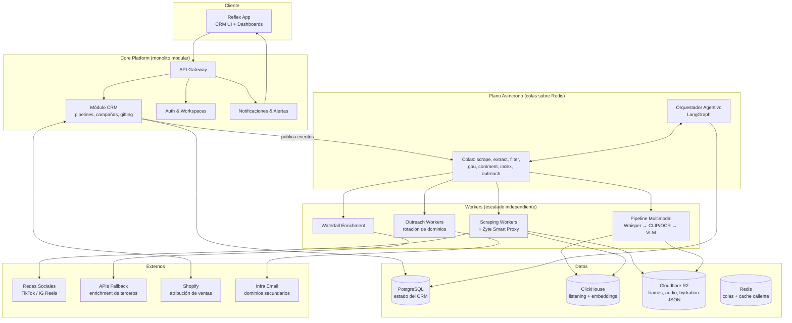
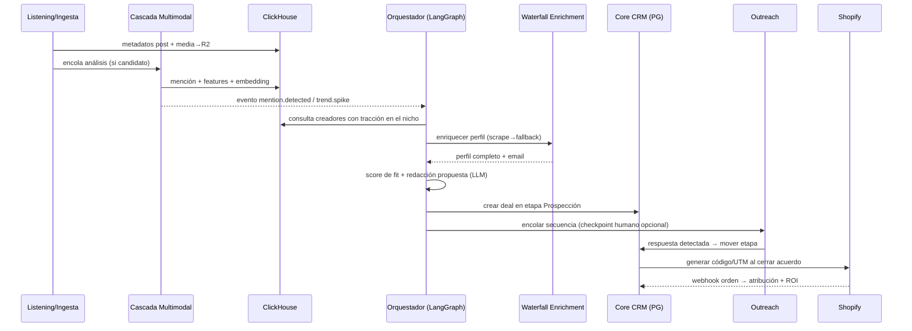

# Arquitectura del Sistema — Qualify (CRM Agentivo de Influencer Marketing)

**Estado:** Propuesto · **Fecha:** 2026-07-17

---

## 1. Principios de diseño

1. **Monolito modular + workers asíncronos.** Un solo deployable para el core (API + CRM) y una flota de workers desacoplados por colas. Microservicios solo donde el perfil de carga lo exige (scraping, procesamiento multimodal). Evita la complejidad operativa prematura sin sacrificar escalado independiente donde importa.
2. **Todo lo costoso es asíncrono y en cascada.** Ninguna llamada a scraping, transcripción o VLM ocurre en el request path del usuario. Cada etapa cara tiene un filtro barato delante (cascada de costos).
3. **Dos planos de datos.** Postgres = estado transaccional del negocio (verdad del CRM). ClickHouse = hechos analíticos inmutables a escala (métricas, transcripciones, embeddings). Nunca se cruzan escrituras; se conectan por `creator_id`.
4. **Eventos como contrato entre módulos.** Los módulos no se llaman entre sí directamente; publican eventos de dominio (`creator.enriched`, `mention.detected`, `trend.spike`). Esto permite que el "Bucle Agentivo" observe todo sin acoplarse a nada.
5. **Agentes con permisos explícitos.** Los agentes (outreach, listening, gifting) operan mediante tools tipados con límites de gasto/volumen y checkpoints de aprobación humana configurables por workspace.
6. **Provenance obligatorio.** Toda señal o enrichment derivado lleva el `post_id`/`comment_id`/`source_id` de origen más `detector_version`/`pipeline_version` (regla arquitectónica dura, no opcional).

---

## 2. Vista de contenedores



---

## 3. Descomposición en módulos

### 3.1 Core CRM (Postgres)
La verdad transaccional del negocio.

- **Entidades:** workspaces, usuarios, creadores (vista CRM), pipelines/etapas, campañas, gifting (estados de envío), plantillas, logs de conversación.
- **Responsabilidad:** CRUD, reglas de negocio de embudos, permisos, auditoría.
- **No hace:** scraping, análisis, ni envío de emails — solo emite comandos/eventos.

### 3.2 Waterfall Enrichment (worker)
Motor en cascada que reemplaza la base de datos estática de 380M perfiles.

```
Solicitud de perfil → ¿cache fresco en Postgres/Redis? → sí: retorna
    ↓ no
Scrape directo (Zyte) → éxito: normaliza + guarda + evento creator.enriched
    ↓ fallo
API fallback económica (nivel 1) → fallo → API fallback (nivel 2) → fallo
    ↓
Marca perfil como "parcial" + reintento programado con backoff
```

- **TTL por tipo de dato:** followers/engagement (24-72 h), bio/links (7 días), email (30 días).
- Cada fuente escribe con `source` y `fetched_at` — el merge es por prioridad de fuente + frescura, nunca sobrescritura ciega.

### 3.3 Social Listening & Ingesta (workers + ClickHouse) — *Fase 1, en curso*
Implementado como el pipeline de ingesta descrito en [plan-ingesta-social.md](plan-ingesta-social.md):

- **Descubrimiento:** scheduler (Celery Beat) monitorea cuentas/hashtags configurados.
- **Ingesta:** metadatos de posts → ClickHouse; media y hydration JSON → R2 con referencia (re-parseable sin re-scrapear).
- **Detección de tendencias:** materialized views en ClickHouse sobre ventanas móviles (crecimiento de menciones, velocity de sonidos/hashtags). Un spike sobre umbral emite `trend.spike`.

### 3.4 Pipeline Multimodal en cascada (workers)
Resuelve el punto ciego del ~70% de menciones sin texto. Cada filtro descarta candidatos antes de pagar el siguiente:

| Etapa | Herramienta | Costo relativo | Descarta |
|---|---|---|---|
| F1: Transcripción de audio | faster-whisper | Bajo | ~60% (sin mención hablada ni señal) |
| F2: Frames clave + filtro CLIP + OCR | ffmpeg + CLIP zero-shot | Muy bajo | ~25% adicional |
| F3: Análisis semántico profundo | VLM (Moondream2 / Qwen2.5-VL) en GPU serverless | Alto | Solo pre-calificados llegan aquí |

- **Salida:** menciones estructuradas (marca, sentimiento, contexto, tags estéticos, objetos) + embeddings → ClickHouse (`search.content_index`). Emite `mention.detected`.
- Cada etapa es una cola independiente → escalado y reintentos por etapa; si la GPU está fría, los jobs esperan en `gpu_jobs` sin bloquear scraping ni filtrado CLIP.

> **⚠️ Reconciliación docs↔código (architect, 2026-07-24). La tabla de arriba es un OBJETIVO DE DISEÑO, no una medición. Hoy el código no la cumple, y en una de las etapas el signo está invertido.** Se escribe aquí, en la tabla misma, porque leerla sin este aviso lleva a construir modelos de coste sobre cifras que nadie ha verificado. Tres divergencias, en orden de gravedad:
>
> 1. **Los porcentajes de descarte (~60 %, ~25 %) nunca se han medido.** No existe evaluación de golden-set que los respalde — el golden set tiene 1 ítem y ninguna etiqueta de filtro. Son estimaciones de diseño heredadas del plan original. **Todo modelo de coste por vídeo derivado de estas cifras es, hoy, no validado**, y debe etiquetarse como tal allí donde se use.
> 2. **DEFECTO VERIFICADO (tarea #13): `run_filter` devuelve `passed=False` para toda entrada**, y `cascade.py` condiciona `run_vision` a ese flag → **la etapa de visión es inalcanzable a través de `run_cascade`**. Reproducido de forma independiente por `datasci` y por el lead sobre `tests/fixtures/sample_frame.jpg`: scores máximos de ~1e-4 contra un umbral de 0,22, es decir 3–4 órdenes de magnitud por debajo. **La tasa real de descarte en F2 no es ~25 %: es 100 %.** El signo está invertido respecto de lo que documenta la tabla. Sobrevivió porque `tests/test_filter.py` sólo comprueba estructura (`0.0 <= s <= 1.0`) y nunca discriminación — un filtro constante-`False` lo pasa trivialmente. **Dos causas raíz compiten y no están resueltas** (unidades: SigLIP emite sigmoides independientes, no softmax; vs. torre de texto rota: el modelo carga con `bos/eos_token_id` en rango CLIP sobre un vocabulario de ~32k). **Implican arreglos distintos, y recalibrar un umbral sobre una torre de texto rota quemaría esfuerzo de etiquetado y seguiría fallando.** Por eso **aquí no se propone ningún valor de umbral**: el umbral correcto es empírico y exige el golden set. Lo que se corrige ahora es la documentación, no la calibración.
> 3. **El orden de etapas de la tabla no es el del código ni el de la topología de colas.** La tabla presenta F1 (transcripción) como el primer filtro, descartando ~60 % antes de F2. Ni `CLAUDE.md` (`filter_jobs → gpu_jobs`) ni `cascade.py` hacen eso: el código ejecuta **F2 como gate de F3**, con F1 y sentiment incondicionales. Y no es un descuido de implementación — **usar F1 como gate exige un clasificador de "hay señal" que no existe en ningún paquete**, cosa que el propio docstring de `run_cascade` documenta con honestidad. Es decir, el ~60 % de la primera fila no está sólo sin validar: **no hay componente capaz de producirlo**. La tabla describe una cascada de tres gates; lo construido y lo planificado son de uno.
>
> **Regla que se deriva y que aplica más allá de esta tabla:** una etapa de cascada no puede reclamar una tasa de descarte en documentación hasta que exista (a) el componente que la produce y (b) una medición sobre el golden set. Mientras falte cualquiera de las dos, la cifra va marcada como objetivo.

### 3.5 Orquestador Agentivo (LangGraph)
El "Bucle de Acción": convierte eventos en workflows autónomos.

- **Grafo por workflow:** p. ej. *Prospección Autónoma*: `trend.spike` → buscar creadores del nicho → enriquecer (waterfall) → calificar (score fit/tracción) → encontrar email → redactar propuesta personalizada (LLM con contexto del media analizado) → insertar en etapa "Prospección" del CRM → (opcional) encolar outreach.
- **Checkpoints humanos:** cada grafo declara puntos de aprobación (p. ej. "aprobar email antes de enviar") configurables por workspace.
- **Estado del grafo** persiste en Postgres (tabla `agent_runs`) — reanudable, auditable, con límites de presupuesto por run.

### 3.6 Motor de Outreach (workers + infra de email)
Principio "buy, don't build": el envío se delega a Instantly/HeyReach vía API; Qualify orquesta.

- **Pool de dominios secundarios** con warmup y límites diarios por buzón; rotación ponderada por reputación (gestionado por el proveedor, monitoreado por Qualify).
- **Secuencias:** plantillas + variables generadas por LLM, follow-ups condicionados a apertura/respuesta.
- **Detección de respuestas** (webhook) → clasifica intención (interesado / no / rebote) → mueve el deal de etapa en el CRM automáticamente.
- Todo envío/evento se loguea en Postgres (`email_events`) para compliance y deliverability.

### 3.7 Atribución & Social Commerce (integración Shopify)
- Genera códigos de descuento y links UTM únicos por creador/campaña vía API de Shopify.
- Webhooks de órdenes → matching código/UTM → tabla `attributions` en Postgres + réplica de hechos en ClickHouse para ROI por creador/campaña/contenido.

---

## 4. Esquemas de datos (nivel entidad)

### PostgreSQL (transaccional)
```
workspaces(id, plan, límites, config_agentes)
users(id, tenant_id, rol)
creators(id, handles{tiktok,ig}, email, estado_enrichment, merged_profile jsonb, updated_at)
pipelines(id, tenant_id) → stages(id, pipeline_id, orden)
deals(id, creator_id, stage_id, campaign_id, valor_estimado, owner)
campaigns(id, tipo{gifting|paid|affiliate}, presupuesto, estado)
gifting_shipments(id, deal_id, producto, tracking, estado)
templates(id, canal, cuerpo, variables)
outreach_sequences(id, pasos jsonb) / email_events(id, deal_id, tipo, ts, meta)
sending_domains(id, dominio, reputación, warmup_stage, límite_diario)
agent_runs(id, workflow, estado_grafo jsonb, presupuesto_usado, checkpoints)
attributions(id, creator_id, campaign_id, order_id_shopify, monto, ts)
```

### ClickHouse (analítico, append-only — DB `crm`, prefijos `ingestion.*` y `search.*`)
```
ingestion.posts / comments (per-platform, ReplacingMergeTree,
    clave natural (brand_id, platform, post_id), partición toYYYYMM(posted_date))
search.content_index    -- FTS denormalizado: 1 fila por fragmento de texto
                        -- (caption/frame/transcript/comment), índices tokenbf/ngrambf
search.embeddings       -- SOLO texto (caption/transcript/comment + descripción-texto del frame);
                        -- + embedding_model/embedding_revision/embedding_dim (provenance). Fase posterior.
search.visual_embeddings-- vectores de imagen RAW de frames (SigLIP2, 768-dim). DISEÑADA, NO construida:
                        -- activo de Fase 3 (Visual Listening: clustering logo/producto, near-dup), NO de lookalike.
                        -- Compute ≈ gratis (reusa el pass del filtro F2); el costo es storage+índice de billones de
                        -- vectores → no se puebla/indexa hasta que exista un surface visual. Ver ADR 11.
signals.events          -- señales tipadas con provenance (fase 3)
crm.creators            -- perfil CRM del creator: métricas + metadata (followers, demografía,
                        -- niche_labels) + contacto (waterfall). SIN vectores. ORDER BY (platform, creator_id)
crm.creator_centroids   -- centroides de embeddings para lookalike (fase 4), tabla hija dedicada;
                        -- dim fija por modalidad (text=1024 / visual=768), sub-centroides. Ver ADR 10
billing.usage_events    -- billing por créditos (fase 5)
trend_signals / attribution_facts -- vistas materializadas de agregación
```

Reglas: `ORDER BY` es inmutable — se diseña alrededor de los filtros esperados antes de crear la tabla. ClickHouse nunca es fuente de verdad de estado; se puede reconstruir desde R2 + reproceso.

**Lookalike (Fase 4) — separación vectores/metadata.** Los vectores de contenido NO viven en `crm.creators` (que churnea por upserts de metadata con TTL 24-72h, y un índice HNSW se reconstruye en cada merge). Viven en la tabla hija `crm.creator_centroids`:

```sql
CREATE TABLE crm.creator_centroids (
    platform LowCardinality(String),
    creator_id String,
    modality LowCardinality(String),   -- text|visual (espacios separados, nunca concatenados)
    centroid_ix UInt8 DEFAULT 0,        -- 0 = media global; 1..k = sub-centroides (multi-nicho)
    embedding Array(Float32),           -- dim fija POR modalidad (text=1024, visual=768)
    embedding_model LowCardinality(String),
    embedding_revision LowCardinality(String),
    n_posts UInt32,
    updated_at DateTime DEFAULT now()
) ENGINE = ReplacingMergeTree(updated_at)
ORDER BY (platform, modality, creator_id, centroid_ix);
```

- **Pooling (centroid_ix=0):** media ponderada por recencia × engagement de embeddings por-post L2-normalizados (decay temporal exponencial × log-views), por modalidad. Pondera el estilo *actual* → captura pivots de contenido que el metadata pierde.
- **Sub-centroides:** creators multi-nicho (fitness + cocina) necesitan 2-3 sub-centroides (mini k-means sobre sus posts); una sola media cae en el "medio vacío" y no matchea a nadie. v1 puede lanzar solo con `centroid_ix=0` — la columna deja añadir sub-centroides sin migración.
- **Búsqueda ANN — snapshot con swap atómico:** `crm.creator_centroids` es la fuente de verdad; el índice HNSW vive en una tabla **snapshot por modalidad** (dim uniforme: text=1024, visual=768), reconstruida periódicamente (Celery Beat, p. ej. horario) en una staging y swapeada con `EXCHANGE TABLES` (atómico en ClickHouse). Esto elude por completo el problema de HNSW-rebuild-on-merge sobre un `ReplacingMergeTree` y hace irrelevante el bug de crash-durability (el snapshot es desechable y se reconstruye entero cada ciclo). Nunca se indexa `crm.creators` directamente. Ver ADR 9.

```sql
-- Una snapshot POR modalidad (vector_similarity exige dim uniforme). Ejemplo texto (bge-m3/e5-large, 1024).
CREATE TABLE crm.creator_centroids_text_snap (
    platform LowCardinality(String),
    creator_id String,
    centroid_ix UInt8,
    embedding Array(Float32),
    n_posts UInt32,
    INDEX ann_idx embedding TYPE vector_similarity('hnsw', 'cosineDistance', 1024) GRANULARITY 1
) ENGINE = MergeTree()
ORDER BY (platform, creator_id, centroid_ix);
-- Rebuild: construir en _stage → EXCHANGE TABLES crm.creator_centroids_text_snap AND crm.creator_centroids_text_stage
```

- **Lookalike = fusión, no content-only:** el centroide de contenido resuelve lo que el metadata no ve (pivots, contenido no-textual, mismo label/contenido opuesto); el metadata (`crm.creators`: demografía de audiencia, follower-graph) resuelve lo que el embedding no ve. La query combina similitud vectorial + filtros de metadata. El eje visual, cuando se incorpore, entra como **ingrediente de peso menor en el centroide fusionado** (ponderado hacia transcript+comentarios), nunca como feature standalone. Ver ADR 12.
- **Modelo de texto (propuesto, pendiente golden-set):** `bge-m3` (1024-dim, MIT) por defecto — emite dense + sparse (lexical, se acopla al índice `tokenbf_v1` existente) + ColBERT desde un solo modelo, similaridad simétrica sin prefijos query:/passage: (encaja en lookalike creator-a-creator), contexto 8192 para transcripts largos. `multilingual-e5-large` como fallback más liviano. Reemplaza el tentativo MiniLM-384. Ver §8.1.

---

## 5. Flujo end-to-end: del listening a la venta



---

## 6. Decisiones de arquitectura (ADRs resumidos)

| # | Decisión | Alternativa descartada | Razón |
|---|---|---|---|
| 1 | Monolito modular + workers | Microservicios completos | Equipo pequeño; los límites de módulo por eventos permiten extraer servicios después sin reescribir |
| 2 | Celery/Redis (pipeline) + LangGraph (agentes) | n8n como orquestador central | n8n es excelente para prototipar, pero el grafo agentivo necesita estado tipado, checkpoints y presupuestos — LangGraph lo da nativo |
| 3 | ClickHouse para listening | pgvector/Timescale en Postgres | Volumen de series temporales + agregaciones de ventana + búsqueda vectorial a escala; Postgres se mantiene simple |
| 4 | Cascada de 3 filtros multimodales **[cifra no validada — ver reconciliación en §3.4, 2026-07-24]** | VLM directo sobre todo el contenido | Reduce el costo por video ~90% **(objetivo de diseño, nunca medido: el golden set tiene 1 ítem; y hoy sólo hay 1 gate construido, no 3 — el gate F1 exigiría un clasificador de "hay señal" que no existe)**; el VLM solo ve candidatos pre-calificados |
| 5 | Waterfall enrichment on-demand | Base de datos estática precargada | Datos frescos, costo proporcional al uso, sin mantener 380M perfiles muertos |
| 6 | Eventos de dominio como contrato | Llamadas directas entre módulos | Desacople real; el orquestador y las alertas observan sin acoplarse |
| 7 | Outreach vía Instantly/HeyReach (buy) | Construir infra de envío propia | "Buy, don't build" para infra commodity; el diferencial de Qualify está en el listening y las señales |
| 8 | Reflex (Python full-stack) para CRM UI | Next.js (React/TS) | El resto del stack ya es Python (FastAPI, Celery, LangGraph); Reflex evita mantener un segundo lenguaje/build toolchain para un equipo pequeño — ya existe un scaffold funcional (`Qualify/`) con dashboard de mentions sobre SQLModel |
| 9 | Lookalike sobre ClickHouse nativo (`vector_similarity`, HNSW/usearch ≥26.4), índice en snapshot con swap atómico (`EXCHANGE TABLES`) | Vector DB dedicado (Qdrant/pgvector) / índice HNSW directo sobre el ReplacingMergeTree | Lookalike busca *centroides* de creator (millones de vectores), no per-post (billones); ClickHouse HNSW lo maneja y mantiene el principio de un solo store analítico. El índice vive en una snapshot reconstruida periódicamente y swapeada atómicamente → elude HNSW-rebuild-on-merge y el bug de crash-desync (snapshot desechable). Un vector DB solo se justificaría por ANN per-post a escala de billones (búsqueda semántica global) — decisión futura separada |
| 10 | Centroides en tabla hija `crm.creator_centroids` (modality + centroid_ix) | Columna `content_embedding Array(Float32)` plana en `crm.creators` | Espacios de embedding separados por modalidad (text 1024 / visual 768) no caben en un vector plano; multi-nicho necesita sub-centroides; aísla el índice HNSW del churn de metadata de `crm.creators` |
| 11 | Una tabla/índice de embeddings por (modalidad, modelo, dim); `search.embeddings` queda text-only, `search.visual_embeddings` separada y **diseñada-no-construida** (activo de Fase 3 Visual Listening, no de lookalike) | Columna de embeddings mixta multi-dim / fusionar text+visual en un vector / construir visual lookalike en Fase 4 | Un índice ANN exige dim fija. El eje visual es red ocean: Modash embebe frames RAW (búsqueda por imagen funciona) → un lookalike visual standalone sería una versión más limpia de lo que ellos ya venden, sin ventaja. El visual solo aporta como ingrediente menor de un centroide fusionado. La tabla se congela para su uso real (clustering visual de Fase 3), sin poblar/indexar hasta que haya surface |
| 12 | Lookalike = fusión (centroide de contenido + filtros de metadata) | Lookalike content-only / metadata-only | El metadata (demografía de audiencia, follower-graph) captura lo que el embedding no ve; el contenido captura pivots, contenido no-textual y "mismo label/contenido opuesto" que el metadata pierde. Ninguno solo es suficiente |
| 13 | Solo modelos de embedding con licencia comercial (Apache/MIT): SigLIP2, `multilingual-e5-large`, `bge-m3`, `Qwen/Qwen3-Embedding-0.6B` | `jinaai/jina-clip-v2`, `jinaai/jina-embeddings-v3` (CC-BY-NC-4.0) | Qualify es producto comercial; la cláusula NonCommercial prohíbe el uso. Guardrail para que nadie elija Jina por reflejo de downloads/MTEB. El checkpoint final entre los permitidos lo decide el golden-set (§8.1.2), no MTEB |
| 14 | Score de creator (fit/tracción) persistido como salida tipada versionada — fila en `signals.events` (`detector_version` = versión del scorer, source = post_ids/señales puntuadas) o tabla de scoring dedicada con las mismas columnas de provenance | Columna `score` mutable en `crm.creators` | Un score es una señal DERIVADA → la regla de provenance dura aplica: debe llevar `detector_version` + los ids fuente que lo computaron para ser auditable y recomputable. Una columna mutable pierde historial/trazabilidad y churnea con el TTL de metadata de `crm.creators` |
| 15 | Inbox social unificado (Fase 6) = construir la capa de agregación/routing/contexto; el transporte de mensajes (DM/comentarios TikTok/IG) se integra vía API de plataforma. Nuevas tablas Postgres `conversations`/`inbox_messages`, cada inbound ligado a source `post_id`/`comment_id` | Construir infra de mensajería propia / reutilizar `email_events` como store de conversación social | "Buy commodity, build differentiated": el transporte es commodity, el valor es el contexto unificado listening+CRM. `email_events` es solo outreach-email, no sirve como store de conversación social |
| 16 | `signals.events` materializa salidas de detectores tipados como 1 fila por (fragmento fuente, `signal_type`, `label`); `ORDER BY (brand_id, platform, signal_type, toDate(posted_date), post_id)`; provenance obligatorio = source `post_id`/`comment_id` + `fragment_type` + `detector_version` + `model_id`/`revision` + `label_set_version`; multi-label → N filas, nunca `Array` | Columna `Array` de labels / tabla nueva por detector / `label_set` fuera del provenance | Mantiene `signals.events` filtrable por `signal_type`/`label` (regla ORDER-BY-alrededor-de-filtros); N filas evita explotar arrays en queries analíticas; `label_set_version` es provenance real porque cambiar las labels candidatas de un zero-shot cambia el output sin cambiar el modelo |
| 17 | **Ingesta social (Fase 1 Parte 2) = construir** el scraping+parseo propio sobre Zyte: parsers tipados sobre hydration JSON, cobertura multi-formato TikTok/IG (video, foto/galería, story, texto / reel, post, carrusel, story). EnsembleData/Data365 quedan como **fallback documentado** por formato bloqueado o no rentable (p. ej. stories). La rotación de proxies **no se decide aquí**: sigue Zyte-primario / Decodo·Bright Data-fallback (fijo por `CLAUDE.md`, Bloque 1) | Comprar la ingesta completa como API (EnsembleData primario + Data365 fallback), tal como recomendaba `alternativas-fase1.md` #1 | (1) `CLAUDE.md` lista *"the social ingestion pipeline itself"* bajo **Build** (core diferenciado) y solo *"web access/proxies (Zyte)"* bajo **Buy** → el split estratégico ya resuelve comprar-proxy/construir-pipeline; (2) regla dura de raw-payload: no se puede *"re-parsear sin re-scrapear"* un campo que el vendor nunca expuso — su esquema normalizado es el techo permanente de cobertura; (3) la tesis *"leer el contenido, no el perfil"* exige media cruda + payload completo, no el subconjunto normalizado del vendor; (4) la matriz de cobertura (nota abajo) muestra stories y posts de texto **débil/inconsistentemente** cubiertos por AMBOS vendors, mientras el objetivo del sprint es cobertura ancha incluidas esas formas edge — parsear hydration JSON está acotado solo por lo que la plataforma renderiza. Vendor API se mantiene como fallback dirigido (stories, backstop anti-bloqueo), no como fuente primaria |
| 18 | **Envelope de raw-payload + `content_signature`.** El artefacto persistido es un envelope autodescriptivo `{payload_schema_version, platform, source_url, fetched_at, content_signature, zyte_request_meta, hydration}`, **brand-agnóstico** (keyed por `(platform, url)`, no por `brand_id`). `content_signature` = `sha256:<hex>` sobre la serialización canónica del `hydration` crudo. `persist()` escribe los bytes canónicos → el artefacto almacenado es re-verificable. Tres ejes de versión ortogonales: `payload_schema_version` (forma del envelope + algoritmo de firma), `parser_version` (mapeo raw→Post), `pipeline_version` (config de orquestación) | (a) firmar sobre un subconjunto normalizado del payload; (b) claves de almacenamiento content-addressed (append-only por contenido); (c) envelope brand-scoped / meter `brand_id`+`post_id` en `fetch_hydration`; (d) reutilizar `parser_version` para versionar el envelope | Raw = **artefacto de contenido brand-agnóstico**; el `Post` parseado es el hecho **brand-scoped** (`brand_id` entra al parsear, `post_id` es derivado del parse) → `fetch_hydration(url)` no lleva brand/post, se envuelven después; y N marcas que monitorean el mismo post comparten un scrape (ahorro de coste Zyte, §7). Firmar el **payload crudo íntegro** (no un subconjunto) mantiene el envelope parser-agnóstico (normalizar es parser-específico) y da tamper-evidence; la detección de cambio *semántico* es un hash a nivel-parse aparte, fuera de alcance. Clave URL-derivada + overwrite-latest (consistente con `ReplacingMergeTree`); content-addressed/append-only queda como decisión futura de storage. `payload_schema_version` gobierna qué algoritmo canónico usó una firma → debe ser independiente para que la verificación sea autodescriptiva |
| 19 | **[PROPUESTO — NO RESUELTO]** **Fase 0: API de publicación/scheduling como precursor revenue-first.** Si el fundador aprueba el pivote: construir el producto de publicación multiplataforma (REST + MCP + Skills) **sobre un agregador comprado** (Ayrshare / Blotato / Postiz self-host / Zernio), NO integrando 15+ APIs de plataforma en casa; in-sourcing selectivo posterior solo de las 3-5 plataformas que concentren el volumen real. **Multi-tenancy y custodia de credenciales OAuth se adelantan a día uno** (desde Fase 6). Se completa **Fase 1 Parte 3** antes de pausar. Las revisiones de app de plataforma se inician el día uno en paralelo, independientemente de comprar o construir | (a) Construir las 15+ integraciones de publicación en casa desde el inicio; (b) revender el agregador desnudo sin capa agentiva propia; (c) pausar Fase 1 en su estado actual (Parte 2 recién cerrada, Parte 3 sin empezar); (d) no hacer Fase 0 y continuar Fase 1 | (1) `CLAUDE.md` clasifica la infra de envío/distribución como **commodity a comprar**; 15+ integraciones de publicación son la misma categoría → la carga de la prueba recae sobre *construir*, no sobre comprar. (2) El cuello de botella de Fase 0 **no es código sino la revisión/auditoría de app de cada plataforma** (semanas-meses, fuera de nuestro control, rechazable): un MVP "de ingreso rápido" cuyo time-to-first-dollar depende de la cola de revisión de Meta/TikTok no es rápido → arrancar ese reloj el día uno domina cualquier otra decisión de secuencia. (3) Comprar el fan-out completo y para siempre deja el COGS y el revenue ambos *por cuenta conectada*: margen fijado por el markup del vendor, comprimible a voluntad, y el vendor es competidor potencial → el in-sourcing selectivo de la cabeza de la distribución es donde vive el margen; comprar la cola larga es correcto permanentemente. (4) Pausar exactamente ahora **maximiza el trabajo varado**: Partes 1+2 no han producido aún ningún dato aterrizado en ningún store, y `packages/scraper` es el activo que **se pudre** (los parsers de hydration JSON caducan solos). (5) Fase 0 NO elimina la necesidad de scraping: las cuentas conectadas dan solo *owned media*; todo el eje *earned media* (competidores, creadores no afiliados) —que es el producto de Fase 1— es inalcanzable vía OAuth. **Inputs de `gtm` (tarea 3) integrados** (pricing/margen, gating de aprobación, MCP table-stakes, alcance de lectura). **Único ítem abierto antes de un eventual paso a ACEPTADO:** confirmar con el vendor si el endpoint de publish ofrece `idempotency_key`. **Gate primario sigue siendo la aprobación del fundador al pivote — sin ella esta ADR no avanza de PROPUESTO** |
| 20 | **[PROPUESTO — NO RESUELTO · REVISADO 2026-07-23, ver "Reconciliación" al final de la nota de soporte]** **Superficie de activación conversacional: Qualify es un *input* de la automatización de DMs, no un competidor de ella.** **Alcance corregido:** la conclusión es **incondicional para medios ganados** y **condicional para medios propios** — el gate de cuenta conectada dejó de ser hipotético (existe un workstream vivo, `docs/integracion-cuentas-conectadas-meta.md`, Fase 1 Parte 4), así que sobre medios propios el veredicto ya no se apoya en *inalcanzabilidad* sino en la descomposición Build/Buy (2) y en el ruling *read-first, write-later*. (a) NO se construye ni se compra un producto de chat-marketing estilo ManyChat; (b) la activación de Fase 5 viaja por los raíles donde Qualify sí tiene derecho de iniciativa (outbound email/LinkedIn, ADR 7) más un **webhook saliente** hacia la herramienta de chat que el cliente ya opera, aportando Qualify el disparador tipado + contexto de contenido; (c) el inbox de Fase 6 sigue siendo ADR 15 (construir agregación/contexto, integrar transporte), ampliado con **handover bot↔humano** y **contabilidad de ventana de mensajería** como estado transaccional de primer orden; (d) si algún día existe un FSM de conversación autorizado por el cliente, es un componente **nuevo de Fase 6**, compuesto con el Orquestador Agentivo **por eventos de dominio**, nunca embebido en él; (e) el plano de conversaciones es **Postgres**; su cara analítica (`conversations.message_events`) queda **diseñada-no-construida** con `ORDER BY (tenant_id, platform, connected_account_id, toDate(occurred_at), conversation_id)` | (a) Construir comment→DM + flow builder nativos; (b) integrar/revender ManyChat vía su API como superficie de activación de Qualify; (c) construir el flow builder como una UI sobre LangGraph; (d) llevar el estado de conversación a ClickHouse | (1) **Restricción de plataforma, verificada en fuente primaria (Meta, 2026-07-23):** *"Only after an Instagram user has sent your app user's Instagram professional account a message can your app send a message"*; el webhook `comments` solo dispara sobre media **de la cuenta conectada**; Private Replies permite **un** mensaje por comentario, sobre media propio, ≤7 días. El output del plano de datos de Qualify (comentarista/creador en el post de un tercero) **no genera ninguno de esos eventos** → la clave de join no existe y la plataforma la define como inexistente, no como pendiente de construir. Es el mismo eje owned-vs-earned que acotó ADR 19. (2) Descompuesta la categoría, el **transporte** es commodity con un gate regulatorio encima (ADR 15; y el hallazgo de ADR 19 de que *el producto del agregador es su app aprobada, no sus adapters*), el **FSM+inbox** es paridad de mercado, y solo **disparador+contexto** es diferencial → la regla Build/Buy de `CLAUDE.md` recorta a Qualify justo el trozo que ya está en su roadmap. (3) LangGraph **no subsume** el flow builder: difieren en autoría (código en git vs. artefacto de usuario en runtime → sandbox/cuotas/versionado como dato), determinismo (agentivo vs. FSM), y **cardinalidad** — `agent_runs` (§3.5) está dimensionada para runs escasos y auditables; el tráfico de conversación es una fila por usuario final con escrituras por mensaje y latencia de segundos. Componen por el bus de eventos (§1.4), que es para lo que existe. (4) Una conversación es estado **mutable con caducidad** (ventana, handover, asignación) → Postgres por §1.3; su clave analítica líder es `tenant_id` y no `brand_id` —inversión exacta del racional brand-agnóstico de ADR 18— lo que confirma estructuralmente que es **otro plano**. **Gates: (i) la matriz de gating por API de plataforma de `gtm` (G2, `docs/ingenieria-inversa-manychat.md` §2), hoy sin escribir; (ii) aprobación del fundador. Sin ambos esta ADR no avanza de PROPUESTO.** **Pregunta abierta que decide el alcance de la única superficie earned aprovechable:** ¿aplica Private Replies a un comentario en media de un tercero donde la marca fue @-mencionada (webhook `mentions`)? Lectura literal de la doc = **no** → la acción sería respuesta pública, no DM. `gtm` debe confirmarlo; no asumir que sí |

| 21 | **[APROBADO — firmado por el fundador 2026-07-24; la reclasificación de fases queda aplicada, ver §6.2 y `CLAUDE.md`]** **Publicación y atención de DMs sobre cuentas propias entran en alcance ahora (Parte 4-A/4-B); el eje que ordena el roadmap es *media propia vs. media ajena*, no *leer vs. escribir*.** Enmienda el ruling *read-first, write-later* de ADR 19/A1 sin revocar su principio. (a) Publicar reels/stories/promos en cuentas que el operador administra: **commodity, se construye delgado**. (b) *"Atender todos los canales de DM"* **no es el lado write**: es el bucle leer→clasificar→responder, y la clasificación (zero-shot NLI, no LLM) es donde está la diferenciación → **se invierte ahí**. (c) Respuestas **asistidas** (borrador + aprobación humana) dentro; **autónomas fuera**. (d) Publicación programada en **TikTok: bloqueada, no planificada**. (e) Asientos multi-agente: sin fase. Detalle en `integracion-cuentas-conectadas-meta.md` §3 | Mantener publicación y DMs en Fase 5/6 (mapa vigente); o invertir a *write-first* sin más | (1) **Los tres problemas duros de ADR 19 son de multi-tenant/multi-plataforma y no vinculan a N=1** (1 tenant, 1 plataforma, 1 cuenta): no hay techo de rate limit compartido (100 posts/24 h vs. 1–3/día), hay **un** adapter y no quince, y el radio de un doble-post es un reel que el propio operador borra. ADR 19 razonaba correctamente **sobre el producto que ADR 19 evaluaba**; no transfiere. (2) **Verificado en fuente primaria (Meta, 2026-07-24):** una app en Development Mode usada sólo por titulares de rol obtiene acceso estándar **auto-aprobado**, **sin App Review y sin Business Verification** (*"If your app will only be used by app users who have a role on the app itself you do not need to complete verification"*), y **no existe mecanismo por el que el nivel de acceso degrade la visibilidad del post** → el reloj de 2–4 meses **no bloquea a cliente cero**. (3) **Asimetría con TikTok, verificada:** *"All user accounts using the API client to post must be set to private at the time of posting"*, *"regardless of account ownership"* → administrar la cuenta uno mismo **no** levanta la restricción; publicar exigiría apagar el escaparate. Sin mitigación de ingeniería. (4) **La línea Development/Advanced es a la vez frontera técnica, legal y estratégica** → da **un disparador observable** para reabrir la decisión, en vez de un juicio subjetivo sobre cuándo hemos derivado a clon de Zernio. (5) Respuestas autónomas quedan fuera **por número, no por fase**: 65 % de precisión a tasas base de media propia = 1 de cada 3 borradores mal. **Riesgo que podía invertir (2): V1/A5-1 — ahora CERRADO** (ver enmienda a ADR 21 abajo): el nivel de acceso es propiedad de la app y del escenario, no del permiso, luego no existe trampa "Advanced-only por naturaleza"; la mitad Meta se sostiene. Este cierre es lo que permite el paso a APROBADO |
| 22 | **[APROBADO — 2026-07-24, se apoya en las decisiones firmadas del fundador #1 (propiedad del Business Portfolio) y #3 (núcleo compartido en paralelo); la capa de conexión es fundación de ambos emprendimientos]** **Arquitectura de conexión de cuentas + provenance de primera parte.** (a) Módulo `connections` en Postgres: `social_connections` / `oauth_credentials` **append-only versionada** / `connection_events` / `platform_apps`, con `access_posture: development\|live` como **dato, no constante**. (b) **`payload_schema_version = 2`**: el envelope de ADR 18 gana `source_class`, `transport`, `tenant_id`, `connection_id`; `zyte_request_meta` → `transport_meta`; **dos espacios de clave disjuntos, con la rama de primera parte prefijada por `tenant_id`**; `content_signature` **sin cambios y sin salt de tenant**; **sin ruta de compatibilidad v1**. (c) La provenance gana un eje: `connection_id` = **bajo qué consentimiento** se adquirió el dato. (d) **Los hilos de DM son Postgres, no `ingestion.*`**; su cara analítica sí es ClickHouse. (e) `media_publish` es **la única transición del sistema con retry ciego prohibido**: los fallos ambiguos salen por reconciliación contra la API | (a) Credenciales como columnas de `social_connections`; (b) mantener el keying brand-agnóstico de ADR 18 para primera parte, o un envelope separado; (c) que cada impl de `RawPayloadStore` derive su clave; (d) llevar los hilos de conversación a ClickHouse | (1) El rationale brand-agnóstico de ADR 18 (*"N marcas comparten un scrape"*) **sobrevive en la rama `scrape` y se invierte en la de primera parte**: una respuesta de Graph API es analytics y DMs privados de un tenant, jamás compartible. Confiar en que las URLs de distintos tenants no colisionan es apoyar el aislamiento en una propiedad **incidental** → fuga cross-tenant. (2) **Argumento independiente y probablemente más fuerte que el de fuga: la supresión dirigida.** Con prefijo, borrar el raw de un tenant es **un delete por prefijo**; con claves compartidas es imposible sin un índice inverso que nadie ha diseñado. La fuga es un *riesgo*; la supresión es una *obligación*. (3) La clave se deriva **del envelope**, por encima del store, porque si el store la deriva **cada impl reimplementa la regla de aislamiento y cualquiera puede equivocarse** — el mismo argumento con que ADR 18 subió la canonicalización, aplicado a una propiedad de seguridad. Se hace **inconstruible** un envelope de primera parte sin tenant (validator), luego no existe camino de código que emita una clave sin prefijo. (4) `content_signature` no se sala porque contenido idéntico **debe** tener identidad idéntica (dedup, re-parse auditable, staleness); el aislamiento es propiedad de la **ruta**, no de la identidad. (5) Sin shim v1: **cero envelopes persistidos fuera de tests** (R2 no existe, Parte 3 no ha empezado) → gratis hoy, caro en cuanto aterrice el raw store. (6) Una conversación es estado **mutable leído sincrónicamente** para pintar una bandeja; un `ReplacingMergeTree` no es su sitio (mismo razonamiento que ADR 20). (7) El `creation_id` del contenedor de Meta es **un ancla de idempotencia que la plataforma regala**: estable, consultable, sobrevive a nuestro crash → write-ahead + reconciliación, nunca reintento |
| 23 | **[PROPUESTO]** **Buy-vs-build de la superficie de cuentas conectadas: se compra la aprobación, no el código.** (a) **Meta (publicación en cuentas propias): BUILD nativo.** (b) **Meta (DMs/comentarios/bandeja): BUILD** — ni siquiera es superficie de agregador. (c) **TikTok: NI comprar NI construir — no automatizar todavía**; el agregador queda registrado como vía conocida, no ejercida. (d) Venta a terceros: **re-abrir**, con la línea Development/Advanced como disparador. Detalle en `integracion-cuentas-conectadas-meta.md` §5 | Embeber un agregador hospedado (Ayrshare / bundle.social / Zernio) para toda la superficie de publicación; o auto-hospedar Postiz | (1) `fase0-zernio-mercado.md` §2.4 estableció que **lo que compra un agregador hospedado es operar bajo su app ya aprobada, no el código de sus adapters** (demostrado por contraste: Postiz auto-hospedado no presta ninguna aprobación y devuelve el calendario íntegro). **ADR 21(2) demuestra que en Meta, para cliente cero, no hay ninguna aprobación que saltarse** → el driver de valor dominante del agregador vale **cero** en esta superficie. No es que el build gane por poco: el agregador resuelve un problema que no tenemos. (2) Lo que quedaba a favor de comprar —código de adapters y fan-out multi-plataforma— se abarató o volvió irrelevante por ADR 21(1): **un** adapter, y sin fan-out con una sola plataforma en alcance. (3) **Dirimente:** comprar hace viajar **los DMs de la tienda y de sus clientes por un tercero**, lo que choca de frente con la restricción de IP del fundador (*"no les voy a pedir o regalar mi inteligencia de negocio"*) — una restricción sobre la **clase** de arreglo, no sobre una contraparte concreta. (4) **Los agregadores no cubren la mitad que importa:** son herramientas de publicación; la bandeja con estado, ventana de mensajería y triaje no es su superficie → comprar no ahorra nada del trabajo diferenciado. (5) **TikTok invierte el signo por el mismo principio:** la auditoría es **por cliente de API**, el del agregador está auditado y el nuestro no, y para cliente cero esto es **uso propio, no reventa** → la prohibición de reventa de Ayrshare no vincula. Pero **$100–149/mes perpetuos no se pagan** para automatizar una cuenta que puede publicarse a mano gratis, y publicar a mano no tiene gate ninguno → la recomendación honesta no es comprar sino **no automatizar**. **Verificación pendiente antes de ejercer nunca esa vía:** que el cliente auditado del agregador devuelva opciones **públicas** vía `creator_info` de TikTok para una cuenta de cliente conectada — plausible, no verificado. (6) Sin efecto sobre `alternativas-fase1.md` (ADR 17, Zyte): cubre media ajena, superficie distinta |
| 24 | **[APROBADO — firmado por el fundador 2026-07-24 (B0-6/A5-3)]** **La multi-tenancy sale de la Fase 6: el identificador es fundación, los mecanismos de aislamiento son por capas.** (a) Nombre canónico **`tenant_id`**; el `tenant_id` de ADR 20 y del §2.2 de `integracion-cuentas-conectadas-meta.md` **se renombra a `tenant_id`**. (b) **`brand_id` NO se fusiona**: `brand_id` = *qué* se observa, `tenant_id` = *quién* tiene derecho a verlo — ejes ortogonales. (c) **Regla dual de keying:** los hechos de **media ajena** se keyean por `brand_id` y **son compartibles entre tenants**; los datos de **primera parte** se keyean por `tenant_id` y **nunca** lo son → **`tenant_id` NO va en el prefijo de todos los `ORDER BY`**. (d) **RLS de Postgres desde la primera migración**, con rol de aplicación **no propietario** y `FORCE ROW LEVEL SECURITY`. (e) Entra ahora: identificador + RLS + keying R2. Capa posterior: fair-share de rate limit. Se queda en Fase 6: cuotas de recursos y auditoría multi-tenant. (f) **Una bandeja no es un inbox unificado hasta que unifica más de un canal** → bandeja de un canal ahora (Parte 4-B); inbox unificado cross-canal sigue en Fase 6 | Dejar la multi-tenancy en la Fase 6 como endurecimiento; usar `tenant_id`; hacer `brand_id == tenant`; scoping sólo en aplicación con RLS diferida; mover el bloque entero de Fase 6 de golpe | (1) **La premisa de la Fase 6 es falsa:** situar la multi-tenancy al final sólo tiene sentido siendo mono-tenant hasta alcanzar escala, y **hay dos tenants reales el día uno** (la tienda del fundador; la inmobiliaria con N agentes). Es el encargo, no una previsión. (2) **El identificador acaba en prefijo de `ORDER BY`, que es INMUTABLE** — retrofitear no es refactor, es reconstruir y re-ingerir todo el plano analítico. (3) **Es greenfield ahora mismo: cero ocurrencias de `tenant_id`/`tenant_id` en el repo (verificado 2026-07-24)**; sólo existe `brand_id` en `packages/scraper`. Coste hoy = una columna y una convención; coste tras el DDL de la Parte 3 = catastrófico. **Última ventana barata.** (4) Dos ADRs vigentes ya dependen de ello (ADR 20 clave líder de conversaciones; ADR 22 keying tenant-scoped) → dejarlo en Fase 6 es incoherencia del mapa. (5) **Fusionar `brand_id` con `tenant_id` rompería la mitad superviviente de ADR 18** (*"N marcas comparten un scrape"*): dos tenants pueden monitorizar la misma marca. Y con el cliente uno (N agentes × varias oficinas) obligaría a duplicar usuarios por marca. (6) **RLS por coherencia, no por gusto:** ADR 22 ya exige aislamiento **estructural, no disciplinario**, en el envelope y en la clave; admitir mera disciplina de aplicación justo donde viven las credenciales OAuth y los DMs sería contradictorio. Lo caro de retrofitear RLS no son las políticas sino `tenant_id NOT NULL` + **un único helper de sesión que fija el GUC por transacción** — si no existen desde el día uno, no se añaden nunca. (7) **El rol de aplicación no debe ser propietario de las tablas: el propietario SALTA RLS por defecto** → políticas que existen y no protegen nada es peor que ninguna, porque fabrica confianza infundada. Se prueba con una lectura cross-tenant que espera **cero filas**, no con un test de que la policy existe. **Contrapartida registrada, no disfrazada:** bajo (c) las filas de media ajena **no se auto-aíslan** — la comprobación de titularidad vive en la aplicación. Defendible porque el dato es público, pero **no** es el aislamiento estructural exigido en primera parte |

| 25 | **[APROBADO — firmado por el fundador 2026-07-26, sin cambios; ruling original en `docs/integracion-cuentas-conectadas-meta.md` §7]** **Bifurcación de login: Instagram API with FACEBOOK LOGIN for Business.** Meta lo declara excluyente (`app-review.md:23`: *"Your app can either use Facebook Login or Instagram Login but not both"*) y es irreversible, aguas arriba de todo W2. Consecuencias: el vocabulario de scopes es la familia `instagram_*` (`instagram_basic`, `instagram_content_publishing`, `instagram_manage_comments`, `instagram_manage_messages`, `instagram_manage_insights`, + `pages_read_engagement`, `pages_show_list`), **no** `instagram_business_*`; `social_connections.linked_page_id` pasa de `[V]` opcional a **obligatorio**; y W2 debe **detectar la vinculación de la Página** (~~antes de lanzar OAuth~~ → **en el callback, tras el consentimiento; corregido por R4**, ver la enmienda del Sprint 1 más abajo) | Instagram Login (menos fricción de onboarding: no exige Página de Facebook vinculada) | (1) **Decisivo: `mentioned_media` y `mentioned_comment` son EXCLUSIVOS de Facebook Login** (`instagram-api-with-facebook-login/mentions.md:18-20`; edges de `ig-user`). En la matriz de `oauth_scope.py`, `MENTIONED_MEDIA` es **la única celda donde visión Y transcripción son `APPLIES_UNCHANGED`** — es un **objeto de media de un tercero** alcanzable por consentimiento y sin scrapear, la única superficie *earned* legítima del camino OAuth. **Elegir Instagram Login borraría la cascada multimodal de esta vía**, dejando el sentiment sobre comentarios como única etapa que transfiere — el escenario de concentración de robertuito llegando por un mecanismo documentado. Sobre cuentas conectadas, esa vía convierte a Qualify en una herramienta de publicación con analítica. (2) **`Instagram Public Content Access` (Hashtag Search) también es exclusivo de Facebook Login** (`overview.md:88,92`) — la segunda y última superficie earned. (3) `ads_management` / `catalog_management` sólo existen aquí → si el fundador responde (b) a W3-Q1 (*promociones = publicidad pagada*), Instagram Login cierra esa puerta sin haberle preguntado. (4) **Asimetría de migración: Facebook Login → Instagram Login está documentada** y *"might automatically be granted Advanced Access... App Review isn't required"* (`app-review.md:54-63`); **la inversa no está documentada** → **Facebook Login preserva la opcionalidad, Instagram Login la consume.** Ante una decisión irreversible con información incompleta se elige la rama reversible, y aquí coincide con la de mayor capacidad, luego la opcionalidad sale gratis. (5) `story_insights` y las métricas agregadas (`total_comments`/`total_likes`/`total_views`) también son exclusivas de Facebook Login (`insights.md:44,50`). **Coste aceptado, y corrige un juicio previo del architect:** §3.1 registró *"no exige Página de Facebook"* como beneficio de Instagram Login; queda corregido — es una fricción de onboarding **mitigable y de producto**, frente a una pérdida **arquitectónica e irreversible**. Una fricción mitigable no se compra con el diferenciador del producto. **Aviso permanente:** la ortografía del scope de publicación tiene **cuatro variantes en circulación** (`app-review.md:39` `instagram_content_publishing` vs `overview.md:88` `instagram_content_publish`, más la familia `business_*`) → **no hardcodear ninguna desde documentación; resolver empíricamente contra el endpoint de autorización** (`DISCREPANCIES.md` §1). **Requisito derivado, no opcional:** la Página de Facebook vinculada pasa a ser **precondición dura** → W2 debe **detectar la vinculación de la Página** (`social_connections.linked_page_id` obligatorio). **El *mecanismo* de esa detección quedó corregido por R4 (2026-07-25):** no existe path API pre-auth, luego "antes de lanzar OAuth" es **infactible**; el gate vinculante es la **enumeración post-consentimiento en el callback** (sin Página → `link_required`, token descartado en memoria, cero credencial persistida, cero conexión usable). La UI puede mostrar la guía de vinculación como hint pre-flight, pero **eso no es el gate**. Lo que ADR 25 decide —Facebook Login, y que la Página es precondición dura— **sobrevive intacto**; lo que cambia es *cuándo* se comprueba. Razonamiento completo y citas de corpus en `integracion-cuentas-conectadas-meta.md` §7. **Estatus APROBADO: firmado por el fundador el 2026-07-26, sin modificar ni la decisión ni sus consecuencias.** Dejó de ser sólo un ruling técnico del architect sobre fuente primaria. Firmó con las dos incomodidades sobre la mesa: (a) el **coste aceptado** es fricción de onboarding —la Página de Facebook vinculada es **precondición dura**, no un extra—, y (b) la ADR ya estaba **materializada en DDL aplicado** (`social_connections.linked_page_id NOT NULL`) con todo C-04 construido encima, luego no era una elección en pizarra limpia sino la ratificación de algo ya portante. Con esta firma se cierra la única inconsistencia doc/código que arrastraba el Sprint 1 |
| 26 | **[APROBADO — firmado por el fundador 2026-07-25, con condiciones; ruling original en `docs/refinamiento-sprint1.md` §T2.0]** **El monorepo pasa a `uv` workspace ahora; el backend CRM nuevo es `packages/api` (monolito modular, ADR 1) y lo cross-cutting baja a `packages/shared`.** Raíz aggregator con `[tool.uv.workspace] members=["packages/*"]`, un solo lock y un `.venv`. `packages/api` aloja los módulos internos `tenancy` (C-01) y `connections` (C-03); `packages/shared` aloja el helper de sesión único `tenant_session` (C-01.4) y la derivación de clave sobre el store (C-02.2), que api y scraper comparten. El envelope permanece en `packages/scraper/shared.py` este sprint (C-02 lo edita ahí); su mudanza a `packages/shared` es follow-up. `Qualify/` (Reflex) **se queda en la raíz como member** (NO se mueve a `packages/crm/` — decisión firmada para desbloquear a reflex-ui sin mover ficheros) para que C-06 dependa de los view-models de `api`. **Tres condiciones de construcción firmadas (del artículo dev.to que revisó el fundador), vinculantes para pipeline:** **(C1)** el `[project].name` del root **≠ cualquier miembro** → usar `qualify-workspace`; un root que colisiona en nombre con un miembro rompe la resolución del workspace. **(C2)** **cada dependencia entre paquetes** necesita su entrada explícita `[tool.uv.sources] <pkg> = { workspace = true }` en el `pyproject.toml` del que depende — declarar el miembro en `[tool.uv.workspace]` no basta para que `uv` resuelva el import cruzado desde el workspace en vez de PyPI. **(C3)** `addopts = "--import-mode=importlib"` en el `[tool.pytest.ini_options]` del pyproject **raíz** + **NO `__init__.py`** en las carpetas de test de ningún miembro → evita la colisión de módulos de test homónimos entre miembros (p. ej. dos `test_shared.py`) que el import-mode `prepend` por defecto provoca. Se compone con las dos marcas de pytest (`integration`/`db`) de §T2.4 | Seguir con 3 proyectos `uv` standalone (`models`/`scraper` + Reflex en la raíz); un paquete por módulo de dominio; path-deps manuales sin workspace; mover `Qualify/` a `packages/crm/` | (1) Los imports cruzados de C-01/C-02/C-05 llegan **este sprint** (helper de sesión y derivación de clave los necesitan tanto `api` como `scraper`) → sin workspace hay que publicar a un índice o hacer path-installs frágiles. (2) **Última ventana barata**, mismo patrón que `tenant_id`: 3 paquetes y **cero** imports cruzados hoy; tras el primer cruce, unificar 3 locks es un refactor con riesgo. (3) `uv sync` único + resolución coherente del workspace = arranque reproducible (objetivo del fundador), y bump de versión atómico entre `shared`↔`api`↔`scraper`. (4) Proliferar una distribución por módulo contradice ADR 1 (monolito modular) para un equipo en solitario. **Coste aceptado:** unificar 3 locks en un `.venv` compartido (pesado por torch/transformers de `models`; se mitiga con dependency-groups). **Nota de refinamiento de pipeline (QUA-14):** C-02 es puro (solo `uuid.UUID` de stdlib, no cross-importa) → es un driver **más débil** para el workspace de lo citado; el driver real es C-01↔C-06 + el helper de sesión compartido |
| 27 | **[APROBADO — firmado por el fundador 2026-07-25; ruling original en `docs/refinamiento-sprint1.md` §T2.2]** **Migraciones: Alembic para el plano Postgres, SQL versionado para el plano ClickHouse.** Alembic gestiona el plano transaccional (C-01/C-03) con `upgrade`/`downgrade`; **RLS, roles y `FORCE ROW LEVEL SECURITY` se escriben a mano en `op.execute()` — autogenerate NO se usa para políticas/roles** (no las detecta). Las migraciones corren como `qualify_owner`, nunca como `qualify_app`. La revisión 0001 incluye `pgcrypto`, las tablas de C-01+C-03, los tres roles, los `GRANT`s y `ENABLE`+`FORCE RLS`+políticas **en la misma revisión que crea cada tabla** (ruling §1.5). El plano ClickHouse (Parte 3, futuro) usa SQL lineal numerado en `migrations/clickhouse/NNNN_*.sql` | Una sola herramienta para ambos planos; confiar en autogenerate para RLS; SQL crudo también para Postgres | (1) El plano Postgres es transaccional con FKs y esquema que evoluciona → el grafo de revisiones + `downgrade` de Alembic se gana su sitio (criterio "migración reversible"), e integra con el SQLAlchemy que el CRM ya usa. (2) Autogenerate **no** ve RLS/políticas/roles → deben ir a mano; ponerlas en la revisión que crea la tabla es lo que hace estructural (no diferido) el aislamiento de ADR 24d. (3) El plano ClickHouse es append-only con `ORDER BY` **inmutable** → un directorio SQL lineal es más claro y auditable que un grafo para DDL que no se altera, y Alembic no tiene dialecto CH decente; `CLAUDE.md` ya prescribe `migrations/clickhouse/`. Forzar ambos planos a la misma herramienta pierde en los dos |

> **Enmienda de construcción del Sprint 1 (2026-07-25) — rulings del architect sobre los flags de refinamiento de pipeline (QUA-13…QUA-16). Endurece ADR 22 y ADR 24; no las revoca.** Escrito por `principal-architect`. Pipeline halló que varios puntos del spec eran o infactibles o meramente disciplinarios; estos rulings los cierran. Estatus: rulings técnicos del architect (no requieren firma del fundador); vinculan por sí mismos. **Actualización 2026-07-26:** la redacción original los declaraba *"consistentes con el estatus de ADR 25/26/27"*, cuando ADR 25/26/27 estaban en `[PROPUESTO]`; las tres han pasado ya a `[APROBADO]` por firma del fundador (26 y 27 el 2026-07-25, 25 el 2026-07-26), así que esa comparación queda sin objeto — el estatus de estos rulings no depende del de ninguna ADR.
>
> **(R1) `platform_apps` es GLOBAL, no tenant-scoped — corrige C-03.1 (`refinamiento-sprint1.md`) y §2.2 de `integracion-cuentas-conectadas-meta.md`.** C-03.1 dijo "las cuatro tablas con `tenant_id`+RLS"; es **incorrecto para `platform_apps`**. `platform_apps` registra **las apps de Meta de Qualify** (`app_id`, referencia al secreto, `api_version`, `config_version`) — el secreto es de Qualify, no del tenant; **todo tenant conecta a través de la misma fila de app**. Forzarle `tenant_id`+RLS rompería el connect flow. Ruling: **sin `tenant_id`, sin `ENABLE RLS`**; es dato de referencia global, `GRANT SELECT` a `qualify_app` (nunca INSERT/UPDATE — la escribe `qualify_admin`/`qualify_owner`). **Qué app usó una conexión es provenance, no scoping:** `social_connections` gana FK `platform_app_id → platform_apps(id)` (registra bajo qué `api_version`/config se obtuvo cada payload, alineado con el eje de provenance de ADR 22c). El aislamiento vive en `social_connections` (que sí lleva `tenant_id`+RLS); `platform_apps` no contiene dato de tenant → no hay nada que aislar. Si un tenant llegara a necesitar su propia app de Meta, es una relación conexión→app (otra fila global referenciada), **nunca** RLS sobre `platform_apps`.
>
> **(R2) Denormalizar `tenant_id` en `oauth_credentials` y `connection_events` — SÍ, con FK compuesta anti-deriva.** Ambas nacen sin `tenant_id` en el DDL de §2.2. Ruling: **añadir `tenant_id uuid NOT NULL` a ambas** y aplicarles el patrón RLS de C-01.2, en vez de una política por subquery (`tenant_id IN (SELECT … FROM social_connections WHERE id = connection_id)`). Razones: (1) la política por subquery corre un subconsulta correlacionada por fila **y** se evalúa sobre una tabla que a su vez está bajo RLS (riesgo de evaluación recursiva de políticas); denormalizar deja la política en una comparación de columna local, barata. (2) El `tenant_id` de una conexión es **inmutable** (una conexión nunca cambia de tenant) → denormalizar no tiene anomalía de actualización: es copia de una clave-padre inmutable, exactamente la filosofía de provenance de ClickHouse (llevar la clave discriminante en cada fila). **Blindaje contra deriva (obligatorio):** añadir `UNIQUE (id, tenant_id)` a `social_connections` y hacer la FK **compuesta** — `FOREIGN KEY (connection_id, tenant_id) REFERENCES social_connections(id, tenant_id)` — de modo que un `tenant_id` denormalizado que no case con el de su conexión padre sea **estructuralmente imposible de insertar**, no una invariante que un test deba vigilar.
>
> **(R3) GRANTs a nivel de columna que retienen `ciphertext` de `qualify_app` — convierte "nadie lee el token" de disciplinario a estructural. Cierra el 2º hueco de ADR 24 (ver R6).** Ruling, y es la corrección de seguridad de mayor valor del sprint: **`qualify_app` NUNCA recibe `SELECT` a nivel de tabla sobre `oauth_credentials`** (el grant de tabla supersede al de columna en Postgres). Recibe `GRANT SELECT (id, connection_id, tenant_id, version, token_type, issued_at, expires_at, created_at)` — **todo excepto `ciphertext` y `key_id`** → el scanner de refresh y la UI leen metadata (versión, expiry) pero `SELECT ciphertext` lanza **permission denied** (testeable: `assert permission_denied`, no `assert not leaked`). El descifrado vive en un **rol estrecho separado `qualify_credential`**, con `GRANT SELECT (ciphertext, key_id, connection_id, tenant_id, version) ON oauth_credentials` **y ningún otro grant de tabla**; lo usa exclusivamente el `CredentialResolver` (C-03.2). Ambos roles son **RLS-subject** (no-owner, `NOSUPERUSER NOBYPASSRLS`, `FORCE`) → incluso el rol de credenciales sólo descifra dentro de su tenant (defensa en profundidad). **Append-only como privilegio, no convención:** el rol escritor (connect flow C-04 + worker de refresh C-03.4) recibe `GRANT INSERT` sobre `oauth_credentials` **sin UPDATE/DELETE** → la inmutabilidad versionada de ADR 22a es un privilegio de Postgres, no una regla que el código pueda violar. El refresh, que necesita el token vigente para renovarlo, **también** descifra vía `qualify_credential` (nunca lee ciphertext por la vía de aplicación).
>
> **(R4) Mecanismo del paso 0 del login fork (C-04.0) — enumeración post-consentimiento es el gate autoritativo; la guía en UI es un hint pre-flight, no el gate. Corrige C-04.0 y el "detectar antes de emitir URL" de ADR 25.** Pipeline tiene razón: **no existe path API pre-auth** para inspeccionar la cuenta ajena antes de tener token → "detectar la Página FB vinculada **antes de emitir** la URL de OAuth" es infactible. Ruling: el fork ocurre **en el callback, tras el consentimiento**, no antes de emitir la URL. (a) La UI **puede** mostrar proactivamente la guía de vinculación como pre-flight barato (reduce intentos fallidos), pero **no es verificación** — un usuario puede declararse mal. (b) El **gate vinculante** está en el callback: tras canjear el `code`, **antes de persistir una conexión usable**, enumerar las Páginas vinculadas (`/me/accounts` o el edge ig-user→page, endpoint exacto `[V]`); si hay **cero** → estado `link_required`. Como `social_connections.linked_page_id` es **NOT NULL** (ADR 25), en `link_required` **no se crea la fila de `social_connections` y no se persiste `oauth_credentials`** — el token recién canjeado se **descarta en memoria**, nunca se almacena. El `jti` del `state` se **consume igual** (un solo uso). **Invariante testeable que sobrevive intacto:** sin Página vinculada → estado `link_required`, **cero credencial persistida, cero conexión usable**. Lo que cambia respecto de C-04.0 es la palabra operativa: **no *finaliza*** la conexión, no "no *emite* URL".
>
> **(R5) Clave del raw de primera parte = `(connection_id, object_id)` overwrite-latest, NO content-addressed. Corrige la plantilla de clave de C-02.2** (que terminaba en `/{content_signature}`). La clave pasa a `t/{tenant_id}/fp/{platform}/{connection_id}/{object_id}`; `object_id` = el node id de Graph para fetches de nodo, y `{parent_node_id}/{edge}` (con sufijo `/p{n}` si paginado) para fetches de edge — overwrite-latest en todos los casos. Razones, y es el mismo razonamiento con que ADR 18 dejó overwrite-latest en `scrape` y content-addressed como decisión futura, **más fuerte aquí**: (1) las respuestas de Graph llevan **más ruido de envelope volátil** que el hydration scrapeado (cursores de paginación, timestamps de servidor, ecos de rate-limit) → content-addressing por `content_signature` generaría **un blob nuevo en casi cada poll** aunque nada cambie semánticamente — patológico contra el poll de reconciliación de §2.6 (crecimiento O(polls) de casi-duplicados en R2). (2) La identidad que importa es el **objeto lógico** (un media, una página de comentarios), no la respuesta-en-bytes → `(connection_id, object_id)` es el análogo de primera parte del `(platform, url)` overwrite-latest de ADR 18. (3) La **supresión dirigida** (argumento decisivo de ADR 22) funciona igual con ambos esquemas — ambos viven bajo el prefijo `t/{tenant_id}/fp/…`, el borrado es un delete-por-prefijo → content-addressing no compra nada ahí. (4) El **re-parse-sin-re-scrape** de `CLAUDE.md` lo satisface overwrite-latest (el último raw del objeto siempre está en disco y es re-parseable); lo que se cede es el archivo de cada versión-en-bytes intermedia, que para primera parte es sobre todo ruido de cursor — **y la premisa económica que justificaba atesorar cada byte-versión ("scrapear cuesta dinero por request") es más débil aquí**, donde re-fetchear es nuestra propia API consentida (rate-limited, no facturada por request). `content_signature` **permanece en el envelope y en la fila de provenance parseada** (ADR 18) para tamper-evidence + detección de staleness — sólo que **no participa de la clave de almacenamiento**. Content-addressed/append-por-contenido sigue siendo una decisión **futura y global de storage** (mismo estatus que la dejó ADR 18), a decidir una vez para ambos planos, no bifurcada aquí.
>
> **(R6) Endurecimiento de ADR 24 — dos huecos de "estructural, no disciplinario" que pipeline halló (QUA-13).** ADR 24(g) y ADR 22 afirman aislamiento **estructural**; había dos fisuras: **(i) `FORCE ROW LEVEL SECURITY` NO sujeta a un superusuario ni a un rol `BYPASSRLS`** — `FORCE` sólo resuelve el bypass del **propietario** de la tabla. La garantía real de aislamiento la da **exclusivamente `qualify_app` siendo `NOSUPERUSER NOBYPASSRLS` y no-propietario**; `FORCE` es una pata, no la garantía. Corrección al texto de ADR 24(g) ("FORCE lo sujeta"): correcto para el owner, **insuficiente para superuser/bypassrls**. Requisito derivado: un **test estructural de atributos de rol** (`SELECT rolsuper, rolbypassrls FROM pg_roles WHERE rolname='qualify_app'` → ambos `false`), porque ningún test **funcional** caza un cambio de atributo de rol que anule el aislamiento en silencio. Aplica idéntico a `qualify_credential` (R3). **(ii) La lectura del token** era disciplinaria en ADR 22/24 ("ningún rol lee `oauth_credentials` por la vía de aplicación") → se vuelve estructural por los GRANTs a nivel de columna de R3 (`permission denied` sobre `ciphertext`). Con (i) y (ii) cerrados, la afirmación "estructural no disciplinario" de ADR 22/24 se sostiene también en la frontera de credenciales.
>
> **Cross-historia (no es ruling de conexión, se registra para no perderlo):** la resolución de login "qué tenant posee este email" es **inherentemente cross-tenant** (`users` tiene `UNIQUE(tenant_id, email)`) → **no puede ir por `tenant_session`**; necesita path admin/bypass o un índice email-global-único. En el Sprint 1 esto lo cubre el **stub de selección de tenant en dev** (decisión del fundador 2026-07-25); el login real es **QUA-66** (fast-follow). No se resuelve en C-01/C-06.
>
> **(R7) El GUC des-fijado devuelve CADENA VACÍA, no NULL, en conexión reusada del pool → `''::uuid` lanza `invalid input syntax for type uuid`. Corrige el invariante de `docs/refinamiento-sprint1.md` §C-01.2 (que es FALSO) y las 7 políticas de RLS.** Verificado empíricamente por el dev-lead contra el Postgres 16 real y reproducido por `test_guc_does_not_bleed_across_pooled_transactions`. Comportamiento de Postgres, no bug nuestro: un GUC personalizado (`app.*`) queda **definido para la vida de la sesión** en cuanto alguien lo fija una vez; al terminar la transacción, `set_config(..., is_local => true)` lo revierte a su **reset value**, que para un placeholder personalizado es **`''`**, no "no definido". Por tanto `current_setting('app.tenant_id', true)` devuelve NULL **sólo en una conexión física que nunca tocó el GUC** — exactamente el caso que testeaba `test_unset_guc_reads_zero_rows`, que por eso pasaba y daba falsa confianza. En cualquier conexión reusada del pool (el 100% del régimen permanente) devuelve `''` y el cast revienta.
> **Precisión sobre la severidad, porque cambia la prioridad:** esto **no es una fuga**. La transacción aborta, devuelve cero filas y no expone nada de otro tenant — sigue siendo fail-closed en el sentido de seguridad. Es un defecto de **corrección y disponibilidad**: un 500 duro en toda petición que llegue a una conexión reusada sin GUC. Se arregla con urgencia por eso, no por confidencialidad.
> **Fix vinculante:** `NULLIF(current_setting('app.tenant_id', true), '')::uuid` en `USING` **y** en `WITH CHECK`, en **las 7 políticas** (`tenants` por PK `id`; `users`/`tenant_members`/`brands` en 0001; `social_connections`/`oauth_credentials`/`connection_events` en 0002). `NULLIF` restaura el NULL que el diseño siempre asumió → `col = NULL` es NULL → fila filtrada → cero filas, sin error.
> **Descartado — comparar como texto** (`tenant_id::text = current_setting(...)`): elimina el cast y por tanto el error, pero convierte la comparación de la política en texto-contra-texto y **anula el uso del índice btree `ix_*_tenant`** en *toda* consulta filtrada por RLS, que son todas. Se paga una regresión de plan de ejecución permanente para evitar un `NULLIF`.
> **Descartado — sanear valores no-UUID en general** (regex, `safe_cast`, función `try_cast`): el único escritor del GUC es `tenant_session` con un `UUID` de Python ya tipado. Un valor no vacío y no-UUID implica un bug nuestro, y ahí **fallar ruidosamente es el comportamiento correcto**. `NULLIF` cubre exactamente el caso que Postgres genera por sí solo y ninguno más.
> **Descartado — función SQL `app.current_tenant_id()` compartida por las 7 políticas:** DRY-ea el DDL y haría que un cambio futuro fuese un `CREATE OR REPLACE` en vez de 7 `ALTER POLICY`, pero introduce un objeto nuevo en el perímetro de seguridad (propiedad, `EXECUTE`, endurecimiento de `search_path`) para una expresión de 60 caracteres. Y el argumento de inmutabilidad **no aplica**: `ALTER POLICY` en Postgres es barato y online — no es un `ORDER BY` de ClickHouse. Se prefiere el guard de la línea siguiente.
> **Verificado en vivo (dev-lead, 2026-07-25):** volumen limpio → `alembic upgrade head` → seed → `pytest -m db` **18/18 en verde** contra Postgres 16 real, con las 7 políticas en forma `NULLIF`. El ruling deja de ser prospectivo. Se añadió además `test_reset_guc_is_empty_string_not_null`, que **afirma directamente el comportamiento de Postgres del que depende todo el fix** — si una versión futura lo cambia, rompe ahí y en voz alta, en vez de convertir silenciosamente el `NULLIF` en algo que parezca peso muerto y alguien retire.
> **Requisito derivado (esto es lo que evita la recaída):** un **test estructural sobre `pg_policies`** que enumere *todas* las políticas de la base y afirme (i) que cada tabla con `tenant_id` tiene exactamente una política `tenant_isolation`, y (ii) que su `qual` y su `with_check` contienen la forma `NULLIF`. Los dos helpers de autoría (`_enable_rls` en 0001 y `_enable_tenant_rls` en 0002) son **copias independientes** del mismo SQL: un test funcional no caza que la tabla nº 8 de una migración futura se cree con la forma vieja; éste sí. Mismo razonamiento que el test de atributos de rol de (R6).
>
> **(R8) Corolarios operativos de R7 — dónde se aplica el fix, y por qué `qualify_admin` NO recibe `INSERT` sobre `social_connections`.**
> **(a) Edición in-place de 0001/0002, no una migración 0003 de parche.** `migrations/` está **sin commitear** (`git status`: `?? migrations/`), nada desplegado, cero datos de producción → no hay historia que preservar y "reversible por diseño" (ADR 27) no está en juego. Un 0003 de parche además **violaría el ruling §1.5 de ADR 27** ("RLS en la misma revisión que crea cada tabla"): dejaría un estado alcanzable (0002 aplicada, 0003 no) con las tablas creadas y la política rota, y dejaría 0001/0002 como registro falso de la intención de diseño. **Nota operativa que no es opcional:** editar una migración ya aplicada no la re-ejecuta — `alembic upgrade head` será un no-op. Para re-verificar hay que **recrear desde cero** (`docker compose down -v` → up → `upgrade head` → seed), no basta con re-migrar.
> **(b) `tenant_session` NO debe resetear el GUC al salir. Rechazado.** No es defensa en profundidad, es teatro: `set_config(..., is_local => true)` **ya** revierte el valor en el COMMIT/ROLLBACK — el hallazgo de R7 confirma que revierte (a `''`), es decir que **el valor no sobrevive**; no hay bleed de valor que un reset explícito pueda evitar. Añadiría un round-trip por request y, peor, instalaría la creencia de que lo que protege es el reset, cuando lo que protege es (i) el scope transaccional y (ii) que la política sea fail-closed. Lo que sí se conserva es el **test negativo** (`test_guc_does_not_bleed_across_pooled_transactions`), que ahora pasa a fijar el invariante contra un cambio de versión de Postgres — y conviene que afirme explícitamente el valor observado tras el commit (`'' o NULL`), no sólo el conteo de filas.
> **(c) `qualify_admin` se queda con `GRANT SELECT` sobre `social_connections` y nada más — el defecto está en el fixture, no en el grant.** Crear una conexión social **no es una operación inherentemente cross-tenant**: ocurre siempre bajo un tenant conocido, en la ruta de request del callback de C-04, como `qualify_app` (que ya tiene `SELECT, INSERT, UPDATE`). El criterio que `admin_session` documenta para sí mismo — "cross-tenant porque aún no hay tenant actual" — se cumple para `tenants` y para el primer `users` de un tenant, y **no** se cumple aquí. Darle `INSERT` a un rol `BYPASSRLS` sobre la tabla de conexiones abriría un camino para escribir una conexión de cualquier tenant **sin comprobación de RLS**, que es justo la clase de cosa que el FK compuesto de (R2) y las políticas de (R7) existen para hacer estructuralmente imposible — se ampliaría el perímetro privilegiado para satisfacer a un fixture. **El fixture `seeded_connection` se parte:** `admin_session()` para `Tenant`/`User`/`PlatformApp` (aprovisionamiento legítimo), y `tenant_session(TENANT_A)` para la fila de `SocialConnection`. Beneficio secundario y real: el fixture pasa a ejercitar **la puerta que C-04 usará en producción**, de modo que un defecto de grant o de política aparece en el setup en vez de quedar enmascarado por `BYPASSRLS`.
> **(d) Nadie necesita `DELETE`, y `revoke`/`reconnect` ya están cubiertos.** Ambas son transiciones del FSM de C-03.3 (`→ revoked`, `→ active`) que se materializan como `UPDATE` de `status`/`disconnected_at` más un `INSERT` en `connection_events` — **no** como borrado de fila; el rastro append-only es el punto. Son tenant-scoped, luego van por `qualify_app`, que ya tiene `UPDATE`. La ausencia de `DELETE` en los tres roles sobre las cuatro tablas es correcta y debe permanecer.
>
> **Divergencia spec↔código detectada de paso (no es ruling, es un hueco a cerrar): falta `access_posture` en `social_connections`.** `docs/refinamiento-sprint1.md` §C-03 y ADR 22(a) lo exigen `NOT NULL CHECK (access_posture IN ('development','live'))` — "dato, no constante hardcodeada" — y la migración 0002 **no lo crea**. Es la columna que traduce a datos la frontera Development/Advanced Access de la enmienda de ADR 21, y C-04 la necesita para escribirla en el callback. Añadirla ahora es una línea en una migración sin commitear; añadirla después de que existan filas es un backfill con default discutible.

> **Ejecución del rename de ADR 24(a) (2026-07-24).** ADR 24 dictaminó `tenant_id` como nombre canónico pero el texto de este documento seguía diciendo `workspace_id` en 14 sitios — ADR 20, ADR 22, el addendum del envelope v2, el esbozo de entidades Postgres del §4 y el DDL propuesto de `conversations.message_events`. **Rename ejecutado en todos ellos.** `docs/arquitectura.md` y `docs/backlog-crm-workflows.md` ya no discrepan sobre la clave primaria del modelo de datos. Ninguna de esas tablas existe: el DDL de conversaciones está **PROPUESTO-no-lockeado** y el envelope v2 no está implementado, así que el rename no tiene coste de migración. **Ésta es la última ventana en la que eso es cierto.**
>
> **Nota de modelado que acompaña al rename, y que responde a la divergencia que `po` plantea en su §1.1** (que el "tenant" del negocio y la unidad de aislamiento puedan separarse — p. ej. la inmobiliaria queriendo varias unidades aisladas bajo un mismo contrato de facturación): **no se resuelve renombrando la unidad de aislamiento, se resuelve no confundiendo facturación con aislamiento.** `tenant_id` es y seguirá siendo **la unidad de aislamiento**: la cláusula primera de toda query, el prefijo de toda clave de primera parte, el sujeto de toda política RLS. Si más adelante hace falta agrupar varias de ellas bajo un contrato, se **añade un padre** (`organization_id` / `billing_account_id`) por encima. **Añadir un padre es una operación no destructiva; renombrar una clave líder de ClickHouse es imposible.** Por eso la forma segura es fijar ahora el nombre de la unidad de aislamiento y dejar abierta la agrupación, y no al revés.

> **Enmienda a ADR 21 (2026-07-24) — la frontera Development/Advanced, definida de forma operativa.** ADR 21 la enunció cualitativamente. `pipeline` localizó la frase primaria que la fija (Instagram Platform overview): Advanced Access es *"the access level required **if your app serves Instagram professional accounts that you don't own or manage** and can be used by app users who do not have a role on your app... This access level requires App Review and Business Verification."* **Ambas condiciones se cumplen con el cliente uno** → **App Review + Business Verification vinculan en el cliente uno, no en un hito de escala lejano.** El ruling de ADR 21 para cliente cero queda **intacto**; lo que se corrige es la distancia: entre *"cliente cero desbloqueado"* y *"producto que da de alta clientes"* hay **exactamente un ciclo de App Review**, y el reloj vuelve a la ruta crítica del producto. Restaura en plena fuerza el punto 1 de §1.4 (arrancar el trámite en la semana 0, coste de ingeniería cero). **Además, aviso de diseño de la misma fuente:** *"some features might not work properly until your app has been granted Advanced Access"* → **el camino de cliente cero no es una vista previa funcional limpia del real**; no tratar "funciona para el fundador" como validación del caso cliente. **LÍMITE QUE ESTA ADR DECLARA, y que no debe quedar implícito: el acceso estándar está probado como LIBRE DE REVISIÓN; NO está probado como FUNCIONALMENTE COMPLETO para publicar.** `overview.md:43`: *"because of the limited scope of Standard Access, some features might not work properly until your app has been granted Advanced Access."* Es una salvedad del propio Meta, **inespecífica y no testeable desde la documentación**. ADR 21 y la reclasificación de §3.6 se apoyan en el acceso estándar, luego el límite vive **dentro de la ADR** y no sólo en una nota. **Resolución honesta: prueba empírica contra una cuenta real — tarea del fundador, no de documentación.** No tratar *"no requiere App Review"* como si dijera *"funciona igual"*. **Confirmado además contra el corpus** (`reference/meta-instagram-platform/instagram-platform/app-review.md:11-16`): la tabla de escenarios de desarrollo lista *"My app is only for a business I own or manage"* → acceso estándar → **App Review "Not required"**, en ambas vías de login; y *"I am a Tech Provider and my app serves multiple businesses"* → Advanced → **"Required"**. **El gate está keyado al ESCENARIO, no al permiso.** **Y cierra V1/A5-1**, la única pregunta que podía tumbar la mitad Meta: **no existe trampa de "permiso Advanced-only por naturaleza"** — las páginas `/docs/permissions/reference/<permiso>` no existen (301 a una única página de requisitos de envío) porque **el nivel de acceso es propiedad de la app y de a quién sirve, no del permiso**.

> **Enmienda a ADR 23 (2026-07-24) — re-ejecutada para el CLIENTE UNO.** §5 respondió el buy-vs-build para cliente cero, donde no hay aprobación que comprar. Con la enmienda a ADR 21, la pregunta que decide es otra: **¿enrutar al cliente uno por un agregador evita nuestro App Review?** **Ruling: se mantiene BUILD NATIVO, y por una razón más fuerte que la de §5.** (1) Sí bypasea el gate **de la publicación** — es literalmente el producto del agregador. (2) Pero la necesidad del cliente uno **no es publicar, es la bandeja** (agentes humanos atendiendo canales). (3) **Los agregadores no cubren la bandeja** → necesitamos App Review propio para la mitad de mensajería **pase lo que pase**; y Meta revisa **por envío, no por permiso**, luego una vez pagado el reloj por mensajería **la publicación viaja gratis en el mismo envío** → **el agregador compra cero tiempo de calendario**. (4) La **cautividad del consentimiento** muerde más en un CRM que en un revendedor: el grant pertenece al agregador, nunca custodiamos el token, y un cambio de términos obliga a que **todos los clientes vuelvan a consentir** en el peor momento posible. El moat declarado es poseer la relación con el cliente; **alquilar el consentimiento es alquilar el moat**, y deja sin objeto toda la custodia versionada del §2.2. **Consecuencia operativa:** si el envío cubre publicación + mensajería juntas, la demo funcional que Meta exige grabar debe cubrir **ambas** superficies → eso fija qué hay que tener construido antes de enviar. **Bisagra falsable:** (3) depende de que **ningún agregador ofrezca bandeja de DMs de Instagram bajo su app aprobada** — creído por la evidencia de §5.2, **no verificado producto a producto**. Si alguno la ofrece, la decisión se re-abre.

> **Estado: RESUELTO (aprobado por el usuario, 2026-07-20).** El usuario aprobó ADR 17 —construir el scraping+parseo propio sobre Zyte como camino primario de la ingesta social— vía el lead. En la misma aprobación confirmó explícitamente que **EnsembleData/Data365 quedan como fallback diferido**: NO se construyen ahora, se mantienen documentados como backstop dirigido (formatos bloqueados —notablemente stories— y anti-bloqueo/ráfaga) per la nota de reconciliación abajo. La desviación de la Recomendación #1 de `alternativas-fase1.md` (comprar la ingesta completa) queda por tanto ratificada por el usuario, no solo flagged al lead. Gate de aprobación cerrado; el sprint de Parte 2 (`packages/scraper`) procede sobre esta base.

> **Enmienda a ADR 22 / ADR 23 (2026-07-24) — decisiones del fundador firmadas que tocan diseño.** Escrito por `architect` (arch-rm).
>
> **(1) Propiedad del Business Portfolio (B0-3 / A5-2, CERRADO): el FUNDADOR posee el Business Portfolio bajo su propia entidad.** La cuenta profesional de Instagram de la tienda vive bajo el portfolio de negocio del fundador, no bajo el de PuntoServis. Consecuencias de diseño, no de opinión: **(a)** la custodia de tokens del §2.2 de `integracion-cuentas-conectadas-meta.md` se diseña **sin cautividad de vendor/partner** — ningún tercero posee el grant; refuerza el BUILD NATIVO de ADR 23 por una segunda vía (alquilar el consentimiento queda descartado también por propiedad, no sólo por moat). **(b)** La **frontera de IP con PuntoServis queda limpia**: la app de Meta se registra bajo la entidad del fundador, sin integración, export ni cuenta compartida con el tooling que PuntoServis suministra (§3.7). **(c)** La rotación por `key_id` (§2.2) **sigue siendo buena práctica pero deja de estar forzada por incertidumbre de propiedad** — el hedge "construir con `key_id` para dejar la puerta abierta" ya no lo exige la propiedad; la columna se conserva por higiene de rotación, no por incertidumbre. **(d)** La regla de §3.7(3) —el estado local nunca es autoritativo sobre qué hay publicado, se reconcilia contra la API— **se mantiene**: correr en paralelo al tooling de PuntoServis significa que otra herramienta puede escribir sobre la misma cuenta.
>
> **(2) "Promociones" = orgánico primero (B0-2 / W3-Q1, RESUELTO): AMBOS, orgánico día uno.** Los posts promocionales **orgánicos** (Content Publishing API, cubiertos por ADR 21) son día uno. La **publicidad pagada — Marketing API, `ads_management`, exige método de pago + Business Manager, CERO investigación en el repo** — **NO entra en alcance de ADR 21**: se registra aquí como **ítem futuro explícito con su propia pasada de investigación/ADR**, para que no se cuele en silencio. Por naturaleza es gestión de gasto sobre cuentas "que no posees ni administras" → detrás del reloj de Advanced Access (enmienda a ADR 21), no adelantable a cliente cero aunque se quisiera. La vía Facebook Login del ADR 25 es la única que expone `ads_management`, así que la puerta queda **abierta sin coste**; ejercerla es una decisión de producto futura, **PROPUESTO**.
>
> **Nota sobre ADR 7 (outreach):** Instantly deprecó su API v1 el 2026-01-19 y la partió en 3 módulos separados. La integración de Fase 5 debe apuntar a la API nueva; documentarlo al diseñar el conector. La decisión "buy, don't build" se sostiene.

> **Corrección de tesis competitiva (pendiente de aprobación humana, ver §8):** la premisa de `ingenieria-inversa-stack-gtm.md` §2/§6 — "nadie hace content lookalike sobre TikTok/IG; los influencer tools usan solo bio+métricas" — es **falsa en 2026**: Modash (Creator Lookalikes API, eje visual+captions, ~$16.2K/año) y Kuli (frame-by-frame + transcripción de audio) ya lo hacen; Syncly Social es un tercer player en el eje audio. El diferenciador sobreviviente, en orden de fuerza: (1) **fusión listening+activation** — los competidores son solo discovery; *caveat*: Syncly Social (YC, TikTok-native) ya fusiona listening+discovery, pero **no cierra el loop a activation/outreach ni usa la señal de comentarios como eje de similitud** → es el benchmark competitivo #1 a vigilar, no un empate; (2) **señal de comentarios/audiencia** como eje de similitud (nadie embebe commenters) — *precondición arquitectónica:* exige filtrado spam/bot de Fase 3 upstream + ponderación IDF de commenters-hub, o colapsa a ruido de popularidad; esto hace la Fase 3 (señales) una dependencia dura de este eje en Fase 4, no independiente; (3) **provenance + capa de señales tipadas** sobre social audiovisual (Fase 3, vacío confirmado); (4) full-multimodal-incl-audio y **español-first como refuerzos secundarios, no pilares** — Kuli/Syncly ya transcriben audio, y el español es probablemente **table-stakes, no moat** (whisper WER ES ~3-5% en limpio, cerca del inglés; cualquiera con modelo multilingüe lo maneja) → requiere test empírico de WER en dominio TikTok antes de sostener cualquier claim. Fuentes en `docs/research-features-gtm.md` (acceso 2026-07-18).

> **Matriz de cobertura de formatos (soporte de ADR 17).** Fuentes: `alternativas-fase1.md` §2a + verificación en vivo de docs/páginas de vendor (2026-07-19). Celdas sin confirmar se marcan como **pregunta abierta**, no se adivinan (regla `CLAUDE.md` de no inventar capacidades). `alternativas-fase1.md` documenta cobertura **a nivel plataforma**, no a nivel formato — casi toda la granularidad por formato edge sale de la verificación en vivo o queda abierta.
>
> | Formato | Zyte (parseo propio) | EnsembleData | Data365 |
> |---|---|---|---|
> | TikTok — video | Sí (hydration JSON) | Sí (docs) | Sí (docs) |
> | TikTok — foto/galería (photo-mode) | Sí (construible; `imagePost` en hydration) | Parcial — homepage dice "photos" pero **sin endpoint dedicado en docs** ⚠ pregunta abierta | No confirmado ⚠ pregunta abierta |
> | TikTok — story | Parcial (efímero; requiere sesión/auth — difícil para todos) | No (no documentado) | Parcial (solo mientras activa, ventana 24 h) |
> | TikTok — texto | Parcial (formato raro; parseable si presente en hydration) | No confirmado ⚠ pregunta abierta | No confirmado ⚠ pregunta abierta |
> | IG — reel | Sí | Sí (`getUserReels`) | Sí |
> | IG — post (feed) | Sí | Sí | Sí |
> | IG — carrusel | Sí | Parcial (dentro del endpoint de post; sin endpoint dedicado) ⚠ | Sí (imágenes de carrusel expuestas) |
> | IG — story | Parcial (requiere auth) | No (no documentado) | Parcial (solo mientras activa) |
>
> **Coste e infra por vendor:**
>
> | | Modelo de coste | ~Coste/1K registros | Rotación IP/proxy incluida |
> |---|---|---|---|
> | Zyte (parseo propio) | Pay-per-request | Variable por dificultad del sitio (Zyte API PAYG desde $0; tope $100/mes Standard) | Sí — bundled en Zyte API (Bloque 1) |
> | EnsembleData | Unidades (mayoría 1 unidad/request; varía por complejidad del endpoint) | No expresable limpio en $/1K (depende del endpoint); tiers $100–$1,400/mes | Sí (implícito — es una scraping API gestionada) |
> | Data365 | Créditos (1 post = 1, post+comentarios = 5, perfil = 9) | ~€0.60/1K posts (€300/mes = 500K créditos); sube con comentarios/perfil | Sí (implícito — gestionada) |
>
> **Lectura para la decisión:** el eje que discrimina no es el coste (los tres son viables) sino **el techo de cobertura y el control del payload**. Los formatos edge que el sprint exige (foto-galería TikTok, texto, stories) son justo donde AMBOS vendors están sin confirmar o no cubren; y ninguna API expone el hydration JSON crudo requerido por la regla de re-parse-sin-re-scrape. Construir el parseo mantiene la cobertura acotada solo por lo que la plataforma renderiza, no por el roadmap de un vendor. Caveat de honestidad: el marketing de EnsembleData afirma "photos" para TikTok pero su página de docs no enumera endpoint de photo-mode ni de stories — por eso esas celdas quedan como pregunta abierta, no como "no".

> **Nota de reconciliación con `alternativas-fase1.md` (ADR 17).** El Resumen Ejecutivo y la Recomendación #1 de ese doc dicen *"comprar la ingesta (EnsembleData primario + Data365 fallback)"*. ADR 17 **no** contradice esa investigación de mercado: **estrecha** su alcance a la luz del split Build/Buy de `CLAUDE.md`. Se compra la capa commodity (proxy/anti-bloqueo = Zyte, ya fijo) y se construye el pipeline de ingesta/parseo (core diferenciado, listado explícitamente bajo **Build** en `CLAUDE.md`). EnsembleData/Data365 **no se descartan**: quedan como fallback dirigido para (a) formatos donde el parseo propio esté bloqueado —notablemente stories, difíciles para todos por efímeras y auth-gated—, y (b) backstop de anti-bloqueo/ráfaga. Esta desviación de la recomendación escrita del doc es intencional y está flagged al lead.

> **Contrato del envelope de raw-payload (soporte de ADR 18 — autoritativo para `packages/scraper`).** Vive en `shared.py` (destino `packages/shared`), parser-agnóstico.
>
> **Forma del envelope (persistido):**
> ```
> RawPayloadEnvelope {
>     payload_schema_version: int      # actual = 1; versiona forma del envelope + algoritmo de firma
>     platform: Platform
>     source_url: str
>     fetched_at: datetime
>     content_signature: str           # "sha256:<hex>" sobre canonical_bytes(hydration)
>     zyte_request_meta: dict[str, Any] = {}   # metadata brand-agnóstica del scrape (request id / coste / timing Zyte); {} hasta que Parte 3 la cablee desde el transporte
>     hydration: dict[str, Any]        # payload crudo tal como se scrapeó (orden de arrays preservado)
> }
> ```
> **Función canónica (única, compartida por firma y por `persist()`):**
> ```
> canonical_bytes(obj) = json.dumps(
>     obj, sort_keys=True, ensure_ascii=False,
>     separators=(",", ":"), allow_nan=False,
> ).encode("utf-8")
> content_signature(hydration) = "sha256:" + sha256(canonical_bytes(hydration)).hexdigest()
> ```
> - `sort_keys=True`: estabilidad ante reordenamiento de claves. **Arrays NO se ordenan** (el orden es significativo — deriva `MediaItem.ordinal`).
> - `allow_nan=False`: `NaN`/`Infinity` no son JSON válido → se levanta en vez de emitir bytes no deterministas.
> - **Sin normalización NFC Unicode** (decisión deliberada): normalizar mutaría el payload crudo; el hydration de la plataforma es byte-estable por scrape, la deriva de normalización cross-scrape es irreal. La firma es identidad del payload canónico-pero-no-normalizado.
> - Prefijo `sha256:` autodescriptivo (self-describing) para permitir cambio de algoritmo bajo un nuevo `payload_schema_version`. (Nota: difiere del `manifest_sha256` hex-desnudo de la eval harness de datasci — deliberado; el envelope es un contrato cross-service de vida más larga.)
>
> **Persistencia — seam del `RawPayloadStore` (pregunta abierta a, PINNEADA 2026-07-20).** `persist` cambia de firma a un **sink de bytes puro**:
> ```
> persist(self, platform: Platform, source_url: str, body: bytes) -> str
> ```
> El store deriva la clave vía `raw_payload_key(platform, source_url)`, **escribe `body` verbatim** (sin re-serializar) y devuelve la clave. NO conoce `RawPayloadEnvelope`, ni pydantic, ni la canonicalización. Razones: (1) es la costura de red/persistencia y debe seguir siendo swappable — la impl R2 de Parte 3 es un solo `put_object(key, body)`, sin lógica de envelope duplicada; (2) recibir **bytes** en vez de un dict **elimina estructuralmente** el bug de re-serialización actual (`LocalDiskRawPayloadStore.persist` hoy hace `json.dumps(payload, ensure_ascii=False)` sin `sort_keys` ni `separators`) — el store ya no puede re-codificar porque nunca ve un dict; (3) la política de clave URL-derivada queda encapsulada y uniforme entre impls tras el seam.
>
> **Canonicalización en el sitio de commit (una sola vez, por encima del store).** El artefacto persistido es el **envelope entero**, no el `hydration` desnudo: `body = canonical_bytes(envelope.model_dump(mode="json"))`, calculado en la capa que hace commit (el `scrape-worker` de Celery en Parte 3; un helper fino `persist_envelope(store, envelope) -> str` en Parte 2). Ese helper hace `r2_key = store.persist(envelope.platform, envelope.source_url, canonical_bytes(envelope.model_dump(mode="json")))`. `r2_key` **no** vive en el envelope (no está en el field set) — es el retorno de `persist`, y fluye a `ScrapeProvenance.hydration_json_r2_key`.
>
> **Modelos in-memory — `RawHydration` se pliega en el envelope (pregunta abierta b, PINNEADA).** `RawHydration` **desaparece**: su rol —portar el payload crudo + provenance de captura— lo asume ahora `RawPayloadEnvelope`, que ya lleva `hydration` + `source_url` + `fetched_at` como fuente única de verdad. `fetch_hydration(url)` **mantiene su firma de parámetros** (solo `url`, brand-agnóstico) pero cambia su **retorno** a `RawPayloadEnvelope` y **deja de persistir**: es captura pura (fetch HTML → extrae hydration → construye+firma el envelope, estampando `payload_schema_version=1`, `content_signature`, `zyte_request_meta`). La persistencia es una operación de la costura de persistencia, propiedad de la orquestación (el `scrape-worker`), no del cliente vendor-agnóstico cuyo rol documentado es "URL → payload". La regla dura *"raw persistido antes de parsear"* se conserva **por dependencia de tipos**, no por acoplar persist a fetch: `ScrapeProvenance.hydration_json_r2_key` es obligatorio y solo `persist` lo produce → no se puede construir un `Post` sin haber persistido primero.
>
> **Provenance (DECIDIDO — lockeado por el lead, ya no solo recomendado).** `ScrapeProvenance` gana `content_signature: str`, de modo que un `Post` parseado referencie la **versión exacta de contenido** de la que se derivó — no solo el `hydration_json_r2_key` (URL-derivado y sobreescribible). Si el raw en esa clave se re-scrapea después, el `content_signature` del `Post` sigue identificando qué contenido lo produjo → re-parse auditable + detección de staleness (firma almacenada ≠ firma del Post ⇒ el contenido cambió desde el parseo).
>
> **Invariante de verificación (pregunta abierta 3, CONFIRMADA — reemplaza la exigencia informal "stored bytes == signed bytes"):** para todo envelope almacenado, `content_signature == "sha256:" + sha256(canonical_bytes(stored.hydration)).hexdigest()`, **re-verificable desde el artefacto solo**: cargar bytes → `RawPayloadEnvelope.model_validate` → recomputar la firma sobre el `hydration` embebido → comparar con `stored.content_signature`. Autocontenido porque el `hydration` viaja dentro del envelope; `sort_keys=True` es recursivo, así que la forma canónica del `hydration` embebido coincide byte-a-byte con `canonical_bytes(hydration)` standalone. No se guardan los bytes firmados por separado.

> ---
>
> **Addendum a ADR 18 (2026-07-24) — `payload_schema_version = 2`: envelope agnóstico de origen y keying tenant-scoped. PROPUESTO. Autoritativo para `packages/scraper` una vez aprobado.**
>
> Escrito por `architect-r`. Eleva a contrato implementable lo que `docs/integracion-cuentas-conectadas-meta.md` §2.4 decidió como nota de diseño. **La decisión es del architect; la implementación en `shared.py` es de `pipeline`.** Resuelve lo que §2.4 dejó implícito: la función de clave exacta, el mecanismo que la hace inviolable, la consecuencia sobre el seam de persistencia, y la migración.
>
> | Decisión | Alternativa descartada | Razón |
> |---|---|---|
> | Bump a `payload_schema_version = 2` con `source_class`, `transport`/`transport_meta` y campos de tenant | Añadir campos sin bump; o un envelope separado para primera parte | El bump es el eje que ADR 18 creó **exactamente para esto**. Un segundo envelope duplicaría canonicalización, firma y verificación — las tres cosas que ADR 18 unificó a propósito |
> | Clave de almacenamiento **prefijada por `tenant_id`** para `first_party_api` | Mantener `raw_payload_key(platform, url)` único, confiando en que las URLs de distintos tenants no colisionan | La unicidad de URL es una propiedad **incidental**, no un invariante impuesto. Apoyar el aislamiento multi-tenant en un accidente de hashing es una fuga cross-tenant esperando a ocurrir. El prefijo la hace **estructural**: un cruce exige forjar una ruta, no colisionar un hash |
> | Derivar la clave **desde el envelope**, por encima del store | Que cada impl de `RawPayloadStore` derive su clave | Si el store deriva la clave, **cada impl reimplementa la regla de aislamiento** y cada una puede equivocarse. Es el mismo argumento con el que ADR 18 subió la canonicalización por encima del store, aplicado a una propiedad de seguridad |
> | `content_signature` **sin cambios y sin salt de tenant** | Salar la firma con `tenant_id` "para aislamiento" | Contenido idéntico **debe** producir identidad idéntica: es lo que sostiene dedup, re-parse auditable y detección de staleness. El aislamiento es propiedad de la **ruta**, no de la **identidad**. Salar cambia una propiedad real por una ilusoria — la ruta ya aísla |
> | **Sin ruta de compatibilidad v1** | Lector dual v1/v2 | **Cero envelopes v1 persistidos fuera de tests**: R2 no existe y la Parte 3 no ha empezado. Un shim sería generalidad especulativa. Esto es gratis hoy y caro en cuanto la Parte 3 aterrice el raw store — es la razón de que se decida ahora |
>
> **Forma del envelope v2:**
> ```
> RawPayloadEnvelope {
>     payload_schema_version: int      # = 2
>     source_class: SourceClass        # 'scrape' | 'first_party_api'  — NUEVO
>     platform: Platform
>     source_url: str                  # first_party: access_token y todo parámetro de credencial ELIMINADOS
>     fetched_at: datetime
>     content_signature: str           # "sha256:<hex>" sobre canonical_bytes(hydration) — SIN CAMBIOS
>     transport: str                   # 'zyte' | 'meta_graph_api'  — NUEVO
>     transport_meta: dict[str, Any] = {}   # ex-`zyte_request_meta`; para Meta: api_version + cabeceras de rate limit (§2.7)
>     tenant_id: UUID | None = None      # obligatorio SII source_class == 'first_party_api'
>     connection_id: UUID | None = None     # idem — bajo qué consentimiento concreto se obtuvo
>     hydration: dict[str, Any]
> }
> ```
>
> `transport` se separa de `transport_meta` (refinamiento sobre §2.4, no contradicción): el identificador del transporte es un **eje de provenance**, y enterrado como clave de un dict libre no se puede validar ni consultar. `transport_meta` sigue siendo la bolsa opaca de metadata vendor-específica.
>
> **Espacios de clave, disjuntos por `source_class`:**
> ```
> scrape:           raw/scrape/{platform}/{sha256(source_url)}.json
> first_party_api:  raw/first-party/{tenant_id}/{platform}/{sha256(source_url)}.json
> ```
> El rationale brand-agnóstico de ADR 18 (*"N marcas comparten un scrape"*, ahorro de coste Zyte) **sobrevive intacto en la rama `scrape`** y **se invierte en la rama `first_party_api`**. No se versiona la ruta (`raw/v2/...`): el envelope ya es autodescriptivo, y acoplar el layout de almacenamiento al número de versión obligaría a re-keyar en bumps que no tocan el keying. Los espacios v1 (`hydration/...`) y v2 (`raw/...`) no colisionan por construcción.
>
> **Enforcement — por construcción, no por convención.** Dos mecanismos, en el mismo idioma que `shared.py` ya usa para la regla *raw-antes-de-parsear* (dependencia de tipos, no disciplina):
> 1. Un `model_validator` de pydantic rechaza `source_class='first_party_api'` sin `tenant_id` y sin `connection_id`. Un envelope de primera parte **sin tenant no se puede construir**.
> 2. La clave se deriva del envelope, no de argumentos sueltos: `raw_payload_key(envelope: RawPayloadEnvelope) -> str`. Como (1) garantiza que el envelope lleva tenant, **no existe un camino de código que produzca una clave de primera parte sin prefijo de tenant**.
>
> **Consecuencia sobre el seam de persistencia.** `RawPayloadStore.persist` cambia de firma:
> ```
> persist(self, key: str, body: bytes) -> str        # v2
> persist(self, platform, source_url, body) -> str   # v1 — retirada
> ```
> El store pasa a ser un sink puro **clave→bytes**: deja de conocer `Platform`, `SourceClass` y la política de claves. `persist_envelope` calcula clave y bytes canónicos y los pasa. Esto **refuerza** los tres motivos que ADR 18 dio para el sink de bytes; no los revisa. La impl R2 de la Parte 3 sigue siendo un `put_object(key, body)` de una línea.
>
> **Segundo argumento para el prefijo de tenant, independiente del de fuga y probablemente más fuerte: la supresión dirigida.** §2.4(c) exige poder localizar y borrar todo lo derivado de una conexión revocada o de un tenant que ejerce supresión. Con prefijo, el raw de un tenant se borra con **un delete por prefijo**. Con claves compartidas es **imposible** sin un índice inverso que nadie ha diseñado. La fuga es un *riesgo*; la supresión es una *obligación*, y sólo una de las dos formas de keying la satisface.
>
> **Consecuencia que hay que anotar y no sobre-diseñar todavía:** el raw de primera parte puede contener **contenido de DMs**, es decir datos personales de los clientes *de nuestro cliente*. Hereda las obligaciones del tenant sobre sus interesados. El prefijo de tenant es condición necesaria para cumplirlas; no es condición suficiente, y la política de retención se decide cuando el plano de conversaciones se construya, no aquí.
>
> **Aún sin decidir, deliberadamente:** ningún `ORDER BY` ni `PARTITION BY` de ClickHouse se fija en este addendum. Son inmutables una vez enviados y requieren el gate de `clickhouse-architecture-advisor` (§2.4 y §4 del doc de Meta).
>
> ---
>
> ### Nota de soporte de ADR 19 — Fase 0 (PROPUESTO, pendiente de aprobación del fundador)
>
> **Esta nota NO describe estado aprobado.** Documenta una propuesta de pivote estratégico bajo evaluación (sesión 2026-07-20). Nada aquí supersede una ADR RESUELTA hasta que el fundador apruebe explícitamente vía el lead, igual que el gate que cerró ADR 17.
>
> **Contexto.** Se propone una **Fase 0** previa a completar el pipeline de listening: un MVP de ingreso rápido modelado sobre zernio.com — una API de publicación/scheduling social (auth unificada + una sola forma de request sobre 15+ plataformas, más Ads, Analytics, Comentarios/DMs y un servidor MCP), con precio por cuenta social conectada, vendida a desarrolladores y a PYMES/B2C. Es un pivote de *listening inbound* a *publishing outbound*. Fase 1 quedaría **pausada**.
>
> **Colisiones con decisiones ya comprometidas.**
>
> | Decisión comprometida | Referencia | Naturaleza del conflicto | ¿Reconciliable? |
> |---|---|---|---|
> | "Buy, don't build" para infra de envío/distribución | `CLAUDE.md` (Key strategic decisions); ADR 7 | Fase 0 construiría infra de distribución commodity. Matiz honesto: ADR 7 trata *cold outreach* (deliverability/reputación), Fase 0 es *publicación en cuentas propias* — dominios distintos, pero el **principio** (plumbing commodity: integrar, no reimplementar) aplica idéntico | **Reconciliable** — comprando el fan-out y construyendo solo la capa agentiva/MCP. Es exactamente lo que propone ADR 19 |
> | Mapa de fases (1→6) | `CLAUDE.md` (Roadmap phase map) | La publicación no existe en el mapa. Lo más cercano es **Fase 5** (GTM activation: "signal → enrich → AI-drafted action → **push**" + servidor MCP). Fase 0 adelanta la *superficie de activación* y el *MCP* de Fase 5 a la posición cero **mientras pausa la capa de datos (Fase 1) que da contenido a esas acciones** → inversión de secuencia: se envía la activación sin señales, es decir, un scheduler genérico con ~20 competidores | **Requiere reversión explícita del mapa**, no reconciliación. Honestamente: Fase 0 es un *producto distinto que comparte infraestructura*, no un incremento temprano del mismo producto. Debe declararse así |
> | "Leer el contenido, no el perfil" | `CLAUDE.md`; `README.md`; §6 nota de tesis competitiva | **No hay contradicción — hay ortogonalidad.** La tesis es sobre asimetría informativa al leer contenido *ajeno*. Las cuentas conectadas dan contenido *propio del cliente*, que el cliente ya conoce → la tesis no transfiere, ni se daña | Sin conflicto. Pero deja varado el único activo que la implementa (`packages/models`) |
> | Dos planos de datos (PG transaccional / CH analítico) | §1.3, §4 | **No es conflicto sino infra-uso**: Fase 0 es casi enteramente Postgres (tokens, schedules, intentos de publicación, tenants). ClickHouse solo tendría un rol legítimo —y sería su primera tabla real en producción— en la *ingesta de analytics por post* traída de las APIs de plataforma (serie temporal post × día × métrica). Riesgo inverso: presión por colapsar ambos en un store y erosionar la separación. Además Fase 0 introduce una **tercera preocupación que el modelo de dos planos no cubre: secretos** (tokens OAuth) → exige decisión de vault/KMS, que no es un plano de datos | **Reconciliable**, pero exige añadir explícitamente la custodia de secretos como preocupación de primer orden |
> | Provenance obligatorio | §1.6; ADR 14, 16, 18 | **No conflicto — generaliza.** Fase 0 no produce señales derivadas, pero necesita la regla análoga para efectos externos: todo intento de publicación debe portar `idempotency_key` + respuesta cruda de la plataforma + qué credencial (`connection_id` + versión) se usó + `adapter_version` | Reconciliable y **recomendado**: extender la regla a *"todo efecto externo lleva provenance"* |
> | Multi-tenancy diferida a Fase 6 | `CLAUDE.md` (Fase 6: "multi-tenant isolation") | **La colisión más grande.** Fase 0 custodia tokens OAuth de las cuentas de negocio de terceros desde el primer cliente. El aislamiento no es diferible | **Reversión dura** del diferimiento. No hay versión de Fase 0 con multi-tenancy diferida |
> | Perfil de riesgo (§7) | §7 | Los riesgos listados son bloqueo de scraping, deliverability, deriva del VLM, GDPR. Fase 0 añade clases **nuevas**: custodia de credenciales de terceros (una brecha es incidente reportable que involucra a los clientes *de nuestros clientes*), dependencia de revisión de app de plataforma (riesgo de calendario fuera de control), y concentración de revenue sobre un acceso de API revocable. **Contrapartida honesta a favor del pivote:** Fase 0 no scrapea → cambia el riesgo *existencial* legal/técnico de §7 por un riesgo de *calendario/aprobación* | Requiere reescritura de §7 si se aprueba |
>
> **Reutilización tras la pausa (verificado contra el filesystem, no contra los docs).**
>
> - `packages/scraper/src/qualify_scraper/shared.py` — **transfiere, es la reutilización más fuerte del repo.** `canonical_bytes`, `content_signature`, `RawPayloadEnvelope`, el seam `RawPayloadStore` y el versionado triaxial (`payload_schema_version` / `parser_version` / `pipeline_version`) generalizan de "hydration scrapeado" a "respuesta cruda de API de terceros", que Fase 0 necesita idénticamente (guardar la respuesta verbatim para re-parsear sin re-llamar; identidad tamper-evident). **Inversión concreta:** `raw_payload_key(platform, url)` es brand-agnóstico por decisión deliberada de ADR 18 ("N marcas comparten un scrape"); en Fase 0 una respuesta cruda es **tenant-scoped por naturaleza** (analytics privados de un cliente, jamás compartibles entre tenants) → el *núcleo* de ADR 18 sobrevive, su *racional de keying* se invierte.
> - `packages/scraper` resto — **varado y perecedero**: `client.py` (Zyte transport/cliente), `extract.py`, `parsers/tiktok.py` + `parsers/instagram.py`, los 8 fixtures de formato y la mayoría de los 24 tests. Sin uso en Fase 0. Peor que varado: **caduca solo** — el hydration JSON cambia bajo nuestros pies y los fixtures congelan una foto de 2026-07; una suite de parsers que no corre contra páginas vivas se degrada en silencio.
> - `packages/scraper/src/qualify_scraper/schemas.py` — reutilización **conceptual, no de código**: Fase 0 necesita un modelo de contenido *outbound* (qué publicar) estructuralmente parecido (lista de media + `ordinal` + `kind`, discriminador por formato nativo de plataforma) pero semánticamente invertido (borrador-a-publicar vs. hecho-observado).
> - `packages/models` — **varado casi por completo**, y es el core diferenciado. Un producto de scheduling no necesita SigLIP2, VLM ni whisper. Dos excepciones: (a) el patrón `Provider` Protocol + la **eval harness** (`eval/harness.py`, `eval/cost.py`, `eval/provenance.py`, `eval/metrics.py`) es *metodología* que transfiere a cualquier feature con modelo detrás, incluida generación/repurposing de captions (upsell plausible de Fase 0); (b) `sentiment.py` + el clasificador zero-shot propuesto son utilizables **de inmediato** si Fase 0 lee comentarios de cuentas conectadas — ese es el punto de composición real. **Asimetría clave frente a `scraper` — [CORREGIDA 2026-07-23, ver addendum abajo]:** la redacción original decía *"`models` NO se pudre"* (checkpoints y golden set son artefactos estables). `datasci` la **refutó tal como estaba enunciada** y la conclusión sobrevive por otro motivo: lo que se pudre no son los pesos sino la **superficie de runtime entre el código y los pesos** (versiones de librería, roster de Inference Providers, disponibilidad/licencia del checkpoint) — con **dos de tres vectores ya realizados durante desarrollo activo**. La formulación correcta: *pausar `models` es barato porque la **reparación** es barata (un pin de versión o un swap de provider tras el `Provider` Protocol), no porque la rotura sea improbable.* Pausar `scraper` cuesta re-verificación contra páginas vivas, que no se puede hacer offline.
> - App Reflex (`Qualify/`) — **mayor reutilización proporcional, menor valor absoluto.** `components.py` (shell sidebar/topbar/stats/filtros/tabla) transfiere a un dashboard de cuentas conectadas / cola programada / log de publicaciones; `models.py`, `seed_data.py` y `state.py` son específicos de mentions y se reescriben. Son ~454 líneas de scaffold exploratorio: la reutilización es casi ruido. Lo relevante es que **ADR 8 (Reflex como CRM UI) sobrevive intacta** — el pivote no la perturba.
> - **El coste varado real no es LOC** (el repo es pequeño), sino el **conocimiento secuenciado**: el razonamiento de ADR 17/18, la matriz de cobertura de formatos y la evaluación de vendors se enfrían. Y el timing es el peor posible: Parte 2 acaba de cerrar y Parte 3 (DDL ClickHouse, Celery, R2, `packages/shared`) no ha empezado → **las Partes 1+2 no han producido todavía ningún dato aterrizado en ningún store, es decir, cero valor realizado.** Esto **no** es un argumento de sunk cost: es que Parte 3 es el paso que convierte trabajo existente de valor-cero a valor-demostrable, y es el paso más barato que queda en relación con lo que desbloquea. De ahí la condición de ADR 19 de completar Parte 3 antes de pausar.
>
> **Los 5 problemas de ingeniería más duros de Fase 0, ordenados por riesgo.**
>
> 1. **La revisión/auditoría de app de plataforma como dependencia de calendario.** No es código. Varias plataformas restringen la publicación a cuentas propiedad del desarrollador hasta pasar auditoría; Meta exige App Review con verificación de negocio. Semanas-meses, fuera de control, rechazable. **Puede invertir por sí solo todo el racional "revenue rápido" del pivote.** Confirmación pendiente de `gtm` (tarea 3).
> 2. **Publicación exactly-once bajo fallo ambiguo.** Un doble-post es un fallo visible para el cliente, no silencioso. Lo difícil no es el reintento que controlamos sino el **timeout donde no sabemos si la plataforma aceptó**. Mitigación: reconciliar contra el endpoint de posts recientes cuando exista, o token de dedup del lado cliente cuando la plataforma lo ofrezca; donde no exista ninguno, **fallar cerrado** (no reintentar automáticamente) y escalar al usuario — un post tarde es mejor que un post duplicado.
> 3. **Custodia de credenciales OAuth multi-tenant.** El cifrado en reposo es la parte fácil (envelope encryption: DEK por tenant envuelta por master key en KMS, ciphertext en Postgres, master key nunca en la app). Lo difícil: carreras de rotación de refresh-token (dos refrescos concurrentes invalidan el token y desconectan al cliente en silencio → lock distribuido por conexión), **revocación silenciosa** (nos enteramos por un 401 → hace falta una máquina de estados `connection_health` sana→degradada→revocada y prompts de reconexión, que es un driver de carga de soporte, no una nota al pie), y radio de explosión por tenant. Fase 1 nunca tuvo esta preocupación: scrapear no custodia credenciales ajenas.
> 4. **Techos de rate limit por *app*, compartidos entre tenants.** Los límites de plataforma son por-app **y** por-usuario. El techo por-app es un recurso escaso **compartido**: un tenant ruidoso degrada a todos, y nuestro propio crecimiento degrada a los clientes existentes. Exige scheduling fair-share + cuota por tenant **antes** de tener muchos tenants, no después.
> 5. **Divergencia y deriva de los contratos por plataforma.** Los adapters no comparten forma: subida chunked/resumable (video), patrón contenedor-luego-publicar en dos fases, single-shot síncrono, y asíncrono con polling de estado de procesado; más validación/transcodificación por plataforma (aspect ratio, duración, códec, tamaño). 15 plataformas × APIs que cambian = impuesto de mantenimiento permanente **sin diferenciación**. Quinto en riesgo, **primero en coste recurrente** — y es exactamente el "commodity plumbing" que `CLAUDE.md` manda comprar.
>
> **Boceto C4 (nivel contenedor) de Fase 0.**
>
> ```mermaid
> graph TB
>     subgraph Clientes
>         DEV[Desarrolladores<br/>REST API + API keys]
>         AG[Agentes LLM<br/>MCP server + Skills]
>         PYME[PYMES/B2C<br/>UI Reflex]
>     end
>     subgraph Core["Core (monolito modular)"]
>         GW[API Gateway<br/>authn/z, cuotas, Idempotency-Key]
>         MCP[MCP Server<br/>capa fina sobre REST]
>         TEN[Tenants & Identity]
>         VAULT[Connection Vault<br/>OAuth: envelope encryption + KMS]
>         SCHED[Content & Scheduling<br/>posts / post_targets / schedules]
>     end
>     subgraph Async["Plano asíncrono (Celery/Redis)"]
>         DUE[Poller de trabajo vencido]
>         PUB[Publish workers<br/>máquina de estados por target]
>         REF[Refresh de tokens<br/>Beat + lock por conexión]
>         MET[Pull de analytics]
>         HOOK[Webhooks salientes<br/>firmados + DLQ]
>     end
>     subgraph Adapters["Capa de publicación"]
>         AGG[Agregador comprado<br/>cola larga de plataformas]
>         NATIVE[Adapters nativos<br/>solo cabeza de volumen]
>         MEDIA[Validación/transcode<br/>ffmpeg]
>     end
>     subgraph Datos
>         PG[(PostgreSQL<br/>tenants, conexiones, schedules,<br/>intentos de publicación)]
>         KMS[(KMS<br/>master key)]
>         CH[(ClickHouse<br/>analytics por post: serie temporal)]
>         R2[(R2<br/>media + respuestas crudas de API)]
>         RD[(Redis<br/>colas + token buckets)]
>     end
>     DEV & AG & PYME --> GW
>     AG --> MCP --> GW
>     GW --> TEN & VAULT & SCHED
>     SCHED --> PG
>     TEN --> PG
>     VAULT --> PG
>     VAULT <--> KMS
>     SCHED --> DUE --> RD --> PUB
>     PUB --> MEDIA --> AGG & NATIVE
>     PUB --> R2
>     REF --> VAULT
>     MET --> CH
>     MET --> R2
>     PUB --> HOOK --> DEV
> ```
>
> **El caso a favor (steelman) y su límite real.** El argumento fuerte del pivote es que las cuentas conectadas dan acceso **autenticado, legítimo y ToS-limpio** a analytics, comentarios y DMs de primera parte — datos que Fase 1 planea obtener por scraping de pago bajo riesgo legal/ToS, y que además son de **mayor fidelidad** que cualquier scrape (alcance real, impresiones, guardados y demografía de audiencia simplemente no son scrapeables: viven detrás del login del dueño de la cuenta).
>
> - **Dónde SÍ compone:** (a) *distribución* — Fase 0 vende exactamente al comprador que Fase 1 persigue (equipos de marketing/growth/community en marcas), y un scheduler es una cuña de baja fricción con línea de presupuesto obvia, mientras que el social listening es compra deliberada; (b) *credencial como activo — pero acotado por dos límites (corrección de `gtm`, `docs/fase0-zernio-mercado.md` §6.2)* — la conexión OAuth es cara de adquirir y **es lo que el paso "push" de Fase 5 necesita**, pero "pre-construye la superficie de activación de Fase 5" sobre-afirma en dos ejes: **(i) solo el rail de canal propio.** La activación de Fase 5 son dos rails distintos: (a) smart-replies a comentarios/DMs y publicación en los canales *propios* del cliente, y (b) outbound a creadores/leads *no afiliados* (secuencias email/LinkedIn vía Instantly/HeyReach/Smartlead). El grant OAuth de Fase 0 pre-construye solo el rail (a); el rail (b) es un stack de email/LinkedIn que el publish-OAuth nunca toca → lo exacto es "pre-construye el slice de reply/publish de canal propio", no "la superficie de activación". **(ii) el grant es vendor-captive, no propio.** Como los hallazgos 1–2 fuerzan el camino de compra (el self-host no absorbe la aprobación), en ese camino el usuario final consiente la app de *bundle.social*, no la nuestra → los tokens viven bajo el app de plataforma del vendor. La "superficie pre-construida" es **consentimiento alquilado**: no transfiere si cambiamos de agregador y se evapora si el agregador pierde su aprobación de plataforma (riesgo residual 1). Fase 5 construiría activación sobre un grant que no poseemos. Sigue siendo composición real —el rail (a) existe y necesita este grant—, pero es un *nice-to-have acotado y de tenencia rentada, no la tesis que justifica el greenlight*; (c) *corpus de comentarios de primera parte* — si las APIs los exponen, `sentiment.py` y el clasificador zero-shot son utilizables sin scrapear nada; (d) *ground truth* — analytics de primera parte dan datos de engagement **etiquetados** imposibles de scrapear, útiles para calibrar scoring más adelante.
> - **Dónde NO compone, y esto es decisivo:** el producto de Fase 1 es escuchar lo que dicen *terceros* sobre una marca **y sus competidores**. Una concesión OAuth entrega, por construcción, **solo lo que el cliente posee**. El contenido de un competidor, los comentarios de un competidor y el video de un creador no afiliado son **inalcanzables** por esa vía. Es decir: Fase 0 cubre el segmento *owned media* y **exactamente cero** del segmento *earned media*, que es el producto. Corolario duro: **Fase 0 no elimina la necesidad de scraping ni mitiga el riesgo existencial de §7**; el stack de Fase 1 sigue siendo necesario íntegro y después. Segundo corolario: la justificación de la cascada multimodal ("~70% de menciones sin texto") habla de videos *ajenos* — sobre el media propio del cliente, el cliente ya sabe qué hay dentro, así que el valor de la cascada tampoco transfiere.
> - **Contraste con los scopes reales de las APIs (verificado por `gtm`, 2026-07-20/21, `docs/fase0-zernio-mercado.md` §4).** El steelman debe *tensarse aún más* de lo que yo lo escribí. Hay dos superficies earned genuinamente ToS-limpias que subestimé: IG `mentioned_media`/`mentioned_comment`/`tags` (terceros @-mencionando la marca **propia** del cliente) y los comentarios sobre el contenido propio del cliente — ambas consentidas, sin scrape, y `sentiment.py` corre sobre ellas hoy. **Pero** cubren solo la **marca propia** del cliente, nunca competidores ni creadores no afiliados (las unidades de análisis de Fase 3/4). Y la superficie multimodal central —TikTok— **cierra la puerta entera**: las listas de comentarios existen solo en la Research API (académica US/EU, requests comerciales rechazadas), no en la Display API de cuenta conectada; corroborado por que el propio Inbox de Zernio enumera IG/FB/WhatsApp/X y **no** TikTok. La composición es real pero estrecha: sentimiento sobre comentarios/menciones de marca propia, mayoritariamente IG.
> - **Veredicto (corregido tras `gtm`):** las dos fases **componen comercialmente y en el eje credencial/activación; en el eje de datos componen solo parcial y asimétricamente** — marca propia, mayoritariamente IG, TikTok excluido. El framing de "flywheel de datos ToS-limpios" es la parte **más débil** del steelman, más débil aún de lo que la primera versión de esta nota admitió: es un **puente parcial, no el dataset de Fase 1**. Baja de "lo más fuerte del pivote es el read de primera parte" a "el read de primera parte es real pero cubre solo marca propia y excluye TikTok". Si se vende el pivote internamente, conviene venderlo por lo que de verdad aguanta —adquisición del cliente, y el slice de reply/publish de canal propio de Fase 5 bajo tokens vendor-held (§6.2 de `gtm`)— **no** por el flywheel de datos ni por "pre-construir la activación de Fase 5" a secas. Incluso la parte del steelman que sobrevive es un nice-to-have acotado y de tenencia rentada, **no** la razón que debería inclinar el greenlight; lo que debe inclinarlo (o no) es el reloj de aprobación de plataforma y el margen del agregador, no la composición con Fase 1.
>
> **Build vs buy del plumbing (con cifras de `gtm`, `docs/fase0-zernio-mercado.md` §2–§3).** Aplicando la regla de `CLAUDE.md`, 15+ integraciones de publicación son plumbing commodity → comprar el fan-out, construir la capa agentiva/MCP/Skills. Las cifras endurecen la conclusión y **eliminan varios vendors**:
> - **Ayrshare queda descartado como base:** sus términos prohíben expresamente construir un producto competidor o explotar comercialmente el servicio → revender su API a desarrolladores lo viola de frente. Económicamente además es margen bruto **negativo** al precio de mercado (~$3/cuenta) salvo a volumen muy alto.
> - **Solo dos opciones satisfacen a la vez derechos-de-reventa Y absorción-de-aprobación:** (a) **bundle.social** ($100/mes flat, cuentas ilimitadas, se posiciona explícitamente como "reseller platform" → 67–93% de margen a precio de reventa); (b) **Postiz self-host** (AGPL, legal). **Caveat decisivo de `gtm` para esta ADR:** Postiz self-host **NO resuelve el gating de aprobación** — es código, no credenciales; auto-hospedarlo reintroduce nuestro propio app-review de Meta/TikTok/YouTube íntegro. **El producto real del agregador hospedado es su app ya aprobada, no sus adapters.** Esto refuerza que el activo que se compra no es "ahorro de código" sino "ahorro de la cola de revisión de plataforma".
> - El contraargumento de margen se mantiene: al comprar el fan-out, COGS y revenue son ambos *por cuenta conectada* → wrapper fino, el vendor puede comprimir margen o competir de frente. Por eso la recomendación es **escalonada**: (1) *validar* — montar sobre **bundle.social** (único que da reventa + app aprobada + margen viable), enviar REST+MCP+Skills encima, y arrancar en paralelo el reloj de las revisiones de app para las 3-5 plataformas de cabeza; (2) *in-sourcing selectivo* — internalizar solo esas 3-5 plataformas de volumen (donde vive el margen), dejando la cola larga comprada permanentemente. **Trade-off explícito:** comprar = rápido, poco control, margen fino/comprimible, vendor = competidor potencial, y su caída es visible para nuestro cliente **sin remediación**. Construir = lento, gated por app-review, impuesto de mantenimiento permanente, pero dueño del margen y de los modos de fallo.
>
> **Estado de las preguntas abiertas tras el input de `gtm` (tarea 3, verificado contra docs primarios 2026-07-20/21).**
> - (a) *Gating de aprobación por plataforma* — **RESUELTO, y peor de lo que ADR 19 supuso.** TikTok no restringe a "cuentas del desarrollador" sino que gatea la **visibilidad**: los clients no auditados publican todo como `SELF_ONLY`/privado (server-side; `privacy_level` debe casar con `creator_info`, que nunca devuelve opciones públicas para apps no auditadas), tope 5 usuarios/24h; auditoría 5–10 días hábiles si aprueban a la primera. Para el cliente eso se lee como "producto silenciosamente roto", no "acceso limitado". Meta = App Review + Business Verification (documentos de entidad legal con match exacto + sitio en vivo) → **pre-bloqueo brutal para un fundador solo sin entidad registrada**, antes de que arranque el reloj de revisión. LinkedIn org = partner review, semanas-meses, rechazable (solo el posting a perfil personal está abierto). YouTube = 100 videos/día hard cap. **Hallazgo clave: las plataformas difíciles de acceder son exactamente las que quiere una PYME española (IG/TikTok/FB) — la dificultad de acceso correlaciona con el valor comercial, y no hay atajo de ingeniería.**
> - (b) *Pricing/margen/reventa* — **RESUELTO** (ver arriba): Ayrshare prohíbe reventa y da margen negativo; solo bundle.social y Postiz-self-host son viables; el self-host no absorbe la aprobación.
> - (c) *MCP ya vendido* — **RESUELTO: es table-stakes.** 12+ incumbentes ya lo envían (PostPlanify, Ayrshare, Postiz, Buffer, Blotato a $29 flat, bundle.social, Zernio). En el segmento dev, MCP es una casilla, no un moat → **debe escribirse esa delgadez en el pitch de ADR 19.** Matiz: Metricool (líder SMB-ES) no tiene MCP, pero las SMB no compran por MCP → el diferenciador está en el mercado equivocado.
> - (d) *Alcance de lectura real* — **RESUELTO (ver el bloque de steelman corregido arriba): marca propia, mayoritariamente IG, TikTok excluido.** El caso de composición con Fase 1 sobrevive pero como puente parcial, no como dataset de Fase 1.
>
> **Addendum a ADR 19 (2026-07-23) — integración de los inputs de `datasci`.** Cierra la revisión interrumpida el 2026-07-21 por límite de sesión. Fuente: `packages/models/NOTES_fase0_agentive_layer.md` (verificado contra el Hub live 2026-07-21 y contra el filesystem). Los inputs de `gtm` (`docs/fase0-zernio-mercado.md`) ya estaban integrados arriba; **estos no lo estaban**.
>
> 1. **ADR 19 omite un acoplamiento, y es el que más importa comercialmente.** La versión más vendible de reutilizar la cascada en Fase 0 es *inteligencia creativa competitiva* (*"esto es lo que le está funcionando a tu competencia"*). **No es una feature de Fase 0 que rescate trabajo varado de `models`: es una feature que *des-pausa* `scraper`.** El contenido de un competidor no es alcanzable por API de cuenta conectada —nadie hace OAuth en la cuenta de su competidor—, así que exige scraping, es decir exactamente el paquete que ADR 19 declara perecedero y propone pausar. **Si el fundador quiere esta feature en Fase 0, la decisión de pausa se reabre y el coste de rot de `scraper` vuelve a la mesa.** Este acoplamiento faltaba en el análisis de reutilización de arriba y queda añadido aquí.
> 2. **Y sus unit economics se rompen por separado, aunque se resolviera lo anterior.** El coste del análisis competitivo escala con **competidores monitorizados**, magnitud **no correlacionada** con cuentas conectadas — que es la unidad de precio de Fase 0. La unidad de facturación y el driver de coste se separan: a 300 videos/mes el VLM se come 45% del asiento con Haiku 4.5 y **135% (bajo el agua) con Sonnet 5**; incluso el escenario modesto (20 propios + 3 competidores × 30 videos/mes) consume 50.5% del asiento con Sonnet 5. Y son cifras **solo-VLM**: la ASR queda excluida por no haber tarifa por minuto verificada, así que los totales reales son mayores. Corolario: no se puede empaquetar en la suscripción por cuenta conectada — exige precio medido/créditos (el modelo `billing.usage_events` ya diseñado para Fase 5) más cuota dura por tenant.
> 3. **El checkpoint de visión comprometido está mal especificado, y toca a `CLAUDE.md`.** `moondream/moondream3-preview` (a) es **BSL 1.1** (Business Source License, licenciante M87 Labs), **no open-weight** — la metadata del Hub dice `license: other`; el Additional Use Grant permite uso en producción *salvo* ofrecer el trabajo a terceros de forma hospedada/embebida para competir con M87; Change Date a dos años, luego Apache-2.0; el uso de Qualify es *probablemente* admisible, pero eso es una lectura legal, no de ingeniería; (b) son **9.27B parámetros (~18.5 GB) y cero Inference Providers**, así que *"comprarlo hospedado para empezar"* **no está disponible** — invierte la secuencia buy-first de `alternativas-fase1.md`; (c) **nunca se ha ejecutado** en este repo (la caché local tiene 16 KB, sin pesos). **El checkpoint de visión de facto es `Qwen/Qwen3-VL-4B-Instruct`** —el documentado como *fallback*— y es el único que ha funcionado alguna vez, con riesgo de proveedor único (featherless-ai). **ADR 13 rechazó modelos CC-BY-NC por motivos comerciales; BSL merece el mismo test explícito en vez de un pase implícito.** `CLAUDE.md` queda corregido en consecuencia (§Stack y §Fase 1 target state); `docs/modelos-multimodal-fase1.md` necesita la misma corrección en su fila de visión y **no** es propiedad del architect en esta sesión → queda como acción pendiente asignada.
> 4. **Reencuadre del argumento estratégico de Fase 0.** *No vender Fase 0 como "reutiliza nuestro core diferenciado"* — la reutilización es más fina de lo que parece y el claim no sobrevive al contacto con el build: la mitad que compone (extracción descriptiva de features sobre la librería propia) es barata, honesta y modesta; la mitad que carga el claim grande (*"por qué funcionó este post"*) es **estadísticamente insostenible a escala MVP** y solo debería enviarse en forma descriptiva; la mitad que diferenciaría de verdad (competitiva) cae en los puntos 1–2. **La contribución real de Fase 0 al futuro ML de Qualify es el *dataset* que acumula** (features creativas cross-account × series temporales de analytics), no la cascada que reutiliza — argumento genuinamente distinto del que ADR 19 hace hoy, y que se optimiza ahora y barato mediante decisiones de esquema.
> 5. **Mitigación barata que la pausa debería incluir.** `uv.lock` pinea versiones exactas (los specifiers de `pyproject.toml` son cotas inferiores abiertas → **el lockfile es toda la protección**; no correr `uv lock --upgrade` a la ligera durante la pausa), y los 4 tests `@pytest.mark.integration` son **los únicos detectores de deriva** de los caminos hospedados. Correrlos en un cron mensual de CI y nada más convierte rot silencioso en señal fechada por ~$0/mes, y un thaw no acotado en uno acotado.
>
> **Efecto neto sobre ADR 19:** ninguno de estos cinco puntos invierte la recomendación (comprar el fan-out, construir la capa agentiva, arrancar el reloj de app review el día uno). Los puntos 1–2 y 4 **debilitan aún más el steelman de composición con Fase 1**, en la misma dirección que ya lo debilitó la corrección de `gtm`: lo que queda en pie del pivote es adquisición de cliente y el slice de reply/publish de canal propio, no la reutilización del core ni el flywheel de datos.
>
> **Única pregunta que sigue ABIERTA antes de un eventual paso a ACEPTADO — `idempotency_key` en publish.** Ni los docs públicos de Zernio ni los de bundle.social enumeran un parámetro de idempotency-key en el endpoint de publicación (`gtm` no lo afirma en ningún sentido, aplicando el estándar "endpoint enumerado vs. claim de marketing"). Dado que un doble-post es fallo visible para el cliente (problema #2 de la lista de riesgos), **esto debe preguntarse directamente al vendor antes de comprometer el build sobre él** — si el agregador no ofrece idempotencia en publish, la garantía exactly-once hay que construirla nosotros por encima (reconciliación contra el endpoint de posts recientes; fallar cerrado donde no exista), lo que erosiona parte del ahorro de comprar.

> ---
>
> ### Nota de soporte de ADR 20 — Superficie de activación conversacional (ManyChat) — PROPUESTO
>
> **Esta nota NO describe estado aprobado.** Sesión de research 2026-07-23 (`.claude/research-sessions/2026-07-23-manychat.md`). Depende de la matriz de gating de `gtm` (tarea G2, `docs/ingenieria-inversa-manychat.md` §2), **hoy sin escribir**. Nada aquí pasa de PROPUESTO sin ella + aprobación del fundador, igual que el gate que cerró ADR 17.
>
> **Restricción física que gobierna toda la nota (fuentes primarias Meta, acceso 2026-07-23).** Se verifica primero porque decide casi todo lo demás:
>
> | Hecho | Fuente primaria |
> |---|---|
> | El webhook `comments` notifica comentarios sobre *"the Media objects of the Instagram professional account using your app"* — **media propio de la cuenta conectada**, no media arbitrario de Instagram | [IG Platform Webhooks](https://developers.facebook.com/docs/instagram-platform/webhooks) |
> | *"Only after an Instagram user has sent your app user's Instagram professional account a message can your app send a message to the Instagram user."* → **no existe el DM en frío**. Ventana estándar de 24 h desde el mensaje del usuario; `human_agent` la extiende a 7 días, solo para soporte humano | [IG Messaging API](https://developers.facebook.com/docs/instagram-platform/instagram-api-with-instagram-login/messaging-api/) |
> | Private Replies: **un solo** mensaje por comentario, sobre *"posts, ads posts, reels, or live story"* de la cuenta profesional, dentro de **7 días** desde el comentario. La ventana de 24 h se abre *solo cuando el usuario responde* a ese mensaje | [Private Replies](https://developers.facebook.com/docs/messenger-platform/instagram/features/private-replies) |
> | El webhook `mentions` notifica cuando alguien **@-menciona a la cuenta conectada** — esto sí ocurre en media de terceros (superficie *earned* consentida, ya identificada en la nota de ADR 19 §4) | [IG Platform Webhooks](https://developers.facebook.com/docs/instagram-platform/webhooks) |
>
> **Lectura arquitectónica:** ManyChat no es un producto de mensajería, es un producto construido **exactamente sobre el hueco que Meta deja abierto**: el comentario en media propio es el único evento que concede derecho a iniciar un mensaje, y Private Replies es el único mecanismo. Todo comment→DM del mercado es ese primitivo con UI encima. Por tanto **la pregunta no es "¿podemos construir el flow builder?" sino "¿tenemos alguna vez el evento que lo dispara?"** — y en el plano de datos de Qualify (medios ganados: contenido de competidores y de creadores no afiliados) **no lo tenemos, por construcción**. No es una limitación de implementación; es que el grant OAuth no existe y el comentario no está en nuestro media.
>
> #### A1 · Mapeo de categorías de ManyChat sobre el mapa de módulos/fases
>
> Inventario de categorías tomado del encuadre de la sesión (el inventario con URL por fila es de `gtm`/G1; esta tabla mapea, no cataloga). Columna *Plano*: **O** = requiere medios propios (cuenta conectada del cliente), **E** = alcanzable desde medios ganados, **N/A** = superficie web propia, ajena a ambos.
>
> | Categoría ManyChat | Plano | Contraparte en Qualify | Fase | Estado real |
> |---|---|---|---|---|
> | Canales (IG / Messenger / WhatsApp / TikTok DM) | O | Inbox social unificado (ADR 15) | 6 | **Diseñado, no construido.** ADR 15 ya decidió integrar transporte, no construirlo |
> | Disparador comment→DM | O | **Nada.** El análogo más cercano, `mention.detected` (§3.4), es *earned* y no concede derecho a mensaje | — | **Genuinamente nuevo — y bloqueado por el plano** (ver A2) |
> | Disparador por keyword | O | El motor existe: detectores tipados → `signals.events` (ADR 16). Lo que falta es el *binding a inbound propio*, no el detector | 3 (motor) / 6 (binding) | **Motor diseñado; fuente inbound inexistente** |
> | Flow builder visual | O | Orquestador Agentivo LangGraph (§3.5) — **no es la misma capa**, ver A3 | 5 | Ver A3 |
> | Broadcasts (difusión a suscriptores) | O | Motor de Outreach (§3.6) es cold email/LinkedIn a no-suscriptores: motor reutilizable, **canal y base legal distintos** | 5 | Nuevo canal sobre motor existente |
> | Live chat inbox | O | ADR 15 | 6 | Diseñado. **Hueco detectado:** ADR 15 no contempla el traspaso bot↔humano (`messaging_handover` es un webhook real de la plataforma) → ver A2 |
> | Tags / custom fields / segments | O | Core CRM Postgres (§3.1: `creators`, `pipelines`, `deals`) | 4 | **Parcial.** §4 no tiene campos definidos por el usuario; los `custom fields` exigen un slot flexible (jsonb + catálogo) que hoy no está modelado |
> | Growth tools (widgets web, QR, ref links) | N/A | Ninguna | — | **Fuera de tesis.** Es captación sobre la web propia del cliente; no toca ni listening ni CRM |
> | Integraciones (Zapier / Make / HubSpot / Shopify) | O | Shopify ya en §3.7; el resto no existe | 5–6 | Parcial |
> | IA (AI Step, Intentions, AI Assistant) | O | Cascada multimodal (§3.4) + clasificador zero-shot (§8.1 ítem 7) + smart replies RAG (Fase 5) | 3 / 5 | **Diseñado; la capacidad de modelo la evalúa `datasci` (D1–D2)** |
> | Analytics de flows | O | Requiere un plano de conversaciones que no existe | 6 | Ver A5 |
>
> **Conclusión A1:** de once categorías, **cero son nuevas *y* alcanzables**. Ocho exigen propiedad de la cuenta; una es ajena al producto; dos (tags/campos, integraciones) son extensiones menores del CRM ya diseñado. Lo único con densidad arquitectónica real es el flow builder (A3) y el plano de conversaciones (A5) — y ambos viven íntegros en Fase 6, detrás del mismo gate de cuenta conectada que ADR 19 ya analizó.
>
> #### A2 · Los tres candidatos contra las reglas duras
>
> **(1) comment→DM.**
> - *Dos planos:* el estado de una conversación es mutable y con máquina de estados (ventana abierta/cerrada, asignación, handover, leído) → **Postgres**, nunca ClickHouse (§1.3: CH son hechos inmutables). Coherente con ADR 15; no se relitiga, se extiende.
> - *Provenance:* un DM automático es un **efecto externo derivado**, y la nota de ADR 19 ya propuso generalizar la regla a *"todo efecto externo lleva provenance"*. Aplica idéntico y con más filo: cada envío debe portar `comment_id` fuente + `rule_version` (la regla del cliente que disparó) + `model_id`/`revision` + `prompt_version` si el texto fue generado + `idempotency_key`. Un DM duplicado, igual que un doble-post (ADR 19, riesgo #2), es fallo **visible para el usuario final del cliente**, no silencioso.
> - *Eventos de dominio:* exige una clase de evento **nueva y separada**, `owned.comment.received`, que **no debe fusionarse con `mention.detected`** (§3.4). Distinto plano, distinta alcanzabilidad, distinta base legal, distinta latencia (segundos vs. batch). Fusionarlas metería un evento con derecho-a-responder y uno sin él en el mismo topic — el error de diseño más caro posible aquí, porque el consumidor no podría distinguir cuándo tiene permiso para actuar.
> - *Veredicto:* **no viola ninguna regla dura; falla antes, en el input.** El evento solo existe si el cliente conecta su cuenta — es decir, si Qualify ya hizo Fase 0/6.
>
> **(2) Flow builder.** Ver A3. La regla que tensiona no es provenance sino **cardinalidad**: §3.5 persiste estado de grafo en `agent_runs` (Postgres), dimensionado para runs largos, escasos y con presupuesto. Un FSM de conversación corre **uno por usuario final**, con latencia de segundos. Meter el segundo en la tabla del primero destruye su perfil de escritura.
>
> **(3) Inbox unificado.** ADR 15 ya lo resolvió (construir agregación/contexto, integrar transporte). Dos huecos que esta sesión añade y que ADR 15 no cubre:
> - **Handover bot↔humano.** Meta expone `messaging_handover` / `standby` como protocolo de plataforma: quién "posee" la conversación en cada momento es estado de la plataforma, no solo nuestro. El inbox debe modelar la propiedad del hilo como espejo de ese estado, no inventarse el suyo.
> - **Contabilidad de ventana.** Cada hilo lleva un reloj (24 h estándar / 7 días `human_agent` / 7 días Private Reply, *un solo* mensaje). Es estado transaccional con caducidad: pertenece a Postgres y debe ser consultable **antes** de encolar cualquier envío, no descubierto por un error de la API.
>
> #### A3 · ¿LangGraph subsume el flow builder, o compiten? — pregunta central de la sesión
>
> **Respuesta: son capas distintas que componen. No compiten, y —lo importante— el flow builder NO debe construirse como "una UI sobre LangGraph".** Esa es la respuesta intuitiva y es incorrecta en cuatro ejes independientes, cualquiera de los cuales basta:
>
> | Eje | Orquestador Agentivo (§3.5, LangGraph) | FSM de conversación (flow builder) |
> |---|---|---|
> | **Autoría** | Ingenieros de Qualify, en Python, versionado en git, requiere deploy | **El cliente**, en el navegador, en runtime, sin deploy |
> | **Determinismo** | Orquesta pasos **no deterministas** (scoring, redacción LLM) con checkpoints humanos y presupuesto por run (§3.5) | Máquina de estados **determinista**: match de keyword, botones, delays, ramas |
> | **Cardinalidad / latencia** | Pocos runs, largos, acotados por presupuesto (uno por `trend.spike`) | **Uno por usuario final**, latencia de segundos (el usuario está escribiendo) |
> | **Unidad de fallo** | Un run malo cuesta dinero y un email malo | Un flow malo **habla en nombre del cliente a sus propios clientes**, en un canal donde la plataforma sanciona |
>
> El eje de **autoría** es el que decide, y no es cosmético: un artefacto escrito por el cliente en runtime es **dato**, no código. Exige sandbox, validación de esquema, cuotas, versionado como fila, y rollback — el conjunto entero de preocupaciones que un grafo compilado en git no tiene. Tratarlo como "otra UI del mismo motor" importa esas preocupaciones al núcleo agentivo, que hoy asume autoría confiable.
>
> El eje de **cardinalidad** es el que rompe físicamente: §3.5 persiste el estado del grafo en `agent_runs` (Postgres). Esa tabla está dimensionada para runs escasos y auditables. El tráfico de conversación —una fila viva por usuario final que interactúa, con escrituras por mensaje— la convierte en una tabla de sesiones de alta rotación. Son perfiles de escritura incompatibles en la misma tabla, y `agent_runs` es la que pierde (su valor es ser auditable y consultable, no rápida).
>
> **El punto de composición correcto es el bus de eventos de dominio** (§1.4 — la regla que ya existe precisamente para esto):
>
> ```
> FSM de conversación  --emite-->  evento de dominio  -->  LangGraph (run agentivo)
> LangGraph  --encola mensaje-->  FSM de conversación (como un nodo más de su cola de salida)
> ```
>
> Ninguno embebe al otro; se hablan por eventos, exactamente como el resto de módulos. Un nodo del FSM que dice "este lead cualificó" emite un evento; el orquestador arranca su grafo lento, caro y auditado. A la inversa, un run agentivo que decide "responde esto" **no habla con la plataforma**: deposita un mensaje en la conversación y el FSM/la capa de transporte lo envía respetando ventana, cuota y handover. Esto mantiene un solo sitio que conoce las reglas de la plataforma.
>
> **La objeción de 2026, y por qué no cambia la conclusión.** Es tentador decir que el flow builder es un artefacto de 2016 —existía porque entonces ningún modelo podía leer el mensaje y decidir— y que la versión diferenciada es "declara la política, el agente la ejecuta". La objeción es real pero pierde: el cliente quiere determinismo **por compliance y por coste**, no por falta de tecnología. Un bot que improvisa hablando a los clientes de una marca es un pasivo legal, y una llamada a LLM por mensaje a cardinalidad de conversación es un coste variable que no se puede acotar por run. La descomposición correcta es la que ManyChat ya usa con su "AI Step": **FSM como sustrato de ejecución, LLM como *tipo de nodo* dentro de él.** Lo cual confirma la respuesta en capas en vez de refutarla.
>
> **Corolario para el roadmap:** el Orquestador Agentivo (Fase 5) **no adquiere alcance** por esta sesión. El FSM de conversación es un componente *nuevo*, de Fase 6, y solo llega a existir si Qualify tiene cuentas conectadas. La decisión que sí se toma hoy es **negativa y barata**: no diseñar el orquestador esperando que algún día renderice flujos de usuario.
>
> #### A4 · Buy-vs-build: ¿de qué lado de la línea cae la automatización de DMs?
>
> La regla de `CLAUDE.md` (comprar infra commodity, construir el core diferenciado) no se aplica a "automatización de DMs" como bloque: hay que descomponerla, porque las tres partes caen en lados distintos.
>
> | Componente | Lado | Razón |
> |---|---|---|
> | **Transporte** (adapters de plataforma, custodia OAuth, ingesta de webhooks, contabilidad de ventana, rate limits, **app review**) | **Buy** | ADR 15 ya lo decidió. Y el hallazgo de ADR 19 lo endurece: *el producto real del agregador es su app ya aprobada, no sus adapters*. Es la parte cara, gated y sin diferenciación |
> | **FSM de conversación + inbox UI** | **Buy / no hacer** | ManyChat, Chatfuel y Tidio lo envían desde hace años. Construirlo son meses para llegar a paridad |
> | **Selección del disparador + contexto** | **Build** | Es lo único que nadie más puede hacer: *"escribe a quien reaccionó a este contenido, con el contexto de lo que ese video decía"*. Es la tesis "leer el contenido, no el perfil" aplicada a activación |
>
> **Pero la pregunta tal como está planteada tiene una respuesta previa: ninguna de las dos.** Integrar ManyChat vía su API tampoco funciona, y no por una limitación de su API sino por la restricción de plataforma ya verificada arriba: **nadie —ni ManyChat, ni Qualify, ni cualquier otro— puede enviar un mensaje a un usuario de Instagram que no haya escrito antes a esa cuenta.** El output del plano de datos de Qualify es un *comentarista o creador en el post de otro*: no ha escrito a la cuenta del cliente, no comentó en su media, y por tanto no hay ni ventana de 24 h ni Private Reply aplicable. **La clave de join no existe** — y no es que falte construirla, es que la plataforma la define como inexistente. Cualquier propuesta de "Qualify detecta la señal → ManyChat manda el DM" debe exhibir primero *qué evento consentido* concede el derecho a ese mensaje. Si no lo exhibe, es una feature que no se puede enviar.
>
> **Tercera opción, que es la recomendada: Qualify no construye ni compra automatización de DMs — es un *input* de ella, no un competidor de ella.**
>
> - Qualify emite la señal tipada con provenance (`signals.events`, ADR 16). La activación viaja por los raíles que Qualify **sí** tiene derecho a usar: outbound email/LinkedIn de Fase 5 (ADR 7), donde la base legal es distinta y el destinatario no requiere opt-in previo de plataforma.
> - Para el *slice* estrecho de medios propios, se integra por webhook hacia la herramienta de chat que el cliente **ya** usa (que será ManyChat). Qualify aporta el disparador y el contexto; el otro producto aporta el derecho a mensaje que solo la cuenta conectada concede.
> - Esto es exactamente la regla de `CLAUDE.md` bien aplicada: **el transporte conversacional es commodity con un gate regulatorio encima; el contexto es el diferencial.**
>
> **La excepción real, y es la única cosa robable de esta sesión.** Hay una superficie donde Qualify **mejora** a ManyChat en vez de duplicarlo: el webhook `mentions` entrega @-menciones de la marca del cliente **en media de terceros** — earned, consentido, sin scrapear. ~~Los disparadores de ManyChat son de media propio; esa superficie les queda fuera.~~ **[CORREGIDO — ver C2 en la Reconciliación: es falso. ManyChat tiene un disparador de "respuestas a menciones en historias", 1 de ~14. El argumento correcto no es que la superficie les falte, sino que ManyChat es reactivo por diseño y no tiene ninguna feature de descubrimiento.]** Qualify ya la analiza (es literalmente `mention.detected`, §3.4). **Pregunta abierta que decide su valor y que `gtm` debe cerrar en G2:** ¿aplica Private Replies a un comentario que vive en el media *de otro* donde la marca fue mencionada? La documentación de Private Replies enumera *"posts, ads posts, reels, or live story"* de la cuenta profesional — la lectura literal es **no**, con lo que la única acción disponible sería una respuesta pública (comentario), no un DM. **No asumir que sí.** Si es "no", la superficie sigue teniendo valor de *listening y respuesta pública*, pero no de activación por DM.
>
> #### A5 · Modelo de datos: ¿el plano de conversaciones va a Postgres o a ClickHouse?
>
> **Postgres, y hoy no se crea ninguna tabla de ClickHouse.** ADR 15 ya situó `conversations` / `inbox_messages` en Postgres; esta sesión lo confirma y añade el porqué preciso: una conversación es **estado mutable con máquina de estados y caducidad** (ventana abierta/cerrada, propiedad bot/humano vía `messaging_handover`, asignación, leído, un-solo-Private-Reply-consumido). §1.3 reserva ClickHouse para hechos analíticos **inmutables**; un `ReplacingMergeTree` sobre estado de conversación sería usar el store equivocado para el trabajo de un store transaccional.
>
> **Qué parte sí es analítica, y dónde va.** Dos cosas distintas que conviene no mezclar:
>
> 1. **Señales derivadas de mensajes** (intención, sentimiento sobre un inbound). Son señales derivadas → por la regla dura de provenance van a **`signals.events`** (ADR 16), no a una tabla nueva, con `fragment_type` ∈ {`inbound_dm`, `inbound_comment`} y el `message_id`/`comment_id` como fuente. **Tensión honesta que ADR 16 no previó:** su `ORDER BY` termina en `post_id`, y un DM no tiene `post_id`. Todas las señales de DM caerían en un mismo prefijo vacío. Para los filtros para los que ADR 16 se diseñó (`brand_id` + `platform` + `signal_type` + rango de fechas) sigue funcionando; degrada solo el point-lookup por conversación. **No se toca el `ORDER BY` de ADR 16** (es inmutable y su caso de uso primario es earned). Si el point-lookup por conversación se vuelve requisito, es motivo para la tabla dedicada de abajo, no para migrar ADR 16.
> 2. **Hechos de conversación para reporting** (volumen, tiempo de respuesta, embudo disparador→respuesta→conversión). Esto **sí** es ClickHouse, y **sí** es Fase 6 — se aplica el precedente de ADR 11: **diseñada, no construida.** Se fija el `ORDER BY` ahora porque es inmutable, y no se crea la tabla hasta que exista superficie.
>
> ```sql
> -- DISEÑADA, NO CONSTRUIDA (Fase 6). Se poblaría desde Postgres (CDC/batch), nunca como fuente de verdad.
> CREATE TABLE conversations.message_events (
>     tenant_id        UInt64,
>     platform            LowCardinality(String),
>     connected_account_id String,
>     occurred_at         DateTime,
>     conversation_id     String,
>     message_id          String,
>     direction           LowCardinality(String),  -- inbound|outbound
>     actor               LowCardinality(String),  -- user|bot|human_agent
>     trigger_kind        LowCardinality(String),  -- comment_reply|keyword|broadcast|agent_run|manual
>     rule_version        LowCardinality(String),  -- provenance del efecto externo
>     source_comment_id   String,                  -- provenance: qué comentario concedió el derecho
>     agent_run_id        String                   -- vínculo al run de LangGraph, si lo hubo
> ) ENGINE = MergeTree()
> PARTITION BY toYYYYMM(occurred_at)
> ORDER BY (tenant_id, platform, connected_account_id, toDate(occurred_at), conversation_id);
> ```
>
> **Justificación del `ORDER BY` contra los filtros esperados** (la regla exige diseñarlo antes de crear la tabla):
> - `tenant_id` **primero, no `brand_id`** — y esto es un hallazgo, no un detalle. Las tablas de earned media keyean por `brand_id` porque un post es un hecho sobre *una marca observada*. Una conversación es propiedad del **tenant** (son los DMs de la cuenta del cliente), jamás compartible entre tenants — la inversión exacta del racional brand-agnóstico de ADR 18. Que la clave líder cambie de naturaleza **es la confirmación estructural de que esto es otro plano**, no una extensión del de listening. Además el aislamiento multi-tenant es la primera cláusula de toda query (ADR 19 lo adelanta a día uno).
> - `platform`, `connected_account_id` — un workspace con varias cuentas conectadas reporta por cuenta; ambas son de baja cardinalidad y aparecen en todo dashboard.
> - `toDate(occurred_at)` — el rango de fechas es el filtro analítico universal (mismo patrón que ADR 16).
> - `conversation_id` al final — drill-down al hilo, la única query de alta cardinalidad, y el desempate natural.
> - `direction` / `trigger_kind` **no** entran en la clave: son filtros de baja cardinalidad que el escaneo del granule resuelve, y meterlos delante de la fecha rompería el patrón de rango temporal.
>
> **Regla que se hereda intacta:** ClickHouse no es fuente de verdad de estado (§4); esta tabla se reconstruye desde Postgres.
>
> #### Reconciliación (2026-07-23, posterior) — el gate de cuenta conectada dejó de ser hipotético
>
> Las secciones A1–A5 de arriba se escribieron sin conocer dos cosas que estaban aterrizando en disco **en paralelo, la misma noche**. Ninguna invierte la decisión de ADR 20, **dos corrigen su razonamiento y una corrige su prioridad práctica**. Se documentan sin suavizar.
>
> **Fuentes nuevas:** `docs/integracion-cuentas-conectadas-meta.md` (sesión /team-dev, 316 líneas, §0–§2 — sus §3 y §4 **nunca se escribieron**, la sesión murió por límite), `.claude/sprint-state-2026-07-23-ig-crm.md`, `docs/ingenieria-inversa-manychat.md` §1 y §3 (gtm, ya no es un stub), y `packages/models/oauth_scope.py`. Todos read-only para mí.
>
> **C1 · Corrección: "no existe el DM en frío" está sobre-generalizada — es específica de Instagram.** La tabla de restricciones que abre esta nota es correcta *para IG*, y A1–A5 la extendieron indebidamente a "automatización de DMs" como categoría. Por canal (fuentes primarias Meta, acceso 2026-07-23):
>
> | Canal | ¿Iniciar conversación con un desconocido? | ¿Re-enganchar a quien ya optó por entrar? |
> |---|---|---|
> | **Instagram** | **No.** Solo reactivo dentro de ventana 24 h, o **un** Private Reply por comentario en media propio | Limitado (`human_agent` 7 días, uso de soporte) |
> | **WhatsApp** | **No** — *"You can only send messages to WhatsApp users who have opted in to receiving messages from you"* | **Sí**: plantillas **APROBADAS** son *"the only type of message that can be sent outside of a customer service window"*, con opt-in previo, categoría y precio por conversación ([templates](https://developers.facebook.com/documentation/business-messaging/whatsapp/templates/overview), [opt-in](https://developers.facebook.com/documentation/business-messaging/whatsapp/getting-opt-in)) |
> | **Telegram** | Sin ventana de mensajería (envío libre) — gtm §1.1 [P] | Sí |
>
> **El núcleo sobrevive y queda mejor enunciado:** *ningún canal permite escribir a un desconocido*, luego el output de medios ganados de Qualify (un comentarista en el post de un tercero) sigue sin superficie de mensajería. Lo que difiere entre canales no es el acceso al desconocido sino el **derecho de re-enganche a quien ya consintió** — y ése es un eje que A1–A5 no modelaron. Consecuencia de diseño real: la contabilidad de ventana del A2 no es un reloj sino **una política por canal**, y WhatsApp añade objetos que IG no tiene (plantilla aprobada, categoría de conversación, coste por conversación). Un inbox unificado que asuma la semántica de IG en todos los canales está mal diseñado desde el primer día.
>
> **C2 · Corrección: ManyChat *sí* tiene un disparador de medio ganado.** A4 afirmó que la superficie `mentions` *"les queda fuera"*. Es **falso**: gtm §1.2 [P] documenta *"Respuestas a menciones en historias"* — alguien menciona al cliente **en SU historia** y dispara automatización. Es **1 de ~14** disparadores del catálogo, y gtm lo señala como el resumen honesto de su screen. La afirmación correcta no es "esa superficie es nuestra" sino que **el ratio 1:14 es la forma del producto**: ManyChat es **reactivo por diseño** — gtm §1 lectura 1: 193 artículos y **cero** features de descubrimiento. **Esto refuerza ADR 20 en vez de debilitarlo**, y por un argumento mejor que el que usé: la complementariedad no viene de que no podamos mandar DMs, viene de que **ManyChat espera y Qualify busca**. Y gtm da el mecanismo concreto de integración que A4 pedía sin nombrarlo: *External Request* y *Dynamic Block* (§1.7), dos primitivas de extensión independientes de canal.
>
> **C3 · Corrección de premisa: el gate de cuenta conectada es un workstream vivo, no una hipótesis.** A1 archivó ocho de once categorías como *"exige propiedad de la cuenta"* y A3 escribió *"si algún día existe un FSM de conversación autorizado por el cliente"*. Hay una sesión /team-dev, con objetivo verbatim del fundador, construyendo exactamente esa capa. Su ruling: **Fase 1 Parte 4 — ingesta de primera parte**, hermana de la Parte 2, con la Parte 3 como ruta crítica dura. Si esa capa aterriza, sobre **media propio** el webhook `comments` sí dispara y Private Replies sí aplica → esas ocho categorías pasan de *inalcanzables* a *gated pero alcanzables*. **Lo que NO cambia:** (i) toda la mitad *earned* — `integracion-cuentas-conectadas-meta.md` §2.8 lo dice con más dureza que yo (*"Monitorización de competidores: ❌ No, estructuralmente"*; *"cualquier material de producto que insinúe monitorización de competidores a partir de cuentas conectadas es falso"*); (ii) la descomposición Build/Buy de A4; (iii) el argumento de cardinalidad de A3, que es indiferente a quién posee la cuenta. **Lo que sí cambia: la razón por la que ADR 20 dice "no construir" sobre medio propio.** Pasa de *"nunca recibimos el evento"* a *"lo recibiremos, y aun así el transporte es commodity y la mitad write es la que no diferencia"*. Es una pata más débil y hay que decirlo.
>
> **C4 · Lo que de verdad tensiona ADR 20: el contexto de cliente revelado por el fundador** (`sprint-state` §"FOUNDER CONTEXT REVEALED ~02:30"). Cliente cero = él mismo (tienda PuntoServis, Cúcuta, Colombia). Cliente uno = un asesor inmobiliario con **agentes humanos** que usarían la herramienta para *"atender todos sus canales"*. **Ambos son medio propio, y ambos necesitan la mitad *write* primero.** Tres consecuencias que no se pueden diluir:
> - **La tabla de precisión se invierte.** `NOTES_manychat_activation_layer.md` §2.2 (datasci) descartó el auto-reply a tasas base de medios ganados (π≈0.5% → 7.9% de precisión, 11.6 falsos positivos por verdadero). Sobre medio propio la misma tabla da π≈10% → **65% de precisión**. El veredicto no transfiere porque la premisa no transfiere: **la feature es no-enviable para la tesis earned original y enviable para sus dos primeros clientes reales.**
> - **ADR 20 se escribió para el producto del phase map, no para los clientes que hay en mano.** Su recomendación —no construir la superficie de activación— es correcta para Qualify-listening-de-medios-ganados y **posiblemente equivocada para el comprador que existe hoy**. Lo digo así en vez de defender la ADR: el objeto de decisión cambió bajo ella.
> - **WhatsApp, que ADR 20 no consideró en absoluto, puede ser el canal principal.** El inmobiliario colombiano opera en WhatsApp, no en Instagram, y `fase0-zernio-mercado.md` marca WhatsApp Business como **"no verificado en esta pasada — pendiente"**. Es el hueco de investigación más grande que toca a esta ADR, y C1 muestra que su semántica de mensajería es la más distinta de las tres.
>
> **Ruling de arbitraje sobre el §0 de `integracion-cuentas-conectadas-meta.md`** (el lead me pidió arbitrar su desafío al §6.1 de `fase0-zernio-mercado.md`). **Lo ratifico, con una salvedad.** El argumento es que el NO-GO se apoyaba en un producto que ya no es el propuesto: Uso B (revender una API de publicación a devs) vs Uso A (embeber cuentas conectadas en un CRM vertical). Verificado contra ADR 19, cuyo objeto es textualmente *"API de publicación... vendida a desarrolladores y a PYMES/B2C"* — la distinción se sostiene, y con ella caen correctamente (i) la prohibición de reventa de Ayrshare, (ii) la aritmética de margen contra un precio de reventa de $1–6/cuenta, (iii) la irrelevancia del MCP, (iv) el techo de precio de Metricool. Y retiene correctamente lo que es del lado de la plataforma: App Review + Business Verification 2–4 meses, entidad legal como pre-bloqueo, *el agregador vende su aprobación no su código*, los límites de cobertura de OAuth, y multi-tenancy de día uno. **Salvedad:** el §0.2 dice que el riesgo de "consentimiento alquilado" *"sobrevive y empeora — ver §3.2"*, pero **§3 nunca se escribió**. Bajo Uso A con build nativo de Meta el consentimiento sería **nuestro**, no alquilado, y el riesgo se extinguiría en vez de empeorar. Ese ítem queda **sin sustentar** hasta que exista §3, y la ADR 22 que el doc declara no tiene análisis detrás. No es un fallo del razonamiento; es material que murió con la sesión.
>
> **Convergencias independientes que vale la pena registrar como corroboración mutua** (dos análisis que no se vieron llegaron a lo mismo): (a) el keying de datos de primera parte es **tenant-scoped, no brand-scoped** — su §2.4(b) invierte el rationale de ADR 18 por riesgo de fuga cross-tenant, y mi A5 llegó a `tenant_id` como clave líder por la vía del `ORDER BY`; (b) *read-first, write-later* (su §1.6) y *"Qualify es un input, no un competidor"* (mi A4) son el mismo ruling desde dos lados — **y C4 es exactamente lo que ambos tienen en contra**; (c) mi addendum a ADR 19 punto 1 (la inteligencia competitiva *des-pausa* `scraper`) y su §0.3 (OAuth es complemento, no sustituto) son el mismo hallazgo por dos caminos.
>
> **Estado tras la reconciliación:** ADR 20 sigue **PROPUESTO** y suma un tercer gate. Gates: (i) G2 de gtm — **parcialmente resuelto**, §1 y §3 aterrizaron, la matriz de gating §2 sigue PENDIENTE; (ii) aprobación del fundador; (iii) **nuevo** — la decisión de alcance que plantea C4, que es de producto y no de arquitectura: si el fundador prioriza a los dos clientes que tiene sobre el producto del phase map, la mitad *owned* de ADR 20 debe re-decidirse, no reinterpretarse. **Colisión de numeración pendiente de resolución humana:** `integracion-cuentas-conectadas-meta.md` declara producir ADR 20, 21 y 22, que nunca se escribieron. No renumero unilateralmente.

---

## 7. Escalabilidad, costos y riesgos

**Escalado:** cada cola de worker escala horizontalmente por profundidad de cola. ClickHouse por shards cuando `search.content_index` supere ~1 TB. El core CRM escala vertical largo rato.

**Control de costos:** presupuesto por `agent_run` y por workspace (tokens LLM, requests Zyte, minutos de transcripción); métricas de costo por etapa de cascada para ajustar umbrales de descarte.

**Riesgos principales:**

- *Bloqueos de scraping:* mitigado por Zyte + fallback APIs, pero es el riesgo existencial — mantener siempre ≥2 proveedores fallback activos y presupuesto de reintentos.
- *Deliverability:* delegada al proveedor de outreach, pero monitorear bounce/spam-rate por dominio con circuit breaker que pausa el pool.
- *Deriva de calidad del VLM:* evaluar con un golden set de videos etiquetados; los umbrales de la cascada se calibran contra ese set.
- *Compliance (GDPR/CAN-SPAM):* emails obtenidos de fuentes públicas requieren opt-out funcional y supresión global por workspace desde el día 1.

## 8. Próximos pasos

1. [ ] DDL detallado de Postgres (migraciones iniciales) y tablas ClickHouse con sort keys definitivos.
2. [ ] Definir catálogo de eventos de dominio (schema registry ligero en JSON Schema).
3. [ ] Prototipo del grafo LangGraph de *Prospección Autónoma* con checkpoints.
4. [ ] Benchmark de la cascada multimodal con 100 videos reales (costo/precisión por etapa).
5. [ ] Evaluación de proveedores de outreach (Instantly vs HeyReach) y diseño de la integración.

### 8.1 Decisiones abiertas (requieren aprobación humana antes de fijarse en docs)

Surgen de la reconciliación de los teardowns GTM (`research-features-gtm.md`) y la feasibility técnica de embeddings. Las ADRs 9-16 arriba SÍ están lockeadas (técnicas, dentro del mandato de arquitectura). Las de esta lista NO — pero varias han cambiado de estado; ver la línea **Estado** de cada una. Convención: *abierto* = sin decisión; *aplicado, pendiente confirmación* = el texto ya está escrito en el working tree pero el gate de aprobación humana que el backlog fijó (`backlog-features-gtm.md`) aún no consta cerrado por commit ni nota de aprobación.

1. **Reescritura de tesis competitiva** en `ingenieria-inversa-stack-gtm.md` §2/§6 y `README.md`: la premisa "nadie hace content lookalike" es falsa (Modash/Kuli/Syncly). Reencuadrar el diferenciador a fusión listening+activation + eje comentarios/audiencia + provenance (audio-multimodal y español como secundarios).
   - **Estado: RESUELTO (aprobado por el usuario, 2026-07-18).** El reencuadre está escrito en `ingenieria-inversa-stack-gtm.md` §2/§6, `README.md` y la nota de corrección de §6 arriba, y aprobado explícitamente por el usuario vía el lead. Era un claim de **posicionamiento/producto** fuera del mandato unilateral del architect, por eso requería sign-off humano — ya obtenido. Contenido correcto y sourced; gate de aprobación cerrado.
2. **Upgrade del modelo de texto** MiniLM-384 → `bge-m3` (1024-dim, MIT) por defecto (fallbacks `multilingual-e5-large` y `Qwen/Qwen3-Embedding-0.6B`, Apache-2.0, top MTEB-multilingual actual) para lookalike/RAG: mejor en español a costo ~igual + dense/sparse/ColBERT en un modelo (el sparse se acopla al `tokenbf_v1` existente) + similaridad simétrica ideal para lookalike. `CLAUDE.md` exige validación con golden-set antes de fijar checkpoints.
   - **Estado: ABIERTO (sin cambio).** Propuesto como default en §4 y admitido como candidato licencia-comercial en ADR 13, pero **no lockeado**: los tres candidatos entran al bake-off del golden-set (datasci). No fijar el checkpoint en código hasta ese número.
3. **Construir vs diferir `search.visual_embeddings`** (lookalike visual): recomendación = diferir (eje visual ya cubierto por competidores). Si producto quiere entrar al eje visual, es decisión de scope/costo de Fase 4.
   - **Estado: FIRMADO en su parte de arquitectura (ADR 11).** La decisión técnica —no construir/poblar/indexar visual lookalike ahora; `search.visual_embeddings` queda diseñada-no-construida como activo de Fase 3 Visual Listening— quedó lockeada en ADR 11 (§6). Lo único que sigue abierto es el **scope de producto** (si Qualify decide entrar al eje visual), que es una decisión de priorización de Fase 4, no un ítem de arquitectura pendiente.
4. **"Español-first" como claim de producto**: probablemente **table-stakes, no moat** — whisper WER ES ~3-5% en limpio (cerca del inglés), y cualquier competidor con modelo multilingüe (bge-m3 es MIT/gratis) maneja español; el riesgo real es el dominio TikTok (música, slang, code-switch), que golpea también al inglés. datasci es dueño del probe empírico (WER de whisper-large-v3-turbo sobre ~20-30 clips ES con transcript de referencia vs control EN; calidad de lookalike bge-m3 en creators hispanos vs baseline EN). Bloqueado solo por datos etiquetados; se pliega al mismo esfuerzo de golden-set de Fase 1.
   - **Estado: ABIERTO (sin cambio), rastreado como hipótesis.** Corresponde a `backlog-features-gtm.md` P4-3 (hipótesis a validar). No sostener el claim sin el número de WER en dominio. Consistente con la nota de §6 y el ítem 1.
5. **Correcciones al modelo de costos de Fase 1** (en `alternativas-fase1.md`/`README.md`): Prospeo cae a ~4.5% hit-rate en bulk (no 98%, que es solo lookup individual); Smartlead API/white-label está en Pro $94/mes (no Base $39); Trigify 2026 = $149/$270/$549. Las decisiones de vendor se sostienen; solo el costeo cambia.
   - **Estado: RESUELTO (aprobado por el usuario, 2026-07-18).** Las tres correcciones están escritas en `alternativas-fase1.md` §3a/§3b, `README.md` (tabla Fase 1) e `ingenieria-inversa-stack-gtm.md` (Trigify), y aprobadas explícitamente por el usuario vía el lead. Corresponden a `backlog-features-gtm.md` **F1-C1 y F1-C2** (que el PO había marcado "requiere aprobación explícita del lead" — ahora obtenida; **no** son la fila C5, que es la deprecación de la API de Instantly, ya RESUELTA vía la nota de ADR 7). `CLAUDE.md` **no** está afectado: no lista cifras de precio/precisión de estos vendors (verificado). Las decisiones de vendor se sostienen; solo cambia el costeo.
6. **Principio de billing** (`billing.usage_events`, Fase 5): cobrar por dato VÁLIDO (patrón BetterContact), no por intento — advertencia directa del caso Clay (+28% precio / −40% créditos / cobra intentos fallidos; queja #1 = credit burn impredecible).
   - **Estado: PRINCIPIO REGISTRADO, no contestado.** `backlog-features-gtm.md` lo marca RESUELTO (fila C6: "ya registrado en §8.1 item 6") y lo baja a los stories P5-1/P4-4. No es una decisión controvertida que requiera aprobación, sino un guardrail de diseño de Fase 5; se vuelve vinculante cuando se diseñe el esquema `billing.usage_events` (Fase 5, aún inexistente). Candidato a ADR propia recién en ese momento — no se mintea ahora para no adelantar una fase sin esquema.
7. **Clasificador zero-shot de texto como primitiva de detección de Fase 3** (`MoritzLaurer/bge-m3-zeroshot-v2.0`, MIT): `packages/models/NOTES_pain_signal_feasibility.md` (datasci, 2026-07-18) encontró que la librería de señales tipadas (`backlog-features-gtm.md` P3-1) no es construible con el cascade actual tal cual — robertuito solo da polaridad 3-clase, y 7 de 10 pain points del set de creador/podcaster investigado (queja de pago, fricción de brand-deal, intención de sponsorship, etc.) son *tópico/intención*, no polaridad. Este gap no estaba reconciliado entre `backlog-features-gtm.md` (que no menciona la dependencia) y las notas de datasci hasta esta sesión.
   - **Estado: RESUELTO (aprobado por el usuario, 2026-07-18) como adición de stack propuesta — NO como decisión de scope de Fase 3.** El checkpoint queda registrado en `docs/modelos-multimodal-fase1.md` ("Clasificador zero-shot de texto") y en el stack tentativo de `CLAUDE.md`, con costo estimado <5% del cascade/video y misma golden-set-antes-de-lockear que el resto de checkpoints. Lo que **sigue abierto** es si P3-1 (la librería de señales) entra a sprint — eso es una decisión de priorización de Fase 3, no de arquitectura, y no se adelanta aquí.
