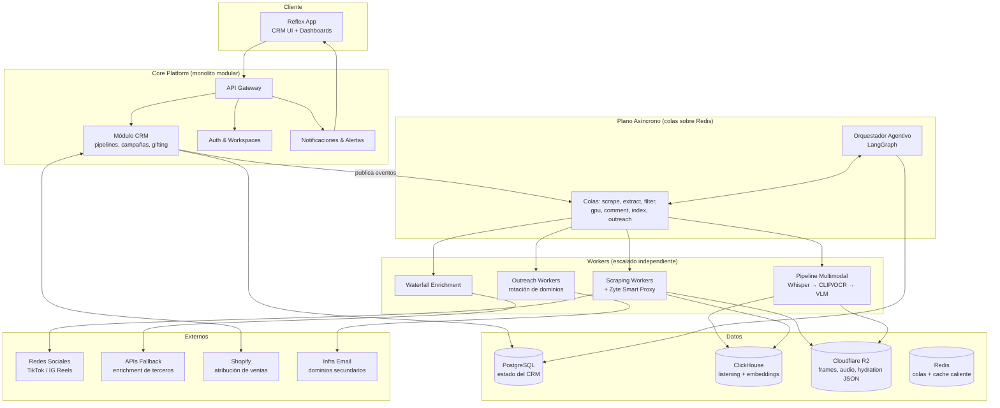
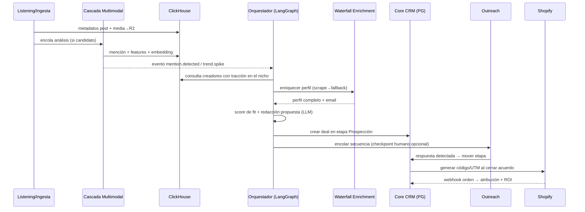

# Arquitectura del Sistema — Qualify (CRM Agentivo de Influencer Marketing)

**Estado:** Propuesto · **Fecha:** 2026-07-17

---

## 1. Principios de diseño

1. **Monolito modular + workers asíncronos.** Un solo deployable para el core (API + CRM) y una flota de workers desacoplados por colas. Microservicios solo donde el perfil de carga lo exige (scraping, procesamiento multimodal). Evita la complejidad operativa prematura sin sacrificar escalado independiente donde importa.
2. **Todo lo costoso es asíncrono y en cascada.** Ninguna llamada a scraping, transcripción o VLM ocurre en el request path del usuario. Cada etapa cara tiene un filtro barato delante (cascada de costos).
3. **Dos planos de datos.** Postgres = estado transaccional del negocio (verdad del CRM). ClickHouse = hechos analíticos inmutables a escala (métricas, transcripciones, embeddings). Nunca se cruzan escrituras; se conectan por `creator_id`.
4. **Eventos como contrato entre módulos.** Los módulos no se llaman entre sí directamente; publican eventos de dominio (`creator.enriched`, `mention.detected`, `trend.spike`). Esto permite que el "Bucle Agentivo" observe todo sin acoplarse a nada.
5. **Agentes con permisos explícitos.** Los agentes (outreach, listening, gifting) operan mediante tools tipados con límites de gasto/volumen y checkpoints de aprobación humana configurables por workspace.
6. **Provenance obligatorio.** Toda señal o enrichment derivado lleva el `post_id`/`comment_id`/`source_id` de origen más `detector_version`/`pipeline_version` (regla arquitectónica dura, no opcional).

---

## 2. Vista de contenedores



---

## 3. Descomposición en módulos

### 3.1 Core CRM (Postgres)
La verdad transaccional del negocio.

- **Entidades:** workspaces, usuarios, creadores (vista CRM), pipelines/etapas, campañas, gifting (estados de envío), plantillas, logs de conversación.
- **Responsabilidad:** CRUD, reglas de negocio de embudos, permisos, auditoría.
- **No hace:** scraping, análisis, ni envío de emails — solo emite comandos/eventos.

### 3.2 Waterfall Enrichment (worker)
Motor en cascada que reemplaza la base de datos estática de 380M perfiles.

```
Solicitud de perfil → ¿cache fresco en Postgres/Redis? → sí: retorna
    ↓ no
Scrape directo (Zyte) → éxito: normaliza + guarda + evento creator.enriched
    ↓ fallo
API fallback económica (nivel 1) → fallo → API fallback (nivel 2) → fallo
    ↓
Marca perfil como "parcial" + reintento programado con backoff
```

- **TTL por tipo de dato:** followers/engagement (24-72 h), bio/links (7 días), email (30 días).
- Cada fuente escribe con `source` y `fetched_at` — el merge es por prioridad de fuente + frescura, nunca sobrescritura ciega.

### 3.3 Social Listening & Ingesta (workers + ClickHouse) — *Fase 1, en curso*
Implementado como el pipeline de ingesta descrito en [plan-ingesta-social.md](plan-ingesta-social.md):

- **Descubrimiento:** scheduler (Celery Beat) monitorea cuentas/hashtags configurados.
- **Ingesta:** metadatos de posts → ClickHouse; media y hydration JSON → R2 con referencia (re-parseable sin re-scrapear).
- **Detección de tendencias:** materialized views en ClickHouse sobre ventanas móviles (crecimiento de menciones, velocity de sonidos/hashtags). Un spike sobre umbral emite `trend.spike`.

### 3.4 Pipeline Multimodal en cascada (workers)
Resuelve el punto ciego del ~70% de menciones sin texto. Cada filtro descarta candidatos antes de pagar el siguiente:

| Etapa | Herramienta | Costo relativo | Descarta |
|---|---|---|---|
| F1: Transcripción de audio | faster-whisper | Bajo | ~60% (sin mención hablada ni señal) |
| F2: Frames clave + filtro CLIP + OCR | ffmpeg + CLIP zero-shot | Muy bajo | ~25% adicional |
| F3: Análisis semántico profundo | VLM (Moondream2 / Qwen2.5-VL) en GPU serverless | Alto | Solo pre-calificados llegan aquí |

- **Salida:** menciones estructuradas (marca, sentimiento, contexto, tags estéticos, objetos) + embeddings → ClickHouse (`search.content_index`). Emite `mention.detected`.
- Cada etapa es una cola independiente → escalado y reintentos por etapa; si la GPU está fría, los jobs esperan en `gpu_jobs` sin bloquear scraping ni filtrado CLIP.

### 3.5 Orquestador Agentivo (LangGraph)
El "Bucle de Acción": convierte eventos en workflows autónomos.

- **Grafo por workflow:** p. ej. *Prospección Autónoma*: `trend.spike` → buscar creadores del nicho → enriquecer (waterfall) → calificar (score fit/tracción) → encontrar email → redactar propuesta personalizada (LLM con contexto del media analizado) → insertar en etapa "Prospección" del CRM → (opcional) encolar outreach.
- **Checkpoints humanos:** cada grafo declara puntos de aprobación (p. ej. "aprobar email antes de enviar") configurables por workspace.
- **Estado del grafo** persiste en Postgres (tabla `agent_runs`) — reanudable, auditable, con límites de presupuesto por run.

### 3.6 Motor de Outreach (workers + infra de email)
Principio "buy, don't build": el envío se delega a Instantly/HeyReach vía API; Qualify orquesta.

- **Pool de dominios secundarios** con warmup y límites diarios por buzón; rotación ponderada por reputación (gestionado por el proveedor, monitoreado por Qualify).
- **Secuencias:** plantillas + variables generadas por LLM, follow-ups condicionados a apertura/respuesta.
- **Detección de respuestas** (webhook) → clasifica intención (interesado / no / rebote) → mueve el deal de etapa en el CRM automáticamente.
- Todo envío/evento se loguea en Postgres (`email_events`) para compliance y deliverability.

### 3.7 Atribución & Social Commerce (integración Shopify)
- Genera códigos de descuento y links UTM únicos por creador/campaña vía API de Shopify.
- Webhooks de órdenes → matching código/UTM → tabla `attributions` en Postgres + réplica de hechos en ClickHouse para ROI por creador/campaña/contenido.

---

## 4. Esquemas de datos (nivel entidad)

### PostgreSQL (transaccional)
```
workspaces(id, plan, límites, config_agentes)
users(id, workspace_id, rol)
creators(id, handles{tiktok,ig}, email, estado_enrichment, merged_profile jsonb, updated_at)
pipelines(id, workspace_id) → stages(id, pipeline_id, orden)
deals(id, creator_id, stage_id, campaign_id, valor_estimado, owner)
campaigns(id, tipo{gifting|paid|affiliate}, presupuesto, estado)
gifting_shipments(id, deal_id, producto, tracking, estado)
templates(id, canal, cuerpo, variables)
outreach_sequences(id, pasos jsonb) / email_events(id, deal_id, tipo, ts, meta)
sending_domains(id, dominio, reputación, warmup_stage, límite_diario)
agent_runs(id, workflow, estado_grafo jsonb, presupuesto_usado, checkpoints)
attributions(id, creator_id, campaign_id, order_id_shopify, monto, ts)
```

### ClickHouse (analítico, append-only — DB `crm`, prefijos `ingestion.*` y `search.*`)
```
ingestion.posts / comments (per-platform, ReplacingMergeTree,
    clave natural (brand_id, platform, post_id), partición toYYYYMM(posted_date))
search.content_index    -- FTS denormalizado: 1 fila por fragmento de texto
                        -- (caption/frame/transcript/comment), índices tokenbf/ngrambf
search.embeddings       -- SOLO texto (caption/transcript/comment + descripción-texto del frame);
                        -- + embedding_model/embedding_revision/embedding_dim (provenance). Fase posterior.
search.visual_embeddings-- vectores de imagen RAW de frames (SigLIP2, 768-dim). DISEÑADA, NO construida:
                        -- activo de Fase 3 (Visual Listening: clustering logo/producto, near-dup), NO de lookalike.
                        -- Compute ≈ gratis (reusa el pass del filtro F2); el costo es storage+índice de billones de
                        -- vectores → no se puebla/indexa hasta que exista un surface visual. Ver ADR 11.
signals.events          -- señales tipadas con provenance (fase 3)
crm.creators            -- perfil CRM del creator: métricas + metadata (followers, demografía,
                        -- niche_labels) + contacto (waterfall). SIN vectores. ORDER BY (platform, creator_id)
crm.creator_centroids   -- centroides de embeddings para lookalike (fase 4), tabla hija dedicada;
                        -- dim fija por modalidad (text=1024 / visual=768), sub-centroides. Ver ADR 10
billing.usage_events    -- billing por créditos (fase 5)
trend_signals / attribution_facts -- vistas materializadas de agregación
```

Reglas: `ORDER BY` es inmutable — se diseña alrededor de los filtros esperados antes de crear la tabla. ClickHouse nunca es fuente de verdad de estado; se puede reconstruir desde R2 + reproceso.

**Lookalike (Fase 4) — separación vectores/metadata.** Los vectores de contenido NO viven en `crm.creators` (que churnea por upserts de metadata con TTL 24-72h, y un índice HNSW se reconstruye en cada merge). Viven en la tabla hija `crm.creator_centroids`:

```sql
CREATE TABLE crm.creator_centroids (
    platform LowCardinality(String),
    creator_id String,
    modality LowCardinality(String),   -- text|visual (espacios separados, nunca concatenados)
    centroid_ix UInt8 DEFAULT 0,        -- 0 = media global; 1..k = sub-centroides (multi-nicho)
    embedding Array(Float32),           -- dim fija POR modalidad (text=1024, visual=768)
    embedding_model LowCardinality(String),
    embedding_revision LowCardinality(String),
    n_posts UInt32,
    updated_at DateTime DEFAULT now()
) ENGINE = ReplacingMergeTree(updated_at)
ORDER BY (platform, modality, creator_id, centroid_ix);
```

- **Pooling (centroid_ix=0):** media ponderada por recencia × engagement de embeddings por-post L2-normalizados (decay temporal exponencial × log-views), por modalidad. Pondera el estilo *actual* → captura pivots de contenido que el metadata pierde.
- **Sub-centroides:** creators multi-nicho (fitness + cocina) necesitan 2-3 sub-centroides (mini k-means sobre sus posts); una sola media cae en el "medio vacío" y no matchea a nadie. v1 puede lanzar solo con `centroid_ix=0` — la columna deja añadir sub-centroides sin migración.
- **Búsqueda ANN — snapshot con swap atómico:** `crm.creator_centroids` es la fuente de verdad; el índice HNSW vive en una tabla **snapshot por modalidad** (dim uniforme: text=1024, visual=768), reconstruida periódicamente (Celery Beat, p. ej. horario) en una staging y swapeada con `EXCHANGE TABLES` (atómico en ClickHouse). Esto elude por completo el problema de HNSW-rebuild-on-merge sobre un `ReplacingMergeTree` y hace irrelevante el bug de crash-durability (el snapshot es desechable y se reconstruye entero cada ciclo). Nunca se indexa `crm.creators` directamente. Ver ADR 9.

```sql
-- Una snapshot POR modalidad (vector_similarity exige dim uniforme). Ejemplo texto (bge-m3/e5-large, 1024).
CREATE TABLE crm.creator_centroids_text_snap (
    platform LowCardinality(String),
    creator_id String,
    centroid_ix UInt8,
    embedding Array(Float32),
    n_posts UInt32,
    INDEX ann_idx embedding TYPE vector_similarity('hnsw', 'cosineDistance', 1024) GRANULARITY 1
) ENGINE = MergeTree()
ORDER BY (platform, creator_id, centroid_ix);
-- Rebuild: construir en _stage → EXCHANGE TABLES crm.creator_centroids_text_snap AND crm.creator_centroids_text_stage
```

- **Lookalike = fusión, no content-only:** el centroide de contenido resuelve lo que el metadata no ve (pivots, contenido no-textual, mismo label/contenido opuesto); el metadata (`crm.creators`: demografía de audiencia, follower-graph) resuelve lo que el embedding no ve. La query combina similitud vectorial + filtros de metadata. El eje visual, cuando se incorpore, entra como **ingrediente de peso menor en el centroide fusionado** (ponderado hacia transcript+comentarios), nunca como feature standalone. Ver ADR 12.
- **Modelo de texto (propuesto, pendiente golden-set):** `bge-m3` (1024-dim, MIT) por defecto — emite dense + sparse (lexical, se acopla al índice `tokenbf_v1` existente) + ColBERT desde un solo modelo, similaridad simétrica sin prefijos query:/passage: (encaja en lookalike creator-a-creator), contexto 8192 para transcripts largos. `multilingual-e5-large` como fallback más liviano. Reemplaza el tentativo MiniLM-384. Ver §8.1.

---

## 5. Flujo end-to-end: del listening a la venta



---

## 6. Decisiones de arquitectura (ADRs resumidos)

| # | Decisión | Alternativa descartada | Razón |
|---|---|---|---|
| 1 | Monolito modular + workers | Microservicios completos | Equipo pequeño; los límites de módulo por eventos permiten extraer servicios después sin reescribir |
| 2 | Celery/Redis (pipeline) + LangGraph (agentes) | n8n como orquestador central | n8n es excelente para prototipar, pero el grafo agentivo necesita estado tipado, checkpoints y presupuestos — LangGraph lo da nativo |
| 3 | ClickHouse para listening | pgvector/Timescale en Postgres | Volumen de series temporales + agregaciones de ventana + búsqueda vectorial a escala; Postgres se mantiene simple |
| 4 | Cascada de 3 filtros multimodales | VLM directo sobre todo el contenido | Reduce el costo por video ~90%; el VLM solo ve candidatos pre-calificados |
| 5 | Waterfall enrichment on-demand | Base de datos estática precargada | Datos frescos, costo proporcional al uso, sin mantener 380M perfiles muertos |
| 6 | Eventos de dominio como contrato | Llamadas directas entre módulos | Desacople real; el orquestador y las alertas observan sin acoplarse |
| 7 | Outreach vía Instantly/HeyReach (buy) | Construir infra de envío propia | "Buy, don't build" para infra commodity; el diferencial de Qualify está en el listening y las señales |
| 8 | Reflex (Python full-stack) para CRM UI | Next.js (React/TS) | El resto del stack ya es Python (FastAPI, Celery, LangGraph); Reflex evita mantener un segundo lenguaje/build toolchain para un equipo pequeño — ya existe un scaffold funcional (`Qualify/`) con dashboard de mentions sobre SQLModel |
| 9 | Lookalike sobre ClickHouse nativo (`vector_similarity`, HNSW/usearch ≥26.4), índice en snapshot con swap atómico (`EXCHANGE TABLES`) | Vector DB dedicado (Qdrant/pgvector) / índice HNSW directo sobre el ReplacingMergeTree | Lookalike busca *centroides* de creator (millones de vectores), no per-post (billones); ClickHouse HNSW lo maneja y mantiene el principio de un solo store analítico. El índice vive en una snapshot reconstruida periódicamente y swapeada atómicamente → elude HNSW-rebuild-on-merge y el bug de crash-desync (snapshot desechable). Un vector DB solo se justificaría por ANN per-post a escala de billones (búsqueda semántica global) — decisión futura separada |
| 10 | Centroides en tabla hija `crm.creator_centroids` (modality + centroid_ix) | Columna `content_embedding Array(Float32)` plana en `crm.creators` | Espacios de embedding separados por modalidad (text 1024 / visual 768) no caben en un vector plano; multi-nicho necesita sub-centroides; aísla el índice HNSW del churn de metadata de `crm.creators` |
| 11 | Una tabla/índice de embeddings por (modalidad, modelo, dim); `search.embeddings` queda text-only, `search.visual_embeddings` separada y **diseñada-no-construida** (activo de Fase 3 Visual Listening, no de lookalike) | Columna de embeddings mixta multi-dim / fusionar text+visual en un vector / construir visual lookalike en Fase 4 | Un índice ANN exige dim fija. El eje visual es red ocean: Modash embebe frames RAW (búsqueda por imagen funciona) → un lookalike visual standalone sería una versión más limpia de lo que ellos ya venden, sin ventaja. El visual solo aporta como ingrediente menor de un centroide fusionado. La tabla se congela para su uso real (clustering visual de Fase 3), sin poblar/indexar hasta que haya surface |
| 12 | Lookalike = fusión (centroide de contenido + filtros de metadata) | Lookalike content-only / metadata-only | El metadata (demografía de audiencia, follower-graph) captura lo que el embedding no ve; el contenido captura pivots, contenido no-textual y "mismo label/contenido opuesto" que el metadata pierde. Ninguno solo es suficiente |
| 13 | Solo modelos de embedding con licencia comercial (Apache/MIT): SigLIP2, `multilingual-e5-large`, `bge-m3`, `Qwen/Qwen3-Embedding-0.6B` | `jinaai/jina-clip-v2`, `jinaai/jina-embeddings-v3` (CC-BY-NC-4.0) | Qualify es producto comercial; la cláusula NonCommercial prohíbe el uso. Guardrail para que nadie elija Jina por reflejo de downloads/MTEB. El checkpoint final entre los permitidos lo decide el golden-set (§8.1.2), no MTEB |
| 14 | Score de creator (fit/tracción) persistido como salida tipada versionada — fila en `signals.events` (`detector_version` = versión del scorer, source = post_ids/señales puntuadas) o tabla de scoring dedicada con las mismas columnas de provenance | Columna `score` mutable en `crm.creators` | Un score es una señal DERIVADA → la regla de provenance dura aplica: debe llevar `detector_version` + los ids fuente que lo computaron para ser auditable y recomputable. Una columna mutable pierde historial/trazabilidad y churnea con el TTL de metadata de `crm.creators` |
| 15 | Inbox social unificado (Fase 6) = construir la capa de agregación/routing/contexto; el transporte de mensajes (DM/comentarios TikTok/IG) se integra vía API de plataforma. Nuevas tablas Postgres `conversations`/`inbox_messages`, cada inbound ligado a source `post_id`/`comment_id` | Construir infra de mensajería propia / reutilizar `email_events` como store de conversación social | "Buy commodity, build differentiated": el transporte es commodity, el valor es el contexto unificado listening+CRM. `email_events` es solo outreach-email, no sirve como store de conversación social |
| 16 | `signals.events` materializa salidas de detectores tipados como 1 fila por (fragmento fuente, `signal_type`, `label`); `ORDER BY (brand_id, platform, signal_type, toDate(posted_date), post_id)`; provenance obligatorio = source `post_id`/`comment_id` + `fragment_type` + `detector_version` + `model_id`/`revision` + `label_set_version`; multi-label → N filas, nunca `Array` | Columna `Array` de labels / tabla nueva por detector / `label_set` fuera del provenance | Mantiene `signals.events` filtrable por `signal_type`/`label` (regla ORDER-BY-alrededor-de-filtros); N filas evita explotar arrays en queries analíticas; `label_set_version` es provenance real porque cambiar las labels candidatas de un zero-shot cambia el output sin cambiar el modelo |
| 17 | **Ingesta social (Fase 1 Parte 2) = construir** el scraping+parseo propio sobre Zyte: parsers tipados sobre hydration JSON, cobertura multi-formato TikTok/IG (video, foto/galería, story, texto / reel, post, carrusel, story). EnsembleData/Data365 quedan como **fallback documentado** por formato bloqueado o no rentable (p. ej. stories). La rotación de proxies **no se decide aquí**: sigue Zyte-primario / Decodo·Bright Data-fallback (fijo por `CLAUDE.md`, Bloque 1) | Comprar la ingesta completa como API (EnsembleData primario + Data365 fallback), tal como recomendaba `alternativas-fase1.md` #1 | (1) `CLAUDE.md` lista *"the social ingestion pipeline itself"* bajo **Build** (core diferenciado) y solo *"web access/proxies (Zyte)"* bajo **Buy** → el split estratégico ya resuelve comprar-proxy/construir-pipeline; (2) regla dura de raw-payload: no se puede *"re-parsear sin re-scrapear"* un campo que el vendor nunca expuso — su esquema normalizado es el techo permanente de cobertura; (3) la tesis *"leer el contenido, no el perfil"* exige media cruda + payload completo, no el subconjunto normalizado del vendor; (4) la matriz de cobertura (nota abajo) muestra stories y posts de texto **débil/inconsistentemente** cubiertos por AMBOS vendors, mientras el objetivo del sprint es cobertura ancha incluidas esas formas edge — parsear hydration JSON está acotado solo por lo que la plataforma renderiza. Vendor API se mantiene como fallback dirigido (stories, backstop anti-bloqueo), no como fuente primaria |

> **Nota sobre ADR 7 (outreach):** Instantly deprecó su API v1 el 2026-01-19 y la partió en 3 módulos separados. La integración de Fase 5 debe apuntar a la API nueva; documentarlo al diseñar el conector. La decisión "buy, don't build" se sostiene.

> **Corrección de tesis competitiva (pendiente de aprobación humana, ver §8):** la premisa de `ingenieria-inversa-stack-gtm.md` §2/§6 — "nadie hace content lookalike sobre TikTok/IG; los influencer tools usan solo bio+métricas" — es **falsa en 2026**: Modash (Creator Lookalikes API, eje visual+captions, ~$16.2K/año) y Kuli (frame-by-frame + transcripción de audio) ya lo hacen; Syncly Social es un tercer player en el eje audio. El diferenciador sobreviviente, en orden de fuerza: (1) **fusión listening+activation** — los competidores son solo discovery; *caveat*: Syncly Social (YC, TikTok-native) ya fusiona listening+discovery, pero **no cierra el loop a activation/outreach ni usa la señal de comentarios como eje de similitud** → es el benchmark competitivo #1 a vigilar, no un empate; (2) **señal de comentarios/audiencia** como eje de similitud (nadie embebe commenters) — *precondición arquitectónica:* exige filtrado spam/bot de Fase 3 upstream + ponderación IDF de commenters-hub, o colapsa a ruido de popularidad; esto hace la Fase 3 (señales) una dependencia dura de este eje en Fase 4, no independiente; (3) **provenance + capa de señales tipadas** sobre social audiovisual (Fase 3, vacío confirmado); (4) full-multimodal-incl-audio y **español-first como refuerzos secundarios, no pilares** — Kuli/Syncly ya transcriben audio, y el español es probablemente **table-stakes, no moat** (whisper WER ES ~3-5% en limpio, cerca del inglés; cualquiera con modelo multilingüe lo maneja) → requiere test empírico de WER en dominio TikTok antes de sostener cualquier claim. Fuentes en `docs/research-features-gtm.md` (acceso 2026-07-18).

> **Matriz de cobertura de formatos (soporte de ADR 17).** Fuentes: `alternativas-fase1.md` §2a + verificación en vivo de docs/páginas de vendor (2026-07-19). Celdas sin confirmar se marcan como **pregunta abierta**, no se adivinan (regla `CLAUDE.md` de no inventar capacidades). `alternativas-fase1.md` documenta cobertura **a nivel plataforma**, no a nivel formato — casi toda la granularidad por formato edge sale de la verificación en vivo o queda abierta.
>
> | Formato | Zyte (parseo propio) | EnsembleData | Data365 |
> |---|---|---|---|
> | TikTok — video | Sí (hydration JSON) | Sí (docs) | Sí (docs) |
> | TikTok — foto/galería (photo-mode) | Sí (construible; `imagePost` en hydration) | Parcial — homepage dice "photos" pero **sin endpoint dedicado en docs** ⚠ pregunta abierta | No confirmado ⚠ pregunta abierta |
> | TikTok — story | Parcial (efímero; requiere sesión/auth — difícil para todos) | No (no documentado) | Parcial (solo mientras activa, ventana 24 h) |
> | TikTok — texto | Parcial (formato raro; parseable si presente en hydration) | No confirmado ⚠ pregunta abierta | No confirmado ⚠ pregunta abierta |
> | IG — reel | Sí | Sí (`getUserReels`) | Sí |
> | IG — post (feed) | Sí | Sí | Sí |
> | IG — carrusel | Sí | Parcial (dentro del endpoint de post; sin endpoint dedicado) ⚠ | Sí (imágenes de carrusel expuestas) |
> | IG — story | Parcial (requiere auth) | No (no documentado) | Parcial (solo mientras activa) |
>
> **Coste e infra por vendor:**
>
> | | Modelo de coste | ~Coste/1K registros | Rotación IP/proxy incluida |
> |---|---|---|---|
> | Zyte (parseo propio) | Pay-per-request | Variable por dificultad del sitio (Zyte API PAYG desde $0; tope $100/mes Standard) | Sí — bundled en Zyte API (Bloque 1) |
> | EnsembleData | Unidades (mayoría 1 unidad/request; varía por complejidad del endpoint) | No expresable limpio en $/1K (depende del endpoint); tiers $100–$1,400/mes | Sí (implícito — es una scraping API gestionada) |
> | Data365 | Créditos (1 post = 1, post+comentarios = 5, perfil = 9) | ~€0.60/1K posts (€300/mes = 500K créditos); sube con comentarios/perfil | Sí (implícito — gestionada) |
>
> **Lectura para la decisión:** el eje que discrimina no es el coste (los tres son viables) sino **el techo de cobertura y el control del payload**. Los formatos edge que el sprint exige (foto-galería TikTok, texto, stories) son justo donde AMBOS vendors están sin confirmar o no cubren; y ninguna API expone el hydration JSON crudo requerido por la regla de re-parse-sin-re-scrape. Construir el parseo mantiene la cobertura acotada solo por lo que la plataforma renderiza, no por el roadmap de un vendor. Caveat de honestidad: el marketing de EnsembleData afirma "photos" para TikTok pero su página de docs no enumera endpoint de photo-mode ni de stories — por eso esas celdas quedan como pregunta abierta, no como "no".

> **Nota de reconciliación con `alternativas-fase1.md` (ADR 17).** El Resumen Ejecutivo y la Recomendación #1 de ese doc dicen *"comprar la ingesta (EnsembleData primario + Data365 fallback)"*. ADR 17 **no** contradice esa investigación de mercado: **estrecha** su alcance a la luz del split Build/Buy de `CLAUDE.md`. Se compra la capa commodity (proxy/anti-bloqueo = Zyte, ya fijo) y se construye el pipeline de ingesta/parseo (core diferenciado, listado explícitamente bajo **Build** en `CLAUDE.md`). EnsembleData/Data365 **no se descartan**: quedan como fallback dirigido para (a) formatos donde el parseo propio esté bloqueado —notablemente stories, difíciles para todos por efímeras y auth-gated—, y (b) backstop de anti-bloqueo/ráfaga. Esta desviación de la recomendación escrita del doc es intencional y está flagged al lead.

---

## 7. Escalabilidad, costos y riesgos

**Escalado:** cada cola de worker escala horizontalmente por profundidad de cola. ClickHouse por shards cuando `search.content_index` supere ~1 TB. El core CRM escala vertical largo rato.

**Control de costos:** presupuesto por `agent_run` y por workspace (tokens LLM, requests Zyte, minutos de transcripción); métricas de costo por etapa de cascada para ajustar umbrales de descarte.

**Riesgos principales:**

- *Bloqueos de scraping:* mitigado por Zyte + fallback APIs, pero es el riesgo existencial — mantener siempre ≥2 proveedores fallback activos y presupuesto de reintentos.
- *Deliverability:* delegada al proveedor de outreach, pero monitorear bounce/spam-rate por dominio con circuit breaker que pausa el pool.
- *Deriva de calidad del VLM:* evaluar con un golden set de videos etiquetados; los umbrales de la cascada se calibran contra ese set.
- *Compliance (GDPR/CAN-SPAM):* emails obtenidos de fuentes públicas requieren opt-out funcional y supresión global por workspace desde el día 1.

## 8. Próximos pasos

1. [ ] DDL detallado de Postgres (migraciones iniciales) y tablas ClickHouse con sort keys definitivos.
2. [ ] Definir catálogo de eventos de dominio (schema registry ligero en JSON Schema).
3. [ ] Prototipo del grafo LangGraph de *Prospección Autónoma* con checkpoints.
4. [ ] Benchmark de la cascada multimodal con 100 videos reales (costo/precisión por etapa).
5. [ ] Evaluación de proveedores de outreach (Instantly vs HeyReach) y diseño de la integración.

### 8.1 Decisiones abiertas (requieren aprobación humana antes de fijarse en docs)

Surgen de la reconciliación de los teardowns GTM (`research-features-gtm.md`) y la feasibility técnica de embeddings. Las ADRs 9-16 arriba SÍ están lockeadas (técnicas, dentro del mandato de arquitectura). Las de esta lista NO — pero varias han cambiado de estado; ver la línea **Estado** de cada una. Convención: *abierto* = sin decisión; *aplicado, pendiente confirmación* = el texto ya está escrito en el working tree pero el gate de aprobación humana que el backlog fijó (`backlog-features-gtm.md`) aún no consta cerrado por commit ni nota de aprobación.

1. **Reescritura de tesis competitiva** en `ingenieria-inversa-stack-gtm.md` §2/§6 y `README.md`: la premisa "nadie hace content lookalike" es falsa (Modash/Kuli/Syncly). Reencuadrar el diferenciador a fusión listening+activation + eje comentarios/audiencia + provenance (audio-multimodal y español como secundarios).
   - **Estado: RESUELTO (aprobado por el usuario, 2026-07-18).** El reencuadre está escrito en `ingenieria-inversa-stack-gtm.md` §2/§6, `README.md` y la nota de corrección de §6 arriba, y aprobado explícitamente por el usuario vía el lead. Era un claim de **posicionamiento/producto** fuera del mandato unilateral del architect, por eso requería sign-off humano — ya obtenido. Contenido correcto y sourced; gate de aprobación cerrado.
2. **Upgrade del modelo de texto** MiniLM-384 → `bge-m3` (1024-dim, MIT) por defecto (fallbacks `multilingual-e5-large` y `Qwen/Qwen3-Embedding-0.6B`, Apache-2.0, top MTEB-multilingual actual) para lookalike/RAG: mejor en español a costo ~igual + dense/sparse/ColBERT en un modelo (el sparse se acopla al `tokenbf_v1` existente) + similaridad simétrica ideal para lookalike. `CLAUDE.md` exige validación con golden-set antes de fijar checkpoints.
   - **Estado: ABIERTO (sin cambio).** Propuesto como default en §4 y admitido como candidato licencia-comercial en ADR 13, pero **no lockeado**: los tres candidatos entran al bake-off del golden-set (datasci). No fijar el checkpoint en código hasta ese número.
3. **Construir vs diferir `search.visual_embeddings`** (lookalike visual): recomendación = diferir (eje visual ya cubierto por competidores). Si producto quiere entrar al eje visual, es decisión de scope/costo de Fase 4.
   - **Estado: FIRMADO en su parte de arquitectura (ADR 11).** La decisión técnica —no construir/poblar/indexar visual lookalike ahora; `search.visual_embeddings` queda diseñada-no-construida como activo de Fase 3 Visual Listening— quedó lockeada en ADR 11 (§6). Lo único que sigue abierto es el **scope de producto** (si Qualify decide entrar al eje visual), que es una decisión de priorización de Fase 4, no un ítem de arquitectura pendiente.
4. **"Español-first" como claim de producto**: probablemente **table-stakes, no moat** — whisper WER ES ~3-5% en limpio (cerca del inglés), y cualquier competidor con modelo multilingüe (bge-m3 es MIT/gratis) maneja español; el riesgo real es el dominio TikTok (música, slang, code-switch), que golpea también al inglés. datasci es dueño del probe empírico (WER de whisper-large-v3-turbo sobre ~20-30 clips ES con transcript de referencia vs control EN; calidad de lookalike bge-m3 en creators hispanos vs baseline EN). Bloqueado solo por datos etiquetados; se pliega al mismo esfuerzo de golden-set de Fase 1.
   - **Estado: ABIERTO (sin cambio), rastreado como hipótesis.** Corresponde a `backlog-features-gtm.md` P4-3 (hipótesis a validar). No sostener el claim sin el número de WER en dominio. Consistente con la nota de §6 y el ítem 1.
5. **Correcciones al modelo de costos de Fase 1** (en `alternativas-fase1.md`/`README.md`): Prospeo cae a ~4.5% hit-rate en bulk (no 98%, que es solo lookup individual); Smartlead API/white-label está en Pro $94/mes (no Base $39); Trigify 2026 = $149/$270/$549. Las decisiones de vendor se sostienen; solo el costeo cambia.
   - **Estado: RESUELTO (aprobado por el usuario, 2026-07-18).** Las tres correcciones están escritas en `alternativas-fase1.md` §3a/§3b, `README.md` (tabla Fase 1) e `ingenieria-inversa-stack-gtm.md` (Trigify), y aprobadas explícitamente por el usuario vía el lead. Corresponden a `backlog-features-gtm.md` **F1-C1 y F1-C2** (que el PO había marcado "requiere aprobación explícita del lead" — ahora obtenida; **no** son la fila C5, que es la deprecación de la API de Instantly, ya RESUELTA vía la nota de ADR 7). `CLAUDE.md` **no** está afectado: no lista cifras de precio/precisión de estos vendors (verificado). Las decisiones de vendor se sostienen; solo cambia el costeo.
6. **Principio de billing** (`billing.usage_events`, Fase 5): cobrar por dato VÁLIDO (patrón BetterContact), no por intento — advertencia directa del caso Clay (+28% precio / −40% créditos / cobra intentos fallidos; queja #1 = credit burn impredecible).
   - **Estado: PRINCIPIO REGISTRADO, no contestado.** `backlog-features-gtm.md` lo marca RESUELTO (fila C6: "ya registrado en §8.1 item 6") y lo baja a los stories P5-1/P4-4. No es una decisión controvertida que requiera aprobación, sino un guardrail de diseño de Fase 5; se vuelve vinculante cuando se diseñe el esquema `billing.usage_events` (Fase 5, aún inexistente). Candidato a ADR propia recién en ese momento — no se mintea ahora para no adelantar una fase sin esquema.
7. **Clasificador zero-shot de texto como primitiva de detección de Fase 3** (`MoritzLaurer/bge-m3-zeroshot-v2.0`, MIT): `packages/models/NOTES_pain_signal_feasibility.md` (datasci, 2026-07-18) encontró que la librería de señales tipadas (`backlog-features-gtm.md` P3-1) no es construible con el cascade actual tal cual — robertuito solo da polaridad 3-clase, y 7 de 10 pain points del set de creador/podcaster investigado (queja de pago, fricción de brand-deal, intención de sponsorship, etc.) son *tópico/intención*, no polaridad. Este gap no estaba reconciliado entre `backlog-features-gtm.md` (que no menciona la dependencia) y las notas de datasci hasta esta sesión.
   - **Estado: RESUELTO (aprobado por el usuario, 2026-07-18) como adición de stack propuesta — NO como decisión de scope de Fase 3.** El checkpoint queda registrado en `docs/modelos-multimodal-fase1.md` ("Clasificador zero-shot de texto") y en el stack tentativo de `CLAUDE.md`, con costo estimado <5% del cascade/video y misma golden-set-antes-de-lockear que el resto de checkpoints. Lo que **sigue abierto** es si P3-1 (la librería de señales) entra a sprint — eso es una decisión de priorización de Fase 3, no de arquitectura, y no se adelanta aquí.
