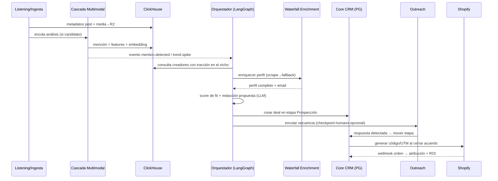

# Arquitectura del Sistema — Qualify (CRM Agentivo de Influencer Marketing)

**Estado:** Propuesto · **Fecha:** 2026-07-17

---

## 1. Principios de diseño

1. **Monolito modular + workers asíncronos.** Un solo deployable para el core (API + CRM) y una flota de workers desacoplados por colas. Microservicios solo donde el perfil de carga lo exige (scraping, procesamiento multimodal). Evita la complejidad operativa prematura sin sacrificar escalado independiente donde importa.
2. **Todo lo costoso es asíncrono y en cascada.** Ninguna llamada a scraping, transcripción o VLM ocurre en el request path del usuario. Cada etapa cara tiene un filtro barato delante (cascada de costos).
3. **Dos planos de datos.** Postgres = estado transaccional del negocio (verdad del CRM). ClickHouse = hechos analíticos inmutables a escala (métricas, transcripciones, embeddings). Nunca se cruzan escrituras; se conectan por `creator_id`.
4. **Eventos como contrato entre módulos.** Los módulos no se llaman entre sí directamente; publican eventos de dominio (`creator.enriched`, `mention.detected`, `trend.spike`). Esto permite que el "Bucle Agentivo" observe todo sin acoplarse a nada.
5. **Agentes con permisos explícitos.** Los agentes (outreach, listening, gifting) operan mediante tools tipados con límites de gasto/volumen y checkpoints de aprobación humana configurables por workspace.
6. **Provenance obligatorio.** Toda señal o enrichment derivado lleva el `post_id`/`comment_id`/`source_id` de origen más `detector_version`/`pipeline_version` (regla arquitectónica dura, no opcional).

---

## 2. Vista de contenedores


---

## 3. Descomposición en módulos

### 3.1 Core CRM (Postgres)
La verdad transaccional del negocio.

- **Entidades:** workspaces, usuarios, creadores (vista CRM), pipelines/etapas, campañas, gifting (estados de envío), plantillas, logs de conversación.
- **Responsabilidad:** CRUD, reglas de negocio de embudos, permisos, auditoría.
- **No hace:** scraping, análisis, ni envío de emails — solo emite comandos/eventos.

### 3.2 Waterfall Enrichment (worker)
Motor en cascada que reemplaza la base de datos estática de 380M perfiles.

```
Solicitud de perfil → ¿cache fresco en Postgres/Redis? → sí: retorna
    ↓ no
Scrape directo (Zyte) → éxito: normaliza + guarda + evento creator.enriched
    ↓ fallo
API fallback económica (nivel 1) → fallo → API fallback (nivel 2) → fallo
    ↓
Marca perfil como "parcial" + reintento programado con backoff
```

- **TTL por tipo de dato:** followers/engagement (24-72 h), bio/links (7 días), email (30 días).
- Cada fuente escribe con `source` y `fetched_at` — el merge es por prioridad de fuente + frescura, nunca sobrescritura ciega.

### 3.3 Social Listening & Ingesta (workers + ClickHouse) — *Fase 1, en curso*
Implementado como el pipeline de ingesta descrito en [plan-ingesta-social.md](plan-ingesta-social.md):

- **Descubrimiento:** scheduler (Celery Beat) monitorea cuentas/hashtags configurados.
- **Ingesta:** metadatos de posts → ClickHouse; media y hydration JSON → R2 con referencia (re-parseable sin re-scrapear).
- **Detección de tendencias:** materialized views en ClickHouse sobre ventanas móviles (crecimiento de menciones, velocity de sonidos/hashtags). Un spike sobre umbral emite `trend.spike`.

### 3.4 Pipeline Multimodal en cascada (workers)
Resuelve el punto ciego del ~70% de menciones sin texto. Cada filtro descarta candidatos antes de pagar el siguiente:

| Etapa | Herramienta | Costo relativo | Descarta |
|---|---|---|---|
| F1: Transcripción de audio | faster-whisper | Bajo | ~60% (sin mención hablada ni señal) |
| F2: Frames clave + filtro CLIP + OCR | ffmpeg + CLIP zero-shot | Muy bajo | ~25% adicional |
| F3: Análisis semántico profundo | VLM (Moondream2 / Qwen2.5-VL) en GPU serverless | Alto | Solo pre-calificados llegan aquí |

- **Salida:** menciones estructuradas (marca, sentimiento, contexto, tags estéticos, objetos) + embeddings → ClickHouse (`search.content_index`). Emite `mention.detected`.
- Cada etapa es una cola independiente → escalado y reintentos por etapa; si la GPU está fría, los jobs esperan en `gpu_jobs` sin bloquear scraping ni filtrado CLIP.

### 3.5 Orquestador Agentivo (LangGraph)
El "Bucle de Acción": convierte eventos en workflows autónomos.

- **Grafo por workflow:** p. ej. *Prospección Autónoma*: `trend.spike` → buscar creadores del nicho → enriquecer (waterfall) → calificar (score fit/tracción) → encontrar email → redactar propuesta personalizada (LLM con contexto del media analizado) → insertar en etapa "Prospección" del CRM → (opcional) encolar outreach.
- **Checkpoints humanos:** cada grafo declara puntos de aprobación (p. ej. "aprobar email antes de enviar") configurables por workspace.
- **Estado del grafo** persiste en Postgres (tabla `agent_runs`) — reanudable, auditable, con límites de presupuesto por run.

### 3.6 Motor de Outreach (workers + infra de email)
Principio "buy, don't build": el envío se delega a Instantly/HeyReach vía API; Qualify orquesta.

- **Pool de dominios secundarios** con warmup y límites diarios por buzón; rotación ponderada por reputación (gestionado por el proveedor, monitoreado por Qualify).
- **Secuencias:** plantillas + variables generadas por LLM, follow-ups condicionados a apertura/respuesta.
- **Detección de respuestas** (webhook) → clasifica intención (interesado / no / rebote) → mueve el deal de etapa en el CRM automáticamente.
- Todo envío/evento se loguea en Postgres (`email_events`) para compliance y deliverability.

### 3.7 Atribución & Social Commerce (integración Shopify)
- Genera códigos de descuento y links UTM únicos por creador/campaña vía API de Shopify.
- Webhooks de órdenes → matching código/UTM → tabla `attributions` en Postgres + réplica de hechos en ClickHouse para ROI por creador/campaña/contenido.

---

## 4. Esquemas de datos (nivel entidad)

### PostgreSQL (transaccional)
```
workspaces(id, plan, límites, config_agentes)
users(id, workspace_id, rol)
creators(id, handles{tiktok,ig}, email, estado_enrichment, merged_profile jsonb, updated_at)
pipelines(id, workspace_id) → stages(id, pipeline_id, orden)
deals(id, creator_id, stage_id, campaign_id, valor_estimado, owner)
campaigns(id, tipo{gifting|paid|affiliate}, presupuesto, estado)
gifting_shipments(id, deal_id, producto, tracking, estado)
templates(id, canal, cuerpo, variables)
outreach_sequences(id, pasos jsonb) / email_events(id, deal_id, tipo, ts, meta)
sending_domains(id, dominio, reputación, warmup_stage, límite_diario)
agent_runs(id, workflow, estado_grafo jsonb, presupuesto_usado, checkpoints)
attributions(id, creator_id, campaign_id, order_id_shopify, monto, ts)
```

### ClickHouse (analítico, append-only — DB `crm`, prefijos `ingestion.*` y `search.*`)
```
ingestion.posts / comments (per-platform, ReplacingMergeTree,
    clave natural (brand_id, platform, post_id), partición toYYYYMM(posted_date))
search.content_index  -- FTS denormalizado: 1 fila por fragmento de texto
                      -- (caption/frame/transcript/comment), índices tokenbf/ngrambf
search.embeddings     -- vectores para búsqueda semántica (fase posterior)
signals.events        -- señales tipadas con provenance (fase 3)
crm.creators          -- centroides de embeddings para lookalike (fase 4)
billing.usage_events  -- billing por créditos (fase 5)
trend_signals / attribution_facts -- vistas materializadas de agregación
```

Reglas: `ORDER BY` es inmutable — se diseña alrededor de los filtros esperados antes de crear la tabla. ClickHouse nunca es fuente de verdad de estado; se puede reconstruir desde R2 + reproceso.

---

## 5. Flujo end-to-end: del listening a la venta



---

## 6. Decisiones de arquitectura (ADRs resumidos)

| # | Decisión | Alternativa descartada | Razón |
|---|---|---|---|
| 1 | Monolito modular + workers | Microservicios completos | Equipo pequeño; los límites de módulo por eventos permiten extraer servicios después sin reescribir |
| 2 | Celery/Redis (pipeline) + LangGraph (agentes) | n8n como orquestador central | n8n es excelente para prototipar, pero el grafo agentivo necesita estado tipado, checkpoints y presupuestos — LangGraph lo da nativo |
| 3 | ClickHouse para listening | pgvector/Timescale en Postgres | Volumen de series temporales + agregaciones de ventana + búsqueda vectorial a escala; Postgres se mantiene simple |
| 4 | Cascada de 3 filtros multimodales | VLM directo sobre todo el contenido | Reduce el costo por video ~90%; el VLM solo ve candidatos pre-calificados |
| 5 | Waterfall enrichment on-demand | Base de datos estática precargada | Datos frescos, costo proporcional al uso, sin mantener 380M perfiles muertos |
| 6 | Eventos de dominio como contrato | Llamadas directas entre módulos | Desacople real; el orquestador y las alertas observan sin acoplarse |
| 7 | Outreach vía Instantly/HeyReach (buy) | Construir infra de envío propia | "Buy, don't build" para infra commodity; el diferencial de Qualify está en el listening y las señales |

---

## 7. Escalabilidad, costos y riesgos

**Escalado:** cada cola de worker escala horizontalmente por profundidad de cola. ClickHouse por shards cuando `search.content_index` supere ~1 TB. El core CRM escala vertical largo rato.

**Control de costos:** presupuesto por `agent_run` y por workspace (tokens LLM, requests Zyte, minutos de transcripción); métricas de costo por etapa de cascada para ajustar umbrales de descarte.

**Riesgos principales:**

- *Bloqueos de scraping:* mitigado por Zyte + fallback APIs, pero es el riesgo existencial — mantener siempre ≥2 proveedores fallback activos y presupuesto de reintentos.
- *Deliverability:* delegada al proveedor de outreach, pero monitorear bounce/spam-rate por dominio con circuit breaker que pausa el pool.
- *Deriva de calidad del VLM:* evaluar con un golden set de videos etiquetados; los umbrales de la cascada se calibran contra ese set.
- *Compliance (GDPR/CAN-SPAM):* emails obtenidos de fuentes públicas requieren opt-out funcional y supresión global por workspace desde el día 1.

## 8. Próximos pasos

1. [ ] DDL detallado de Postgres (migraciones iniciales) y tablas ClickHouse con sort keys definitivos.
2. [ ] Definir catálogo de eventos de dominio (schema registry ligero en JSON Schema).
3. [ ] Prototipo del grafo LangGraph de *Prospección Autónoma* con checkpoints.
4. [ ] Benchmark de la cascada multimodal con 100 videos reales (costo/precisión por etapa).
5. [ ] Evaluación de proveedores de outreach (Instantly vs HeyReach) y diseño de la integración.
