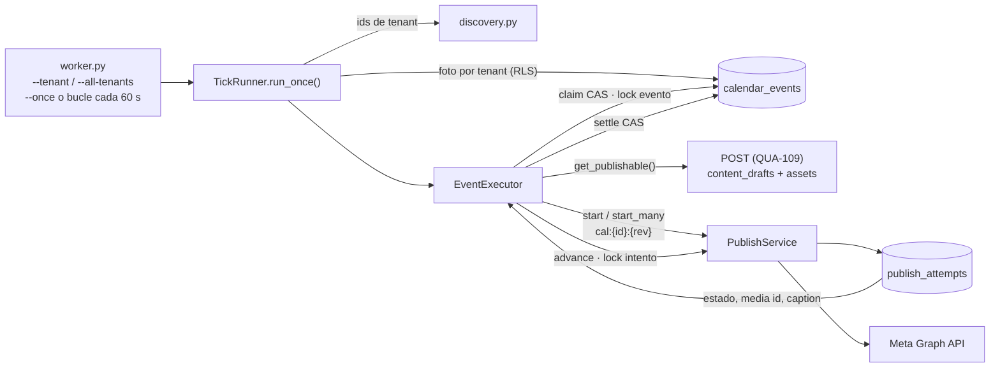
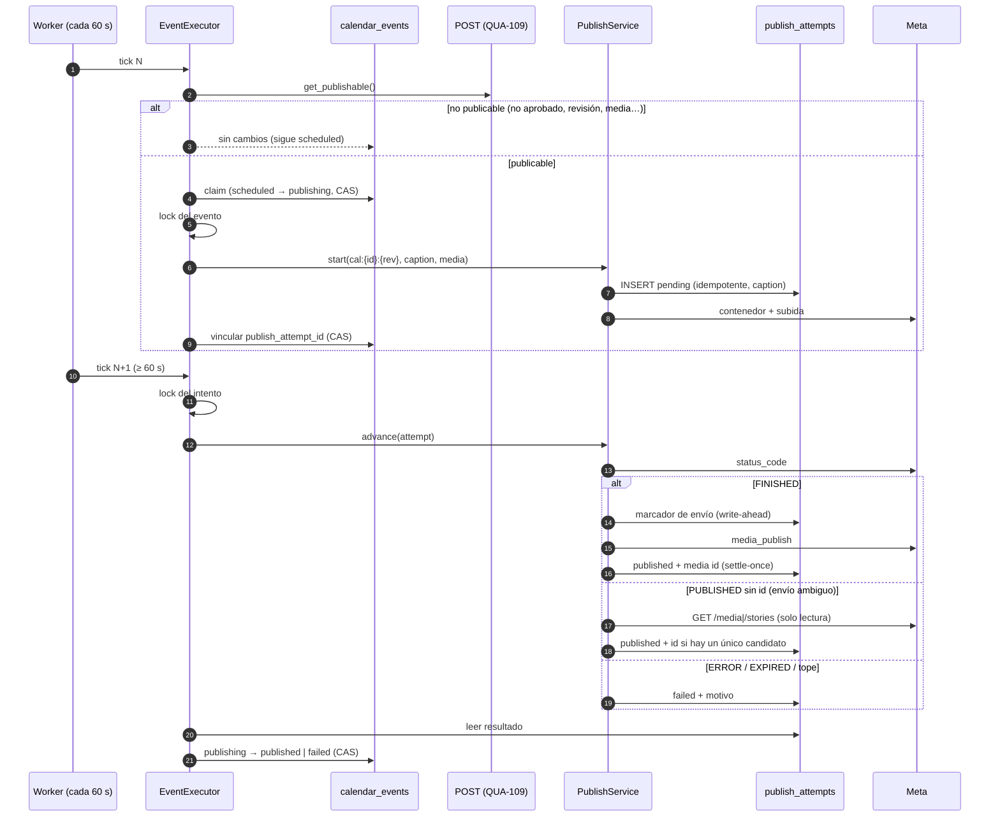
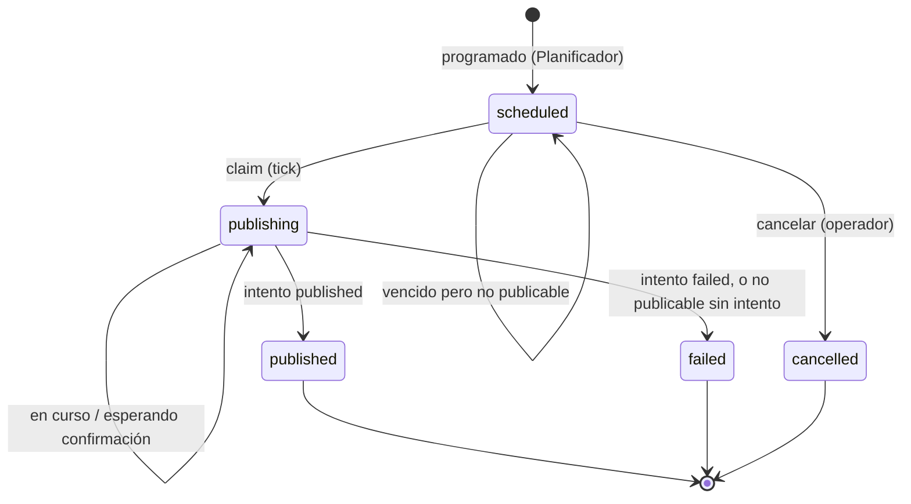

# QUA-111 — Automatización del Planificador: ejecución de Calendar Events

`[IMPLEMENTADO 2026-09-27 · rama yroa1402/qua-111-…]` Documento de decisión y de funcionamiento del ejecutor automático del Planificador. Cumple el primer entregable del ticket (el documento del mecanismo) y deja los UML con la implementación final.

**Regla de negocio (Herwin):** `scheduled_at` alcanzado + POST aprobado → se publica con el publisher existente. POST no aprobado → no se publica y el evento sigue pendiente.

---

## 1. Decisión del mecanismo

### Contexto verificado en el repo

- No hay Celery, colas ni workers. `docker-compose.yml` = Postgres + Redis. Redis se usa para locks cortos y tokens, no como cola.
- No hay Dockerfile, Procfile ni configuración de deploy, y **el hosting de producción no está decidido** ([prioridad-despliegue-subdominio.md](prioridad-despliegue-subdominio.md)).
- Los procesos del repo se ejecutan como app Reflex (`reflex run`) o como CLI `python -m …` lanzados por el `justfile` (`seed`, `refresh-referentes`, `classify-hashtags`).
- El polling de QUA-89 vive dentro de la sesión del navegador: **si nadie tiene la pestaña abierta, no corre**. Es el antecedente que no hay que copiar.

### Opciones comparadas

| Criterio | Cron que invoca un comando | Tarea periódica dentro de Reflex/FastAPI | **Worker dedicado con bucle** | Celery + Beat |
|---|---|---|---|---|
| Simplicidad | Alta | Media: se acopla al ciclo de vida del servidor web | **Alta** | Baja: broker, worker, beat y su despliegue |
| Supervivencia a reinicios | Sí (cada ejecución es nueva) | Muere y renace con la app web; con N réplicas corre N veces | **Sí (el estado está en Postgres)** | Sí |
| Exactamente una vez | Depende de los locks | Depende de los locks | **Depende de los locks** | Depende de los locks (Celery no lo garantiza solo) |
| Operación en el deploy real (sin decidir) | Necesita un cron en el host | Solo si la app web está siempre viva | **Cualquier host que pueda correr un proceso** | Necesita infraestructura nueva |
| Coste | Nulo | Nulo | **Nulo** | Redis como broker + procesos extra |
| Reutilización (vídeo de QUA-110, reconciliación) | Otro comando por job | Mezcla jobs con la web | **El mismo patrón de CLI** | Alta, pero adelanta Fase 1 Parte 3 (F6) |

### Decisión

**Un único punto de entrada, `python -m qualify_api.planner.worker`, que sirve para las dos formas de ejecución más baratas:**

- **Worker dedicado** (modo por defecto): un proceso de larga duración que ejecuta un tick cada `--interval` segundos (60 por defecto).
- **Cron o job de plataforma** (`--once`): un tick por invocación. El planificador externo decide la frecuencia.

Se descartan la tarea dentro de la app web (acopla la publicación al servidor HTTP y se multiplica con las réplicas) y Celery + Beat (infraestructura nueva para un solo job; es la decisión F6 del fundador y adelanta la Parte 3). **La corrección no depende de cuál se elija**: la exclusión y la idempotencia viven en la base de datos (§4), así que un cron y un worker a la vez, o dos workers, son seguros.

---

## 2. Cómo se ejecuta

| Entorno | Comando | Alcance |
|---|---|---|
| Local / desarrollo | `just calendar-worker --tenant <uuid>` o `just calendar-tick --tenant <uuid>` | **Solo ese tenant.** Obligatorio en local: la base de desarrollo tiene tenants de prueba sobre los que un tick de producción actuaría |
| Producción, proceso siempre vivo | `python -m qualify_api.planner.worker --all-tenants` bajo el supervisor del host (systemd, contenedor con reinicio, etc.) | Todos los tenants con trabajo |
| Producción con cron | `* * * * * python -m qualify_api.planner.worker --once --all-tenants` | Todos los tenants con trabajo |

- **El alcance es obligatorio:** `--tenant <uuid>` (repetible) o `--all-tenants`. No hay un valor por defecto que signifique "todos".
- **Frecuencia:** 60 s (mínimo 30 s), medidos de inicio a inicio. Es la cadencia de sondeo que recomienda Meta para los contenedores; cada tick avanza un paso cada publicación en curso.
- **Configuración:** lee `.env` de la raíz (Meta, R2, DSNs), igual que los demás CLI del repo. **Publica de verdad** en las cuentas conectadas del alcance.
- **Salida:** `--once` devuelve 0, o 1 si el tick no pudo ni listar sus tenants. En modo bucle, Ctrl+C termina con 0.

---

## 3. Qué hace cada tick

Código: `planner/worker.py` → `planner/tick.py` (`TickRunner.run_once`) → `planner/executor.py` (`EventExecutor`) → `publishing/service.py` (`PublishService`, sin cambios de diseño).

1. **Tenants.** `--tenant` usa exactamente esos, sin leer otros. `--all-tenants` hace una sola lectura con `admin_session`, `SELECT DISTINCT tenant_id` de los eventos vencidos o en curso: solo ids, ninguna fila de evento ([`planner/discovery.py`](../packages/api/src/qualify_api/planner/discovery.py)).
2. **Por tenant**, con su propio manejo de errores y una **foto tomada al principio** (todo por `tenant_session`, bajo RLS):
   1. eventos `publishing` **con** intento → un `advance()` y, si el intento terminó, la liquidación del evento;
   2. eventos `publishing` **sin** intento → retomar el inicio (caída entre el claim y el vínculo);
   3. eventos `scheduled` vencidos → evaluar el POST, claim e inicio de la publicación.
   Solo se procesa la foto: lo que aparece o se inicia durante el tick espera al siguiente. `run_once()` nunca espera ni reintenta.
3. **Errores:** el error de un evento se registra y el tick sigue con el siguiente; el de un tenant, lo mismo con el siguiente tenant. Un tick que falla entero lo registra el worker, que sigue.

### El POST que se publica (contrato con QUA-109/110)

El ejecutor lee el POST con `PostReader.get_publishable()` ([`planner/publishable.py`](../packages/api/src/qualify_api/planner/publishable.py), la única regla, compartida con la tarjeta del calendario). Solo publica si **todo** esto se cumple; si no, devuelve el motivo y el evento sigue `scheduled`:

- aprobado, y `revision == approved_revision` (una edición posterior a la aprobación bloquea);
- variante elegida legible: el caption es `CopyPayload.rendered_caption()`;
- categoría: `galeria` (1 imagen → IMAGE, 2–10 → CAROUSEL), `reel` (1 vídeo → REELS), `story` (1 vídeo → STORIES). No se publican la story de imagen, `tiktok_video`, ni una categoría nula o desconocida;
- media en R2 bajo `t/{tenant_id}/…`, con `content_type` (`image/jpeg`, `video/mp4` o `video/quicktime`) y posiciones únicas.

---

## 4. Por qué nunca se publica dos veces

| Riesgo | Mecanismo | Dónde |
|---|---|---|
| Dos procesos reclaman el mismo evento | **Claim atómico:** un `UPDATE … WHERE status='scheduled' AND revision=:r AND scheduled_at<=now RETURNING` | `PlannerRepository.claim` |
| El operador reprograma o cancela durante el claim | Reprogramar y cancelar exigen `scheduled`, así que pierden contra el claim | FSM y repositorio |
| Dos procesos inician el mismo evento | **Lock del evento** (`pg_try_advisory_xact_lock`) durante todo el inicio | `planner/locks.py` |
| Caída entre el inicio y el vínculo | Clave determinista `cal:{event_id}:{revision}` + `UNIQUE(connection_id, idempotency_key)`: repetir el `start()` devuelve el intento existente sin llamar a Meta | `PublishService.start` |
| Dos procesos avanzan el mismo intento | **Lock del intento** durante `advance()`. El marcador de envío no es un compare-and-set: sin el lock, dos procesos podrían llamar dos veces a `media_publish` (lo demuestra un test de diagnóstico) | `EventExecutor.advance_event` |
| Envío ambiguo (timeout) | A6-min: el marcador se escribe antes del envío y después solo se lee el estado del contenedor; nunca se reenvía | `PublishService._publish_once` |
| Doble liquidación del evento | Compare-and-set `publishing → published/failed` sobre estado, revisión e intento; la fila del intento es inmutable una vez liquidada (settle-once) | `settle_from_attempt` |

Los locks son de transacción: Postgres los libera al hacer commit, rollback o si el proceso muere. Un reinicio no deja nada bloqueado.

---

## 5. Resultado y trazabilidad

- **Evento:** `scheduled → publishing → published | failed`, siempre por la FSM del planner. Un `failed` libera el POST, que vuelve a "Sin programar".
- **Intento de publicación:** vinculado al evento (`calendar_events.publish_attempt_id`), con `idempotency_key`, `media_product_type`, **el caption enviado a Meta** (en todos los tipos) y `published_media_id`.
- **`published_media_id`:**
  - camino normal: lo devuelve `media_publish`;
  - si el envío fue ambiguo y Meta confirma después con el estado `PUBLISHED`: el contenedor no expone el id, así que se **recupera en solo lectura** listando los media recientes de la cuenta (`/media` o `/stories`) y se acepta **solo si hay un único candidato** que coincide en superficie, hora, caption y no pertenece a otro intento. Si no hay candidato inequívoco, queda vacío y se registra `media_id_unresolved`: nunca se adivina ni se vuelve a publicar.

---

## 6. UML

### Flujo

### Secuencia de una publicación

### Estados del evento

---

## 7. Límites conocidos (no bloquean el ticket)

- **Esperando confirmación:** un envío ambiguo sin veredicto de Meta mantiene el evento en `publishing` y cuesta una llamada de estado por tick. Resolverlo de forma automática es la reconciliación completa (A6).
- **Otros llamadores de `advance()`** (la ruta HTTP de publishing y la pantalla Publicar) no usan el lock del ejecutor. Hoy no conocen los intentos del calendario.
- **Un intento cuyo `client_for` o `container_status` falla en cada paso** nunca llega a comprobar el tope, así que no se liquida; el tick lo reporta cada vez.
- **Contrato con QUA-109/110:** hoy los POST generados no son publicables (assets en `generated/…`, sin `content_type`, PNG). Los requisitos que deben cumplir están en §3 y en los tickets.

## 8. Verificación

- Tests: `test_planner_executor.py`, `test_planner_db.py` (Postgres real, concurrencia con hilos y barreras), `test_planner_publishable.py`, `test_planner_worker.py`, `test_planner_thumbnail.py`, `test_publishing_service.py` y `test_publishing_client.py`.
- E2E real en localhost (2026-09-27, PuntoServis, @qualifymkt.co): dos Reels publicados de principio a fin (`scheduled → publishing → published`), un intento por evento, caption idéntico en Graph y un tick posterior sin efecto. El worker se validó en local con `--once` y en bucle, sin publicar.
