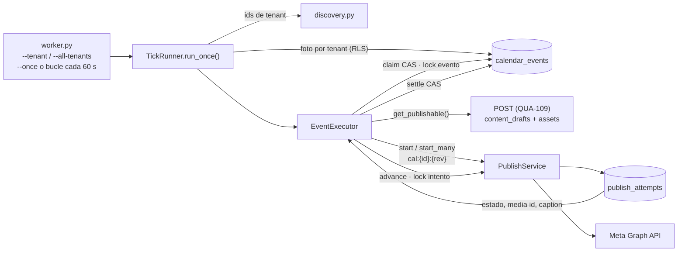
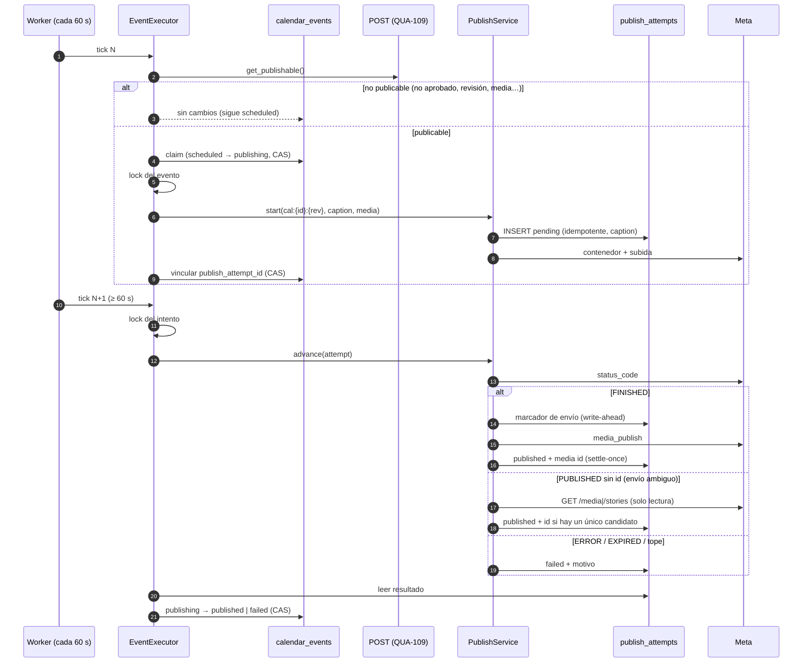
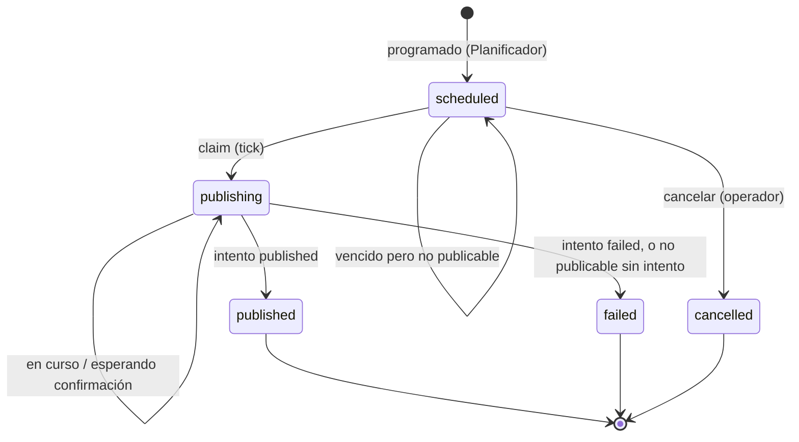

# QUA-111 — Automatización del Planificador: ejecución de Calendar Events

`[IMPLEMENTADO 2026-09-27 · rama yroa1402/qua-111-…]` Documento de decisión y de funcionamiento del ejecutor automático del Planificador. Cumple el primer entregable del ticket (el documento del mecanismo) y deja los UML con la implementación final.

**Regla de negocio (Herwin):** `scheduled_at` alcanzado + POST aprobado → se publica con el publisher existente. POST no aprobado → no se publica y el evento sigue pendiente.

---

## 1. Decisión del mecanismo

### Contexto verificado en el repo

- No hay Celery, colas ni workers. `docker-compose.yml` = Postgres + Redis. Redis se usa para locks cortos y tokens, no como cola.
- No hay Dockerfile, Procfile ni configuración de deploy, y **el hosting de producción no está decidido** ([prioridad-despliegue-subdominio.md](prioridad-despliegue-subdominio.md)).
- Los procesos del repo se ejecutan como app Reflex (`reflex run`) o como CLI `python -m …` lanzados por el `justfile` (`seed`, `refresh-referentes`, `classify-hashtags`).
- El polling de QUA-89 vive dentro de la sesión del navegador: **si nadie tiene la pestaña abierta, no corre**. Es el antecedente que no hay que copiar.

### Opciones comparadas

| Criterio | Cron que invoca un comando | Tarea periódica dentro de Reflex/FastAPI | **Worker dedicado con bucle** | Celery + Beat |
|---|---|---|---|---|
| Simplicidad | Alta | Media: se acopla al ciclo de vida del servidor web | **Alta** | Baja: broker, worker, beat y su despliegue |
| Supervivencia a reinicios | Sí (cada ejecución es nueva) | Muere y renace con la app web; con N réplicas corre N veces | **Sí (el estado está en Postgres)** | Sí |
| Exactamente una vez | Depende de los locks | Depende de los locks | **Depende de los locks** | Depende de los locks (Celery no lo garantiza solo) |
| Operación en el deploy real (sin decidir) | Necesita un cron en el host | Solo si la app web está siempre viva | **Cualquier host que pueda correr un proceso** | Necesita infraestructura nueva |
| Coste | Nulo | Nulo | **Nulo** | Redis como broker + procesos extra |
| Reutilización (vídeo de QUA-110, reconciliación) | Otro comando por job | Mezcla jobs con la web | **El mismo patrón de CLI** | Alta, pero adelanta Fase 1 Parte 3 (F6) |

### Decisión

**Un único punto de entrada, `python -m qualify_api.planner.worker`, que sirve para las dos formas de ejecución más baratas:**

- **Worker dedicado** (modo por defecto): un proceso de larga duración que ejecuta un tick cada `--interval` segundos (60 por defecto).
- **Cron o job de plataforma** (`--once`): un tick por invocación. El planificador externo decide la frecuencia.

Se descartan la tarea dentro de la app web (acopla la publicación al servidor HTTP y se multiplica con las réplicas) y Celery + Beat (infraestructura nueva para un solo job; es la decisión F6 del fundador y adelanta la Parte 3). **La corrección no depende de cuál se elija**: la exclusión y la idempotencia viven en la base de datos (§4), así que un cron y un worker a la vez, o dos workers, son seguros.

### Enmienda 2026-09-29 — el worker corre dentro de la app (rama `feat/planner-default-timezone-caracas`)

**Problema observado:** un evento aprobado programado a las 4:35 p. m. Caracas venció y quedó en `scheduled`. El evento y la lógica estaban bien; **ningún proceso ejecutaba el tick**. La decisión anterior dejaba el worker como un proceso aparte que nadie arrancaba: ni `reflex run`, ni `.claude/launch.json`, ni `just dev` lo inician, y el hosting de producción sigue sin decidir, así que ningún supervisor lo lanzaba. El diseño era correcto en sí, pero nada lo conectaba al funcionamiento de la app.

**Cambio:** el backend de Reflex arranca el mismo bucle (`run_worker` → `TickRunner`) en **un hilo propio con su propio event loop** al iniciar la app (lifespan task en `Qualify/Qualify.py`, módulo `planner/embedded.py`). Si la app está levantada, las publicaciones programadas se procesan; nadie tiene que acordarse de un comando.

Por qué esto no reabre las objeciones de la tabla:
- **"Se multiplica con las réplicas":** es seguro por diseño (§4). N procesos, o la app más un CLI/cron, publican cada evento una sola vez; lo cubren los tests `test_two_embedded_workers_publish_an_event_once` y `test_two_concurrent_ticks_do_not_duplicate_a_publication`.
- **"Acopla la publicación al servidor HTTP":** el tick corre en su propio hilo, así que las llamadas síncronas a Postgres, R2 y Meta no bloquean los websockets. Quien quiera separarlo pone `QUALIFY_CALENDAR_WORKER=off` y corre el CLI de §2, que sigue igual.

Configuración (variables de entorno, leídas al arrancar; `.env` sirve):

| Variable | Valores | Por defecto |
|---|---|---|
| `QUALIFY_CALENDAR_WORKER` | `embedded` \| `off` | `embedded` |
| `QUALIFY_CALENDAR_WORKER_TENANTS` | vacío o `all` \| UUIDs separados por coma | **vacío = todas las cuentas conectadas** (comportamiento normal del producto). Una lista de UUIDs es una **restricción explícita** para desarrollo o pruebas, nunca el mecanismo para habilitar una cuenta |
| `QUALIFY_CALENDAR_WORKER_INTERVAL` | segundos, mínimo 30 | 60 |

**Descubrimiento automático (por defecto).** En cada tick, `DiscoveredTenants` lee con `admin_session` solo los ids de los tenants que tienen un evento vencido cuya **propia conexión está `active`**, o un evento en `publishing`. Una cuenta que se conecta después del arranque entra en el siguiente tick: no hay que tocar `.env`, código ni reiniciar. Todo lo que sigue va por `tenant_session(tenant_id)` con RLS. Un evento no puede apuntar a la conexión de otro tenant, porque la FK de `calendar_events` es compuesta `(connection_id, tenant_id)`.

**Cuenta sin conexión activa.** El tenant no se descubre. Si igualmente llega a un tick (por un worker restringido), el ejecutor comprueba la conexión antes del claim y devuelve `NOT_READY` con `reason=connection_not_active`: el evento sigue `scheduled`, sin error, sin intento y sin fallo, igual que un POST sin aprobar. Se publica en el primer tick después de reconectar la cuenta.

**Aviso del Planificador** (modal del evento):

| Estado | Mensaje |
|---|---|
| Worker activo y la cuenta tiene una conexión activa | "Publicación automática activa…" |
| Worker activo y sin conexión activa | Aviso: conectar una cuenta en Conexiones |
| Worker no activo (apagado, mal configurado o restringido a otros tenants) | Aviso: el servicio de publicación automática no está disponible |

**Base de desarrollo compartida con los tests.** Con el valor por defecto, el worker local también procesa los tenants que dejan los tests `db` (hoy unos 200, con cientos de eventos en `publishing` sobre conexiones sin credenciales). No pueden llegar a Meta sin credenciales, pero cada tick tarda unos 50 s en recorrerlos. Mientras corren los tests `db`, conviene levantar la app con `QUALIFY_CALENDAR_WORKER=off` para que el worker no compita con ellos.

**Caída y reinicio:** el primer tick corre al arrancar. Un evento vencido sigue vencido (`scheduled_at <= now`) y se ejecuta en ese tick. Un evento en `publishing` se reanuda o se avanza. Si el intento ya existía, se vuelve a enlazar por su clave de idempotencia y nunca se envía dos veces. Lo cubre el test `test_a_worker_restart_mid_publication_resumes_without_publishing_twice`.

---

## 2. Cómo se ejecuta

| Entorno | Comando | Alcance |
|---|---|---|
| Local / desarrollo | `just calendar-worker --tenant <uuid>` o `just calendar-tick --tenant <uuid>` | **Solo ese tenant.** Obligatorio en local: la base de desarrollo tiene tenants de prueba sobre los que un tick de producción actuaría |
| Producción, proceso siempre vivo | `python -m qualify_api.planner.worker --all-tenants` bajo el supervisor del host (systemd, contenedor con reinicio, etc.) | Todos los tenants con trabajo |
| Producción con cron | `* * * * * python -m qualify_api.planner.worker --once --all-tenants` | Todos los tenants con trabajo |

- **El alcance es obligatorio:** `--tenant <uuid>` (repetible) o `--all-tenants`. No hay un valor por defecto que signifique "todos".
- **Frecuencia:** 60 s (mínimo 30 s), medidos de inicio a inicio. Es la cadencia de sondeo que recomienda Meta para los contenedores; cada tick avanza un paso cada publicación en curso.
- **Configuración:** lee `.env` de la raíz (Meta, R2, DSNs), igual que los demás CLI del repo. **Publica de verdad** en las cuentas conectadas del alcance.
- **Salida:** `--once` devuelve 0, o 1 si el tick no pudo ni listar sus tenants. En modo bucle, Ctrl+C termina con 0.

---

## 3. Qué hace cada tick

Código: `planner/worker.py` → `planner/tick.py` (`TickRunner.run_once`) → `planner/executor.py` (`EventExecutor`) → `publishing/service.py` (`PublishService`, sin cambios de diseño).

1. **Tenants.** `--tenant` usa exactamente esos, sin leer otros. `--all-tenants` hace una sola lectura con `admin_session`, `SELECT DISTINCT tenant_id` de los eventos vencidos o en curso: solo ids, ninguna fila de evento ([`planner/discovery.py`](../packages/api/src/qualify_api/planner/discovery.py)).
2. **Por tenant**, con su propio manejo de errores y una **foto tomada al principio** (todo por `tenant_session`, bajo RLS):
   1. eventos `publishing` **con** intento → un `advance()` y, si el intento terminó, la liquidación del evento;
   2. eventos `publishing` **sin** intento → retomar el inicio (caída entre el claim y el vínculo);
   3. eventos `scheduled` vencidos → evaluar el POST, claim e inicio de la publicación.
   Solo se procesa la foto: lo que aparece o se inicia durante el tick espera al siguiente. `run_once()` nunca espera ni reintenta.
3. **Errores:** el error de un evento se registra y el tick sigue con el siguiente; el de un tenant, lo mismo con el siguiente tenant. Un tick que falla entero lo registra el worker, que sigue.

### Ventana de ejecución de 24 h (QUA-115)

Un evento `scheduled` solo se ejecuta mientras `scheduled_at <= now < scheduled_at + 24 h` (`rules.EXECUTION_WINDOW`). La ventana es semiabierta: en el instante exacto `scheduled_at + 24 h` el evento ya está vencido. Aplica a **todo** evento `scheduled`, esté aprobado o no: un POST aprobado tarde se publica si la aprobación llega dentro de la ventana, y un worker caído más de 24 h no "recupera" publicaciones al volver.

El vencimiento es **derivado** de `scheduled_at`: no hay estado ni columna nuevos, y la FSM no cambia. Tres capas lo garantizan, de fuera hacia dentro: `list_due` no devuelve vencidos (`scheduled_at > now - 24 h`), `claim` lleva la misma condición en su `WHERE` (un snapshot anterior al cierre de la ventana no puede reclamar después), y `EventExecutor.try_execute` lo comprueba con su reloj y devuelve `NOT_READY` con motivo `expired` antes de mirar la conexión o el POST.

En el Planificador el evento sigue `scheduled` y se muestra como **"Venció"** (tiene precedencia sobre "Venció sin aprobación"), con la nota de reprogramar. **Reprogramar** es el único camino de vuelta y reutiliza el flujo existente: exige un instante futuro, sube `revision` (clave de idempotencia nueva) y el siguiente tick lo trata como cualquier evento pendiente.

### El POST que se publica (contrato con QUA-109/110)

El ejecutor lee el POST con `PostReader.get_publishable()` ([`planner/publishable.py`](../packages/api/src/qualify_api/planner/publishable.py), la única regla, compartida con la tarjeta del calendario). Solo publica si **todo** esto se cumple; si no, devuelve el motivo y el evento sigue `scheduled`:

- aprobado, y `revision == approved_revision` (una edición posterior a la aprobación bloquea);
- variante elegida legible: el caption es `CopyPayload.rendered_caption()`;
- categoría: `galeria` (1 imagen → IMAGE, 2–10 → CAROUSEL), `reel` (1 vídeo → REELS), `story` (1 vídeo → STORIES). No se publican `tiktok_video` ni una categoría nula o desconocida. La story de **imagen** no entra por la categoría sino por la salida `story` de un POST del motor de plantillas (sección siguiente);
- media en R2 bajo `t/{tenant_id}/…`, con `content_type` (`image/jpeg`, `video/mp4` o `video/quicktime`) y posiciones únicas.

### Eventos por salida (MP-11)

Un POST del motor de plantillas (`docs/plan-mvp-plantillas-remotion.md` §2.2) deja varias salidas en `image_assets`, nombradas por `output_port` (migración 0038): un Reel 9:16 en vídeo, un feed 4:5 y una historia 9:16 en imagen. Evaluado entero, ese paquete no es ninguna forma publicable (`category=reel` + vídeo + dos imágenes → `UNSUPPORTED_SHAPE`), así que **se programa y publica por salida** — el contrato que pidió `docs/ux-plantillas-en-el-post.md` §3.5:

- **`calendar_events.output_port`** (migración 0040, `text NULL`). `NULL` = el POST entero, el comportamiento de todos los eventos anteriores. Un POST con salidas lleva **un evento por salida**, a la misma hora o a distinta; una reprogramación nunca cambia la salida.
- **`PlannerService.schedule(output_port=…)`** valida que el puerto exista entre las salidas del POST (`PostSummary.outputs`) — un POST con salidas exige un puerto (`OutputRequired`), uno sin salidas solo admite `None` (`UnknownOutput`) — y rechaza un segundo evento vivo para la misma `(POST, salida, cuenta, instante)` (`DuplicateEvent`). El POST sigue en «Sin programar» mientras alguna salida no tenga evento vivo.
- **Lectura publicable:** `PostReader.get_publishable(output_port=…)` entrega **solo** los `image_assets` de ese puerto (renumerados desde la posición 0) y `media_product_type` sale del **puerto**, no de la categoría: `reel` → REELS (un vídeo), `feed` → IMAGE (una imagen), `story` → STORIES (una imagen o un vídeo; el publicador publica stories de imagen desde QUA-113). Un puerto desconocido o con el tipo de archivo equivocado es `UNSUPPORTED_SHAPE` con el puerto en el detalle. Sin puerto, la regla anterior queda intacta.
- **Ejecutor:** `EventExecutor` pide al lector el puerto del evento y entrega al `PublishService` la salida con su `media_product_type`. El intento (`publish_attempts`) queda trazable a la salida por `calendar_events.publish_attempt_id` + `output_port` y por el log `calendar.started … output_port=`; no se añadió ninguna columna a `publish_attempts`. La clave de idempotencia sigue siendo `cal:{event_id}:{revision}`, distinta por evento, así que tres salidas son tres intentos.
- **Planificador (UI):** la tarjeta de «Sin programar» muestra un chip por salida con su estado («Reel · sin programar», «Feed · lun 12 · 12:00 p. m. · @bianki», «Historia · publicada»); «Asignar» añade el control **Salida** (Reel 9:16 · Feed 4:5 · Historia 9:16, preseleccionada la primera sin programar); en el calendario y la lista el evento lleva la palabra de su salida, porque el mismo POST aparece hasta tres veces en la semana.

---

## 4. Por qué nunca se publica dos veces

| Riesgo | Mecanismo | Dónde |
|---|---|---|
| Dos procesos reclaman el mismo evento | **Claim atómico:** un `UPDATE … WHERE status='scheduled' AND revision=:r AND scheduled_at<=now RETURNING` | `PlannerRepository.claim` |
| El operador reprograma o cancela durante el claim | Reprogramar y cancelar exigen `scheduled`, así que pierden contra el claim | FSM y repositorio |
| Dos procesos inician el mismo evento | **Lock del evento** (`pg_try_advisory_xact_lock`) durante todo el inicio | `planner/locks.py` |
| Caída entre el inicio y el vínculo | Clave determinista `cal:{event_id}:{revision}` + `UNIQUE(connection_id, idempotency_key)`: repetir el `start()` devuelve el intento existente sin llamar a Meta | `PublishService.start` |
| Dos procesos avanzan el mismo intento | **Lock del intento** durante `advance()`. El marcador de envío no es un compare-and-set: sin el lock, dos procesos podrían llamar dos veces a `media_publish` (lo demuestra un test de diagnóstico) | `EventExecutor.advance_event` |
| Envío ambiguo (timeout) | A6-min: el marcador se escribe antes del envío y después solo se lee el estado del contenedor; nunca se reenvía | `PublishService._publish_once` |
| Doble liquidación del evento | Compare-and-set `publishing → published/failed` sobre estado, revisión e intento; la fila del intento es inmutable una vez liquidada (settle-once) | `settle_from_attempt` |

Los locks son de transacción: Postgres los libera al hacer commit, rollback o si el proceso muere. Un reinicio no deja nada bloqueado.

---

## 5. Resultado y trazabilidad

- **Evento:** `scheduled → publishing → published | failed`, siempre por la FSM del planner. Un `failed` libera el POST, que vuelve a "Sin programar".
- **Intento de publicación:** vinculado al evento (`calendar_events.publish_attempt_id`), con `idempotency_key`, `media_product_type`, **el caption enviado a Meta** (en todos los tipos) y `published_media_id`.
- **`published_media_id`:**
  - camino normal: lo devuelve `media_publish`;
  - si el envío fue ambiguo y Meta confirma después con el estado `PUBLISHED`: el contenedor no expone el id, así que se **recupera en solo lectura** listando los media recientes de la cuenta (`/media` o `/stories`) y se acepta **solo si hay un único candidato** que coincide en superficie, hora, caption y no pertenece a otro intento. Si no hay candidato inequívoco, queda vacío y se registra `media_id_unresolved`: nunca se adivina ni se vuelve a publicar.

---

## 6. UML

### Flujo

### Secuencia de una publicación

### Estados del evento

### Estados visibles y regla de asignación (QUA-118, 2026-10-05)

La FSM no cambia; cambia lo que el Planificador **muestra** y lo que **deja entrar**. Decisiones del fundador, `docs`/Linear QUA-118 Fase A:

- **Cinco estados visibles, y solo cinco** (`Qualify/planner_vm.py`, `status_label`): **Programado** (`scheduled`, POST aprobado, dentro de la ventana), **Pendiente** (`scheduled` con el POST ya no aprobado — solo alcanzable editando un POST aprobado, que vuelve a `generated`), **Publicado** (`published`), **Vencido** (`scheduled` fuera de la ventana de 24 h, aprobado o no; sustituye a «Venció» y «Venció sin aprobación») y **Fallido** (`failed`). Ningún otro nombre: `publishing` se muestra como Programado durante los segundos del intento, y `cancelled` no se muestra nunca — «Cancelar publicación» recorre el edge `cancel` y retira la fila del calendario en el mismo paso (`PlannerService.cancel_and_delete`). La aprobación del POST es otro eje y no reutiliza esas palabras («En revisión», no «Pendiente»).
- **D1 — solo entra al calendario un POST aprobado y publicable.** `ApprovalStatus.is_schedulable` es `APPROVED` únicamente y `PlannerService.schedule` / `reschedule` exigen además `publishable.evaluate` en verde (para un POST con salidas, verde en la salida que se programa); el rechazo `PostNotSchedulable` lleva el motivo exacto del evaluador. **Esto invierte QUA-108 AC 4** («approval gates execution, not planning»): los tests «pending es asignable» de `test_planner_service.py` y `test_planner_ui.py` se reescribieron a propósito. El worker no cambia: su regla «no aprobado → el evento sigue pendiente» (§3) sigue siendo la segunda línea para el caso de edición posterior a la aprobación.
- **A2 — un POST `recurrente` nunca queda bloqueado** por una ocurrencia viva o publicada: `list_unscheduled` lo mantiene en «Sin programar» (`gallery.is_reusable`); cada ocurrencia es un `calendar_event` independiente con su propio estado, clave de idempotencia y resultado.
- **Story de imagen por categoría** (QUA-118 AC 6): `story` + una imagen → `STORIES` también sin puerto (`publishable.compatibility`), la decisión que MP-11 había dejado abierta. `compatibility(platform, category, media_types, output_port)` es además la regla de «esta cuenta admite esta forma» con motivo tipado (`CHANNEL_NOT_SUPPORTED` fuera de Instagram).
- **Historial del POST** (D2): `PostSummary.times_published` / `has_live_event` salen de un agregado sobre `calendar_events` en `DraftPostReader` (sin persistir nada) y alimentan el estado derivado de la galería (`planner/gallery.py`: Borrador · Por completar · Listo · Usado · Desechado), otra entidad distinta de los cinco estados del evento.

---

## 7. Límites conocidos (no bloquean el ticket)

- **Esperando confirmación:** un envío ambiguo sin veredicto de Meta mantiene el evento en `publishing` y cuesta una llamada de estado por tick. Resolverlo de forma automática es la reconciliación completa (A6).
- **Otros llamadores de `advance()`** (la ruta HTTP de publishing y la pantalla Publicar) no usan el lock del ejecutor. Hoy no conocen los intentos del calendario.
- **Un intento cuyo `client_for` o `container_status` falla en cada paso** nunca llega a comprobar el tope, así que no se liquida; el tick lo reporta cada vez.
- **Contrato con QUA-109/110:** hoy los POST generados no son publicables (assets en `generated/…`, sin `content_type`, PNG). Los requisitos que deben cumplir están en §3 y en los tickets.

## 8. Verificación

- Tests: `test_planner_executor.py`, `test_planner_db.py` (Postgres real, concurrencia con hilos y barreras; MP-11: un POST con tres salidas → tres eventos → `evaluate` da REELS / IMAGE / STORIES y el ejecutor arranca el Reel desde su propio puerto), `test_planner_publishable.py` (matriz por puerto, historia de imagen), `test_planner_service.py` (puerto obligatorio, duplicados, «Sin programar» por salida), `test_planner_worker.py`, `test_planner_thumbnail.py`, `test_publishing_service.py`, `test_publishing_client.py` y, en `Qualify/`, `test_planner_ui.py` (chips, control «Salida», preselección).
- E2E real en localhost (2026-09-27, PuntoServis, @qualifymkt.co): dos Reels publicados de principio a fin (`scheduled → publishing → published`), un intento por evento, caption idéntico en Graph y un tick posterior sin efecto. El worker se validó en local con `--once` y en bucle, sin publicar.
