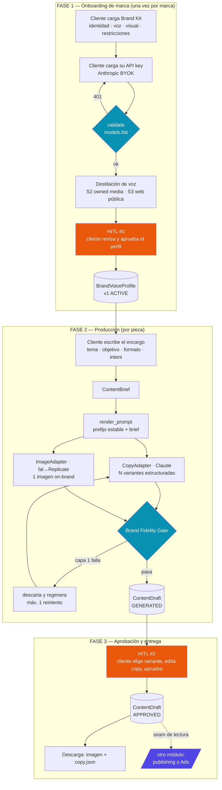
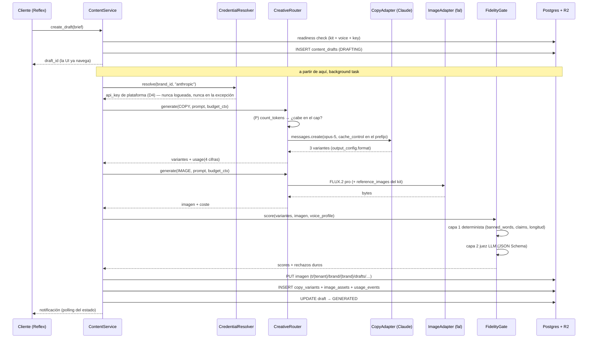

# Diseño técnico — Motor de Contenido de Marca (MVP)

**Fecha:** 2026-08-16 · **Estado:** `[DISEÑO — para revisión antes de codear]`
**Backlog que implementa:** [`docs/backlog-motor-contenido-marca.md`](backlog-motor-contenido-marca.md)
**Decisión rectora:** [ADR 32](adr-32-motor-angulos-creativo.md) + el ADR 34 pendiente (`MC-00`)

Este documento fija **objetivo, flujo, contratos, firmas, endpoints y UI** antes de escribir código. Lo que no esté aquí, no se implementa sin volver a este doc.

---

## 1. Objetivo final del módulo

> **Convertir un encargo del cliente en una pieza publicable que suena y se ve como su marca — copy estructurado + imagen — aprobada por un humano, y entregarla como un artefacto direccionable que otro módulo consume: publicación orgánica o decisión de Ads.**

Tres precisiones que definen el borde, decididas con el fundador el 2026-08-16:

1. **El módulo NO publica.** Termina en el `ContentDraft` aprobado y su asset en R2. Publicar es del módulo de publishing (migración `0003`); decidir si va a Ads es de otro. Esto corta la dependencia de Parte 4 y permite demostrar el módulo sin una cuenta Meta conectada.
2. **El módulo NO decide qué publicar.** El cliente trae el encargo (tema, producto, objetivo). Decidir el *qué* es el Motor de Ángulos (ADR 32, Épica B), bloqueado por el gate de datos. Aquí se ejecuta con la voz de la marca.
3. **El operador es el cliente final**, en su propio tenant. Eso obliga a onboarding autoservicio del brand kit y de la key BYOK, y a que la UI bloquee la generación hasta que la marca esté lista — no a que falle a medio camino.

### 1.1 La consecuencia de "listo para publicar o para Ads" que cambia el contrato

Orgánico y Ads **no consumen la misma forma de copy**. Un caption de Instagram es un bloque con hashtags; un anuncio de Meta necesita campos separados — texto principal, titular, descripción, tipo de CTA — que se renderizan en sitios distintos del creativo. Si el módulo devuelve un blob de texto, el módulo de Ads no puede consumirlo sin volver a llamar a un LLM, y ahí se pierde la garantía de tono que es todo el punto.

**Por tanto el copy se genera estructurado desde el principio**, y el brief declara su `intent`. Es la diferencia entre entregar un artefacto y entregar un texto.

Lo mismo aplica a la imagen: Ads pide otras relaciones de aspecto. El MVP genera **una**, pero persiste el prompt renderizado, el modelo y sus parámetros, de modo que re-renderizar a 1:1 o 9:16 sea barato y determinista más adelante. No es una feature del MVP; es no cerrarse la puerta.

### 1.2 Decisiones cerradas (fundador, 2026-08-16)

| # | Decisión | Consecuencia |
|---|---|---|
| D1 | **El módulo publica, y publicar es la única salida.** *(Revisada 2026-08-16 — publicar en cuentas propias sin App Review está probado en campo.)* Aprobar → publicar vía `publishing/` (migración `0003`). **Sin descarga**: se elimina la ruta de export `.zip`. | Encaja con el modelo firmado `1 login = 1 tenant = 1 negocio` ([modelo de negocio](modelo-negocio-operador-multi-emprendimiento.md)): el operador gobierna **negocios propios**, que es el carril *«my app is only for a business I own or manage»* → Standard Access, sin App Review. El cliente externo queda fuera del MVP por prioridad del fundador. El seam `ApprovedCreative` se mantiene: publicar y Ads son dos consumidores del mismo artefacto. |
| D2 | **`CopyPayload` se queda como está** — anuncio de imagen única. Ads = publicidad en feed/Reels, no display web. | Carrusel es *nice-to-have* futuro; añadir `ads_cards` será un cambio de columna `JSONB`. Ver §1.5 para la restricción de placement que esto arrastra. |
| D3 | **Cuatro rutas HTTP.** | El contrato de salida real es el import de Python. Se añaden rutas cuando exista un consumidor fuera del proceso, no antes. |
| D4 | **Qualify paga toda la generación.** *(Revisada — opción C.)* Sin BYOK en el MVP. | Desaparecen `provider_credentials`, el muro de onboarding y toda la superficie de custodia por marca. **A cambio, el cap deja de ser un guardarraíl y pasa a proteger dinero real de Qualify** — `hard_stop_on_cap` se vuelve financieramente cargante. El camino natural es créditos (ADR 32 D8). Ver §7.5. |
| D5 | **Instagram feed 4:5.** La imagen tiene **tres** rutas, no dos (§1.3), y la de foto propia **no usa modelo de imagen**. | Canva descartado para el MVP por gate de Enterprise (§1.4). |
| D6 | **Ejecución en proceso (`BackgroundTasks`/`asyncio`), Celery como deuda técnica** con contrato de migración fijado. | Ver §7.4. Suficiente para un cliente; la frontera está puesta para que migrar sea cambiar el invocador. |
| D7 | **Sin R2 en el MVP**: se vive sobre la URL del proveedor, con contador de caducidad en la UI. R2 como deuda. | Viable porque fal da **≥7 días** y permite fijar el lifecycle por request; Replicate da **1 hora**. La ventana es por proveedor, no constante. §5.1 y §7.6. |
| D8 | **Solo 4:5 en el MVP.** `REELS_9_16` visible y **deshabilitado** en `/create`, con tooltip. | El recordatorio vive donde se va a necesitar. Nunca se implementará como recorte del 4:5. §1.5. |
| D9 | **Composición con Pillow**, plantilla autoría en Canva exportada a PNG. No se usa la API de imagen para poner texto. | §1.4. Un modelo generativo no garantiza tu cadena exacta ni deja la foto intacta — y ambas cosas son requisitos, no preferencias. |
| D10 | **`RESTYLE_UPLOAD` se parte en `RESTYLE_ENHANCE` y `RESTYLE_SCENE`.** `ENHANCE` entra al MVP. | La frontera de etiquetado de IA de Meta pasa entre las dos. `ENHANCE` es además la ruta nº2 real de los dos negocios del operador: fotos de teléfono en local pequeño. |
| D11 | **Las rutas son submódulos en un acordeón, en orden fijo**, y `GENERATE` va la última con aviso **«NO RECOMENDADA»**. | El orden de la UI *es* la recomendación. Un desplegable neutro las presentaría como equivalentes, que es justo lo que la evidencia dice que no son. §6.4 |
| D12 | **`brand_kit.image_policy` + `ContentDraft.requires_ai_disclosure`.** | La política deja de depender de la memoria de quien redacta el brief, y la obligación de etiquetar viaja con el artefacto hasta el módulo de Ads. |
| D13 | **Vídeo: efectos deterministas sobre metraje propio (ffmpeg), declarados en el brief.** Vídeo generado queda como última opción, igual que `GENERATE`. | §1.7. Retroceso y cámara lenta sobre tu propio vídeo son gratis, instantáneos y no requieren etiqueta. |
| D14 | **`1 tenant = 1 brand`.** *(Fundador, 2026-08-18 — «multibrand es complicado ahora».)* Bianki y Polet son **dos tenants**, con login propio cada uno. | Coherente con el ruling firmado `1 login = 1 tenant = 1 negocio`, sin switch. **Simplifica el módulo:** no hay selector de marca en ninguna pantalla, `brand_kit` es único por tenant y `readiness` deja de necesitar un `brand_id` de entrada. Contrapartida en §7.7. |
| D15 | **Bucle LLM→render→visión para autoría de plantillas** (N1 en MVP; N2+N3 después). El LLM diseña *dentro* del kit; lo aprobado se congela. | §1.9. El render gratis es lo que hace viable el bucle: iterar cuesta solo los tokens del LLM. |
| D16 | **`template_id`+`template_version` en la provenance de cada pieza** → rendimiento por plantilla medible con insights de owned media. | §1.9. «La v2 rinde 40% más que la v1» se vuelve una frase calculable. Loop de ADR 32 D16 sobre datos que ya existen. |
| D17 | **`brand_kit.photo_recipe`**: parámetros de tratamiento de foto descubiertos una vez (con LLM + visión), aplicados gratis para siempre. | §1.9. «Se paga por descubrir, no por repetir» — fundador, 2026-08-18. |
| D18 | **`photo_recipe` produce `(foto, máscara)`, no una foto recortada.** Segmentación local con `birefnet-general-lite` (MIT); la máscara se persiste y cinco features la consumen. | §1.10. Una inferencia, muchos usos. Veto de licencia: nunca `bria-rmbg`. Upgrade a `fal-ai/birefnet/v2` por el `FalAdapter` existente. |

### 1.3 Las cuatro rutas de imagen, en orden fijo de preferencia

**El orden es la decisión de producto, no una lista de opciones equivalentes.** Va de "no se toca ni un píxel del sujeto" a "el sujeto es inventado", y la UI lo presenta exactamente en ese orden (§6.4). El criterio que lo gobierna es uno solo:

> **¿La imagen representa algo concreto que la persona va a recibir?**
> Si sí, los píxeles de esa cosa no se inventan.

| # | Ruta | Qué hace | ¿Etiqueta IA de Meta? | Coste | MVP |
|---|---|---|---|---|---|
| **1º** | **`FROM_UPLOAD`** | Tu foto real, intacta, dentro del marco de marca. Composición determinista | **No** — no interviene IA | **$0** | ✅ |
| **2º** | **`RESTYLE_ENHANCE`** | Luz, color, contraste, limpieza de fondo, upscaling **sobre tu foto real** | **No** — Meta exime corrección de color, recorte, limpieza y upscaling | ~$0.03 | ✅ |
| 3º | `RESTYLE_SCENE` | Tu producto real llevado a un fondo o contexto nuevo | **Sí** — compone/modifica sustancialmente | ~$0.03 | ⬜ |
| 4º | `GENERATE` | Text-to-image: el sujeto lo crea el modelo | **Sí** — genera el sujeto | $0.03–0.09 | ⚠️ con aviso |

**Por qué `FROM_UPLOAD` no usa un modelo de imagen.** Meter la foto de un producto o un inmueble por un modelo image-to-image es pedirle a un generador que reinterprete un activo que debe ser fiel. Aunque el 95% de las veces salga bien, el 5% restante es una fachada que cambió o un plato que no es el que sirves — publicado a nombre de tu marca. Una plantilla compuesta en código **no puede inventar**: pone la foto tal cual dentro del marco. Además es gratis, instantánea y reproducible byte a byte.

**Por qué la frontera entre `ENHANCE` y `SCENE` no es cosmética.** Pasa exactamente por donde Meta traza la suya (§3 de [`estrategia-contenido-bianki-polet.md`](estrategia-contenido-bianki-polet.md)): corregir luz y color no requiere etiqueta; componer una escena nueva sí. Tenerlas como una sola ruta obligaría a decidir caso por caso si la pieza necesita divulgación — y «Undisclosed AI Content» es en 2026 la tercera causa de rechazo de anuncios en Meta, con el 14% del total. La distinción vive en el enum para que no dependa de que alguien se acuerde.

**`GENERATE` no se elimina, se degrada.** Sigue siendo legítima para piezas **sin producto**: una promo de catering, una placa de horarios, un fondo abstracto. Pero aparece la última y con aviso explícito, porque en las categorías reales del operador —comida y bebida— la imagen generada de producto es activamente contraproducente.

**Dos campos que esto obliga:**

- **`brand_kit.image_policy`** — qué rutas están permitidas *para esa marca*. Para Bianki y Polet, `GENERATE` de producto queda bloqueado por política, no por criterio del momento. La capa 1 del gate rechaza un brief que pida una ruta bloqueada **antes de gastar**.
- **`ContentDraft.requires_ai_disclosure`** — derivado de la ruta usada y propagado en `ApprovedCreative`. Cuando la pieza vaya a un anuncio, el módulo de Ads tiene que saber que hay que marcarla.

La foto se sube por `rx.upload` y se estaciona con el `MediaStagingService` que ya existe (`stage_media`), bajo el prefijo del tenant. No hace falta ruta HTTP nueva.

### 1.4 Canva — evaluado, descartado, y por qué la primera razón que di era la equivocada

La idea va justo al problema de "toma mi foto y ponla on-brand": el Brand Kit y las Brand Templates de Canva son literalmente eso, y la **Autofill API** rellena una plantilla de marca con texto e imágenes subidas. Técnicamente encaja.

**Primera lectura (incorrecta):** que el gate de Enterprise mata la idea porque *«la suscripción del desarrollador no se extiende a los usuarios de la integración»* — o sea, una licencia por cliente. **Eso solo aplica cuando los usuarios son terceros.** Bajo el modelo firmado de operador multi-emprendimiento los negocios son **propios**: hay un único usuario de la integración, el propio operador, y **una sola organización Enterprise bastaría** para todos sus negocios. El razonamiento del fundador era correcto.

**Lo que sí la mata es el precio de entrada.** Canva Enterprise es plan con presupuesto a medida y **mínimo de asientos**: las fuentes secundarias consultadas (2026-08-16) dan **$30–50 por asiento/mes** con mínimos que van de 25 a 150 asientos según la fuente. Incluso en la lectura más favorable —25 asientos a $30— son ~$750/mes para un operador que necesita **uno**. `[S]`

**Qué se conserva, y es lo bueno:** el valor real de Canva aquí no es su API, es su **editor**. Diseñar plantillas de marca en Pillow significa maquetar por código, que es un proyecto en sí mismo. El camino intermedio evita las dos cosas:

> **Diseña la plantilla en Canva (plan Pro/Teams, sin API), expórtala como PNG con la zona de la foto transparente, y que Pillow solo componga: foto detrás, plantilla encima.** La plantilla es entonces un PNG + un JSON con las coordenadas del hueco. Se autoría visualmente, se renderiza determinista, no hay dependencia de red en el camino caliente y no hay Enterprise.

Si algún día el operador acaba en Enterprise por otro motivo, el adaptador de Autofill entra por el mismo seam sin tocar el motor. **Acción concreta si quieres certeza sobre el precio:** pedir presupuesto a ventas de Canva para 1–5 asientos; los mínimos publicados hacen improbable que salga, pero es una llamada, no una suposición.

### 1.5 La restricción de placement que arrastra "Ads = Reels"

Un anuncio en Reels no es un 4:5 de feed: es **9:16 (1080×1920)**, y Meta reserva zonas de la pantalla para su propia interfaz. Según la consolidación de marzo de 2026: **14% superior** para el perfil y la etiqueta *Sponsored*, **35% inferior** para el CTA y el caption — queda un **51% central utilizable**. Lo que caiga fuera lo tapa la interfaz.

Consecuencia para este módulo: cuando `intent` incluya `ADS` con placement de Reels, el sujeto y cualquier texto legible tienen que vivir en ese 51% central.

**Decisión (D8):** el MVP genera **solo 4:5**. `REELS_9_16` existe en el enum `ContentFormat` y aparece en `/create` **como opción visible pero deshabilitada**, con tooltip:

> *"Anuncio en Reels · 9:16 — próximamente. Requiere un render aparte con las zonas seguras de Meta (14% superior y 35% inferior reservados por la interfaz). Recortar el 4:5 no sirve."*

No es adorno: la opción deshabilitada es el recordatorio de que la promesa existe, puesta donde se va a necesitar en vez de enterrada en un backlog. Y **nunca se implementa como recorte del 4:5** — es un render nuevo desde el mismo brief, que es exactamente por lo que `image_assets` persiste `rendered_prompt`, `model_id` y `params`.

### 1.6 Criterio de éxito del MVP

El MVP está hecho cuando un cliente puede, **solo desde la UI y sin ayuda**: cargar su brand kit → aprobar su perfil de voz → pedir una pieza → recibir 3 variantes de copy + 1 imagen on-brand → editar, aprobar y descargar. Y cuando `MC-15` (kill criterion) puede medirse: el copy con perfil vence al copy con prompt libre en juicio ciego del propio cliente.

---

### 1.7 Vídeo — un editor ligero sobre TU metraje, no un generador

**Aclaración del fundador (2026-08-18):** no se trata de generar vídeo. Se trata de **cargar el clip ya grabado con el teléfono** y que el módulo lo vista: efectos de velocidad, textos y promociones que entran con *fade in* y salen con *fade out*, y cierre de marca.

Eso es exactamente el paralelo de `FROM_UPLOAD` en imagen: **tu material real, tratado de forma determinista, sin que ningún modelo lo reinterprete.** Es gratis, es instantáneo, no requiere etiqueta de IA de Meta y es lo que la categoría premia.

#### Lo que hace el submódulo

| Capa | Qué | Cómo |
|---|---|---|
| **Velocidad** | Cámara lenta (0.5× / 0.25×), retroceso, boomerang (ida+vuelta en bucle), rampa de velocidad, congelado de fotograma | `ffmpeg` — `setpts`, `reverse`, `concat` |
| **Encuadre** | Recorte a 4:5 o 9:16, corte a 7–10 s | `crop` + `trim` |
| **Marco de marca** | El mismo PNG de plantilla que usa `FROM_UPLOAD`, superpuesto durante todo el clip | `overlay` |
| **Textos y promos** | Tarjetas de texto que **entran con fade y salen con fade**: gancho al principio, precio o promo en medio | PNG renderizado con **Pillow** + `overlay` con `enable='between(t,a,b)'` y alpha animado |
| **Cierre** | Tarjeta final con logo y CTA, 2 s | `concat` |

**La reutilización que hace esto barato:** el PNG que enmarca una foto en `FROM_UPLOAD` **es el mismo PNG** que se superpone al vídeo, y las tarjetas de texto se renderizan con la misma maquinaria de Pillow. Una plantilla de marca, dos salidas. No hay un sistema de vídeo separado que mantener.

#### Cómo se declara, sin construir una línea de tiempo

Un editor con *timeline* es un producto en sí mismo y no es lo que necesitas. El MVP usa **franjas fijas**, que es un formulario y cubre el 90% de un Reel promocional:

```
  [ intro 0–1.5s ]  opcional · tarjeta de marca
  [ ────────── clip completo con marco de marca ────────── ]
       [ texto 1: entra 1.0s, dura 2.5s ]   fade 0.3s
                        [ texto 2: entra 5.0s, dura 2.5s ]  fade 0.3s
                                          [ outro 2s ] opcional · logo + CTA
```

Todo se elige **antes** de procesar, con vista previa, y se puede reprocesar cuantas veces haga falta: es determinista y cuesta $0.

#### Dos advertencias que no son técnicas

- **El retroceso funciona sobre un vertido y es desagradable sobre alguien comiendo.** Es criterio; por eso ningún efecto se aplica por defecto.
- **Música y audio quedan fuera a propósito.** Instagram penaliza el audio externo frente a su propia biblioteca, y se pone en la app en dos toques. Generar o montar audio sería gastar en algo que la plataforma prefiere que no lleves puesto.

#### Vídeo generado: última opción

Igual que `GENERATE` en imagen y por la misma razón. En comida y bebida un producto sintético **en movimiento** es aún más delator que uno estático. Queda declarado, con aviso, y fuera del MVP.

### 1.8 Las tres salidas de una pieza — y qué NO existe en Instagram

**Verificado contra el corpus de Meta en el repo (`reference/meta-instagram-platform/.../content-publishing.md`, 2026-08-18):**

**No existe «pre-publicar en Instagram para terminar de editarlo allí».** La API publica en dos pasos —crear un *media container* (`POST /{ig-id}/media`) y publicarlo (`POST /{ig-id}/media_publish`)— pero **ese contenedor no es un borrador de la app**: es un objeto de servidor que no se puede abrir ni editar en Instagram, y que **caduca a las 24 horas** si no se publica (`status_code = EXPIRED`). Los borradores que ves en la app de Instagram son una función del cliente móvil y la API no los expone. Cerrado: no se puede.

Lo que sí da el contenedor es un **punto de verificación propio**: se crea, se consulta su `status_code` hasta `FINISHED`, y solo entonces se publica. Eso convierte «publicar» en dos estados nuestros, no de Meta.

**Dato operativo del mismo documento:** una cuenta de Instagram admite **100 publicaciones por API en una ventana móvil de 24 horas** (un carrusel cuenta como una), y Meta recomienda que la propia app haga cumplir el límite. Para dos negocios que publican 3–4 veces por semana sobra por dos órdenes de magnitud; importa el día que exista programación automática.

#### Las tres salidas reales

| Salida | Qué hace | Cuándo |
|---|---|---|
| **Publicar** | Crea contenedor → verifica `FINISHED` → publica. La pieza queda `PUBLISHED` con su `media_id` | El camino normal |
| **Preparar** (staging propio) | Crea el contenedor y lo deja verificado, sin publicar. **Caduca en 24 h** y la UI lo dice | Cuando se quiere dejar listo y apretar el botón en otro momento |
| **Descargar → reeditar fuera → recargar** | Descarga imagen y copy; el operador los retoca en Canva u otra app; **vuelve a subir el archivo al mismo draft** y publica desde Qualify | Cuando la última milla necesita una mano humana |

**La tercera es la que devuelve la descarga que D1 había quitado**, pero con una condición que la hace distinta de «bajar el zip y arreglárselas»: **el archivo reeditado vuelve al mismo `ContentDraft`**. Sustituye la imagen, conserva el brief, el perfil de voz, la provenance y el coste, y publica desde Qualify.

Sin ese retorno se pierde lo que hace medible al módulo: si el operador edita fuera y publica a mano, Qualify no sabe qué se publicó, y `MC-15` —el kill criterion, ¿gana el contenido con perfil de voz al manual?— deja de poder calcularse. Por eso la pieza vuelve a casa antes de salir.

Esto añade un estado a la FSM, `STAGED`, entre `APPROVED` y `PUBLISHED`, con su `staged_expires_at`.

### 1.9 Submódulo de plantillas — el molde es el activo

**Validado con POC el 2026-08-18** (tres piezas de Polet con su branding real, renderizadas en 56 ms/pieza, $0, byte a byte reproducibles — `packages/creative/src/qualify_creative/templates/`). El principio que gobierna todo el submódulo, en palabras del fundador: **se paga por descubrir, no por repetir.**

| Concepto | Qué es |
|---|---|
| `BrandTemplate` | Layout declarativo en **coordenadas normalizadas 0..1** (~1,7 KB de JSON): cajas de foto, formas, zonas de texto con rol/peso/alineación. Una definición sirve a 4:5 y 9:16 |
| Render | Pillow, determinista: misma entrada → mismos bytes. 0 tokens, $0, ~56 ms |
| Autoría | Visual (Canva → PNG con hueco) o **generada por LLM** — ver el bucle abajo |

**El bucle LLM → render → visión (D15).** Como la plantilla es JSON pequeño y el render es gratis, un LLM puede *diseñar* plantillas nuevas: propone el JSON → Pillow renderiza (gratis) → un modelo de visión critica el PNG → corrige coordenadas → repite. Tres iteraciones cuestan céntimos de LLM y cero de render. Tres niveles, en orden de construcción:

1. **N1 — elegir y rellenar** (MVP): el LLM lee el brief y decide qué plantilla y qué valor va en cada hueco.
2. **N2 — diseñar plantillas nuevas**: «una para producto agotado, más atrevida» → JSON nuevo → se renderiza → se aprueba → **queda en la biblioteca para siempre**.
3. **N3 — auto-corrección con visión**: el bucle automatizado. N2 no es viable sin N3 — los LLM son malos con coordenadas a ciegas (solapan texto); la visión es lo que lo corrige.

Dos contenciones no negociables: el LLM compone **dentro** del `BrandKit` (paleta y tipografías salen del kit, no las elige él — sin esto, en un mes hay veinte estilos y ninguna marca), y **las plantillas que funcionan se congelan** — la pieza de cada día quiere estabilidad, no novedad.

**Plantillas × métricas (D16) — el oro.** Cada `ApprovedCreative` lleva `template_id` + `template_version` en su provenance. Cuando las métricas de owned media vuelvan por la conexión Meta (insights de la cuenta propia — no necesita Parte 3), la frase «la plantilla de precio v2 rinde 40% mejor que la v1» se vuelve **calculable**. Es la ventaja estructural de las plantillas sobre la imagen generada: las piezas de un mismo molde son comparables entre sí; cada imagen de IA es única y no hay nada que comparar. Este es el loop de aprendizaje de ADR 32 D16, aterrizado en el único plano de datos que ya existe.

**Tratamiento de foto como receta (D17).** El mismo patrón aplicado a la foto: los parámetros de recorte de producto (chroma key o segmentación, tolerancia, suavizado, sombra) se **descubren una vez** —con ayuda del LLM, mirando el resultado— y se guardan como `brand_kit.photo_recipe`. A partir de ahí el pipeline los aplica gratis en cada foto. Investigación de qué técnicas entran: `docs/research-features-tratamiento-foto.md` (en curso).

### 1.10 `photo_recipe` — el sustrato de foto

**Decidido 2026-08-18 (D18), validado con producto real el mismo día** (recorte BiRefNet sobre foto de mesa desordenada → pieza publicable, $0). Es el módulo que convierte la foto del teléfono en material de composición, y su contrato tiene una regla central:

> **La salida no es "la foto recortada" — es `(foto_normalizada, máscara)`.** La segmentación se corre **una vez** por foto y la máscara se persiste junto al asset. Cinco features la consumen sin volver a inferir: recorte, sombra sintética, preset de comida aplicado solo al sujeto, reencuadre 4:5→9:16 que nunca corta el producto, y colocación de texto que no lo tapa. Una inferencia, muchos usos — «se paga por descubrir, no por repetir» aplicado al píxel.

**Etapas del pipeline** (investigación: [`research-features-tratamiento-foto.md`](research-features-tratamiento-foto.md)):

| # | Etapa | Con qué | Nota |
|---|---|---|---|
| 1 | **Normalización** — los 4 fallos silenciosos: `exif_transpose`, HEIC, Display P3→sRGB, y export final con `UnsharpMask` + JPEG q85 | Pillow + `pillow-heif` | Sin esto, fotos de iPhone llegan giradas y con colores lavados. **Corre siempre**, incluso si el resto se desactiva |
| 2 | **Segmentación** → máscara persistida | `rembg[birefnet-general-lite]` (MIT — **nunca** el default `bria-rmbg`, licencia comercial de pago) | Local, ~2s CPU. Upgrade path sin arquitectura nueva: `fal-ai/birefnet/v2` por el mismo `FalAdapter`. Halo en cristal/espuma → escalada `-matting` → `_HR` → fal |
| 3 | **Derivados** — recorte, sombra (blur del alfa), preset cálido por marca (WB + CLAHE + saturación ≤+10 **solo sobre el sujeto**) | Pillow + OpenCV | Todos leen la máscara de la etapa 2; ninguno re-infiere |

Los parámetros de 1 y 3 viven en `brand_kit.photo_recipe` (D17): se calibran una vez por marca —con LLM + visión mirando el resultado— y el pipeline los aplica gratis para siempre.

**Extensión futura ya habilitada (v2, no se construye ahora):** secuencias animadas desde fotos — el recorte flotando con su sombra, fondo con parallax, textos con fade, ensamblado a MP4 9:16 por ffmpeg y audio puesto en la app de IG. La única primitiva nueva son **keyframes** sobre las mismas cajas normalizadas (`Box` como función del tiempo); todo lo demás — máscara persistida, composición declarativa, `TextOverlay` con timing, ffmpeg — ya está decidido y es exactamente lo que hace viable la extensión a ~15s de render y $0 por Reel, sin tocar un píxel del producto con un modelo. Para este efecto la ruta determinista no es la barata: es la mejor (fidelidad + reproducible + sin etiqueta de IA).

## 2. Flujo end-to-end

### 2.1 Las tres fases y sus tres puertas humanas



Las cajas naranjas son las puertas humanas; las cian son las puertas automáticas que pueden rechazar. La caja morada es el borde del módulo.

### 2.2 Secuencia de una generación (el camino caliente)



**Por qué el servicio responde antes de generar:** una generación de copy + imagen tarda entre 15 y 60 segundos. Bloquear la request es una mala UX y un timeout esperando a ocurrir. El `draft_id` se devuelve inmediatamente y la UI hace polling del estado — el mismo patrón que ya usa `connections_state` con sus `@rx.event(background=True)`.

### 2.3 Máquina de estados del draft

Réplica del patrón de `connections/fsm.py`: transiciones explícitas, tabla, y ninguna mutación de estado fuera de `apply_transition`.

```
                    ┌──────────────┐
                    │   DRAFTING   │  fila creada, trabajo encolado
                    └──────┬───────┘
              generate_ok  │  generate_fail / budget_exceeded / credential_invalid
              ┌────────────┴────────────┐
              ▼                         ▼
      ┌───────────────┐          ┌─────────────┐
      │   GENERATED   │          │   FAILED    │ (terminal; reason legible)
      └───┬───────┬───┘          └─────────────┘
   approve│       │reject
          ▼       ▼
  ┌────────────┐ ┌──────────────┐
  │  APPROVED  │ │   REJECTED   │──regenerate──► DRAFTING
  └─────┬──────┘ └──────────────┘
        │ export
        ▼
  ┌────────────┐
  │  EXPORTED  │  (no terminal: se puede re-exportar; sella exported_at)
  └────────────┘
```

Reglas duras:
- `APPROVED` exige `selected_variant_id` no nulo. Aprobar sin elegir variante es un estado que miente.
- Solo `APPROVED`/`EXPORTED` son visibles para el seam de lectura de otros módulos. Un draft `GENERATED` no es un artefacto, es trabajo en curso.
- `FAILED` guarda `failure_reason` como enum (`BUDGET_EXCEEDED`, `CREDENTIAL_INVALID`, `PROVIDER_ERROR`, `FIDELITY_REJECTED`, `REFUSAL`), no como texto libre: la UI tiene que poder decir qué hacer al respecto.

---

## 3. Contratos de datos

### 3.1 Esquema (migración `0005_creative`, RLS en la misma revisión)

Todas con `tenant_id UUID NOT NULL`, `ENABLE`+`FORCE` RLS y la policy `NULLIF(current_setting('app.tenant_id', true), '')::uuid` de la migración 0001. Todas con `created_at`/`updated_at`.

| Tabla | Claves | Columnas de fondo |
|---|---|---|
| `brand_kits` | PK `id`, UNIQUE `(brand_id)` | `positioning`, `audience`, `language`, `regional_variant`, `tone_axes JSONB`, `do_examples JSONB`, `dont_examples JSONB`, `banned_words TEXT[]`, `forbidden_claims TEXT[]`, `emoji_policy`, `hashtag_policy JSONB`, `cta_patterns TEXT[]`, `length_targets JSONB`, `palette_rgb TEXT[]`, `logo_asset_key`, `reference_image_keys TEXT[]`, `completeness_score` |
| `brand_voice_profiles` | PK `id`, UNIQUE `(brand_id, version)` | `version INT`, `status` (`PROPOSED`/`ACTIVE`/`SUPERSEDED`), `profile JSONB`, `sources JSONB` (provenance), `distilled_by_model`, `distilled_at`, `approved_by`, `approved_at` |
| ~~`provider_credentials`~~ | — | **Eliminada por D4.** Sin BYOK no hay credencial por marca: las keys de Anthropic/fal/Replicate son de la plataforma y viven en el entorno, como el resto de la configuración de despliegue. La tabla vuelve el día que aparezca un cliente que quiera traer su propia key |
| `creative_engine_config` | PK `id`, UNIQUE `(brand_id)` | `monthly_budget_cap_usd`, `budget_spent_usd`, `cycle_started_at`, `hard_stop_on_cap`, `on_credential_failure`, `hitl_required` (siempre `true`), `task_chains JSONB` |
| `content_briefs` | PK `id` | `brand_id`, `objective`, `topic`, `product_ref`, `platform`, `format`, `intent`, `constraints JSONB`, `created_by` |
| `content_drafts` | PK `id`, IDX `(brand_id, status, created_at DESC)` | `brief_id`, `status`, `failure_reason`, `selected_variant_id`, `voice_profile_version`, `pipeline_version`, `approved_by`, `approved_at`, `exported_at` |
| `copy_variants` | PK `id`, IDX `(draft_id)` | `draft_id`, `ordinal`, `copy JSONB` (la forma de §3.2), `edited_copy JSONB` (nulo si el humano no tocó), `fidelity JSONB`, `model_id`, `model_revision` |
| `image_assets` | PK `id`, IDX `(draft_id)` | `draft_id`, **`media_url`**, **`media_expires_at`** (el que devuelve el proveedor que sirvió — §5.1), `object_key` (nulo hasta que llegue R2), `width`, `height`, `aspect_ratio`, `rendered_prompt`, `model_id`, `provider`, `params JSONB`, `fidelity JSONB` |
| `creative_usage_events` | PK `id`, IDX `(brand_id, occurred_at)` | `draft_id`, `provider`, `model_id`, `unit` (`piece`/`token`), `input_tokens`, `output_tokens`, `cache_read_tokens`, `cache_creation_tokens`, `pieces`, `cost_usd`, `paid_by` (`tenant`/`platform`), `pricing_table_version` |

**Excepción deliberada de RLS:** ninguna. A diferencia de `ingestion.raw_payloads` (ADR 18), aquí todo es first-party y todo aísla.

**`provider_credentials.ciphertext` no es legible por `qualify_app`.** Igual que `oauth_credentials` en la migración 0002 (R3): el `GRANT` de columna se le da solo a `qualify_credential`. La UI no puede llegar a la key ni por error de código.

### 3.2 El contrato de copy — `CopyPayload`

El artefacto que consume el módulo de abajo. Pydantic en `qualify_creative.brand.schemas`.

```python
class CopyPayload(BaseModel):
    """Structured copy. Organic fields are always produced; ads fields only when the
    brief's intent includes ADS. Kept structured because an ads creative renders
    primary text, headline and description in different slots — a single caption blob
    would force the ads module to re-generate, losing the voice guarantee."""

    model_config = ConfigDict(frozen=True)

    hook: str                      # first line; the scroll-stopper, ≤ 60 chars
    caption: str                   # organic body, hook NOT repeated
    hashtags: tuple[str, ...]      # without '#', deduplicated, policy-capped
    cta: str

    ads_primary_text: str | None = None
    ads_headline: str | None = None       # ≤ 40 chars (Meta slot)
    ads_description: str | None = None    # ≤ 30 chars (Meta slot)
    ads_cta_type: AdsCtaType | None = None

    def rendered_caption(self) -> str:
        """The organic string as it would be pasted: hook, blank line, caption,
        blank line, hashtags. The only place that concatenation is defined."""
```

### 3.3 El resto de los contratos

```python
class ToneAxes(BaseModel):
    """Numeric, not adjectives — adjectives are unmeasurable and the fidelity judge
    needs something to score against. Each axis is 0..100."""
    formal_casual: int
    sober_enthusiastic: int
    technical_plain: int
    brief_elaborate: int


class BrandKit(BaseModel):
    brand_id: UUID
    positioning: str
    audience: str
    language: Language                    # es | en
    regional_variant: str                 # "es-CO", "es-UY" — el registro tú/usted/vos
    tone_axes: ToneAxes
    do_examples: tuple[str, ...]
    dont_examples: tuple[str, ...]
    banned_words: tuple[str, ...]
    forbidden_claims: tuple[str, ...]     # regulatorio; chequeo determinista
    emoji_policy: EmojiPolicy             # none | sparse | free
    hashtag_policy: HashtagPolicy         # {min, max, always: [...], never: [...]}
    cta_patterns: tuple[str, ...]
    length_targets: LengthTargets         # por plataforma/formato
    palette_rgb: tuple[str, ...]
    logo_asset_key: str | None
    reference_image_keys: tuple[str, ...] # ≤ 14 (tope de Nano Banana Pro)


class BrandVoiceProfile(BaseModel):
    brand_id: UUID
    version: int
    status: VoiceProfileStatus            # PROPOSED | ACTIVE | SUPERSEDED
    tone_axes: ToneAxes                   # destilados, pueden diferir del kit
    lexicon: tuple[str, ...]              # léxico recurrente propio de la marca
    avoid_lexicon: tuple[str, ...]
    sentence_rhythm: str
    signature_moves: tuple[str, ...]      # patrones retóricos propios
    sources: tuple[VoiceSource, ...]      # PROVENANCE OBLIGATORIA
    distilled_by_model: str
    distilled_at: datetime


class VoiceSource(BaseModel):
    kind: VoiceSourceKind                 # MANUAL_KIT | OWNED_MEDIA | PUBLIC_WEB
    ref: str                              # media_id, URL, o "brand_kit"
    excerpt: str                          # el fragmento que sostiene la inferencia


class ContentBrief(BaseModel):
    brand_id: UUID
    objective: BriefObjective             # AWARENESS | CONSIDERATION | LEAD | SALE
    topic: str
    product_ref: str | None
    platform: Platform                    # INSTAGRAM | FACEBOOK
    format: ContentFormat                 # FEED_POST (MVP) | STORY | REEL_COVER
    intent: BriefIntent                   # ORGANIC | ADS | BOTH
    image_source: ImageSource             # GENERATE | FROM_UPLOAD  (§1.3)
    source_image_key: str | None          # required when image_source is FROM_UPLOAD
    constraints: BriefConstraints         # must_mention, must_avoid, max_length override
    variants_requested: int = 3

    @model_validator(mode="after")
    def _upload_needs_a_key(self) -> "ContentBrief":
        """FROM_UPLOAD without a staged photo is a brief that cannot be executed. Caught
        here, at construction, and not three layers down inside the router."""


class FidelityVerdict(BaseModel):
    passed: bool
    hard_failures: tuple[HardFailure, ...]   # capa 1 — determinista, bloquea
    score: float                             # capa 2 — juez LLM, 0..1
    rationale: str
    judged_by_model: str | None
```

**Por qué `frozen=True` en `CopyPayload` y no en `BrandKit`:** el payload es un artefacto entregado — si el módulo de Ads pudiera mutarlo, la provenance dejaría de significar nada. El kit se edita constantemente.

---

## 4. Firmas

### 4.1 El seam de proveedores (`qualify_creative.providers`)

Mismo molde que `qualify_models.providers` y `qualify_scraper.client`.

```python
class GenerationTask(StrEnum):
    COPY = "copy"
    PRODUCT_IMAGE = "product_image"    # text-to-image, from the brief
    RESTYLE_PHOTO = "restyle_photo"    # image-to-image; declared, NOT in the MVP


# FROM_UPLOAD is deliberately absent from this enum: composing the client's photo into
# their brand frame is local rendering, not a vendor call. Giving it a fake provider so
# it could ride the router would buy uniformity and cost honesty — it has no key, no
# price and no failure mode worth a fallback chain.
def compose_branded_photo(
    *, photo: bytes, kit: BrandKit, template: BrandTemplate, copy: CopyPayload | None
) -> ComposedImage:
    """Deterministic: same photo + same kit + same template → identical bytes. Cannot
    invent content — that is the whole reason this path exists (§1.3)."""


@dataclass(frozen=True)
class GenerationRequest:
    task: GenerationTask
    rendered_prompt: RenderedPrompt        # §4.2 — el prefijo estable ya separado
    params: Mapping[str, object]
    output_schema: Mapping[str, object] | None   # JSON Schema para las tareas de texto


@dataclass(frozen=True)
class GenerationResult:
    payload: bytes | Mapping[str, object]  # bytes para imagen, dict validado para texto
    model_id: str
    model_revision: str | None
    usage: Usage                           # las 4 cifras de token, o pieces=1
    provider: str


class GenerationProvider(Protocol):
    """The single seam between the engine and any vendor. Business code imports THIS,
    never `anthropic` / `fal_client` / `replicate` — a static test enforces it."""

    name: str
    supports: frozenset[GenerationTask]

    def generate(self, request: GenerationRequest, *, api_key: str) -> GenerationResult: ...

    def estimate_cost_usd(self, request: GenerationRequest, pricing: PricingTable) -> Decimal:
        """Pre-flight estimate for the router's (P) check. For token-priced models this
        MUST call the vendor's own counter (`messages.count_tokens`), never a heuristic:
        tiktoken-style estimators undercount Claude tokens by 15-20%."""
```

Nótese `api_key` como parámetro explícito y obligatorio de `generate`. **No hay firma que permita omitirlo.** Es la contramedida de tipo a la caída silenciosa al `ANTHROPIC_API_KEY` del entorno.

```python
class CredentialResolver(Protocol):
    """D4: only `PlatformKeyResolver` exists in the MVP — Qualify pays, keys come from
    the environment. The Protocol stays because the parameters that a future
    `TenantKeyResolver` would need (tenant, brand) are the ones the call sites must pass
    ANYWAY for the usage event; taking them out now would mean threading them back
    through every adapter later."""

    def resolve(self, *, tenant_id: UUID, brand_id: UUID, provider: str) -> ResolvedKey: ...


@dataclass(frozen=True)
class ResolvedKey:
    api_key: str
    paid_by: PaidBy                        # PLATFORM (MVP) | TENANT (future BYOK)
    fingerprint: str                       # para logs y auditoría; la key nunca se loguea

    def __repr__(self) -> str:             # blindaje: la key no sale en un traceback
        return f"ResolvedKey(fingerprint={self.fingerprint!r}, paid_by={self.paid_by})"
```

`api_key` sigue siendo parámetro obligatorio de `generate()` aunque hoy siempre venga del entorno. No es ceremonia: es lo que impide que un adaptador construya el cliente sin argumentos y quede a merced de lo que haya en el entorno de ese proceso — y es lo que hará que reintroducir BYOK sea cambiar una implementación del resolver, no auditar cada adaptador.

```python
class CreativeRouter:
    def __init__(
        self,
        providers: Mapping[str, GenerationProvider],
        pricing: PricingTable,
        credentials: CredentialResolver,
        clock: Clock,
    ) -> None: ...

    def run(
        self,
        *,
        tenant_id: UUID,
        brand_id: UUID,
        chain: tuple[str, ...],
        request: GenerationRequest,
        budget: BudgetContext,
        policy: FallbackPolicy,
    ) -> RouterOutcome:
        """Walk `chain` applying (F) provider failure → next link, (P) projected cost >
        remaining cap → downgrade or block, (Q) fidelity below threshold → next link.
        Every hop is recorded in `RouterOutcome.hops` with its reason; a silent skip is
        a bug. For COPY there is no aggregator mirror, so (F) resolves via
        `policy.on_credential_failure` instead: BLOCK (default) or PLATFORM_FALLBACK."""
```

### 4.2 El render del prompt (`qualify_creative.brand.render`)

La pieza que hace o rompe el coste de la capa de texto.

```python
@dataclass(frozen=True)
class RenderedPrompt:
    """Split, not concatenated, and that is the whole point: `stable_prefix` is
    byte-identical for every generation of the same brand+voice version, so it takes the
    prompt-cache breakpoint (~0.1x on reads). `volatile_suffix` carries the brief.
    Nothing volatile may appear in the prefix — no timestamp, no request id, no
    unsorted JSON — or the cache never hits and the copy layer costs 10x."""

    stable_prefix: str
    volatile_suffix: str
    prefix_fingerprint: str    # sha256; el test de MC-08 compara dos briefs distintos


def render_prompt(
    *,
    kit: BrandKit,
    voice: BrandVoiceProfile,
    brief: ContentBrief,
    task: GenerationTask,
) -> RenderedPrompt:
    """Deterministic. Same (kit, voice, brief, task) → same bytes, always. Serialization
    of every collection is sorted; no clock, no uuid, no locale-dependent formatting."""
```

### 4.3 El gate de fidelidad (`qualify_creative.brand.fidelity`)

```python
def check_hard_rules(copy: CopyPayload, kit: BrandKit) -> tuple[HardFailure, ...]:
    """Layer 1: deterministic, no network, no model. Banned words, forbidden claims,
    length targets, emoji and hashtag policy, language/regional variant. Runs ALWAYS —
    including when the judge is disabled or the BYOK key is dead. This is the layer that
    makes regulated-brand output publishable, so it is pure and unit-testable."""


class FidelityJudge(Protocol):
    def judge(
        self, *, copy: CopyPayload, voice: BrandVoiceProfile, api_key: str
    ) -> FidelityVerdict: ...
```

### 4.4 El servicio (`qualify_api.creative.service`)

Servicios con UUIDs explícitos y keyword-only, como `ConnectService` y `PublishService`. Nunca leen identidad ambiente.

```python
class BrandKitService:
    def upsert_kit(self, *, tenant_id: UUID, brand_id: UUID, kit: BrandKitInput,
                   user_id: UUID) -> BrandKit: ...
    def readiness(self, *, tenant_id: UUID, brand_id: UUID) -> BrandReadiness: ...
    # store_credential: removed by D4. No per-brand keys in the MVP.


class VoiceProfileService:
    def distill(self, *, tenant_id: UUID, brand_id: UUID,
                sources: frozenset[VoiceSourceKind]) -> BrandVoiceProfile:
        """Returns a PROPOSED profile. Raises `InsufficientEvidence` rather than
        inventing a profile from 12 generic posts — a fabricated voice propagates
        silently into every piece the brand ever publishes.

        D4: this call resolves the credential with `paid_by=PLATFORM` — the client sees
        their voice profile BEFORE being asked for an API key. It is one call per brand,
        it produces nothing publishable, and it is the step where the onboarding wall
        used to be. The cost lands in `creative_usage_events` marked as platform spend,
        so the subsidy is measured rather than invisible."""
    def approve(self, *, tenant_id: UUID, brand_id: UUID, version: int,
                user_id: UUID, edits: VoiceProfileEdits | None) -> BrandVoiceProfile: ...
    def active(self, *, tenant_id: UUID, brand_id: UUID) -> BrandVoiceProfile | None: ...


class ContentService:
    def create_draft(self, *, tenant_id: UUID, brand_id: UUID, brief: ContentBrief,
                     user_id: UUID) -> UUID:
        """Persists brief + draft in DRAFTING and returns the draft id immediately.
        Generation runs out of band — a copy+image round trip is 15-60s and blocking the
        request is a timeout waiting to happen. Raises `BrandNotReady` up front rather
        than failing mid-generation."""

    def run_generation(self, *, tenant_id: UUID, draft_id: UUID) -> None:
        """Idempotent by draft state: a second call on a draft past DRAFTING is a no-op.
        Every exit path writes a terminal status — a draft stuck in DRAFTING forever is
        the failure mode this method exists to prevent."""

    def get_draft(self, *, tenant_id: UUID, draft_id: UUID) -> DraftDetail: ...
    def list_drafts(self, *, tenant_id: UUID, brand_id: UUID,
                    status: DraftStatus | None, limit: int, offset: int) -> tuple[DraftSummary, ...]: ...

    def edit_variant(self, *, tenant_id: UUID, variant_id: UUID,
                     copy: CopyPayload, user_id: UUID) -> FidelityVerdict:
        """Human edits are re-checked against layer 1. The human may override a soft
        judge score; they may NOT override a forbidden claim."""

    def approve(self, *, tenant_id: UUID, draft_id: UUID, variant_id: UUID,
                user_id: UUID) -> DraftDetail: ...
    def reject(self, *, tenant_id: UUID, draft_id: UUID, reason: str,
               user_id: UUID, regenerate: bool) -> DraftDetail: ...
```

### 4.5 El seam de lectura para otros módulos (`qualify_api.creative.read`)

**Este es el contrato de salida del módulo** y por ADR 1 (monolito modular) su forma primaria es un import de Python, no HTTP. El módulo de publishing y el de Ads viven en el mismo proceso; meterles un salto HTTP sería inventar latencia y perder los tipos de excepción — exactamente lo que dice `connections_provider.py` sobre por qué la UI llama a los servicios en proceso.

```python
@dataclass(frozen=True)
class ApprovedCreative:
    """The module's output artifact. Everything a downstream consumer needs to publish
    organically or route to Ads, with no second call into the creative engine."""

    draft_id: UUID
    brand_id: UUID
    copy: CopyPayload
    image_object_key: str
    image_width: int
    image_height: int
    aspect_ratio: str
    intent: BriefIntent
    voice_profile_version: int
    approved_at: datetime
    provenance: CreativeProvenance      # modelos, revisiones, pipeline_version


def approved_creative(*, tenant_id: UUID, draft_id: UUID) -> ApprovedCreative | None:
    """None when the draft does not exist, is not visible to this tenant, or has not
    been approved. A GENERATED draft is work in progress, not an artifact."""


def list_approved(*, tenant_id: UUID, brand_id: UUID, since: datetime | None,
                  intent: BriefIntent | None) -> tuple[ApprovedCreative, ...]: ...
```

---

## 5. Endpoints HTTP

**Deliberadamente pocos, y con una razón por cada uno.** El repo ya tomó esta postura en `http/__init__.py`: HTTP existe donde un navegador o un tercero tiene que llegar; lo demás es un import. Inventar un CRUD REST completo para que lo consuma la propia UI Reflex del mismo proceso sería trabajo y superficie de ataque a cambio de nada.

Router: `qualify_api.http.creative_routes`, prefijo `/api/creative`. Todos toman identidad de `Principal` (nunca del body, C1) y todos devuelven 404 —no 403— cuando el recurso pertenece a otro tenant: distinguirlos filtra la existencia del recurso.

| Método | Ruta | Por qué es HTTP | Respuesta |
|---|---|---|---|
| `GET` | `/api/creative/drafts/{draft_id}/image` | **La ruta del preview.** El navegador tiene que cargar el `` antes de que el operador pulse publicar. Devuelve **302 a una URL firmada de R2 con TTL corto**, no los bytes — servir binarios por el backend de Reflex es desperdiciar el proceso. | `302` |
| `GET` | `/api/creative/drafts/{draft_id}` | Segunda puerta del seam de lectura, para cuando el consumidor de Ads sea externo al proceso. Devuelve `ApprovedCreative` o 404. | `200 application/json` |
| `POST` | `/api/creative/drafts/{draft_id}/generate` | Reintento operativo, y el hook del worker cuando exista. Idempotente. | `202` |

*(La ruta de export `.zip` se elimina por D1: publicar es la única salida.)*

### 5.1 Dónde viven las imágenes — MVP sobre la URL del proveedor, R2 como deuda

**Decisión (D7, 2026-08-16):** el MVP **no sube nada a R2**. El preview, la publicación y la lectura salen de la URL que devuelve el proveedor. Mover el almacenamiento a R2 queda como deuda técnica con su plan (§7.6).

Esto es viable **por un dato concreto y solo con fal como primario** — comprobado en la documentación de ambos vendors el 2026-08-16:

| Proveedor | Vida de la URL | Control |
|---|---|---|
| **fal** (primario, ADR 32 D5) | **≥ 7 días** por defecto | Configurable **por request** con la cabecera `X-Fal-Object-Lifecycle-Preference`: `expiration_duration_seconds`, o `null` para que **no expire**. URLs `v3.fal.media/...` públicamente accesibles |
| **Replicate** (espejo obligatorio) | **1 hora**, y no negociable | Por defecto se borran también inputs, outputs y logs de la predicción a la hora |

Tres consecuencias que el código tiene que respetar:

1. **La ventana no es una constante, es por proveedor.** Siete días y una hora son productos distintos. `image_assets.media_expires_at` se persiste **con el valor que devuelva el proveedor que efectivamente sirvió la pieza**, no con un literal. Un contador cableado a "7 días" miente en cuanto el router cae al espejo.
2. **Fijar el lifecycle explícitamente en fal, no confiar en el default.** Un default puede cambiar; una cabecera enviada por nosotros, no. Se manda siempre.
3. **Que caiga en Replicate es un evento visible para el operador**, no un detalle interno: la pieza pasa de siete días a una hora de margen. La UI lo dice con todas las letras.

**Lo que Meta necesita, y encaja:** la Content Publishing API recibe un `image_url` y **Meta descarga la imagen desde ahí** al crear el contenedor. Las URLs de fal son públicas, así que sirven. Es también la razón por la que la ventana importa: si expira antes de publicar, la publicación falla después de que el humano ya aprobó.

**El coste real de esta deuda, para que esté escrito:** una pieza cuya URL expiró no se puede publicar — hay que **regenerarla, y eso se paga otra vez**. Con fal a 7 días el escenario es improbable; con Replicate a una hora, no lo es. El contador de la UI es la mitigación, y por eso es parte del MVP y no un adorno.

**Retención cuando llegue R2:** las piezas propias generadas **no** caen bajo la regla de 7 días de [`backlog-retencion-datos-r2.md`](backlog-retencion-datos-r2.md), que gobierna binarios de *earned media* reingestable. Un creativo aprobado y publicado es un activo del negocio, no un caché. Conviene fijarlo en ese backlog para que una purga futura no se lo lleve por delante.

Lo que **no** es endpoint, y por qué: crear el brief, editar el copy, aprobar, rechazar y cargar el brand kit son llamadas en proceso desde los event handlers de Reflex a `ContentService`. Si mañana aparece una app móvil o un cliente externo, se añaden entonces — sobre servicios que ya existen y ya están probados.

**La key BYOK nunca viaja por un GET.** Se escribe una sola vez desde el formulario (event handler → `store_credential`) y a partir de ahí solo se leen `fingerprint` y `status`.

---

## 6. UI

Operador: **el fundador sobre sus propios negocios** (revisado 2026-08-16 — el cliente externo sale del MVP por prioridad). Rige `1 login = 1 tenant = 1 negocio`, **sin switcher**: la UI es siempre de un negocio y no necesita selector de marca en ningún sitio.

> **Higiene de logout, heredada del modelo firmado y que este módulo puede violar fácilmente.** Los previews de imagen son lo más visible que produce Qualify y lo más fácil de dejar colgado: una URL firmada de R2 cacheada por el navegador, un `draft_id` en `localStorage`, un estado de Reflex no destruido. Si tras un logout aparece el apartamento de la inmobiliaria dentro de la sesión del local de comida, es exactamente el cruce que el ruling prohíbe. Todo lo que este módulo persista en cliente va **namespaced por `tenant_id`**, y las URLs firmadas llevan TTL corto para que una cacheada deje de servir sola.

Cinco pantallas. Reutiliza el patrón ya establecido en `Qualify/`: `*_page.py` (vista), `*_state.py` (`rx.State` + eventos background), `*_vm.py` (dataclasses congeladas para la vista), `*_provider.py` (lecturas por `tenant_session`, escrituras delegadas al servicio).

### 6.1 Mapa y guardas

```
/brand              Brand Kit          ← entrada por defecto si la marca no está lista
/brand/voice        Perfil de voz      HITL #0
/create             Nuevo encargo      bloqueado si !readiness.is_ready
/drafts             Bandeja
/drafts/{id}        Revisión           HITL #2
```

`BrandReadiness` es la guarda y se calcula en el servidor, no en la vista:

```python
@dataclass(frozen=True)
class BrandReadiness:
    has_kit: bool
    kit_completeness: float          # 0..1, sobre los campos que mueven el output
    has_active_voice: bool
    budget_remaining_usd: Decimal
    missing: tuple[ReadinessGap, ...]   # enum, para que la UI enlace al arreglo

    @property
    def can_distill(self) -> bool:
        """Kit complete enough."""

    @property
    def can_generate(self) -> bool:
        """can_distill + active voice profile + budget left. The gate on /create."""
```

**El onboarding que D4 permite** es el más corto posible: *kit → destilar → aprobar voz → generar*. No hay paso de credencial en ninguna pantalla; el cliente nunca ve una API key. Es la ventaja real de que pague Qualify, y hay que aprovecharla en la UX en vez de dejar el hueco donde estaba el formulario.

La UI **no ofrece un botón de generar deshabilitado sin explicación**: muestra qué falta y enlaza a la pantalla que lo arregla. Un cliente final que no entiende por qué no puede generar abandona.

### 6.2 `/brand` — Brand Kit

Cuatro secciones en acordeón, con un medidor de completitud arriba que dice qué campos mueven de verdad el resultado (los ejemplos de copy pesan más que la paleta).

| Sección | Contenido | Nota de UX |
|---|---|---|
| Identidad | posicionamiento, audiencia, idioma + variante regional | La variante regional es un `select`, no texto libre: `es-CO` y `es-ES` producen copys distintos y el modelo se va a España si no se le fija |
| Voz | 4 ejes con slider, do/dont examples | Los sliders con etiquetas en ambos extremos, no números — "sobrio ↔ entusiasta", y el número por debajo |
| Visual | paleta, logo, hasta 14 imágenes de referencia | Drag & drop a R2 vía `stage_media`; preview inmediato |
| Restricciones | palabras vetadas, **claims prohibidos** | Con aviso explícito: "esto se comprueba siempre, incluso si desactivas el resto" |
| Plantilla | marco de marca para la ruta `FROM_UPLOAD` (§1.3): posición del logo, banda de titular, márgenes | Con vista previa sobre una foto de ejemplo. Es lo que hace que la foto del cliente salga on-brand sin que un modelo la reinterprete |

*(La sección de credenciales desapareció con D4: el cliente no ve ninguna API key.)*

### 6.3 `/brand/voice` — HITL #0

La pantalla que decide si el módulo tiene foso, así que es la que más cuidado merece: **cada campo destilado se muestra junto a la evidencia que lo produjo**, y el cliente edita en línea.

```
┌─ Perfil de voz propuesto · v1 ──────────────── [Editar] [Aprobar] ─┐
│                                                                     │
│  Ejes de tono          destilado    │  del kit    │                 │
│  formal ↔ coloquial       72        │    65       │ ⚠ difiere       │
│  sobrio ↔ entusiasta      58        │    60       │                 │
│                                                                     │
│  Léxico propio                                                      │
│  "acompañamos" · "a tu medida" · "sin letra chica"                  │
│  └ evidencia: 7 posts · «Te acompañamos en cada paso…» [ver]        │
│                                                                     │
│  Movimientos característicos                                        │
│  · Abre con pregunta directa al lector      └ 5 de 12 posts         │
│  · Cierra con CTA en imperativo suave       └ 9 de 12 posts         │
│                                                                     │
│  Fuentes: 12 posts propios · sitio web · brand kit                  │
└─────────────────────────────────────────────────────────────────────┘
```

Sin aprobar no hay perfil activo y no se puede generar. Si `distill` levanta `InsufficientEvidence`, la pantalla dice qué falta (conectar la cuenta, dar la URL del sitio, o rellenar más ejemplos en el kit) en vez de mostrar un perfil inventado.

### 6.4 `/create` — el encargo

Formulario corto a propósito. El valor está en el sustrato, no en que el cliente rellene 20 campos.

- **Objetivo** (4 botones, no un select): reconocimiento · consideración · captar contacto · vender
- **Tema o producto** (texto libre, el único campo obligatorio largo)
- **Plataforma y formato**: Instagram · post de feed **4:5** (activo) · *Anuncio en Reels 9:16* **visible y deshabilitado**, con el tooltip de §1.5 (D8)
- **Destino**: orgánico · anuncio · ambos → mapea a `intent` y decide si se piden los campos de Ads
- **La imagen — acordeón de tres submódulos en orden fijo** (D11). No es un desplegable: el orden *es* la recomendación, y presentarlas como equivalentes sería contradecir la evidencia.

```
  ┌─ Tu foto, con tu marca ──────────────── RECOMENDADO ─┐
  │  Sube la foto y la ponemos en tu marco.               │  ← abierto por defecto
  │  Sin retoque de IA. Gratis. [ Subir foto ]            │
  └───────────────────────────────────────────────────────┘
  ┌─ Tu foto, mejorada ──────────────────────────────────┐
  │  Corregimos luz y color sobre TU foto real.           │
  │  No requiere etiqueta de IA en anuncios. ~$0.03       │
  └───────────────────────────────────────────────────────┘
  ┌─ Tu producto, en otro fondo ───────── requiere etiqueta ─┐
  │  Lleva tu producto real a un contexto nuevo.          │
  │  Meta obliga a marcarlo como IA en anuncios. ~$0.03   │
  └───────────────────────────────────────────────────────┘
  ┌─ Generar desde cero ─────────────────  NO RECOMENDADA ─┐
  │  ⚠ La imagen no será tu producto. En comida y bebida  │
  │  esto destruye confianza y Meta obliga a etiquetarlo.  │
  │  Úsalo solo para piezas SIN producto (horarios,        │
  │  promos, fondos). ~$0.03–0.09                          │
  └───────────────────────────────────────────────────────┘
```

  Reglas de la pantalla: el primer submódulo va **abierto por defecto**; las rutas que `brand_kit.image_policy` bloquee para esa marca aparecen **visibles y deshabilitadas** con el motivo (no se ocultan — ocultarlas invita a preguntar por qué no están); y las dos últimas muestran el aviso de etiquetado **antes** de elegir, no después de generar.
- **Vídeo** (§1.7), cuando el formato lo admita: sube tu clip y elige efectos —cámara lenta, retroceso, boomerang, congelado— **antes** de procesar, con vista previa. Gratis y sin etiqueta de IA.
- **Restricciones opcionales**: debe mencionar / debe evitar

Al enviar: navega a `/drafts/{id}` con el estado en `DRAFTING` y un indicador de progreso real por etapa (copy → imagen → verificación), no un spinner ciego. Una espera de 40 segundos sin información se percibe como una caída.

### 6.4b Tipos de contenido del generador (2026-09-25)

> **Esto reemplaza al acordeón de imagen de §6.4.** Ahora lo primero que se elige en `/create` es **qué se genera**. La ruta de imagen se deriva de lo elegido (`creative_provider.submit_brief`): si el operador sube imágenes propias, se colocan sin tocar (`FROM_UPLOAD`); si no sube ninguna, es `TEMPLATE_ONLY`. El resto de §6.4 sigue igual: objetivo, tema, destino y restricciones.

Hay cinco tipos (`qualify_creative.enums.ContentKind`). Cada uno tiene sus entradas (`schemas.MediaInputs`, guardadas en `content_briefs.media`, migración 0024) y su artefacto:

| Tipo | Entradas | Qué genera | Proveedor | Costo |
|---|---|---|---|---|
| **Guion para creador real** (`creator_script`) | duración (15/30/45/60 s) | `script` (lo que dice) + `shots` (toma por toma: qué se ve, qué se dice, segundos) + el texto del post | Claude (el mismo adaptador de copy) | solo tokens |
| **Video con avatar humano** (`avatar_video`) | avatar de la biblioteca de HeyGen, voz en español, duración; fondo y productos **opcionales** | video vertical 9:16 donde el avatar lee el `script` | HeyGen v3 (`type: avatar`, Avatar IV) | $0.0667/s |
| **Video con avatar animado** (`animated_avatar_video`) | personaje **generado por IA** a partir de una descripción, o **desde una imagen** (mascota, ilustración; exige confirmar los derechos); voz, duración; fondo y productos opcionales | igual que el anterior | IA: `POST /v3/avatars {type: prompt}` y luego `type: avatar`. Imagen: `type: image` | IA: ~$0.50 por avatar + $0.0667/s. Imagen: $0.05/s |
| **Imagen tipo flyer** (`static_flyer`) | fondo, uno o varios productos (hasta 10), carrusel sí/no; todo opcional | una imagen 4:5 o un **carrusel**: portada con el gancho y el primer producto, un slide por cada producto más y un slide de cierre con el CTA | local (PIL, `qualify_creative.compose`) | gratis |
| **Con plantilla** (`template`) | — | **solo la opción** (badge "Próximamente"); el brief la rechaza | — | — |

**Por qué el fondo y el producto se componen en una imagen.** HeyGen v3 acepta como fondo **una sola imagen** y no tiene forma nativa de meter un producto en el cuadro. Lo verificamos contra su OpenAPI el 2026-09-25: no hay campo de producto ni de overlay, la marca de agua es Enterprise y las plantillas se diseñan solo en su editor web. Por eso `compose.compose_scene` junta el fondo del operador (o un degradado con el primer color de la marca) y los productos en la franja de arriba, donde el presentador no los tapa, y esa imagen se sube como asset y se usa de fondo. El producto nunca se retoca: se escala y va sobre una tarjeta blanca con sombra, o directo si ya viene recortado con transparencia.

**El guion.** `CopyPayload` ganó `script` y `shots`. El prompt (`brand/render.py`) le dice a cada tipo qué escribir:

- **Creador real:** el guion completo más las tomas.
- **Avatar:** texto para leer en voz alta, sin emojis ni hashtags, con los números escritos como se dicen.
- **Flyer:** gancho y CTA cortos, porque van impresos en la imagen.

El largo se pide en palabras según la duración (~2,3 palabras por segundo). Las reglas duras de la marca (palabras prohibidas, afirmaciones prohibidas) también revisan el guion y las tomas.

Medido en vivo (2026-09-25, Opus): 30 s de creador dieron 71 palabras (se pidieron ~69) en 5 tomas que suman 30 s; 15 s de avatar dieron 34 palabras (se pidieron ~35).

**Cómo corre** (`qualify_api.creative.media.MediaProducer`, lo llama `ContentService._generate`):

1. Primero se generan las variantes de copy.
2. Con la **primera variante que pasa las reglas duras** se arma el artefacto: el flyer imprime su gancho y su CTA, y el avatar lee su guion.
3. El video se descarga a nuestro almacenamiento apenas termina. El `video_url` de HeyGen es un link firmado que vence y el borrador nunca depende de él.

Qué queda guardado:

- **Medios:** van en `image_assets` con `media_type` (`image` o `video`) y `position` (orden del carrusel).
- **Costos:** cada llamada a HeyGen queda en `creative_usage_events`. El render se registra con `unit='second'` y el avatar IA con `unit='piece'`, con la tabla de precios v2.
- **Presupuesto:** el pre-chequeo del router aplica igual que con la copy.
- **Si el video falla:** el borrador queda `failed` con su motivo, pero **conserva las variantes**, porque el guion sirve igual, y el gasto que ya se hizo queda registrado.

Otros detalles:

- **Llaves:** cada proveedor usa la suya (`QUALIFY_ANTHROPIC_API_KEY`, `QUALIFY_HEYGEN_API_KEY`). Antes, el resolvedor le daba a cualquier proveedor la llave de Anthropic.
- **Reaper:** subió de 10 a 20 minutos, porque un video con avatar IA (crear el avatar más el render) puede tardar varios.
- **Revisión:** `/drafts/{id}` muestra el video con su reproductor o las imágenes del carrusel en orden, cada una con su descarga. El guion se puede editar y las tomas se leen debajo. La edición se fusiona sobre la copy guardada, así que ya no borra el guion, las tomas ni los campos de anuncio. Antes los perdía.

**Arreglo que salió de la prueba en vivo.** Contra la API real, el adaptador de copy mandaba el schema de `CopyPayload` tal cual y la API lo rechazaba con HTTP 400: *"For 'object' type, 'additionalProperties' must be explicitly set to false"*. O sea, en producción no se podía generar ninguna copy. Ahora pasa por `anthropic_copy.strict_schema`, que hace la misma transformación que el `transform_schema` del SDK; hay un test que lo compara con el del SDK.

**Estado de HeyGen (2026-09-25).** La cuenta responde **402 `insufficient_credit`**: *"This operation requires 'api' credits"*. El código de video está probado con fakes y el camino de fallo se probó en vivo (el borrador falla con `provider_error` y no se cobra nada), pero **para renderizar hay que cargar créditos de API en HeyGen**.

### 6.5 `/drafts/{id}` — HITL #2

```
┌─ Borrador · Apartamento La Riviera ───────── GENERATED ─┐
│                                                          │
│  ┌──────────────┐   ○ Variante 1   ● Variante 2   ○ 3    │
│  │              │   ┌────────────────────────────────┐   │
│  │   imagen     │   │ Gancho                         │   │
│  │   4:5        │   │ ¿Y si tu próxima casa ya…      │   │
│  │              │   │                                │   │
│  │              │   │ Caption            [editable]  │   │
│  │  [regenerar] │   │ …                              │   │
│  └──────────────┘   │ #hashtags                      │   │
│                     │ CTA                            │   │
│  Fidelidad de marca │ ──────────────────────────     │   │
│  ✅ reglas duras    │ Ads: titular · descripción·CTA │   │
│  0.86 tono          └────────────────────────────────┘   │
│                                                          │
│  Coste: $0.04 · Perfil v1 · opus-5 + FLUX.2 pro         │
│                        [Rechazar]  [Aprobar y descargar] │
└──────────────────────────────────────────────────────────┘
```

Reglas de la pantalla:
- Editar el copy **re-dispara la capa 1** en el acto. Si el cliente escribe un claim prohibido, el botón de aprobar se bloquea con el motivo — no se avisa después de aprobar.
- **Contador de caducidad, siempre visible mientras la pieza no esté publicada** (D7 / §5.1). Se calcula de `media_expires_at`, nunca de una constante:
  - fal (≥7 días): línea discreta — *«disponible hasta el 23 ago»*.
  - Replicate (1 hora): **aviso destacado** — *«te queda 1 h para publicar; después habrá que regenerar la imagen»*. La diferencia de trato es intencionada: son márgenes de distinto orden.
  - Vencida: el botón de publicar se sustituye por *Regenerar imagen*, con el coste indicado. No se deja pulsar publicar sabiendo que va a fallar.
- El coste se muestra siempre. El dinero es de Qualify (D4), y ocultárselo al que genera es justo lo que produce el bucle de regeneración.
- `Aprobar` exige variante seleccionada (lo impone la FSM) y dispara la descarga.
- En `FAILED`, la pantalla muestra el `failure_reason` traducido y la acción concreta: renovar la key, subir el cap, o reintentar.

### 6.6 Firmas del lado Reflex

```python
# creative_vm.py — dataclasses congeladas, sin lógica de negocio
@dataclass(frozen=True)
class DraftVM:
    draft_id: str
    status_label: str
    status_tone: str                  # para el color del badge
    variants: tuple[CopyVariantVM, ...]
    image_url: str | None
    fidelity_summary: str
    cost_label: str
    can_approve: bool
    blocking_reason: str | None


# creative_provider.py — lecturas propias, escrituras delegadas
def drafts_for(tenant_id: UUID, brand_id: UUID, status: str | None) -> tuple[DraftSummaryVM, ...]
def draft_detail(tenant_id: UUID, draft_id: UUID) -> DraftVM | None
def brand_readiness(tenant_id: UUID, brand_id: UUID) -> ReadinessVM
def submit_brief(tenant_id: UUID, brand_id: UUID, form: BriefForm, user_id: UUID) -> UUID


# creative_state.py
class CreativeState(rx.State):
    @rx.event(background=True)
    async def load_drafts(self) -> AsyncIterator[...]: ...
    @rx.event(background=True)
    async def poll_draft(self, draft_id: str) -> AsyncIterator[...]:
        """Polls while DRAFTING. Backs off 1s → 2s → 4s, caps at 5s, gives up at 5 min
        and shows a timeout state — an infinite spinner is a lie about the system."""
    @rx.event(background=True)
    async def approve_draft(self, draft_id: str, variant_id: str) -> AsyncIterator[...]: ...
```

---

## 7. Notas técnicas — revisión

### 7.1 Lo que se confirma del plan anterior

| Nota | Estado |
|---|---|
| RLS en la misma revisión Alembic (ADR 27) | Confirmado; `0005_creative` |
| `tenant_session` como única puerta; test estático lo vigila | Confirmado; el provider de Reflex lee así, igual que `connections_provider` |
| Credenciales cifradas por marca, rol `qualify_credential` | **Retirado por D4** — no hay credencial por marca que custodiar. El patrón sigue vivo en `oauth_credentials` (conexiones sociales) y volvería intacto con BYOK |
| Provenance obligatoria en cada artefacto | Confirmado; `ApprovedCreative.provenance` la propaga aguas abajo |
| Prefijo estable primero para que la caché de prompt sirva | Confirmado y **elevado a tipo**: `RenderedPrompt` separa los dos trozos en vez de confiar en la disciplina del que escribe el prompt |
| Capa 1 determinista siempre activa | Confirmado; además se re-ejecuta tras la edición humana |

### 7.2 Lo que cambia respecto al plan

1. **`api_key` es parámetro obligatorio de `generate`**, no un detalle del adaptador. La caída silenciosa al entorno pasa de ser un riesgo vigilado por un test a ser imposible de expresar en la firma. El test estático sigue, como segunda red.
2. **El copy es estructurado desde el día 1**, no un caption. Consecuencia directa de que el consumidor sea "publicar o Ads" — el plan anterior asumía orgánico.
3. **La generación es asíncrona** y la UI hace polling. El plan no lo decía y es una decisión de arquitectura, no de UX: obliga a que `run_generation` sea idempotente y a que todo camino escriba estado terminal.
4. **HTTP se reduce a cuatro rutas.** El plan hablaba de "endpoints" en abstracto; puestos a escribirlos, la mayoría no se justifican en un monolito modular donde la UI vive en el mismo proceso.
5. **`ContentDraft` separa el trabajo (`GENERATED`) del artefacto (`APPROVED`).** Solo lo segundo es visible al seam de lectura. Sin esa distinción, el módulo de Ads podría consumir un borrador que ningún humano validó — que es exactamente lo que ADR 21 y ADR 32 prohíben.

### 7.3 Riesgos que este diseño no cierra

1. **El juez LLM juzga output de LLM.** Mitigado por la capa 1 determinista y por el golden set de `MC-15`, no resuelto.
2. **`Brand` sigue siendo casi vacío** (`id`/`tenant_id`/`name`). Este diseño cuelga todo de `brand_id` y no lo extiende. Si el modelo agencia necesita más, se decide en `MC-01`.
3. **Sin espejo para el texto.** Documentado en el backlog §2.1; la política `on_credential_failure` es una mitigación operativa, no técnica.
4. **La ruta `FROM_UPLOAD` depende de que el modelo no invente.** La restricción de prompt y la capa 1 reducen el riesgo; no lo eliminan. Para marcas reguladas, la aprobación humana (HITL #2) es la garantía real, y por eso `hitl_required` no es configurable.

*(El riesgo de la key BYOK antes de ver valor queda cerrado por D4. El del worker pasa a §7.4 como deuda con plan.)*

### 7.4 Deuda técnica aceptada — ejecución en proceso, Celery después

**Decisión (D6):** el MVP ejecuta `run_generation` **en el mismo proceso** — `BackgroundTasks` de FastAPI o `asyncio.create_task` desde el event handler de Reflex. Celery no existe en el repo (Parte 3, no arrancada) y montarlo solo para este módulo sería adelantar infraestructura de la fase equivocada. Con un cliente, esto sobra.

#### Lo que se rompe con ejecución en proceso, dicho sin adornos

| Fallo | Qué se ve | Mitigación en el MVP |
|---|---|---|
| El proceso se reinicia a mitad de generación (deploy, crash) | El draft se queda en `DRAFTING` **para siempre** | **Reaper obligatorio, no opcional** — §abajo |
| No hay reintento automático ante un 5xx del proveedor | El draft acaba en `FAILED` y el cliente reintenta a mano | Aceptado. El botón de reintento está en la UI |
| No hay control de concurrencia ni backpressure | Diez generaciones simultáneas compiten por el mismo proceso y la UI se pone lenta | Aceptado con un cliente. Es exactamente el síntoma que dispara la migración |
| No hay cola: la carga no se puede diferir | Un pico se traduce en latencia, no en espera ordenada | Aceptado |

**El reaper es parte del MVP, no del futuro.** Sin él, el primer deploy durante una generación deja un borrador colgado y el cliente ve un spinner eterno. Implementación mínima: al listar o abrir drafts, todo `DRAFTING` con `created_at` anterior a 10 minutos pasa a `FAILED` con `failure_reason = TIMEOUT`. Es una consulta, no un servicio.

#### El contrato que hace la migración barata

Cuatro propiedades del diseño, puestas a propósito para que mover esto a Celery sea cambiar el invocador y nada más:

1. **`run_generation(*, tenant_id: UUID, draft_id: UUID)` no recibe objetos.** Solo dos UUID, serializables a JSON. Es literalmente ya la firma de una tarea Celery.
2. **Es idempotente por estado del draft.** Una segunda llamada sobre un draft que pasó de `DRAFTING` es un no-op. Eso es lo que Celery necesita para reintentar sin duplicar coste — y es también lo que hace seguro el reaper.
3. **No hay estado compartido en memoria.** Todo va por Postgres y R2. Un worker en otro proceso, o en otra máquina, ve exactamente lo mismo.
4. **El invocador está aislado en un único seam**, para que no haya que buscarlo por el código:

```python
class TaskDispatcher(Protocol):
    """The one place that knows HOW work leaves the request. Swapping the implementation
    is the entire Celery migration."""
    def dispatch_generation(self, *, tenant_id: UUID, draft_id: UUID) -> None: ...


class InlineDispatcher:
    """MVP. Runs in this process. Dies with it — hence the reaper."""


class CeleryDispatcher:
    """Later. `run_generation.delay(str(tenant_id), str(draft_id))` and nothing else
    changes: the service, the FSM, the idempotency and the persistence are already
    written for a worker that lives somewhere else."""
```

**Disparadores explícitos de la migración** (para no debatirlo cada vez): un segundo cliente activo, o generaciones concurrentes que degraden visiblemente la UI, o la necesidad de programar generación. Cualquiera de los tres, y se monta Celery — que además es infraestructura que Parte 3 va a necesitar igualmente, así que el trabajo no se tira.

**Lo que NO se debe hacer mientras tanto**, porque encarece la migración: meter estado de la generación en memoria del proceso, pasar objetos vivos (sesiones, clientes, adaptadores) al dispatcher, o llamar a `run_generation` desde más de un sitio saltándose el `TaskDispatcher`.

---

### 7.6 Deuda aceptada — almacenamiento en R2

**Decisión (D7):** el MVP vive sobre la URL del proveedor (§5.1). Mover a R2 queda pendiente.

| Disparador de la migración | Por qué |
|---|---|
| El router empieza a caer en Replicate con frecuencia | La ventana pasa de 7 días a 1 hora y las publicaciones fallidas dejan de ser teóricas |
| Se quiere reutilizar un creativo aprobado (Ads, republicar, loop) | Un activo del negocio no puede vivir en almacenamiento de entrega de un tercero |
| fal cambia su política de retención o de acceso público | Dependencia sin SLA propio |
| Llega el primer cliente externo | Sus creativos apuntando a URLs públicas de un tercero es una conversación que no quieres tener |

**Lo que hace barata la migración**, y hay que respetarlo mientras tanto:

- La UI **nunca** usa `media_url` directa: siempre pasa por `/api/creative/drafts/{id}/image`, que hoy hace `302` a la URL del proveedor y mañana hará `302` a una URL firmada de R2. **Una línea, un sitio.**
- `image_assets` ya lleva `object_key` (nulo hoy) y `media_expires_at`. El día de la migración se rellena el primero y el segundo pasa a ser irrelevante; no hay cambio de esquema.
- `MediaStagingService` (`publishing/staging.py`) ya existe y ya sabe estacionar media bajo el prefijo del tenant. La migración es llamarlo, no escribirlo.

**Lo que NO se debe hacer mientras tanto:** pintar `media_url` en un `` desde el componente Reflex, guardarla en el estado del cliente, o pasarla a `publishing` en vez del `draft_id`. Cualquiera de las tres convierte una línea en una cacería.

### 7.7 La contrapartida de `1 tenant = 1 brand`

La decisión simplifica este módulo y cierra una puerta fuera de él. Conviene que esté escrito para que nadie la redescubra por sorpresa:

**El programa de fidelidad conjunto entre Bianki y Polet queda descartado.** El [backlog de Loyalty](backlog-loyalty-sellos-cupones.md) bloquea el cupón cross-negocio **por diseño**, no por olvido: cruzar tenants exigiría la identidad de operador que el ruling del 2026-08-16 descartó a sabiendas. Con dos tenants, «compra pizza en Bianki, suma sello para un bubble tea en Polet» no es implementable sin reabrir esa puerta.

**Lo que sí sobrevive:** el **Combo Vecino** ($6, bebida + pizza) sigue funcionando como promoción y como pieza de contenido cruzada — se publica en las dos cuentas, cada una desde su tenant. Lo que se pierde es la acumulación automática de sellos entre los dos, no la venta cruzada.

**Esto cierra `LOY-00.1`** con la respuesta contraria a la que ese backlog asumía: **dos programas de sellos separados**, uno por negocio. Conviene anotarlo allí antes de que arranque.

### 7.5 Lo que D4 traslada: el coste pasa a ser tuyo

Que Qualify pague toda la generación simplifica el módulo entero — se van `provider_credentials`, el resolver por marca, la validación de key, el paso de onboarding y la política `on_credential_failure`. A cambio mueve un riesgo de sitio, y conviene tenerlo escrito:

| Antes (BYOK) | Ahora (D4) |
|---|---|
| El cap era un guardarraíl de producto | **El cap es lo único entre un bucle de regeneración y tu tarjeta.** `hard_stop_on_cap` deja de ser configurable a la ligera |
| Los rate limits eran de cada cliente | **Una sola cuenta para todas las marcas**: una ráfaga de un cliente degrada a los demás. Con uno da igual; es de los primeros síntomas a vigilar |
| Una key inválida era un problema del cliente | Una key caída es una caída **de la plataforma**, para todos a la vez |
| El gasto era visible para quien lo generaba | El gasto es invisible para quien lo genera → **el cliente no tiene ningún incentivo para no regenerar 40 veces** |

Tres controles mínimos que esto exige en el MVP, y que sin BYOK dejan de ser opcionales:

1. **Cap por marca activo por defecto**, con un valor conservador, no ilimitado.
2. **Tope de regeneraciones por draft** (sugerido: 3). Es el freno concreto al bucle; el cap mensual llega tarde.
3. **`creative_usage_events` con `paid_by = PLATFORM` en todo el MVP**, para que el subsidio sea medible desde el primer día. Sin esa cifra no se puede fijar el precio del producto ni decidir cuándo pasar a créditos.

El camino natural desde aquí es el modelo de créditos de ADR 32 D8 (`billing.usage_events`): el cliente compra crédito y consume. D4 no lo contradice — lo prepara, porque la contabilidad por pieza ya queda escrita.

## 8. Estado del diseño

**Las cinco preguntas abiertas quedaron resueltas el 2026-08-16** — tabla D1–D6 en §1.2. El diseño está cerrado para implementar.

Lo que queda pendiente y **no** bloquea empezar:

- `MC-00` — el ADR 34 (grounding first-party + capa de copy + orden) sigue sin firmar. Es gate de *shippear*, no de construir.
- Formato 1:1 para Ads: se añade cuando haya una campaña real, no antes.
- Modelo de créditos (ADR 32 D8) frente a BYOK para clientes no técnicos: D4 deja las dos puertas abiertas; se decide cuando llegue el cliente dos.
