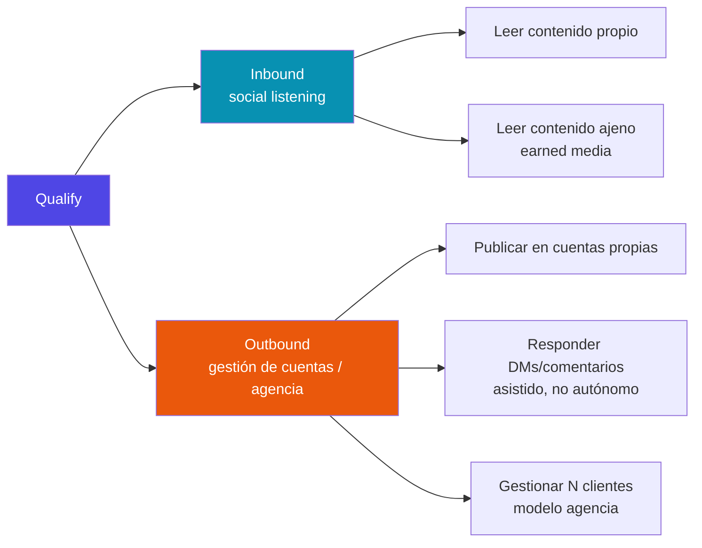

# Qualify — Documentación

Plataforma agentiva de CRM/GTM para social listening sobre TikTok/IG Reels. Tesis central: leer **contenido primario** (video, audio, captions, comentarios) en vez de bios o metadata autodeclarada.

## Empezar por acá

- **[Runbook — Mentions v1: configuración y prueba E2E](mentions-e2e-runbook.md)** — QUA-97 está Done en código/tests (IG caption/comment); este es el procedimiento corto y accionable para la primera prueba real en cuanto Business Verification desbloquee Advanced Access — no requiere volver a investigar nada.
- 🔴 **[PRIORIDAD — despliegue en `qualify.attitudefactory.co`](prioridad-despliegue-subdominio.md)** — el dominio ya está comprado y vivo (2026-08-12); falta desplegar Qualify para tener un redirect URI de OAuth estable. Bloquea toda la cadena hacia Business Verification y Tech Provider. **Una sola decisión abierta: dónde se aloja.**
- **[Plan — CI/CD a costo cero y despliegue a staging](plan-cicd-staging.md)** `[PLAN 2026-10-05]` — cómo robustecer el CI en un repo privado de organización Free (sin branch protection ni environment secrets): CLIs open source (Semgrep, Gitleaks, pip-audit, Trivy, coverage, revisión con Claude) con precios verificados, presupuesto de 2.000 min/mes, el gate duro puesto en el deploy y no en el merge, y la arquitectura del staging en `qualify.attitudefactory.co` (Hetzner CX33 + Compose + Caddy + GHCR). Cierra con 8 decisiones del fundador; corrige el precio de Hetzner del documento de prioridad.
- **[QUA-111 — Automatización del Planificador](automatizacion-calendario-qua111.md)** `[IMPLEMENTADO 2026-09-27]` — el worker que publica los Calendar Events aprobados cuando llega su hora (`just calendar-worker`): decisión del mecanismo, frecuencia, errores y reinicios, cómo se evita la doble publicación, UML, y el contrato que deben cumplir los POST de QUA-109/110.
- **[Plan y MVP — Motor de Plantillas con Remotion](plan-mvp-plantillas-remotion.md)** `[PLAN 2026-10-05]` — replicar el modelo de ElevenCreative Templates para Bianki (shawarma) y Polette (helado de yogurt): catálogo de producto con fotos reales, plantillas Remotion con puertos tipados y versión, una corrida → Reel + feed + historia, prompts por nicho × ángulo con bucle de calificación, campañas en lote; Fases 0 a 3.
- **[Backlog — Motor de Plantillas (Remotion)](backlog-motor-plantillas-remotion.md)** `[PLAN 2026-10-05]` — el tipo «Con plantilla» del generador deja de ser «Próximamente»: Remotion reemplaza al render Pillow (decisión del fundador 2026-10-05), tres plantillas de comida, router de receta con costo visible antes de ejecutar; historias `MP-00…12` para la semana del 5 al 11 de octubre.
- **[UX — Dónde vive el motor de plantillas dentro del flujo del POST](ux-plantillas-en-el-post.md)** `[PROPUESTA UX 2026-10-05, sin implementar]` — el flujo actual (7 pasos, «Con plantilla» como quinto tipo, `/catalog` bajo Negocio), por qué el paquete Reel + feed + historia **no llega hoy a Instagram por el Planificador** (un POST = una categoría; sin story de imagen), tres alternativas de colocación y la recomendación: el Post primero (producto + ángulo → receta cotizada → generar), el catálogo como entrada de *Publicas*, un Post con N salidas programadas por salida; cambios de UI por archivo (esta semana / semana 2) y preguntas al fundador.
- **Motor de Contenido de Marca** (track paralelo, 2026-08-16) — generación de copy + imagen con la voz de la marca del cliente: [backlog](backlog-motor-contenido-marca.md) · [diseño técnico cerrado](diseno-motor-contenido-marca.md).
- **Pool compartido de creadores** `[IMPLEMENTADO 2026-10-01]` — migración 0036 (`vendor_payloads`, `creators`, `creator_sightings`, globales como el catálogo de hashtags): la búsqueda de referentes pregunta primero a la DB y solo va al scraper por lo que falta; qué guarda cada tabla y cómo se mide está en [ui-brandkit-wizard.md](ui-brandkit-wizard.md) (caché 2026-10-01) y en el docstring de la migración.
- **[Crecimiento orgánico — cómo se estima desde fuera](crecimiento-organico-estimacion.md)** `[IMPLEMENTADO 2026-10-01, sin pantalla]` — la fórmula (`G_org = min(ΔF⁺, k·I_org)`, posts "empujados" por alcance/interacción/views tardías), el historial de lecturas que la alimenta (migración 0034, `creator_reads`/`creator_post_reads`) y lo que falta (lecturas periódicas).
- **[Scrape Creators — crecimiento orgánico y contenido con IA](scrapecreators-crecimiento-organico-y-contenido-ia.md)** `[INVESTIGACIÓN VENDOR, 2026-10-01]` — qué expone la API por vídeo/creador: la etiqueta de IA de TikTok (`aigc_info`, C2PA) e Instagram (`gen_ai_detection_method`) verificadas en vivo y a coste cero extra; **ningún histórico ni serie temporal** (la serie hay que construirla con polling, costes estimados; CreatorDB como backfill). Separa `[LIVE]`/`[DOC]`/`[INFERIDO]`.
- 🟡 **[UI — Brand Kit por pasos](ui-brandkit-wizard.md)** `[EN CURSO, sesiones 2026-09-02/03]` — `/brand` pasó de acordeón a dos flujos guiados (manual de 9 pasos, "ya tengo redes" de 11); el acordeón original sigue en el código sin ruta. Incluye la división de la paleta (rueda agrega, swatch edita) y el cambio de `app_shell` a panel con scroll propio, que **afecta a todas las pantallas**. Sin commitear.
- **[Registro de validación de features](registro-validacion-features.md)** — qué feature está respaldada por qué investigación de mercado, organizada por eje (inbound/outbound) y nicho. El árbol visual de todo el trabajo de investigación está ahí.
- **[Proceso para futuras investigaciones](proceso-investigacion-oportunidades.md)** — cómo y cuándo se dispara una nueva investigación de nicho.
- **[Arquitectura general](arquitectura.md)** — decisiones de sistema, ADRs, reglas arquitectónicas duras.
- **[UX/UI y Design System](design-system.md)** — `[v1 2026-08-18]` principios, tokens (teal/slate, Plex Sans+Mono, tonos por rol), shell de página, primitivas (`Qualify/ui/`), patrones de estado, escritura UX y accesibilidad. Guía viva renderizada en la ruta `/design` de la app.
- **[Modelo de negocio — operador multi-emprendimiento](modelo-negocio-operador-multi-emprendimiento.md)** — `[FIRMADO 2026-08-16]` N negocios propios sobre la misma instalación, **`1 login = 1 tenant = 1 negocio`, sin switch** (se cambia de negocio con logout + login). Fija para QUA-66 la higiene de logout: estado Reflex destruido, token de sesión rotado, y todo lo persistido en el cliente namespaced por `tenant_id`.
- **[Plan — QUA-66: Supabase Auth conectado a `tenant_id`](plan-integracion-supabase-auth-tenant.md)** — `[PLAN, alcance confirmado 2026-08-18]` Supabase como proveedor de identidad (los datos siempre en el Postgres propio): el mapeo `credencial → tenant` vive en `app_metadata.tenant_id`, **registro autoservicio que auto-crea el tenant** (`/signup`), login server-side en Reflex, muerte del selector de dev. Fases F0-F4 hasta el primer negocio real logueado: **Polet Bubble Tea** (`polet.attitudefactory.co`).
- **[Iniciativa Loyalty — sellos + cupones](backlog-loyalty-sellos-cupones.md)** — retención para clientes que ya compraron: tarjeta de sellos por compra (los dos locales) y cupones/promociones por comunidad, enviados asistido por `wa.me` sin WhatsApp Business API. Gate: LOY-00 (los dos locales = un tenant; consentimiento promocional; qué POS hay).
- **[Retención de datos y coste de R2](backlog-retencion-datos-r2.md)** — la regla de guardar los binarios de earned media 7 días (techo 30) y purgar lo demás, con el modelo de coste y la única pregunta abierta al fundador (`RET-08`: si la purga alcanza también a las filas de Postgres).
- **[Exploración de naming y dominios](naming-dominios-exploracion.md)** — candidatos de marca validados (disponibilidad, SEO, audiencia) y podio al cierre. Su decisión interina (desplegar bajo el dominio de Attitude) ya se concretó: ver el documento de prioridad de arriba.

## Los dos ejes de producto

Ver el [registro completo](registro-validacion-features.md) para el árbol detallado de features, evidencia y estado por nicho.
