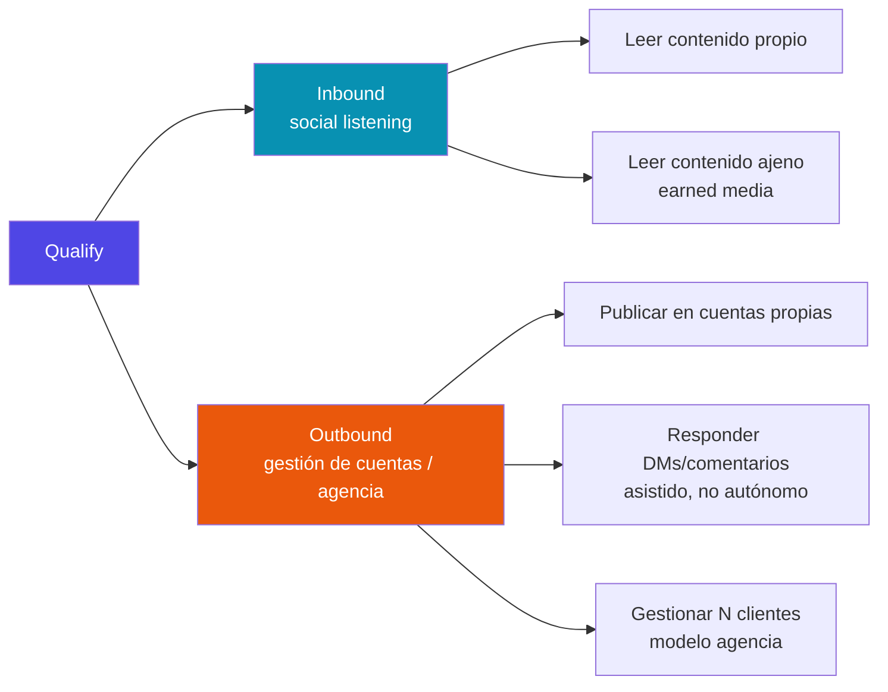

# Qualify — Documentación

Plataforma agentiva de CRM/GTM para social listening sobre TikTok/IG Reels. Tesis central: leer **contenido primario** (video, audio, captions, comentarios) en vez de bios o metadata autodeclarada.

## Empezar por acá

- **[Registro de validación de features](registro-validacion-features.md)** — qué feature está respaldada por qué investigación de mercado, organizada por eje (inbound/outbound) y nicho. El árbol visual de todo el trabajo de investigación está ahí.
- **[Proceso para futuras investigaciones](proceso-investigacion-oportunidades.md)** — cómo y cuándo se dispara una nueva investigación de nicho.
- **[Arquitectura general](arquitectura.md)** — decisiones de sistema, ADRs, reglas arquitectónicas duras.
- **[Exploración de naming y dominios](naming-dominios-exploracion.md)** — candidatos de marca validados (disponibilidad, SEO, audiencia), podio al cierre y la decisión interina de desplegar bajo el dominio de Attitude (2026-08-10).

## Los dos ejes de producto

Ver el [registro completo](registro-validacion-features.md) para el árbol detallado de features, evidencia y estado por nicho.
