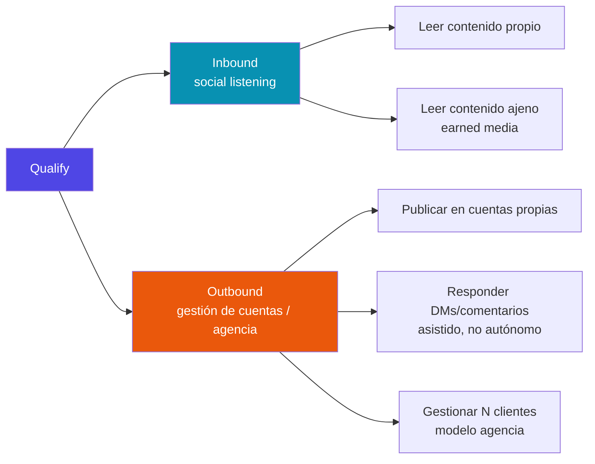

# Qualify — Documentación

> **`[OBSOLETO]` HeyGen — decisión del fundador, 2026-10-16.** Los videos con avatar migran a la suite de ByteDance (BytePlus): **OmniHuman** (el avatar que habla), **Seedance** (el video), **Seedream** (la imagen y el primer fotograma) y **Seed Speech** (la voz clonada). Toda mención a HeyGen en este documento describe el estado anterior o una alternativa ya descartada: no la tomes como decisión vigente. **La migración aún no está hecha en el código** (medido el 2026-10-16): el detalle y lo que falta está en [Pendientes del generador §6](pendientes-generador-contenido.md).

Plataforma agentiva de CRM/GTM para social listening sobre TikTok/IG Reels. Tesis central: leer **contenido primario** (video, audio, captions, comentarios) en vez de bios o metadata autodeclarada.

## Empezar por acá

- **[Roadmap del backlog — épicas, responsables y decisiones](backlog-roadmap.md)** `[VIGENTE 2026-10-24 · m-24849204]` — el orden acordado con el fundador (Ahora / Siguiente / Después), cada épica de Meegle con su prioridad y responsable, las cinco decisiones del 2026-10-23 (menú fijo en mensajes directos, ADR 29 Tech Provider, D1 de WhatsApp sin objeto, prioridad de Anuncios) y lo que queda para el arquitecto.
- **[Épica — Anuncios de Meta desde Qualify](epica-anuncios-meta.md)** `[INVESTIGACIÓN + HISTORIAS 2026-10-21 · sin implementar · decisiones firmadas en ADR 38 · Meegle m-24828970]` — convertir publicaciones en anuncios por la Marketing API (v26.0) con el botón «Más información»: qué existe hoy (textos de anuncio en la pieza sí; enlace, CTA cerrada y cuenta publicitaria no), permisos y puertas (acceso avanzado a `ads_management` en la épica de App Review, nivel Full, app ya en Live), categoría Vivienda, y 18 historias ADS-00…17 en cinco entregas (MVP «Promocionar», clic a WhatsApp/Direct, leads al CRM, anuncio nuevo desde una pieza, públicos) con su ticket de Meegle.
- **[Intención comercial de los comentarios — golden set y medición](intencion-comercial-medicion.md)** `[MEDIDO 2026-10-20 · m-24789644]` — 408 comentarios reales de negocios hispanohablantes, divididos en dev/test. Claude Haiku 5.5 (prompt v2) gana a bge-m3 zero-shot (coincidencia exacta 0,87 frente a 0,61 en test). Clases fiables: `general`, `price`, `availability` y `location`; las demás se muestran como «no fiable». Cinco reglas de etiquetado y cómo repetir la medición.
- **[Interacciones · Fase B — respuestas públicas a comentarios con intención comercial](interacciones-fase-b-respuestas-comerciales.md)** `[IMPLEMENTADO 2026-10-23 · m-24789645 · prueba real hecha]` — puerta → catálogo sin precios → Claude Haiku 5.5 (`m24789645.1`) → motivos de revisión → aprobación humana → `POST /{comment-id}/replies`. Decisiones D1 (sin precios en público), D2 (solo el catálogo es fuente validada) y la nota suave de clases «no fiable». Costo medido US$0,00009–0,00012 por borrador; QUA-144; la conexión sin marca deja el catálogo vacío; permisos de Meta y acceso Standard (QUA-140); aislamiento y su prueba real del 2026-10-23.
- **[Brand Kit — «Tu avatar animado»](brand-kit-avatar-animado.md)** `[ESQUEMATIZADO 2026-10-19 · interruptor QUALIFY_BRAND_AVATAR apagado · esperando la llave de ModelArk]` — al terminar el Brand Kit, Seedream dibuja una mascota de la marca (logo como referencia, paleta, rubro, tono) en segundo plano; se ve y se regenera en el editor `/brand/kit`. Imagen en R2 bajo el prefijo de la marca, registro con procedencia en `brand_kit_details.logo_brief` (sin migración), USD 0,035 por imagen. 6 preguntas al fundador y checklist para cuando lleguen las llaves.
- **[Plan — Stock de Pexels y Pixabay en el generador](plan-integracion-stock-pexels-pixabay.md)** `[PLAN 2026-10-16, revisado: Pixabay primero (Pexels pausó sus claves) y producto desde stock · sin implementar · 7 preguntas al fundador]` — elegir el producto desde «Mi catálogo» o «Imagen de stock», pestaña «Stock» en los fondos (Flyer, Galería, avatar) y, en fase 2, en las referencias del Clip; nunca en fotos de producto. Cliente `qualify_creative.stock` + servicio `qualify_api.stock` (caché de 24 h, cuota por tenant, respaldo Pexels→Pixabay), copia en R2 con procedencia (migración `stock_assets` + `stock_asset_uses`, RLS), guardarraíles «sin personas» y «siempre compuesto». Hallazgos: en producción todo fondo ya es referencia de Seedream (la bandera de IA decide el MVP) y no hay `ffmpeg` para normalizar video (hace falta PyAV).
- **[APIs de imágenes y videos de stock para el generador](apis-imagenes-y-videos-de-stock.md)** `[INVESTIGACIÓN VENDOR 2026-10-16]` — 15 proveedores (Pixabay, Pexels, Unsplash, Openverse, Freepik/Magnific, Shutterstock, Getty, Adobe, Storyblocks, Coverr, Mixkit, Videvo, Envato, GIPHY, Tenor) por vertical 9:16, límites, precio, licencia comercial, guardado en R2, uso con IA y multi-tenant. Recomendación: Pexels como principal y Pixabay como complemento (gratis, sin atribución en la pieza, se pueden guardar). Unsplash, Magnific y Coverr prohíben expresamente usar su contenido con IA; el mayor riesgo es el respaldo implícito de personas de stock junto al producto.
- **[Costos comparativos — voz, avatar, video, imagen y lectura de reels](costos-comparativos-herramientas-ia.md)** `[COMPARATIVA 2026-10-15]` — precio por pieza y por mes (100 videos de 30 s) de Seed Speech, HeyGen, ElevenLabs, OmniHuman, Seedance, Seedream, Remotion y ScrapeCreators, y cinco rutas de punta a punta para un reel con la cara y la voz de la marca. La voz es menos del 2 % del coste; la más barata con buena calidad es HeyGen Avatar IV Photo (~1,2–1,5 USD/video).
- **[Descubrir reels — los reels con más vistas de los referentes](descubrir-reels-scrapecreators.md)** `[IMPLEMENTADO 2026-10-15, sin commitear]` — referentes (también los añadidos a mano) → ScrapeCreators (una lectura de 30 días por cuenta) → Claude descarta los reels de otro rubro → pestañas Semana / Mes por vistas. Incluye qué da ScrapeCreators por reel para análisis y réplica (medido en vivo), costes y el plan de «Replicar».
- **[Referencia — modelos de lip-sync y avatar hablado](referencia-modelos-lipsync-y-avatar-hablado.md)** `[REFERENCIA 2026-10-15]` — todos los modelos en tres familias: (A) video + audio → labios nuevos, (B) foto + audio → video hablado, (C) foto + video de movimiento → video. Por modelo: acceso, si acepta nuestro audio exacto, caras reales, precio por reel de 30 s y licencia (incluido el open source: qué permite uso comercial). ByteDance sí tiene lip-sync video→video por API, pero solo en Volcengine (China); LatentSync (ByteDance, open source) se puede usar vía fal a 0,20 USD por video.
- **[Avatar reutilizable, voz y movimiento con la suite de ByteDance](avatar-reutilizable-voz-y-movimiento-bytedance.md)** `[INVESTIGACIÓN 2026-10-15]` — OmniHuman no guarda avatares (foto + audio en cada llamada); ningún producto de BytePlus guarda cara y voz juntas, así que la unión (foto + `speaker_id` de Seed Speech + real-person asset + consentimiento) vive en tablas nuestras. Copiar los movimientos de un reel: OmniHuman no puede; **DreamActor M2.0** sí (0,05 USD/s), pero copia también los labios, así que pide lip-sync después con nuestro audio. Plan de prueba T1–T6 (≈5 USD + 30 USD de saldo no reembolsable de Seedance).
- **[OmniHuman con caras reales y edición con Seedance](omnihuman-caras-reales-y-edicion-seedance.md)** `[INVESTIGACIÓN 2026-10-15]` — OmniHuman acepta fotos de personas reales según sus docs (sin filtro de privacidad ni prueba de vida; el consentimiento es contractual; sin probar en vivo). Editar ese video con Seedance falla por la vía directa: la excepción de outputs propios no cubre OmniHuman. Solo cabe por el *real-person asset* de la persona, también sin probar. Recomendación: la persona solo en el plano hablado y Seedance para los planos sin ella. Plan de prueba de ≈3–4 USD.
- **[Voz clonada en los modelos de video — Seedance y los demás](voz-clonada-en-modelos-de-video.md)** `[INVESTIGACIÓN 2026-10-15]` — qué motor acepta nuestra voz clonada y hace lip-sync del audio exacto: Seedance solo toma el timbre (regenera la voz), así que la voz exacta pide un lip-sync posterior (HeyGen Lipsync, Sync.so); OmniHuman, HeyGen, Kling y Hedra sí sincronizan nuestro audio; Veo no acepta audio. Costo por reel de 30 s en 15 rutas y la recomendación: Seed Speech como fuente única de la voz.
- **[Voz clonada — Seed Speech frente a HeyGen](investigacion-voz-seed-speech-vs-heygen.md)** `[INVESTIGACIÓN 2026-10-15]` — Seed Speech es el único con español mexicano; cómo guarda las voces (sin borrado ni exportación por API); por qué ningún motor de video acepta su `speaker_id` y el patrón «la voz como audio» para Seedance, OmniHuman y HeyGen; plan para añadirlo a nuestro clonador.
- **[Avatar que habla — OmniHuman frente a HeyGen](investigacion-avatar-omnihuman-vs-heygen.md)** `[INVESTIGACIÓN 2026-10-15]` — OmniHuman no está en ModelArk (Vision AI, verificación empresarial, concurrencia 1 en la 1.5); HeyGen Avatar IV como principal, con el consentimiento del Digital Twin.
- **[Caras reales en video con IA](investigacion-caras-reales-video-ia.md)** `[INVESTIGACIÓN 2026-10-15]` — no todas las apps usan Seedance (ElevenLabs revende ~27 modelos; DaVinci Resolve no genera video); Seedance oficial bloquea caras reales; obligaciones de plataforma de BytePlus; marco legal (AI Act art. 50, EE. UU., México, Brasil). Recomendación: no soportar figuras públicas.
- **[Backlog — Módulo WhatsApp: plan de ejecución](backlog-modulo-whatsapp.md)** `[EN EJECUCIÓN 2026-10-14]` — cuatro entregas ordenadas por valor para comida rápida (cimientos → chats → menú que toma el pedido → volver a vender), contrato técnico por historia WA-04…WA-21 sobre el intake de QUA-147 y el núcleo de conexiones.
- **[Plan — Módulo WhatsApp Business Platform (Cloud API)](plan-modulo-whatsapp-cloud-api.md)** `[PLAN 2026-10-13, 4 decisiones del fundador pendientes]` — reemplazar el bot Baileys de Bianki por la API oficial gestionada desde Qualify (menús, plantillas, marketing, bandeja). Hallazgo que cierra B0-5/A5-4: para la WABA propia **no hace falta App Review ni acceso avanzado**, solo un token de system user; multi-tenant es Tech Provider (envío 3 de P-QUA-8).
- **[Runbook — Mentions v1: configuración y prueba E2E](mentions-e2e-runbook.md)** — QUA-97 está Done en código/tests (IG caption/comment); este es el procedimiento corto y accionable para la primera prueba real en cuanto Business Verification desbloquee Advanced Access — no requiere volver a investigar nada.
- 🔴 **[PRIORIDAD — despliegue en `qualify.attitudefactory.co`](prioridad-despliegue-subdominio.md)** — el dominio ya está comprado y vivo (2026-08-12); falta desplegar Qualify para tener un redirect URI de OAuth estable. Bloquea toda la cadena hacia Business Verification y Tech Provider. **Host decidido (2026-10-05): Hetzner.**
- **[Runbook — despliegue en Hetzner](despliegue-hetzner.md)** `[LISTO PARA EJECUTAR 2026-10-05]` — crear el servidor, preparar con `deploy/bootstrap-server.sh`, `.env.prod`, DNS en Vercel, `just deploy`, logs, respaldos/restauración y los ajustes de Meta/Supabase/Canva. Tabla de rutas de Caddy (FastAPI / backend de Reflex / frontend estático) y pendientes conocidos.
- **[Plan — CI/CD a costo cero y despliegue a staging](plan-cicd-staging.md)** `[PLAN 2026-10-05]` — cómo robustecer el CI en un repo privado de organización Free (sin branch protection ni environment secrets): CLIs open source (Semgrep, Gitleaks, pip-audit, Trivy, coverage, revisión con Claude) con precios verificados, presupuesto de 2.000 min/mes, el gate duro puesto en el deploy y no en el merge, y la arquitectura del staging en `qualify.attitudefactory.co` (Hetzner CX33 + Compose + Caddy + GHCR). Cierra con 8 decisiones del fundador; corrige el precio de Hetzner del documento de prioridad.
- **[Plan — SRE/DevOps sobre la producción en Hetzner](plan-sre-devops-produccion.md)** `[PLAN 2026-10-06]` — línea base medida del deploy (28 s en caché, ~10 s de 502 en el backend por recreación de contenedores), Remotion sin orquestar en producción (perfil `render` apagado, pide CX33), brechas contra el ejemplo oficial de producción de Reflex y 8 tareas ordenadas (CD con GHCR, cero caída, imagen en CI, monitoreo, respaldos).
- **[QUA-111 — Automatización del Planificador](automatizacion-calendario-qua111.md)** `[IMPLEMENTADO 2026-09-27]` — el worker que publica los Calendar Events aprobados cuando llega su hora (`just calendar-worker`): decisión del mecanismo, frecuencia, errores y reinicios, cómo se evita la doble publicación, UML, y el contrato que deben cumplir los POST de QUA-109/110.
- **[Formato de los tickets de Meegle](formato-tickets-meegle.md)** `[VIGENTE 2026-10-21 · m-24823777]` — un solo formato para personas y agentes: tipo de ítem (Issue = unidad de trabajo, Feature = épica), título `<Área>: <qué>`, prioridad P0–P3, etiquetas y las tres descripciones (bug, feature/mejora, tarea técnica) con criterios de aceptación obligatorios. La skill `/meegle-ticket` de Claude Code crea el ticket por el conector de Meegle con este formato.
- **[Plan — Altas de clientes operadas desde Meegle](plan-altas-meegle.md)** `[PLAN 2026-10-16]` — decisión del fundador: sin pantalla de superadmin; cada alta es un ítem «Alta de cliente» en el espacio Meegle Qualify con nodos Datos → Invitada → Registrada → Kit → Primera publicación. Meegle empuja eventos firmados al `/api/meegle/events` (bandeja de QUA-147) y Qualify escribe de vuelta por Open API (campos, nodos, comentarios); Resend confirma entrega; recordatorios y avisos con las automatizaciones nativas de Meegle/Lark. Sustituye A0–A1 del plan de superadmin; fases M0–M3.
- **[Plan — Superadmin de Qualify: alta de clientes de punta a punta](plan-superadmin-alta-clientes.md)** `[PLAN 2026-10-07]` — panel `/admin` del personal de la plataforma (no la vista de cartera descartada en §6.1): identidad `superadmin` sin negocio con segundo factor, puerta única `qualify_api.platform` con auditoría, alta durante la llamada de venta que precarga el Brand Kit en segundo plano (perfil, colores, rubro, hashtags, referentes con presupuesto) sobre el borrador 0037 y el worker embebido del Planificador, invitaciones con nota personal, liberación de @ y purga de abandonados; costo estimado ~$0.20–0.35 por alta; Fases A0–A4 y 8 decisiones.
- **[Plan y MVP — Motor de Plantillas con Remotion](plan-mvp-plantillas-remotion.md)** `[PLAN 2026-10-05]` — replicar el modelo de ElevenCreative Templates para Bianki (shawarma) y Polette (helado de yogurt): catálogo de producto con fotos reales, plantillas Remotion con puertos tipados y versión, una corrida → Reel + feed + historia, prompts por nicho × ángulo con bucle de calificación, campañas en lote; Fases 0 a 3.
- **[Cuentas propias reservadas por marca](decisiones-cuentas-propias.md)** `[IMPLEMENTADO 2026-10-06 · DECISIONES ABIERTAS]` — la cuenta de Instagram/TikTok de Tu cuenta queda reservada para una sola marca (migración 0044): qué pasa en cada caso (incluido el borrador que no se registra), por qué no afecta a la búsqueda de referentes y cuatro decisiones pendientes: caducidad de borradores, verificación de propiedad, cuentas de clientes como referentes y el texto del aviso.
- **[Pendientes del generador de contenido](pendientes-generador-contenido.md)** `[ABIERTO 2026-10-05]` — lo que falta para que un POST generado se publique solo desde el Planificador: los archivos generados siguen en local y no en R2 (aplazado a propósito, con el plan para retomarlo), el media se genera con la primera variante válida y no con la aprobada, Seedance/BYOK sin empezar. Registra también lo resuelto: las imágenes se guardan en JPEG para Meta.
- **[Backlog — Motor de Plantillas (Remotion)](backlog-motor-plantillas-remotion.md)** `[PLAN 2026-10-05]` — el tipo «Con plantilla» del generador deja de ser «Próximamente»: Remotion reemplaza al render Pillow (decisión del fundador 2026-10-05), tres plantillas de comida, router de receta con costo visible antes de ejecutar; historias `MP-00…12` para la semana del 5 al 11 de octubre.
- **[UX — Dónde vive el motor de plantillas dentro del flujo del POST](ux-plantillas-en-el-post.md)** `[PROPUESTA UX 2026-10-05, sin implementar]` — el flujo actual (7 pasos, «Con plantilla» como quinto tipo, `/catalog` bajo Negocio), por qué el paquete Reel + feed + historia **no llega hoy a Instagram por el Planificador** (un POST = una categoría; sin story de imagen), tres alternativas de colocación y la recomendación: el Post primero (producto + ángulo → receta cotizada → generar), el catálogo como entrada de *Publicas*, un Post con N salidas programadas por salida; cambios de UI por archivo (esta semana / semana 2) y preguntas al fundador.
- **Motor de Contenido de Marca** (track paralelo, 2026-08-16) — generación de copy + imagen con la voz de la marca del cliente: [backlog](backlog-motor-contenido-marca.md) · [diseño técnico cerrado](diseno-motor-contenido-marca.md).
- **Pool compartido de creadores** `[IMPLEMENTADO 2026-10-01]` — migración 0036 (`vendor_payloads`, `creators`, `creator_sightings`, globales como el catálogo de hashtags): la búsqueda de referentes pregunta primero a la DB y solo va al scraper por lo que falta; qué guarda cada tabla y cómo se mide está en [ui-brandkit-wizard.md](ui-brandkit-wizard.md) (caché 2026-10-01) y en el docstring de la migración.
- **[Crecimiento orgánico — cómo se estima desde fuera](crecimiento-organico-estimacion.md)** `[IMPLEMENTADO 2026-10-01, sin pantalla]` — la fórmula (`G_org = min(ΔF⁺, k·I_org)`, posts "empujados" por alcance/interacción/views tardías), el historial de lecturas que la alimenta (migración 0034, `creator_reads`/`creator_post_reads`) y lo que falta (lecturas periódicas).
- **[Scrape Creators — crecimiento orgánico y contenido con IA](scrapecreators-crecimiento-organico-y-contenido-ia.md)** `[INVESTIGACIÓN VENDOR, 2026-10-01]` — qué expone la API por vídeo/creador: la etiqueta de IA de TikTok (`aigc_info`, C2PA) e Instagram (`gen_ai_detection_method`) verificadas en vivo y a coste cero extra; **ningún histórico ni serie temporal** (la serie hay que construirla con polling, costes estimados; CreatorDB como backfill). Separa `[LIVE]`/`[DOC]`/`[INFERIDO]`.
- 🟡 **[UI — Brand Kit por pasos](ui-brandkit-wizard.md)** `[EN CURSO, sesiones 2026-09-02/03]` — `/brand` pasó de acordeón a dos flujos guiados (manual de 9 pasos, "ya tengo redes" de 11); el acordeón original sigue en el código sin ruta. Incluye la división de la paleta (rueda agrega, swatch edita) y el cambio de `app_shell` a panel con scroll propio, que **afecta a todas las pantallas**. Sin commitear.
- **[Registro de validación de features](registro-validacion-features.md)** — qué feature está respaldada por qué investigación de mercado, organizada por eje (inbound/outbound) y nicho. El árbol visual de todo el trabajo de investigación está ahí.
- **[Proceso para futuras investigaciones](proceso-investigacion-oportunidades.md)** — cómo y cuándo se dispara una nueva investigación de nicho.
- **[Calidad de código — revisión automática con Claude, anotaciones de ruff y SonarQube Community](calidad-codigo-revision-automatica.md)** `[IMPLEMENTADO 2026-10-05]` — `review.yml` (revisión automática en cada PR a `main` + `@claude` bajo demanda, con la suscripción Max vía `claude setup-token`; hallazgos de `ruff` anotados en el diff con reviewdog) y `sonar.yml` + `infra/sonarqube/` (SonarQube Community Build autoalojado sobre `main`); costos `[V]`, secretos a crear, qué pasa si faltan (nada se rompe) y alternativas descartadas con precio.
- **[Arquitectura general](arquitectura.md)** — decisiones de sistema, ADRs, reglas arquitectónicas duras.
- **[Perfil del cliente — dueños de pymes y emprendimientos](perfil-cliente-pyme.md)** `[v1 2026-10-23 · m-24842828]` — quiénes son los clientes reales (Bianki, Polette, la agencia de viajes de Cúcuta, el inmobiliario), el segmento definido por el fundador (presupuesto acotado, sin marketeros ni diseñadores, pero presentes en redes), la persona principal «dueño de local que hace todo» y la del operador, qué implica para el diseño (beneficios, sin palabras técnicas, pasos cortos, celular primero) y 8 preguntas para validar con clientes. Lo usan el agente `ux-designer` y la skill `qualify-ux`.
- **[Auditoría de experiencia de la app — octubre 2026](ux-auditoria-2026-10.md)** `[v1 2026-10-23]` — revisión de todas las pantallas por dominio (7 informes en `ux-auditoria-2026-10/`), hallazgos transversales, lo que impide terminar y la épica propuesta.
- **[Guía de navegación de Qualify](ux-guia-navegacion.md)** `[v1 propuesta 2026-10-23, decisiones del fundador pendientes]` — menú por trabajos del dueño (Inicio · Atiende · Publica · Resultados · Tu negocio), reglas N1–N13 y recorrido principal.
- **[Épica — Qualify en palabras del dueño: navegación y experiencia](epica-ux-navegacion-experiencia.md)** `[m-24842956 · 2026-10-23]` — 46 historias en Meegle por dominio ([NAV], [MARCA], [PRODUCTOS], [CREAR], [PUBLICAR], [ATENDER], [WHATSAPP], [RESULTADOS]), 7 borradores en revisión, decisiones del fundador y olas de ejecución.
- **[UX/UI y Design System](design-system.md)** — `[v1 2026-08-18]` principios, tokens (teal/slate, Plex Sans+Mono, tonos por rol), shell de página, primitivas (`Qualify/ui/`), patrones de estado, escritura UX y accesibilidad. Guía viva renderizada en la ruta `/design` de la app.
- **[Modelo de negocio — operador multi-emprendimiento](modelo-negocio-operador-multi-emprendimiento.md)** — `[FIRMADO 2026-08-16]` N negocios propios sobre la misma instalación, **`1 login = 1 tenant = 1 negocio`, sin switch** (se cambia de negocio con logout + login). Fija para QUA-66 la higiene de logout: estado Reflex destruido, token de sesión rotado, y todo lo persistido en el cliente namespaced por `tenant_id`.
- **[Plan — QUA-66: Supabase Auth conectado a `tenant_id`](plan-integracion-supabase-auth-tenant.md)** — `[PLAN, alcance confirmado 2026-08-18]` Supabase como proveedor de identidad (los datos siempre en el Postgres propio): el mapeo `credencial → tenant` vive en `app_metadata.tenant_id`, **registro autoservicio que auto-crea el tenant** (`/signup`), login server-side en Reflex, muerte del selector de dev. Fases F0-F4 hasta el primer negocio real logueado: **Polette**, antes Polet (`polet.attitudefactory.co`).
- **[Iniciativa Loyalty — sellos + cupones](backlog-loyalty-sellos-cupones.md)** — retención para clientes que ya compraron: tarjeta de sellos por compra (los dos locales) y cupones/promociones por comunidad, enviados asistido por `wa.me` sin WhatsApp Business API. Gate: LOY-00 (los dos locales = un tenant; consentimiento promocional; qué POS hay).
- **[Retención de datos y coste de R2](backlog-retencion-datos-r2.md)** — la regla de guardar los binarios de earned media 7 días (techo 30) y purgar lo demás, con el modelo de coste y la única pregunta abierta al fundador (`RET-08`: si la purga alcanza también a las filas de Postgres).
- **[Exploración de naming y dominios](naming-dominios-exploracion.md)** — candidatos de marca validados (disponibilidad, SEO, audiencia) y podio al cierre. Su decisión interina (desplegar bajo el dominio de Attitude) ya se concretó: ver el documento de prioridad de arriba.

## Los dos ejes de producto

Ver el [registro completo](registro-validacion-features.md) para el árbol detallado de features, evidencia y estado por nicho.
