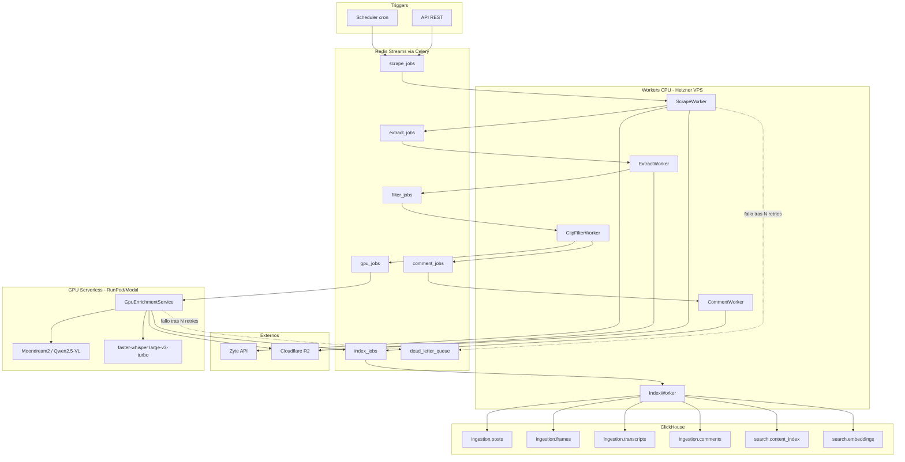

# Plan de implementación — Fase 1: Ingesta y enriquecimiento social (TikTok / Instagram Reels)

**Proyecto:** Qualify (CRM de marketing moderno)
**Módulo:** Ingesta y enriquecimiento social — greenfield.
**Contexto:** Se reutilizan patrones de F1 (ClickHouse + Docker) y lecciones de brand-monitoring (scraping social).

---

## 0. Orden de ejecución revisado (Partes) — 2026-07-17

La sección 6 (`Fases de implementación`) de este doc secuenciaba originalmente **scraping primero** (su "Fase 1", semanas 2-3) y la cascada multimodal después (su "Fase 2", semanas 4-6). Se invierte ese orden: la cascada multimodal (F1/F2/F3 — transcripción, filtro, visión — más sentiment) es el diferenciador de Qualify y el mayor riesgo técnico/de calidad, así que se valida primero con datos de muestra, sin esperar a tener scraping ni infra completos. Para evitar confundir estas "Partes" con las "Fases" del roadmap general (`CLAUDE.md` → Roadmap phase map) o con las "Fase 0-5" internas de la sección 6 de este mismo doc, se usa **Parte** para este sub-orden dentro de la Fase 1 del roadmap:

- **Parte 1 (actual):** cascada multimodal como paquete Python independiente y testeable — filtro (`siglip2-base`) → visión (`Qwen3-VL-4B-Instruct`, swap a `moondream3-preview` cuando haya hosting propio) → transcripción (`whisper-large-v3-turbo`) → sentiment (`robertuito`). Corre sobre fixtures/muestras locales, sin ClickHouse, sin Celery, sin scraping — el objetivo es validar el pipeline de análisis en sí. Modelos y justificación en `docs/modelos-multimodal-fase1.md`. Equivale a una versión reducida (sin ffmpeg/GPU-worker/colas) de la vieja "Fase 2" de la sección 6.
- **Parte 2:** scraping/ingesta real (Zyte vs. EnsembleData/Data365, ver `docs/alternativas-fase1.md`) — la vieja "Fase 1" de la sección 6, reordenada **y** con un cambio de alcance deliberado: se construye cobertura **ancha multi-formato** desde el inicio, no el MVP "TikTok video-only" que secuenciaba la §6. Ver la nota de reconciliación al inicio de la §6 y ADR 17 (`arquitectura.md` §6).
- **Parte 3:** infraestructura y orquestación — `docker-compose.yml`, ClickHouse, Redis/Celery, `packages/shared`, conectar Partes 1 y 2 en colas reales (`extract_jobs → filter_jobs → gpu_jobs`, etc.). Equivale a la vieja "Fase 0" (Fundaciones) más el resto de la vieja "Fase 2" (ffmpeg, GPU worker, colas) que no entra en la Parte 1 por no depender de scraping.
- A partir de ahí, la sección 6 sigue tal cual: Fase 3 (comentarios + FTS), Fase 4 (Instagram + embeddings), Fase 5 (hardening) — esas sí dependen de tener Partes 1-3 integradas.

Las secciones 5.2 y 5.3 (elección de CLIP y del vision model) quedan como registro histórico de la decisión original; la decisión vigente de modelos está en `docs/modelos-multimodal-fase1.md`.

---

## 1. Recomendación de infraestructura (mínimo costo)

| Componente | Recomendación | Motivo |
|---|---|---|
| Cola + broker | Redis 7 + Celery (Streams) en VPS | ~$0 marginal vs SQS; ecosistema Python maduro; suficiente para MVP |
| Object storage | Cloudflare R2 | Sin egress fees; ideal para frames/audio/video |
| ClickHouse | Self-hosted en el mismo VPS (Hetzner CX41) | Más barato que Cloud a bajo volumen; migración futura a ClickHouse Cloud sin cambiar esquema |
| Workers CPU | Mismo VPS Hetzner (scrape, CLIP, comentarios, indexer) | Un nodo ~€15–25/mes cubre MVP |
| GPU scale-to-zero | RunPod Serverless o Modal | Pago por segundo; cold start 30–90s aceptable para batch; evita GPU 24/7 |
| Scraping | Zyte API (pay-per-request) | Ya definido; no self-host |

**Costo estimado MVP:** ~€30–50/mes infra fija + Zyte variable + GPU solo cuando hay jobs.

**Alternativa futura (escala):** migrar cola a SQS, ClickHouse a Cloud, GPU a pool dedicado spot si el cold start deja de ser aceptable.

## 2. Diagrama de flujo de datos



**Principio de diseño:** cada etapa es idempotente y persiste artefactos en R2 + estado en Redis/ClickHouse antes de encolar la siguiente. Si el GPU está frío, los jobs esperan en `gpu_jobs` sin bloquear scrape ni CLIP.

## 3. Esquema ClickHouse propuesto

Base de datos: `crm`. Prefijo lógico `ingestion.*` (datos estructurados) y `search.*` (texto unificado + vectores para módulos futuros).

> `ORDER BY` es inmutable — diseñado según filtros esperados (`brand_id`, `platform`, rango de fechas, `post_id`).

### 3.1 `ingestion.brands` (dimensión, fase 1)

```sql
CREATE TABLE ingestion.brands (
    brand_id UUID,
    name String,
    slug LowCardinality(String),
    created_at DateTime DEFAULT now()
) ENGINE = ReplacingMergeTree(created_at)
ORDER BY (slug, brand_id);
```

### 3.2 `ingestion.posts` (núcleo del CRM)

```sql
CREATE TABLE ingestion.posts (
    brand_id UUID,
    platform LowCardinality(String),          -- 'tiktok' | 'instagram'
    post_id String,                            -- ID nativo de la plataforma
    creator_handle LowCardinality(String),
    creator_id String,
    post_url String,
    caption String DEFAULT '',
    posted_at DateTime,
    posted_date Date DEFAULT toDate(posted_at),
    -- Métricas normalizadas
    views UInt64 DEFAULT 0,
    likes UInt64 DEFAULT 0,
    comments_count UInt32 DEFAULT 0,
    shares UInt32 DEFAULT 0,
    -- Artefactos
    video_r2_key String,
    audio_r2_key String DEFAULT '',
    hydration_json_r2_key String,              -- JSON crudo de Zyte para re-parse
    duration_ms UInt32 DEFAULT 0,
    -- Pipeline
    scrape_status LowCardinality(String),      -- pending|scraped|enriched|indexed|failed
    scraped_at DateTime,
    enriched_at DateTime DEFAULT toDateTime(0),
    pipeline_version LowCardinality(String),
    error_message String DEFAULT '',
    updated_at DateTime DEFAULT now(),
    INDEX idx_creator creator_handle TYPE bloom_filter GRANULARITY 4
) ENGINE = ReplacingMergeTree(updated_at)
PARTITION BY toYYYYMM(posted_date)
ORDER BY (brand_id, platform, posted_date, post_id);
```

Patrones de query futuros cubiertos: posts por marca, por plataforma, por rango de fechas, por creator; deduplicación vía `ReplacingMergeTree`.

> **Nota de expansión multi-formato (Fase 1 Parte 2, sprint 2026-07-19 — soporte de ADR 17).** El sprint de Parte 2 construye cobertura **ancha** desde el inicio (TikTok video/foto-galería/story/texto + IG reel/post/carrusel/story), no el MVP "TikTok video-only" que secuenciaba la §6. Esto expande el contrato de `ingestion.posts` de arriba en tres puntos; **el DDL definitivo se fija en Parte 3** (con `clickhouse-architecture-advisor`), no aquí — este contrato solo documenta la dirección para que el schema Pydantic de `packages/scraper` no pinte el DDL a una esquina:
>
> 1. **Discriminador `content_type`** `LowCardinality(String)` (valores platform-prefijados: `tiktok_video`, `tiktok_photo`, `tiktok_story`, `tiktok_text`, `instagram_reel`, `instagram_post`, `instagram_carousel`, `instagram_story`). Per `schema-types-lowcardinality` (8 valores ≪ 10K). **No** entra al `ORDER BY`: per `schema-pk-prioritize-filters`, las queries de listening filtran por marca+fecha, no por formato; meterlo temprano fragmentaría los scans por rango de fecha. Si aparecen queries filtradas por formato, se resuelve con un índice de salto, no reordenando la clave (que es inmutable). El `ORDER BY (brand_id, platform, posted_date, post_id)` se mantiene sin cambios.
> 2. **Media N-aria → tabla hija `ingestion.post_media`** (1 fila por ítem: `ordinal`, `kind`, `url`, `r2_key`, `duration_ms`), replicando el patrón ya existente de `ingestion.frames` (clave `(brand_id, platform, post_id, ordinal)`). Reemplaza los `video_r2_key`/`audio_r2_key` single-valued para formatos de N ítems (galería/carrusel). Motivo: cada ítem se procesa aguas abajo por separado (su `r2_key` se puebla tras el upload, su propio job de extracción) → un `Array`/`Nested` haría torpe el upsert de estado por-ítem bajo `ReplacingMergeTree`; per `schema-json-when-to-use`, media tiene esquema fijo conocido → columnas tipadas/tabla, no JSON. `ingestion.posts` se mantiene a grano "1 fila por post"; la clave de idempotencia `(brand_id, platform, post_id)` no cambia.
> 3. **Provenance en el parse-output** (regla dura): el objeto parseado nace con `hydration_json_r2_key`, `source_url`, `scraped_at`, `pipeline_version` + `parser_version`. `parser_version` se distingue de `pipeline_version` porque re-parsear el mismo hydration JSON (raw payload persistido, regla dura) con un parser mejorado cambia el output con `scraped_at` inmutable → hay que saber qué parser produjo cada fila para que el re-parse sea auditable. Los campos de estado de pipeline (`scrape_status`, `enriched_at`, `error_message`, `updated_at`) **no** son parse-output: se materializan en Parte 3 (orquestación), no los emite el parser.

### 3.3 `ingestion.frames`

```sql
CREATE TABLE ingestion.frames (
    brand_id UUID,
    platform LowCardinality(String),
    post_id String,
    frame_index UInt16,
    timestamp_ms UInt32,
    r2_key String,
    -- CLIP filter
    clip_score Float32 DEFAULT 0,
    clip_labels Array(LowCardinality(String)),
    clip_selected UInt8 DEFAULT 0,             -- 1 = pasa filtro
    -- Vision enrichment
    vision_model LowCardinality(String) DEFAULT '',
    vision_description String DEFAULT '',
    vision_processed_at DateTime DEFAULT toDateTime(0),
    posted_at DateTime,
    posted_date Date DEFAULT toDate(posted_at),
    updated_at DateTime DEFAULT now()
) ENGINE = ReplacingMergeTree(updated_at)
PARTITION BY toYYYYMM(posted_date)
ORDER BY (brand_id, platform, post_id, frame_index);
```

### 3.4 `ingestion.transcripts`

```sql
CREATE TABLE ingestion.transcripts (
    brand_id UUID,
    platform LowCardinality(String),
    post_id String,
    language LowCardinality(String),
    text_full String,
    segments_json String,                      -- JSON: [{start_ms, end_ms, text}]
    whisper_model LowCardinality(String),
    confidence_avg Float32 DEFAULT 0,
    posted_at DateTime,
    posted_date Date DEFAULT toDate(posted_at),
    updated_at DateTime DEFAULT now(),
    INDEX idx_lang language TYPE set(0) GRANULARITY 4
) ENGINE = ReplacingMergeTree(updated_at)
PARTITION BY toYYYYMM(posted_date)
ORDER BY (brand_id, platform, posted_date, post_id);
```

### 3.5 `ingestion.comments`

```sql
CREATE TABLE ingestion.comments (
    brand_id UUID,
    platform LowCardinality(String),
    post_id String,
    comment_id String,
    author_handle String,
    text_raw String,
    text_clean String,
    -- NLP
    is_spam UInt8 DEFAULT 0,
    spam_reason LowCardinality(String) DEFAULT '',
    sentiment LowCardinality(String),          -- positive|neutral|negative
    sentiment_score Float32,
    sentiment_model LowCardinality(String) DEFAULT 'robertuito',
    like_count UInt32 DEFAULT 0,
    posted_at DateTime,
    posted_date Date DEFAULT toDate(posted_at),
    updated_at DateTime DEFAULT now(),
    INDEX idx_sentiment sentiment TYPE set(0) GRANULARITY 4,
    INDEX idx_spam is_spam TYPE set(0) GRANULARITY 4
) ENGINE = ReplacingMergeTree(updated_at)
PARTITION BY toYYYYMM(posted_date)
ORDER BY (brand_id, platform, post_id, comment_id);
```

### 3.6 `search.content_index` (FTS unificado — base para reporting y alertas)

Tabla desnormalizada: un row por fragmento de texto indexable.

```sql
CREATE TABLE search.content_index (
    brand_id UUID,
    platform LowCardinality(String),
    post_id String,
    content_type LowCardinality(String),       -- caption|frame|transcript|comment
    source_id String,                          -- frame_index, comment_id, o 'caption'
    content_text String,
    language LowCardinality(String) DEFAULT 'es',
    posted_at DateTime,
    posted_date Date DEFAULT toDate(posted_at),
    -- Metadata para filtros cruzados
    creator_handle LowCardinality(String),
    sentiment LowCardinality(String) DEFAULT '',
    is_spam UInt8 DEFAULT 0,
    indexed_at DateTime DEFAULT now(),
    INDEX idx_text_token content_text TYPE tokenbf_v1(10240, 3, 0) GRANULARITY 4,
    INDEX idx_text_ngram content_text TYPE ngrambf_v1(3, 256, 2, 0) GRANULARITY 4
) ENGINE = MergeTree()
PARTITION BY toYYYYMM(posted_date)
ORDER BY (brand_id, content_type, posted_date, post_id, source_id);
```

`tokenbf_v1` para búsqueda por tokens; `ngrambf_v1` para substring/LIKE.

### 3.7 `search.embeddings` (preparado para RAG y clustering — fase 4+)

```sql
CREATE TABLE search.embeddings (
    brand_id UUID,
    post_id String,
    chunk_id String,                           -- UUID determinístico por chunk
    content_type LowCardinality(String),
    source_id String,
    chunk_text String,
    embedding Array(Float32),                  -- dim según modelo (ej. 384 o 768)
    embedding_model LowCardinality(String),
    posted_date Date,
    created_at DateTime DEFAULT now()
) ENGINE = MergeTree()
PARTITION BY toYYYYMM(posted_date)
ORDER BY (brand_id, content_type, post_id, chunk_id);
```

**Extensibilidad** — módulos futuros consumen las mismas tablas:

- Reporting / AI Insights: agregaciones sobre `posts` + `search.content_index`
- Alertas: queries FTS + filtros de sentiment en `content_index`
- RAG smart replies: `search.embeddings` + join con `comments`/`transcripts`
- Visual Listening: `frames.vision_description` + embeddings de frames

### 3.8 Tabla auxiliar de jobs (observabilidad)

```sql
CREATE TABLE ingestion.pipeline_jobs (
    job_id UUID,
    brand_id UUID,
    post_id String,
    stage LowCardinality(String),
    status LowCardinality(String),
    attempt UInt8,
    error String DEFAULT '',
    created_at DateTime,
    finished_at DateTime DEFAULT toDateTime(0)
) ENGINE = MergeTree()
ORDER BY (brand_id, stage, created_at, job_id)
TTL created_at + INTERVAL 90 DAY;
```

## 4. Servicios y colas a implementar

### 4.1 Servicios (Python monorepo)

| Servicio | Runtime | Responsabilidad |
|---|---|---|
| api | FastAPI | CRUD marcas, encolar URLs/handles, consultar estado, búsqueda FTS básica |
| scheduler | Celery Beat | Monitoreo periódico de cuentas/hashtags configurados |
| scrape-worker | Celery | Zyte → parse hydration JSON → upload R2 → insert posts |
| extract-worker | Celery | ffmpeg: keyframes (1 fps + scene detect) + audio WAV |
| clip-filter-worker | Celery | CLIP zero-shot / classifier ligero → marca `clip_selected` |
| gpu-enrichment | RunPod/Modal endpoint | Moondream2 (MVP) → descripciones; faster-whisper → transcript |
| comment-worker | Celery | spam rules + robertuito + insert comments |
| index-worker | Celery | materializa filas en `search.content_index` (+ embeddings fase 4) |

### 4.2 Colas Celery (Redis Streams)

| Cola | Payload | Concurrencia |
|---|---|---|
| scrape_jobs | `{brand_id, platform, url\|handle}` | según rate limit Zyte |
| extract_jobs | `{post_id, video_r2_key}` | 2 workers (ffmpeg CPU-heavy) |
| filter_jobs | `{post_id, frame_r2_keys[]}` | 1–2 workers |
| gpu_jobs | `{post_id, selected_frames[], audio_r2_key}` | 1 (GPU serial) |
| comment_jobs | `{post_id, comments[]}` | 2 workers |
| index_jobs | `{post_id}` | 2 workers |
| dead_letter | jobs fallidos tras 3 retries | manual review |

**¿Worker pool o colas?** Sí a ambos: pool Celery por tipo de worker (CPU vs GPU separados) + colas por etapa para desacoplar latencias (scrape rápido vs GPU lento).

### 4.3 Contratos de payload (ejemplo `gpu_jobs`)

```json
{
  "job_id": "uuid",
  "brand_id": "uuid",
  "post_id": "7123456789",
  "platform": "tiktok",
  "frames": [{"frame_index": 3, "r2_key": "frames/.../003.jpg"}],
  "audio_r2_key": "audio/.../track.wav",
  "vision_model": "moondream2",
  "prompt_template": "Describe brand, product, vibe, setting in 2 sentences."
}
```

### 4.4 Estructura del repo

```
Qualify/
├── docs/plan-ingesta-social.md
├── docker-compose.yml           # ClickHouse, Redis, api, workers locales
├── infra/                       # Terraform/Pulumi (fase 5)
├── packages/
│   ├── shared/                  # schemas Pydantic, IDs, R2 client
│   ├── scraper/                 # Zyte client + parsers TikTok/IG
│   ├── pipeline/                # Celery tasks + orchestration
│   ├── models/                  # CLIP, robertuito wrappers
│   └── gpu-service/             # Modal/RunPod handler
├── migrations/clickhouse/       # DDL versionado
└── scripts/                     # dev helpers, backfill
```

## 5. Decisiones técnicas clave

### 5.1 Scraping con Zyte
- Parser específico por plataforma extrayendo hydration JSON del HTML (no API pública).
- Guardar JSON crudo en R2 (`hydration_json_r2_key`) para re-procesar sin re-scrapear.
- Idempotencia: `post_id + platform` como clave natural; `ReplacingMergeTree` para upserts.

### 5.2 CLIP filter (CPU) — *decisión original, ver `docs/modelos-multimodal-fase1.md` para la vigente*
- Modelo: `openai/clip-vit-base-patch32` via transformers + onnxruntime (opcional) para inferencia más rápida en CPU.
- Estrategia MVP: zero-shot con prompts fijos (product close-up, person using product, brand logo, indoor lifestyle, generic scenery) → descartar frames con score max < umbral (ej. 0.22, calibrar con muestra).
- Reducción esperada: 70–90% de frames descartados antes del GPU.

### 5.3 Vision model (GPU, MVP → iteración) — *decisión original, ver `docs/modelos-multimodal-fase1.md` para la vigente*
- Fase 2 (MVP): **Moondream2** — más ligero, menor VRAM (~4GB), suficiente para descripciones cortas brand-focused.
- Fase 4: **Qwen2.5-VL-3B** como upgrade opt-in por `vision_model` en payload; comparar calidad/costo en A/B.
- Prompt estándar almacenado en config, versionado en `pipeline_version`.

### 5.4 faster-whisper
- Modelo `large-v3-turbo`, `device=cuda`, `compute_type=float16`.
- Mismo contenedor GPU que vision; procesar audio una vez por post (no por frame).
- Output: `text_full` + `segments_json` con timestamps para futuros módulos de clip/sync.

### 5.5 Comentarios
- Spam: reglas heurísticas (URLs, repetición, emojis spam, handles masivos) + opcional modelo ligero en fase 3.
- Sentiment: `pysentimiento/robertuito-sentiment-analysis` (español nativo).
- Embeddings (fase 4): `sentence-transformers/paraphrase-multilingual-MiniLM-L12-v2` en CPU → `search.embeddings`.

### 5.6 Idempotencia y retries
- Cada task verifica estado en `ingestion.posts.scrape_status` antes de ejecutar.
- Exponential backoff: 3 intentos → `dead_letter`.
- GPU worker: timeout 10 min/post; frames en batch de 4–8 imágenes.

## 6. Fases de implementación

> **Nota de reconciliación — sprint Parte 2, 2026-07-19.** El desglose de fases de abajo (heredado del plan original) secuencia la ingesta como *"Fase 1 — Scraping TikTok MVP"* **video-only**, extendiendo Instagram y los demás formatos a fases posteriores. El sprint de Parte 2 **ejecutó una expansión de alcance deliberada**: construyó `packages/scraper` con cobertura **ancha desde el día uno** — los 8 formatos (TikTok video/foto-galería/story/texto + Instagram reel/post/carrusel/story) — no el MVP video-only. Esto **no** es una inconsistencia con el plan: es una decisión tomada al abrir el sprint y lockeada en **ADR 17** (`arquitectura.md` §6). Racional: con el patrón de parsers tipados sobre hydration JSON, el coste marginal de un formato adicional es bajo (dispatch por `content_type`), y diseñar el contrato ancho de entrada (discriminador `content_type` + tabla hija `ingestion.post_media`, ver la nota de expansión en §3.2) evita una migración de esquema retroactiva. Los formatos edge difíciles para todos (stories: efímeros, auth-gated) degradan al fallback EnsembleData/Data365 vía el seam `HydrationExtractionError` en lugar de bloquear el camino video/foto/carrusel/reel. **Lo que envió el sprint:** `packages/scraper` como paquete uv standalone (mirror de `packages/models`), cliente Zyte detrás de un `ScrapingClient` Protocol, persistencia raw-payload-antes-de-parsear, 24 tests en verde sin red, 8/8 formatos con modelos tipados. **Fuera de alcance del sprint (sigue en Parte 3):** el DDL ClickHouse (expansión de `ingestion.posts` + `ingestion.post_media`), colas Celery, R2, `packages/shared`. Léase el desglose de fases de abajo como el plan histórico; la §0 (Partes) y esta nota describen lo realmente ejecutado.

### Fase 0 — Fundaciones (semana 1)
- [ ] Crear repo `Qualify` con estructura monorepo Python 3.11+
- [ ] `docker-compose.yml`: ClickHouse 24+, Redis 7, servicios api + 1 worker
- [ ] Migraciones ClickHouse: tablas `brands`, `posts`, `pipeline_jobs`
- [ ] Cliente R2 (boto3 S3-compatible) + variables de entorno
- [ ] API mínima: `POST /brands`, `POST /posts/scrape`, `GET /posts/{id}/status`
- [ ] CI local: lint + test de parsers con HTML fixtures guardados

### Fase 1 — Scraping TikTok MVP (semanas 2–3)
- [ ] Integración Zyte: fetch HTML → extracción hydration JSON
- [ ] Parser TikTok: métricas, caption, comentarios, URL de video
- [ ] `scrape-worker` + cola `scrape_jobs`
- [ ] Persistencia en R2 (video + JSON) e insert en `ingestion.posts`
- [ ] Tests con 10–20 URLs reales; validar idempotencia

**Criterio de done:** post scrapeado visible en ClickHouse con métricas y video en R2

### Fase 2 — Extracción + CLIP + GPU (Moondream2) (semanas 4–6)
- [ ] `extract-worker`: ffmpeg keyframes + audio WAV → R2
- [ ] Migración: `ingestion.frames`, `ingestion.transcripts`
- [ ] `clip-filter-worker` con umbral configurable
- [ ] Desplegar `gpu-enrichment` en RunPod Serverless/Modal
- [ ] Integrar Moondream2 + faster-whisper en mismo handler
- [ ] Colas `extract_jobs` → `filter_jobs` → `gpu_jobs`

**Criterio de done:** post con frames seleccionados, descripciones visuales y transcript en ClickHouse

### Fase 3 — Comentarios + índice FTS (semanas 7–8)
- [ ] `comment-worker`: limpieza, spam, robertuito
- [ ] Migración: `ingestion.comments`, `search.content_index`
- [ ] `index-worker`: consolidar caption + frames + transcript + comments → FTS
- [ ] API: `GET /search?q=...&brand_id=...` con `hasToken` / `multiSearchAny`

**Criterio de done:** búsqueda full-text funcional en español sobre contenido enriquecido

### Fase 4 — Instagram Reels + embeddings (semanas 9–11)
- [ ] Parser Instagram Reels (mismo pipeline, distinto hydration parser)
- [ ] Migración: `search.embeddings`
- [ ] Embeddings multilingües para comentarios y chunks de transcript
- [ ] Evaluación A/B: Moondream2 vs Qwen2.5-VL-3B (campo `vision_model`)

**Criterio de done:** ambas plataformas en producción; embeddings listos para RAG futuro

### Fase 5 — Hardening y observabilidad (semana 12+)
- [ ] Dashboard pipeline (Grafana o endpoint `/metrics` Prometheus)
- [ ] DLQ viewer + comando de replay
- [ ] Backfill script para re-indexar tras cambio de schema/modelo
- [ ] Terraform para VPS + R2 + RunPod
- [ ] Documentar runbook operativo en `docs/operations.md`
- [ ] Load test: 100 posts/día sostenido

## 7. Riesgos y mitigaciones

| Riesgo | Mitigación |
|---|---|
| Cambio de hydration JSON por TikTok/IG | Guardar JSON crudo; parsers versionados; tests con fixtures |
| Cold start GPU lento | Batch nocturno; pre-warm opcional; cola `gpu_jobs` tolerante |
| Costo Zyte impredecible | Dedup por `post_id`; scrape solo posts nuevos o stale > N horas |
| `ORDER BY` incorrecto en CH | Validar con queries reales en fase 0 antes de producción |
| Calidad CLIP insuficiente | Umbral ajustable; fallback: enviar 1 frame cada N segundos si CLIP descarta todo |
