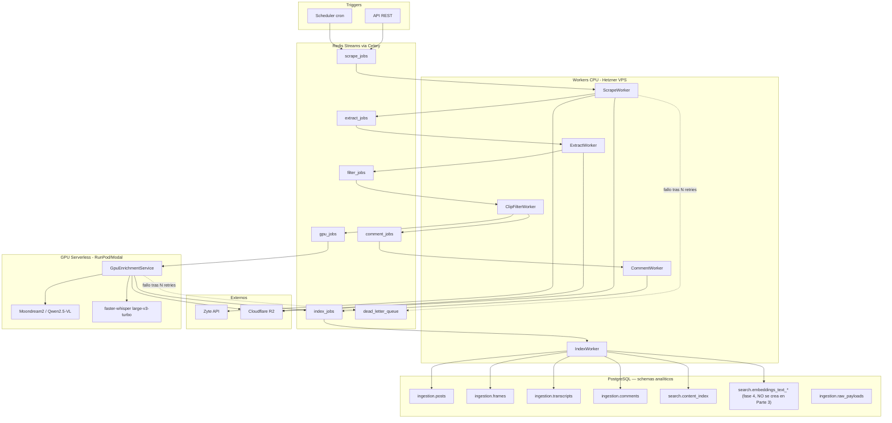

# Plan de implementación — Fase 1: Ingesta y enriquecimiento social (TikTok / Instagram Reels)

**Proyecto:** Qualify (CRM de marketing moderno)
**Módulo:** Ingesta y enriquecimiento social — greenfield.
**Contexto:** Se reutilizan patrones de F1 (plano analítico + Docker) y lecciones de brand-monitoring (scraping social).

---

## 0. Orden de ejecución revisado (Partes) — 2026-07-17

La sección 6 (`Fases de implementación`) de este doc secuenciaba originalmente **scraping primero** (su "Fase 1", semanas 2-3) y la cascada multimodal después (su "Fase 2", semanas 4-6). Se invierte ese orden: la cascada multimodal (F1/F2/F3 — transcripción, filtro, visión — más sentiment) es el diferenciador de Qualify y el mayor riesgo técnico/de calidad, así que se valida primero con datos de muestra, sin esperar a tener scraping ni infra completos. Para evitar confundir estas "Partes" con las "Fases" del roadmap general (`CLAUDE.md` → Roadmap phase map) o con las "Fase 0-5" internas de la sección 6 de este mismo doc, se usa **Parte** para este sub-orden dentro de la Fase 1 del roadmap:

- **Parte 1 (actual):** cascada multimodal como paquete Python independiente y testeable — filtro (`siglip2-base`) → visión (`Qwen3-VL-4B-Instruct`, swap a `moondream3-preview` cuando haya hosting propio) → transcripción (`whisper-large-v3-turbo`) → sentiment (`robertuito`). Corre sobre fixtures/muestras locales, sin ClickHouse, sin Celery, sin scraping — el objetivo es validar el pipeline de análisis en sí. Modelos y justificación en `docs/modelos-multimodal-fase1.md`. Equivale a una versión reducida (sin ffmpeg/GPU-worker/colas) de la vieja "Fase 2" de la sección 6.
- **Parte 2:** scraping/ingesta real (Zyte vs. EnsembleData/Data365, ver `docs/alternativas-fase1.md`) — la vieja "Fase 1" de la sección 6, reordenada **y** con un cambio de alcance deliberado: se construye cobertura **ancha multi-formato** desde el inicio, no el MVP "TikTok video-only" que secuenciaba la §6. Ver la nota de reconciliación al inicio de la §6 y ADR 17 (`arquitectura.md` §6).
- **Parte 3:** infraestructura y orquestación — `docker-compose.yml`, schemas analíticos de Postgres (ADR 31), Redis/Celery, `packages/shared`, conectar Partes 1 y 2 en colas reales (`extract_jobs → filter_jobs → gpu_jobs`, etc.). Equivale a la vieja "Fase 0" (Fundaciones) más el resto de la vieja "Fase 2" (ffmpeg, GPU worker, colas) que no entra en la Parte 1 por no depender de scraping.
- A partir de ahí, la sección 6 sigue tal cual: Fase 3 (comentarios + FTS), Fase 4 (Instagram + embeddings), Fase 5 (hardening) — esas sí dependen de tener Partes 1-3 integradas.

Las secciones 5.2 y 5.3 (elección de CLIP y del vision model) quedan como registro histórico de la decisión original; la decisión vigente de modelos está en `docs/modelos-multimodal-fase1.md`.

---

## 1. Recomendación de infraestructura (mínimo costo)

| Componente | Recomendación | Motivo |
|---|---|---|
| Cola + broker | Redis 7 + Celery (Streams) en VPS | ~$0 marginal vs SQS; ecosistema Python maduro; suficiente para MVP |
| Object storage | Cloudflare R2 | Sin egress fees; ideal para frames/audio/video |
| Plano analítico | **PostgreSQL 16, la misma instancia del CRM** (schemas `ingestion`/`search`/`signals`) — ADR 31 | A 12,5 M filas/año no hay carga analítica que justifique un segundo motor; se gana RLS, joins con el CRM y migraciones reversibles. Imagen `pgvector/pgvector:pg16` para no tener que recrear la base en Fase 4 |
| Workers CPU | Mismo VPS Hetzner (scrape, CLIP, comentarios, indexer) | Un nodo ~€15–25/mes cubre MVP |
| GPU scale-to-zero | RunPod Serverless o Modal | Pago por segundo; cold start 30–90s aceptable para batch; evita GPU 24/7 |
| Scraping | Zyte API (pay-per-request) | Ya definido; no self-host |

**Costo estimado MVP:** ~€30–50/mes infra fija + Zyte variable + GPU solo cuando hay jobs.

**Alternativa futura (escala):** migrar cola a SQS, GPU a pool dedicado spot si el cold start deja de ser aceptable, y **el plano analítico a ClickHouse cuando se cruce el umbral de ADR 31** (`content_index` > 100 M filas, p95 > 2 s con índices afinados, o un cliente con > 5 000 posts/día). Escotilla intermedia antes de esa mudanza: **chDB**, que consulta las tablas de Postgres con la función `postgresql()` y da analítica de grado ClickHouse sin operar un servidor.

## 2. Diagrama de flujo de datos



**Principio de diseño:** cada etapa es idempotente y persiste artefactos en R2 + estado en Redis/Postgres antes de encolar la siguiente. Si el GPU está frío, los jobs esperan en `gpu_jobs` sin bloquear scrape ni CLIP.

## 3. Esquema del plano analítico — contrato de la Parte 3

**Motor: PostgreSQL** (ADR 31, 2026-08-05). Misma base que el CRM (`qualify`), en schemas separados: `ingestion` (hechos estructurados por plataforma), `search` (texto unificado + vectores) y `signals` (señales tipadas derivadas). El plano transaccional sigue en `public`.

> **Historial de esta sección, porque explica por qué está escrita como está.** Se reescribió el 2026-08-04 como contrato de ClickHouse —reconciliando ADR 18/22/24 y cerrando las decisiones D1/D2/D3— y el 2026-08-05 el fundador invirtió el motor (**ADR 31**: el volumen real, ~12,5 M filas/año, no justifica ClickHouse en el MVP). **Lo que sobrevivió de aquel trabajo es casi todo:** las formas de tabla, la clave natural, las tres reglas de provenance, el keying dual marca/tenant y las decisiones D1/D2/D3. **Lo que murió fue la parte cara:** las justificaciones de `ORDER BY` inmutables y la elección de motores de merge. La ironía vale la pena registrarla — la urgencia de aquella sesión venía de la irreversibilidad, y la decisión que la siguió eliminó la irreversibilidad.

### 3.0 Cómo leer esta sección

**Orden de autoridad.** `docs/arquitectura.md` §6 (ADRs) es la ley; esta sección la materializa en DDL. Si algo aquí contradice un ADR, gana el ADR y esta sección tiene un bug.

**Qué se crea y qué no.**

| Tabla | Estado | Fase consumidora |
|---|---|---|
| `ingestion.posts` | **CREAR** | 1 / 2 |
| `ingestion.post_media` | **CREAR** | 1 |
| `ingestion.frames` | **CREAR** | 1 / 3 |
| `ingestion.transcripts` | **CREAR** | 1 / 2 |
| `ingestion.comments` | **CREAR** | 1 / 2 |
| `ingestion.raw_payloads` | **CREAR** | 1 (re-parse) |
| `search.content_index` | **CREAR** | 2 |
| `ingestion.pipeline_jobs` | **CREAR** | 1 (observabilidad) |
| `ingestion.brands` | **NO CREAR — eliminada** (§3.2) | — |
| `signals.events` | **DDL congelado** (§3.13), se crea con el primer detector | 2 / 3 |
| `search.owned_content_index` | **DISEÑADA-NO-CONSTRUIDA** (§3.12) | Parte 4 / 2 |
| `search.embeddings_text_*` | **NO CREAR** — plantilla (§3.14) | 4 |
| `search.visual_embeddings` | **DISEÑADA-NO-CONSTRUIDA** (ADR 11) | 3 |
| `crm.creator_centroids_text` | Fuera de Parte 3 — DDL en `arquitectura.md` §4 | 4 |
| `ingestion.owned_metrics` | **SIN DISEÑAR** — ver §3.15 | Parte 4 / 2 |

**Qué cambió al pasar de ClickHouse a Postgres, en una tabla — para quien venga de la versión anterior:**

| Concepto ClickHouse | Equivalente Postgres | Nota |
|---|---|---|
| `ORDER BY` (inmutable) | índice B-tree (creable y tirable) | La regla de prefijo sigue aplicando a la *query*, pero equivocarse ya no es catastrófico |
| `ReplacingMergeTree(updated_at)` | `UNIQUE` + `INSERT … ON CONFLICT DO UPDATE` con guarda monótona | **Más fuerte**: la deduplicación deja de ser eventual y pasa a ser una garantía en el `INSERT` |
| `PARTITION BY toYYYYMM(...)` | sin particionar hasta ~50 M filas; luego `PARTITION BY RANGE` | Ver §3.1(e) |
| `tokenbf_v1` (búsqueda por tokens) | `tsvector` + GIN | Mejor: hay *stemming* y ranking, no sólo filtro de candidatos |
| `ngrambf_v1` (substring) | `pg_trgm` + GIN | Equivalente funcional |
| `LowCardinality(String)` | `text` | Postgres ya comprime; y `text` no obliga a migrar cuando aparece un valor nuevo |
| `Array(Float32)` + `vector_similarity` | `vector(n)` de `pgvector` + índice HNSW | ADR 11 sobrevive: la dim sigue siendo fija, ahora en el tipo |
| `TTL … DELETE` | job programado de borrado | Postgres no tiene TTL nativo: es un `DELETE` de Celery Beat (§3.10) |
| aislamiento en la aplicación | **RLS**, igual que el CRM | La contrapartida que ADR 24 aceptó desaparece (§3.1(b)) |

### 3.1 Reglas transversales (leer antes de tocar cualquier DDL)

**(a) Nada aquí es irreversible.** Es la diferencia práctica más grande respecto de la versión anterior de esta sección: un índice mal elegido se tira y se recrea. **La única excepción real es convertir una tabla ya poblada en particionada**, que exige reescribirla — barato a 12 M filas (minutos), caro a 500 M. Por eso §3.1(e) fija cuándo hacerlo, no *si*.

**(b) Aislamiento: RLS en todas las tablas, y aquí se gana algo.** Toda tabla analítica lleva `tenant_id uuid NOT NULL` con `ENABLE` + **`FORCE` ROW LEVEL SECURITY** y la misma política que la revisión 0001:

```sql
ALTER TABLE <t> ENABLE ROW LEVEL SECURITY;
ALTER TABLE <t> FORCE  ROW LEVEL SECURITY;
CREATE POLICY tenant_isolation ON <t>
    USING      (tenant_id = NULLIF(current_setting('app.tenant_id', true), '')::uuid)
    WITH CHECK (tenant_id = NULLIF(current_setting('app.tenant_id', true), '')::uuid);
```

El `NULLIF` es **portante** y no se «simplifica»: sin él, una conexión de pool reutilizada devuelve `''` y `''::uuid` revienta en vez de fallar cerrado (ruling R7, `arquitectura.md` §6). `FORCE` es igual de portante: sin él el propietario de la tabla queda exento y las políticas existen sin proteger.

> **Esto retira una contrapartida que ADR 24 había aceptado por escrito.** ADR 24(c) cerraba con *«bajo (c) las filas de media ajena no se auto-aíslan — la comprobación de titularidad vive en la aplicación»*, defendible porque el dato es público, pero explícitamente **no** el aislamiento estructural que se exigía en primera parte. Con un solo motor esa asimetría desaparece: la media ganada se aísla con el mismo mecanismo que las credenciales OAuth. **Y `tenant_id` en estas tablas no contradice ADR 24(c)**, cuya prohibición era *«`tenant_id` NO va en el prefijo de todos los `ORDER BY`»* — una regla sobre una estructura que ya no existe. Lo que sí sobrevive de ADR 24 y **no** se toca es (b): `brand_id` y `tenant_id` siguen siendo ejes ortogonales, *qué* se observa vs. *quién* puede verlo, y no se fusionan.

**(c) Provenance obligatoria.** Toda señal o enriquecimiento derivado lleva el `post_id`/`comment_id`/`source_id` del que se computó **más** la versión de lo que lo produjo. Tres ejes ortogonales, nunca conflados (ADR 18):

| Eje | Qué versiona | Sube cuando |
|---|---|---|
| `payload_schema_version` | forma del envelope crudo + algoritmo de firma | cambia la estructura del envelope (hoy `= 2`, ADR 22(b)) |
| `parser_version` | el código que transforma raw → fila | mejoramos el parser |
| `pipeline_version` | la orquestación que produjo el enriquecimiento | cambia la cascada |

Y por cada modelo que escribe una columna: `<x>_model` + `<x>_model_revision` (la revision del checkpoint en el Hub, no sólo el nombre — el tag se puede mover y entonces *«lo produjo whisper-large-v3-turbo»* no identifica pesos).

**(d) Tipos.** `text` para todo lo textual (nada de `varchar(n)`: el límite no aporta y migrar el límite sí cuesta; nada de `enum`: añadir un valor obliga a migración y estos vocabularios —plataformas, modelos, estados— cambian). `timestamptz` siempre, con todo en UTC. `uuid` para identificadores propios. `jsonb` sólo donde el contenido no se filtra por sus campos. `NOT NULL` con `DEFAULT` en vez de nullable, salvo donde «desconocido» sea un estado real y distinto de «vacío». Postgres no tiene enteros sin signo: `bigint` para `views` (hay vídeos por encima de 4,29e9), `integer` para el resto de métricas.

**(e) Particionado: NO al principio.** Asunción de trabajo: ~600 posts/día → ~34 k filas/día en `search.content_index`, ~12,5 M/año, ~5 GB/año con índices. A ese tamaño particionar añade complejidad de planificación sin comprar nada. **Umbral para particionar por rango mensual sobre `posted_date`: ~50 M filas en la tabla** (realistamente `content_index` y `comments` primero). Coste declarado de esperar: convertir exige reescribir la tabla — minutos hoy, ventana de mantenimiento a 500 M. Se acepta a conciencia porque el umbral avisa mucho antes.

**(f) Idempotencia — y aquí Postgres es estrictamente mejor.** Clave natural `(brand_id, platform, post_id)`. Cada tabla lleva una **restricción `UNIQUE`** sobre la identidad completa de su fila, y las escrituras van por *upsert* con guarda monótona:

```sql
INSERT INTO ingestion.posts (...) VALUES (...)
ON CONFLICT (tenant_id, brand_id, platform, post_id) DO UPDATE
SET  views = EXCLUDED.views, ..., updated_at = EXCLUDED.updated_at
WHERE EXCLUDED.updated_at > ingestion.posts.updated_at;   -- reintento tardío NO pisa dato nuevo
```

Dos propiedades que la versión ClickHouse no podía dar: el duplicado se **rechaza en el `INSERT`** en vez de colapsarse en un merge futuro (se acabó el *«dedup eventual»* y el `FINAL`/`argMax` defensivo en las queries), y la guarda `WHERE EXCLUDED.updated_at > …` hace que un reintento fuera de orden no revierta un estado más nuevo — un modo de fallo que en `ReplacingMergeTree` había que resolver eligiendo bien la columna de versión y confiando.

**(g) Extensiones requeridas.** `pgcrypto` (ya en 0001), **`pg_trgm`** (búsqueda por substring), y **`vector`** sólo cuando llegue la Fase 4. `vector` **no viene en la imagen `postgres:16` del compose**: exige cambiar a `pgvector/pgvector:pg16`. Hacerlo ahora es gratis (la base se recrea con `just down` → `just dev`) y evita descubrirlo el día que se necesite.

### 3.2 `ingestion.brands` — **ELIMINADA, no crear**

El plan anterior definía una dimensión `ingestion.brands`. **Se elimina**, y con un solo motor la razón se vuelve trivial: `brands` ya existe en `public` desde la migración `0001_tenancy_foundation`, con `tenant_id NOT NULL` y RLS. Duplicarla sería tener dos copias de la misma tabla **en la misma base de datos**.

Ganancia colateral de ADR 31: donde antes hacía falta un `DICTIONARY` sobre Postgres o resolver el nombre en la aplicación, ahora `ingestion.posts` hace `JOIN public.brands USING (brand_id)` y ya está. La regla operativa que la versión ClickHouse tenía que imponer a mano —*«ningún `brand_id` del cliente sin resolverlo antes contra Postgres bajo RLS»*— **la aplica ahora el motor**: RLS filtra ambas tablas en la misma consulta.

### 3.3 `ingestion.posts` (núcleo de media ganada)

**Queries esperadas:** (1) posts de una marca en un rango de fechas — dominante; (2) idem acotado a una plataforma; (3) lookup por clave natural; (4) posts de un creador dentro de una marca.

```sql
CREATE TABLE ingestion.posts (
    id                     bigint GENERATED ALWAYS AS IDENTITY PRIMARY KEY,
    tenant_id              uuid        NOT NULL REFERENCES public.tenants(id),
    brand_id               uuid        NOT NULL REFERENCES public.brands(id),
    platform               text        NOT NULL,   -- tiktok | instagram
    post_id                text        NOT NULL,   -- id nativo de la plataforma
    content_type           text        NOT NULL,   -- tiktok_video | instagram_reel | ...
    creator_handle         text        NOT NULL DEFAULT '',
    creator_id             text        NOT NULL DEFAULT '',
    post_url               text        NOT NULL DEFAULT '',
    caption                text        NOT NULL DEFAULT '',
    posted_at              timestamptz NOT NULL,
    posted_date            date        GENERATED ALWAYS AS ((posted_at AT TIME ZONE 'UTC')::date) STORED,
    -- Métricas
    views                  bigint      NOT NULL DEFAULT 0,
    likes                  integer     NOT NULL DEFAULT 0,
    comments_count         integer     NOT NULL DEFAULT 0,
    shares                 integer     NOT NULL DEFAULT 0,
    -- Artefactos
    video_r2_key           text        NOT NULL DEFAULT '',
    audio_r2_key           text        NOT NULL DEFAULT '',
    hydration_json_r2_key  text        NOT NULL,
    duration_ms            integer     NOT NULL DEFAULT 0,
    -- Provenance (§3.1(c))
    content_signature      text        NOT NULL,
    payload_schema_version smallint    NOT NULL DEFAULT 2,
    parser_version         text        NOT NULL,
    pipeline_version       text        NOT NULL DEFAULT '',
    scraped_at             timestamptz NOT NULL,
    -- Estado de pipeline (espejo de observabilidad, NO fuente de verdad — ver nota)
    scrape_status          text        NOT NULL DEFAULT 'pending',
    enriched_at            timestamptz,
    error_message          text        NOT NULL DEFAULT '',
    updated_at             timestamptz NOT NULL DEFAULT now(),
    CONSTRAINT posts_natural_key UNIQUE (tenant_id, brand_id, platform, post_id)
);

CREATE INDEX posts_listing_idx  ON ingestion.posts (tenant_id, brand_id, posted_date DESC, platform);
CREATE INDEX posts_creator_idx  ON ingestion.posts (tenant_id, brand_id, creator_handle);
CREATE INDEX posts_status_idx   ON ingestion.posts (scrape_status) WHERE scrape_status <> 'indexed';
```

**Sobre las claves:**

- **`UNIQUE (tenant_id, brand_id, platform, post_id)`** es la clave natural de `CLAUDE.md` con `tenant_id` delante. `tenant_id` es redundante con `brand_id` (una marca cuelga de un tenant) pero se incluye igualmente: **una `UNIQUE` que empieza por `tenant_id` es también el índice que RLS usa en cada consulta**, y la redundancia cuesta 16 bytes por fila.
- **`id` sintético como PK** en lugar de la clave natural compuesta: las tablas hijas (`post_media`, `frames`, `comments`) referencian el post, y una FK de cuatro columnas se propaga a todas ellas. La clave natural sigue siendo única y es la que usa el upsert.
- **`posts_listing_idx` es el orden que en ClickHouse era el `ORDER BY`**, y el razonamiento se conserva íntegro: el prefijo `(tenant_id, brand_id)` está en todas las queries de listening, `posted_date DESC` sirve el rango temporal en el sentido en que se lee, y `platform` va al final porque el filtro por plataforma es opcional en un producto cross-plataforma. La diferencia es que si esto resulta estar mal, se arregla con un `CREATE INDEX`.
- **`content_type` no entra en el índice de listado** (mismo razonamiento de 2026-07-19: se filtra por marca+fecha, no por formato). Si aparecen queries por formato, es un índice más.

**Notas de contrato:**

1. **Sólo media ganada.** Un post publicado por una cuenta conectada del propio tenant no va aquí (§3.12).
2. **`scrape_status` es un espejo, no un semáforo.** El plano analítico nunca es fuente de verdad de estado (`arquitectura.md` §4). La idempotencia se apoya en la `UNIQUE` + los artefactos en R2, no en leer esta columna para decidir si reprocesar. El índice parcial `WHERE scrape_status <> 'indexed'` existe para diagnóstico y para barridos de reconciliación, y se mantiene pequeño por construcción.
3. **`posted_date` es columna generada**, no calculada por el worker: así no puede desincronizarse de `posted_at`.

### 3.4 `ingestion.post_media` (ítems N-arios: galerías, carruseles)

Formatos de N ítems (foto-galería de TikTok, carrusel de IG) no caben en `video_r2_key`/`audio_r2_key`. Cada ítem se procesa por separado aguas abajo (su upload, su job de extracción), así que va como tabla hija y no como `jsonb`: el estado por-ítem se actualiza de forma independiente, y un array obligaría a reescribir el documento entero en cada actualización.

```sql
CREATE TABLE ingestion.post_media (
    id          bigint GENERATED ALWAYS AS IDENTITY PRIMARY KEY,
    tenant_id   uuid    NOT NULL REFERENCES public.tenants(id),
    post_pk     bigint  NOT NULL REFERENCES ingestion.posts(id) ON DELETE CASCADE,
    ordinal     smallint NOT NULL,               -- 0..N-1
    kind        text    NOT NULL,                -- video | image | audio
    source_url  text    NOT NULL DEFAULT '',
    r2_key      text    NOT NULL DEFAULT '',     -- se puebla tras el upload
    duration_ms integer NOT NULL DEFAULT 0,
    width       integer NOT NULL DEFAULT 0,
    height      integer NOT NULL DEFAULT 0,
    pipeline_version text NOT NULL DEFAULT '',
    updated_at  timestamptz NOT NULL DEFAULT now(),
    CONSTRAINT post_media_key UNIQUE (post_pk, ordinal)
);
```

`ON DELETE CASCADE` es otra cosa que el motor anterior no daba: borrar un post limpia sus ítems, sus frames y sus comentarios sin un job de barrido.

### 3.5 `ingestion.frames`

```sql
CREATE TABLE ingestion.frames (
    id           bigint GENERATED ALWAYS AS IDENTITY PRIMARY KEY,
    tenant_id    uuid     NOT NULL REFERENCES public.tenants(id),
    post_pk      bigint   NOT NULL REFERENCES ingestion.posts(id) ON DELETE CASCADE,
    media_ordinal smallint NOT NULL DEFAULT 0,   -- ítem de post_media del que salió
    frame_index  integer  NOT NULL,
    timestamp_ms integer  NOT NULL DEFAULT 0,
    r2_key       text     NOT NULL DEFAULT '',
    -- Filtro CLIP-style (etapa barata)
    clip_score            real    NOT NULL DEFAULT 0,
    clip_labels           text[]  NOT NULL DEFAULT '{}',
    clip_selected         boolean NOT NULL DEFAULT false,
    clip_model            text    NOT NULL DEFAULT '',
    clip_model_revision   text    NOT NULL DEFAULT '',
    clip_label_set_version text   NOT NULL DEFAULT '',
    clip_threshold        real    NOT NULL DEFAULT 0,
    -- Enriquecimiento de visión (etapa cara)
    vision_model          text    NOT NULL DEFAULT '',
    vision_model_revision text    NOT NULL DEFAULT '',
    vision_description    text    NOT NULL DEFAULT '',
    vision_processed_at   timestamptz,
    pipeline_version      text    NOT NULL DEFAULT '',
    posted_date           date    NOT NULL,
    updated_at            timestamptz NOT NULL DEFAULT now(),
    CONSTRAINT frames_key UNIQUE (post_pk, media_ordinal, frame_index)
);

CREATE INDEX frames_pending_vision_idx ON ingestion.frames (tenant_id, posted_date)
    WHERE clip_selected AND vision_processed_at IS NULL;
```

**`clip_threshold` y `clip_label_set_version` son obligatorias y no adorno:** un filtro zero-shot cambia de salida al cambiar el umbral o el conjunto de etiquetas candidatas **sin cambiar el modelo**. Sin ellas, un `clip_selected = false` es irrepetible y la calibración de la cascada (`arquitectura.md` §3.4, donde ya consta que las tasas de descarte nunca se han medido) no es auditable. Es la misma razón por la que ADR 16 exige `label_set_version`.

`frames_pending_vision_idx` es un **índice parcial**, y es el ejemplo más claro de lo que se gana: la cola de trabajo del worker de visión —*«frames seleccionados que aún no tienen descripción»*— es un índice diminuto que sólo contiene lo pendiente, en vez de un escaneo con filtro. En el motor anterior esto habría sido un `WHERE` sobre columnas fuera de la clave.

### 3.6 `ingestion.transcripts`

```sql
CREATE TABLE ingestion.transcripts (
    id            bigint GENERATED ALWAYS AS IDENTITY PRIMARY KEY,
    tenant_id     uuid    NOT NULL REFERENCES public.tenants(id),
    post_pk       bigint  NOT NULL REFERENCES ingestion.posts(id) ON DELETE CASCADE,
    media_ordinal smallint NOT NULL DEFAULT 0,
    language      text    NOT NULL DEFAULT '',
    text_full     text    NOT NULL DEFAULT '',
    segments      jsonb   NOT NULL DEFAULT '[]'::jsonb,   -- [{start_ms, end_ms, text}]
    asr_model     text    NOT NULL DEFAULT '',
    asr_model_revision text NOT NULL DEFAULT '',
    confidence_avg real   NOT NULL DEFAULT 0,
    pipeline_version text NOT NULL DEFAULT '',
    posted_date   date    NOT NULL,
    updated_at    timestamptz NOT NULL DEFAULT now(),
    CONSTRAINT transcripts_key UNIQUE (post_pk, media_ordinal)
);
```

`segments` pasa de `String` con JSON dentro a **`jsonb` de verdad**: se lee entero para renderizar o re-segmentar, pero ahora además se puede consultar si hiciera falta, sin coste extra.

`whisper_model` se renombró a `asr_model` en la revisión anterior y se mantiene: el checkpoint no está lockeado (`CLAUDE.md` exige golden-set antes de fijarlo) y cambiar de ASR no debe exigir cambiar el esquema.

### 3.7 `ingestion.comments`

```sql
CREATE TABLE ingestion.comments (
    id            bigint GENERATED ALWAYS AS IDENTITY PRIMARY KEY,
    tenant_id     uuid    NOT NULL REFERENCES public.tenants(id),
    post_pk       bigint  NOT NULL REFERENCES ingestion.posts(id) ON DELETE CASCADE,
    comment_id    text    NOT NULL,
    parent_comment_id text NOT NULL DEFAULT '',   -- '' = primer nivel
    author_handle text    NOT NULL DEFAULT '',
    author_id     text    NOT NULL DEFAULT '',
    text_raw      text    NOT NULL DEFAULT '',
    text_clean    text    NOT NULL DEFAULT '',
    -- NLP (etapa barata)
    is_spam       boolean NOT NULL DEFAULT false,
    spam_reason   text    NOT NULL DEFAULT '',
    spam_rules_version text NOT NULL DEFAULT '',
    sentiment     text    NOT NULL DEFAULT '',
    sentiment_score real  NOT NULL DEFAULT 0,
    sentiment_model text  NOT NULL DEFAULT '',
    sentiment_model_revision text NOT NULL DEFAULT '',
    like_count    integer NOT NULL DEFAULT 0,
    pipeline_version text NOT NULL DEFAULT '',
    posted_at     timestamptz NOT NULL,
    posted_date   date    NOT NULL,
    updated_at    timestamptz NOT NULL DEFAULT now(),
    CONSTRAINT comments_key UNIQUE (post_pk, comment_id)
);

CREATE INDEX comments_author_idx    ON ingestion.comments (tenant_id, author_handle, posted_date DESC);
CREATE INDEX comments_sentiment_idx ON ingestion.comments (tenant_id, posted_date) WHERE NOT is_spam;
```

`comments_author_idx` existe porque el eje comentaristas/audiencia (P3-2/P4-2) es un diferenciador declarado del roadmap y *«todo lo que ha comentado esta persona»* será una consulta frecuente. En la versión ClickHouse esto era un índice de salto con la advertencia de que si se volvía dominante habría que crear una vista materializada con otra clave; **aquí es simplemente un índice más**, y el problema desaparece.

`parent_comment_id` entra ahora aunque Fase 1 no lo use: sin ella un hilo de respuestas se aplana y no se reconstruye sin re-scrapear.

### 3.8 `search.content_index` (FTS unificado — la tabla que consume la Fase 2)

Una fila por **fragmento de texto indexable** de media ganada. Es el punto de entrada de los cuatro entregables de Fase 2.

**Queries esperadas:** (1) búsqueda de texto dentro de una marca en un rango de fechas — dominante; (2) idem acotada a un tipo de fragmento; (3) todos los fragmentos de un post; (4) filtros cruzados por sentiment/spam.

```sql
CREATE TABLE search.content_index (
    id            bigint GENERATED ALWAYS AS IDENTITY PRIMARY KEY,
    tenant_id     uuid    NOT NULL REFERENCES public.tenants(id),
    brand_id      uuid    NOT NULL REFERENCES public.brands(id),
    platform      text    NOT NULL,
    post_pk       bigint  NOT NULL REFERENCES ingestion.posts(id) ON DELETE CASCADE,
    post_id       text    NOT NULL,                -- id nativo, denormalizado para mostrar sin join
    content_type  text    NOT NULL,                -- caption | frame | transcript | comment
    source_id     text    NOT NULL,                -- frame_index, comment_id, o 'caption'
    content_text  text    NOT NULL,
    content_tsv   tsvector GENERATED ALWAYS AS (to_tsvector('spanish', content_text)) STORED,
    language      text    NOT NULL DEFAULT '',     -- '' = desconocido (NO 'es' por defecto)
    posted_at     timestamptz NOT NULL,
    posted_date   date    NOT NULL,
    -- Metadata denormalizada para filtros cruzados
    creator_handle text   NOT NULL DEFAULT '',
    sentiment      text   NOT NULL DEFAULT '',
    sentiment_model text  NOT NULL DEFAULT '',
    is_spam        boolean NOT NULL DEFAULT false,
    -- Provenance del fragmento
    parser_version   text NOT NULL DEFAULT '',
    pipeline_version text NOT NULL DEFAULT '',
    indexed_at    timestamptz NOT NULL DEFAULT now(),
    CONSTRAINT content_index_fragment_key UNIQUE (post_pk, content_type, source_id)
);

CREATE INDEX content_tsv_idx    ON search.content_index USING gin (content_tsv);
CREATE INDEX content_trgm_idx   ON search.content_index USING gin (content_text gin_trgm_ops);
CREATE INDEX content_listing_idx ON search.content_index
    (tenant_id, brand_id, content_type, posted_date DESC);
```

**El orden del índice de listado conserva el razonamiento del `ORDER BY` anterior**: `(tenant_id, brand_id)` está en toda query, `content_type` es el segundo filtro real de la Fase 2 (*«sólo comentarios»*, *«sólo transcripciones»*), y `posted_date DESC` sirve el rango en el sentido en que se lee. `platform` sigue fuera a propósito: el producto es listening cross-plataforma, el filtro por defecto es *«todas»*, y ahora si me equivoco es un `CREATE INDEX` y no una re-ingesta.

**Tres cosas que mejoran de verdad, no sólo cambian de sintaxis:**

1. **La búsqueda deja de ser un filtro de candidatos y pasa a ser búsqueda.** `tokenbf_v1` era un bloom filter: descartaba gránulos y luego había que escanear. `tsvector` + GIN da *stemming* español (*«pagando»* encuentra *«pagar»*), operadores de frase y `ts_rank` para ordenar por relevancia — que es lo que un producto de listening necesita y lo que el motor anterior no tenía. `pg_trgm` cubre el substring que hacía `ngrambf_v1`.
2. **La duplicación por re-indexado se vuelve imposible, no improbable.** La versión ClickHouse tenía aquí un bug real (`MergeTree` plano duplicaba cada fragmento al re-parsear); se arregló pasando a `ReplacingMergeTree`, que colapsa **en el merge**. La `UNIQUE (post_pk, content_type, source_id)` lo rechaza **en el `INSERT`**. Se acabó el `LIMIT 1 BY` defensivo en los conteos.
3. **`sentiment` viaja con `sentiment_model`**, porque una copia desnormalizada de una salida de modelo sin la identidad del modelo mezcla dos poblaciones indistinguibles en cuanto se cambie de checkpoint.

**Limitación declarada del `tsvector` generado:** la configuración es `'spanish'` fija, porque una columna generada exige una función `IMMUTABLE` y elegir el diccionario por la columna `language` no lo es. Para un corpus mayoritariamente español es correcto, y el contenido en otros idiomas sigue siendo buscable (peor *stemming*, no invisible) además de estar cubierto por el índice trigram. Si el corpus se vuelve multilingüe en serio, la salida es poblar `content_tsv` desde el *index-worker* con el diccionario detectado — **un `ALTER TABLE`, no una migración de plano**. Se registra como la primera decisión de esta sección que ADR 31 permite dejar abierta a propósito.

**Lo que esta tabla NO contiene (decisión D2 — tema/intención/postura).** Ni ahora ni después se le añaden columnas `topic`/`intent`/`stance`. El hueco es real —la Fase 2 promete *«informes de temas»* y aquí sólo hay polaridad— pero su solución es `signals.events` (§3.13), por tres razones ya decididas en ADR 16: es multi-label por fragmento; una etiqueta de tema necesita `detector_version` + `threshold` + `label_set_version` viajando con ella; y re-etiquetar con un `label_set` nuevo debe **añadir** filas versionadas, no sobrescribir un histórico del que ya salieron informes.

### 3.9 `ingestion.raw_payloads` (aterrizaje del envelope v2)

Cierra el *sketch* que ADR 18 dejó abierto. El envelope persistido en R2 es brand-agnóstico y su ciclo de vida es el de la **captura**, distinto del ciclo del post parseado: por eso es tabla propia y no columnas de `ingestion.posts`.

```sql
CREATE TABLE ingestion.raw_payloads (
    id             bigint GENERATED ALWAYS AS IDENTITY PRIMARY KEY,
    platform       text        NOT NULL,
    source_url     text        NOT NULL,          -- ya saneada (sin params con credencial)
    content_signature text     NOT NULL,          -- 'sha256:<hex>' sobre los bytes canónicos
    r2_key         text        NOT NULL,
    payload_schema_version smallint NOT NULL DEFAULT 2,
    source_class   text        NOT NULL DEFAULT 'scrape',
    transport      text        NOT NULL DEFAULT 'zyte',
    fetched_at     timestamptz NOT NULL,
    byte_size      integer     NOT NULL DEFAULT 0,
    parse_status   text        NOT NULL DEFAULT 'pending',
    parser_version text        NOT NULL DEFAULT '',
    error_message  text        NOT NULL DEFAULT '',
    updated_at     timestamptz NOT NULL DEFAULT now(),
    CONSTRAINT raw_payload_identity UNIQUE (platform, source_url, content_signature)
);

CREATE INDEX raw_latest_idx ON ingestion.raw_payloads (platform, source_url, fetched_at DESC);
```

**La tensión que ADR 18 dejó explícita («conservar todo el histórico» vs. «sólo el último») se resuelve con `content_signature` dentro de la clave**, igual que en la versión anterior: cada *contenido distinto* de un mismo `(platform, source_url)` conserva su fila —se puede re-parsear cualquier captura histórica— y dos fetches que devolvieron bytes idénticos chocan contra la `UNIQUE`, que es literalmente la regla *«nunca re-parsear/re-almacenar contenido idéntico»* implementada por el motor. `raw_latest_idx` sirve el *«dame el último raw de esta URL»*.

> **Ésta es la única tabla de la sección SIN `tenant_id` y SIN RLS, y es deliberado.** El envelope de la rama `scrape` es **brand-agnóstico por diseño** (ADR 18): no lleva `brand_id` ni `tenant_id`, y ahí es donde vive la economía de *«N marcas comparten un scrape»* — el ahorro real, que es la llamada a Zyte. Poner `tenant_id` aquí destruiría esa propiedad. **El aislamiento no se pierde: se desplaza**, porque el vínculo entre un raw y un tenant lo hace `ingestion.posts` (que sí lleva RLS) vía `hydration_json_r2_key` + `content_signature`. Lo que esta tabla contiene es una URL pública y un hash — nada de un tenant.
>
> La rama de primera parte (`source_class = 'first_party_api'`) **no aterriza aquí**: su espacio de claves es disjunto y tenant-prefijado (`t/{tenant_id}/fp/…`, `qualify_scraper/shared.py:255-264`), luego su tabla de captura es otra, tenant-keyed y con RLS, y se diseña con la Parte 4. Las columnas `source_class`/`transport` viven aquí igualmente porque son parte del envelope v2 y omitirlas haría que la fila no describiera su propio artefacto.

### 3.10 `ingestion.pipeline_jobs` (observabilidad)

```sql
CREATE TABLE ingestion.pipeline_jobs (
    id          bigint GENERATED ALWAYS AS IDENTITY PRIMARY KEY,
    job_id      uuid        NOT NULL,
    stage       text        NOT NULL,
    status      text        NOT NULL,
    tenant_id   uuid,                       -- nullable: hay jobs de sistema sin tenant
    brand_id    uuid,
    platform    text        NOT NULL DEFAULT '',
    post_id     text        NOT NULL DEFAULT '',
    attempt     smallint    NOT NULL DEFAULT 1,
    duration_ms integer     NOT NULL DEFAULT 0,
    error       text        NOT NULL DEFAULT '',
    pipeline_version text   NOT NULL DEFAULT '',
    created_at  timestamptz NOT NULL DEFAULT now(),
    finished_at timestamptz
);

CREATE INDEX jobs_health_idx  ON ingestion.pipeline_jobs (stage, status, created_at DESC);
CREATE INDEX jobs_failure_idx ON ingestion.pipeline_jobs (created_at DESC) WHERE status = 'failed';
CREATE INDEX jobs_post_idx    ON ingestion.pipeline_jobs (post_id) WHERE post_id <> '';
```

El orden `(stage, status, created_at)` responde a la pregunta dominante de una tabla de operación —*«¿qué está fallando ahora?»*— y no a *«qué pasó con esta marca»*, que es lo que no se sabe cuando algo se rompe. `jobs_failure_idx` es un índice parcial diminuto: el panel de fallos no escanea la tabla.

**Dos diferencias operativas respecto del plan ClickHouse, ambas a peor, y se declaran:**

1. **No hay `TTL` nativo.** La retención de 90 días es un job de Celery Beat: `DELETE FROM ingestion.pipeline_jobs WHERE created_at < now() - interval '90 days'`. Hay que escribirlo; no ocurre solo. Si el volumen de jobs crece hasta hacer caro ese `DELETE`, la respuesta es particionar por mes y pasar a `DROP TABLE` de la partición vieja — **y ésta es la tabla donde antes se cruzará ese umbral**, por ser la de mayor tasa de escritura y menor valor por fila.
2. **Esta tabla no lleva RLS.** Es observabilidad de operación, se consulta con rol administrativo, y `tenant_id` es nullable porque hay jobs de sistema. Consecuencia que hay que aceptar de frente: **es la única tabla del plano analítico donde un error de la aplicación podría exponer actividad de un tenant a otro**, así que no se expone en la UI de producto — sólo en herramientas internas.

### 3.11 El envelope de raw-payload v2 — referencia corregida

> Sustituye a la nota del plan original, que seguía describiendo `payload_schema_version = 1` y `zyte_request_meta`. La forma canónica, la función de firma y el seam de `persist` son **autoritativos en ADR 18 + ADR 22(b)**; esto es el resumen necesario para leer §3.9. Verificado contra `packages/scraper/src/qualify_scraper/shared.py` en disco, no contra documentación. **ADR 31 no toca nada de esto:** el envelope, R2 y la firma son independientes del motor analítico.

`payload_schema_version = 2` (`shared.py:38`). Campos:

| Campo | Propósito |
|---|---|
| `source_class` | `scrape` \| `first_party_api`. Parte la identidad en **dos espacios de clave disjuntos** (ADR 22(b)). Un envelope `first_party_api` sin `tenant_id`/`connection_id`/`object_id` es **inconstruible** — lo impide un validador (`shared.py:203-210`), no una convención. |
| `platform`, `source_url` | Identidad brand-agnóstica del artefacto crudo en la rama `scrape`. **No** llevan `brand_id`/`post_id`: la clave natural vive en el `Post` parseado, y así N marcas comparten un scrape. |
| `tenant_id`, `connection_id`, `object_id` | Sólo en la rama de primera parte. Prefijan la clave de storage (`t/{tenant_id}/fp/…`) → borrar el raw de un tenant es un **delete por prefijo**. ADR 22(2): la supresión dirigida es una *obligación*, no un riesgo. |
| `content_signature` | `"sha256:" + hex` sobre los bytes canónicos. **Sin salt de tenant**: contenido idéntico debe tener identidad idéntica; el aislamiento es propiedad de la *ruta*, no de la identidad. |
| `fetched_at`, `transport`, `transport_meta` | Provenance de captura. **`zyte_request_meta` se renombró a `transport_meta`** (ADR 22(b)). Se sanea antes de firmar para que ninguna credencial acabe en un artefacto archivado (`shared.py:93`, `_CREDENTIAL_KEYS`). |
| `payload_schema_version` | Versiona la forma del envelope + el algoritmo de firma. |
| `hydration` | El payload crudo. Lo persistido es el **envelope entero** canonicalizado, no el `hydration` desnudo. |

`r2_key` **no** es campo del sobre: es el retorno de `persist()`, y es lo que hereda `ingestion.posts.hydration_json_r2_key`. **Sin ruta de compatibilidad v1** (ADR 22(b)).

### 3.12 `search.owned_content_index` — **DISEÑADA-NO-CONSTRUIDA** (decisión D1)

**La pregunta:** cuando la Parte 4 lea las cuentas conectadas del propio tenant (captions de sus reels, comentarios recibidos), ¿ese texto entra al índice de listening junto al ganado?

**La decisión se mantiene: sí entra, en su propia tabla.** Pero **su fundamento cambió con ADR 31 y hay que decirlo** (ver `arquitectura.md` §6, nota A6). ADR 30 separó las tablas porque *«una tabla tiene un solo prefijo de `ORDER BY` y las dos clases exigen prefijos incompatibles»* y porque la supresión dirigida exigía un borrado por prefijo. **Ninguno de esos dos argumentos sobrevive en Postgres**: los índices son múltiples y no ordenan la tabla, y suprimir el medio propio de un tenant es un `DELETE ... WHERE tenant_id = ?`.

Lo que sostiene hoy la separación es más débil, y basta:

- **Familias de identificador distintas.** La clave del medio propio es `object_id` (media id de la Graph API), no `post_id` (id scrapeado). No son la misma familia y no se unen por igualdad — meterlos en una columna obligaría a un discriminador para saber cuál es cuál.
- **Provenance distinta.** El medio propio lleva `connection_id` (*bajo qué consentimiento* se adquirió, ADR 22(c)); el ganado lleva `content_signature` + `parser_version` del scrape. Son conjuntos de columnas casi disjuntos: fusionarlas dejaría la mitad nula en cada fila.
- **Base legal y ciclo de vida distintos.** Dato consentido y revocable frente a dato público. Mezclarlos en una tabla invita a que una query los trate igual, que es precisamente lo que no deben ser.

```sql
-- NO CREAR EN LA PARTE 3. La forma queda fijada aquí; la tabla la crea la Parte 4.
CREATE TABLE search.owned_content_index (
    id            bigint GENERATED ALWAYS AS IDENTITY PRIMARY KEY,
    tenant_id     uuid    NOT NULL REFERENCES public.tenants(id),
    connection_id uuid    NOT NULL REFERENCES public.social_connections(id),
    connected_account_id text NOT NULL,           -- IG user id / page id
    platform      text    NOT NULL,
    object_id     text    NOT NULL,               -- media id nativo de la plataforma
    content_type  text    NOT NULL,               -- caption | frame | transcript | comment
    source_id     text    NOT NULL,
    content_text  text    NOT NULL,
    content_tsv   tsvector GENERATED ALWAYS AS (to_tsvector('spanish', content_text)) STORED,
    language      text    NOT NULL DEFAULT '',
    author_handle text    NOT NULL DEFAULT '',
    sentiment     text    NOT NULL DEFAULT '',
    sentiment_model text  NOT NULL DEFAULT '',
    is_spam       boolean NOT NULL DEFAULT false,
    posted_at     timestamptz NOT NULL,
    posted_date   date    NOT NULL,
    payload_schema_version smallint NOT NULL DEFAULT 2,
    parser_version   text NOT NULL DEFAULT '',
    pipeline_version text NOT NULL DEFAULT '',
    indexed_at    timestamptz NOT NULL DEFAULT now(),
    CONSTRAINT owned_fragment_key UNIQUE (tenant_id, connected_account_id, object_id, content_type, source_id)
);

CREATE INDEX owned_tsv_idx     ON search.owned_content_index USING gin (content_tsv);
CREATE INDEX owned_listing_idx ON search.owned_content_index
    (tenant_id, connected_account_id, content_type, posted_date DESC);
```

**Cómo se unen las dos mitades en la Fase 2:** `UNION ALL`, cada rama filtrada por su propia clave, nunca una vista que las mezcle sin filtro. El coste es un escaneo extra por query, barato por asimetría de volumen (el medio propio de un tenant son decenas de posts al mes frente a miles de menciones ganadas). **Y ahora ambas ramas llevan RLS**, así que un `WHERE` olvidado ya no puede cruzar tenants — sólo mezclar clases de dato dentro del mismo tenant.

### 3.13 `signals.events` — DDL congelado (decisión D2)

Aquí aterrizan tema, intención y postura, y con ellas la salida de la primitiva zero-shot P3-0 (`QUA-24`). ADR 16 fijó la decisión —1 fila por *(fragmento fuente, `signal_type`, `label`)*, multi-label → N filas y nunca `Array`, provenance obligatoria con `label_set_version`— y sobrevive intacta a ADR 31: es modelado de dominio, no de motor.

```sql
-- Se crea con el PRIMER detector que escriba en ella, no en la Parte 3.
CREATE TABLE signals.events (
    id            bigint GENERATED ALWAYS AS IDENTITY PRIMARY KEY,
    tenant_id     uuid    NOT NULL REFERENCES public.tenants(id),
    brand_id      uuid    NOT NULL REFERENCES public.brands(id),
    platform      text    NOT NULL,
    signal_type   text    NOT NULL,               -- topic | intent | stance | pain | ...
    label         text    NOT NULL,
    score         real    NOT NULL,
    threshold     real    NOT NULL,
    -- Provenance del fragmento fuente (regla dura, ADR 16)
    post_pk       bigint  REFERENCES ingestion.posts(id) ON DELETE CASCADE,
    post_id       text    NOT NULL,
    source_id     text    NOT NULL,               -- comment_id, frame_index, o 'caption'
    fragment_type text    NOT NULL,               -- caption | frame | transcript | comment
    detector_version  text NOT NULL,
    model_id          text NOT NULL,
    model_revision    text NOT NULL DEFAULT '',
    label_set_version text NOT NULL,
    pipeline_version  text NOT NULL DEFAULT '',
    posted_at     timestamptz NOT NULL,
    posted_date   date    NOT NULL,
    detected_at   timestamptz NOT NULL DEFAULT now(),
    CONSTRAINT signal_identity UNIQUE
        (tenant_id, brand_id, platform, signal_type, post_id, source_id, label, detector_version)
);

CREATE INDEX signals_lookup_idx ON signals.events
    (tenant_id, brand_id, signal_type, posted_date DESC, label);
```

**Dos precisiones sobre ADR 16, ninguna de las cuales cambia lo que decidió:**

1. **La `UNIQUE` es la clave de ADR 16 más el sufijo que su propia regla exigía.** ADR 16 escribió el orden `(brand_id, platform, signal_type, posted_date, post_id)`; ese prefijo se conserva en `signals_lookup_idx`. La identidad de fila necesita además `(source_id, label, detector_version)`, porque sin ellos *«N filas para N labels»* sería imposible de mantener idempotente — la propia regla de ADR 16 se autodestruía. `detector_version` va en la identidad a propósito: re-etiquetar con un detector nuevo **añade** población y conserva la anterior, que es lo que significa tener provenance. **Y en Postgres esto es una garantía, no una deduplicación eventual.**
2. **`toDate(posted_date)` se materializa como `posted_date`** — la columna ya es una fecha; era una redundancia editorial.

**Cuándo se crea, y una corrección al mapa de fases que se hace explícita en vez de colarse:** el mapa sitúa `signals.events` en Fase 3, pero la Fase 2 promete *«informes de sentiment y temas»* y los temas sólo existen aquí. Regla: **la crea el primer detector que escriba en ella**, sea de la fase que sea. Lo que se adelantaría es una tabla, no la librería de detectores tipados (P3-1), que sigue siendo Fase 3. La primitiva P3-0 no la necesita para construirse: corre sobre fixtures de `packages/models`.

**Medio propio:** `signals.events` es de media ganada. Las señales sobre medio propio necesitarán una hermana con `connection_id`/`object_id`, por el mismo argumento de §3.12 (familias de identificador y provenance distintas). No se diseña hoy porque no hay detector que las escriba.

### 3.14 `search.embeddings` — **NO CREAR** (decisión D3)

El DDL del plan original (`embedding Array(Float32) -- dim según modelo (ej. 384 o 768)`) describía una **tabla mixta multi-modelo/multi-dim**, que es exactamente lo que **ADR 11 descartó**. Queda derogado, y **ADR 11 sobrevive intacta a ADR 31 por la misma razón que la motivó**: en `pgvector` la dimensión es parte del tipo (`vector(1024)`), así que una tabla e índice por `(modalidad, modelo, dim)` sigue siendo la única forma que funciona.

Además, el checkpoint **no está lockeado**: `arquitectura.md` §8.1 ítem 2 propone `bge-m3` (1024) con `multilingual-e5-large` y `Qwen3-Embedding-0.6B` como candidatos, todos pendientes del bake-off del golden-set, y `CLAUDE.md` prohíbe fijar checkpoint antes de ese número. **Congelar hoy la dim sería fijar el checkpoint por la puerta de atrás, porque la dim *es* el checkpoint.**

```sql
-- PLANTILLA. No es DDL ejecutable: {model_slug} y {dim} los fija el golden-set.
CREATE TABLE search.embeddings_text_{model_slug}_{dim} (
    id           bigint GENERATED ALWAYS AS IDENTITY PRIMARY KEY,
    tenant_id    uuid    NOT NULL REFERENCES public.tenants(id),
    brand_id     uuid    NOT NULL REFERENCES public.brands(id),
    post_pk      bigint  NOT NULL REFERENCES ingestion.posts(id) ON DELETE CASCADE,
    content_type text    NOT NULL,
    source_id    text    NOT NULL,
    chunk_id     text    NOT NULL,               -- determinista por chunk
    chunk_text   text    NOT NULL,
    embedding    vector({dim}) NOT NULL,          -- la dim vive en el TIPO: ADR 11 por construcción
    embedding_model    text NOT NULL,
    embedding_revision text NOT NULL DEFAULT '',
    posted_date  date    NOT NULL,
    created_at   timestamptz NOT NULL DEFAULT now(),
    CONSTRAINT embedding_chunk_key UNIQUE (post_pk, content_type, source_id, chunk_id)
);
CREATE INDEX ON search.embeddings_text_{model_slug}_{dim}
    USING hnsw (embedding vector_cosine_ops);
```

Notas de contrato para quien la cree (Fase 4, no Parte 3):

- **Sólo texto.** `search.visual_embeddings` sigue separada y diseñada-no-construida (ADR 11), activo de Fase 3 (Visual Listening), **no** del lookalike.
- **El activo del lookalike no es esta tabla, es `crm.creator_centroids_text`** (`arquitectura.md` §4, ADR 10): los vectores por-post no se indexan, se agregan a centroides por creador, que es lo que se busca.
- **La maquinaria de snapshot + `EXCHANGE TABLES` de ADR 9 desaparece** (nota A2): existía para eludir el HNSW-rebuild-on-merge de ClickHouse, y en Postgres el índice HNSW se mantiene incrementalmente. El índice va directo sobre la tabla de centroides.

### 3.15 Contrato entre quien escribe estas tablas y quien las lee

**Quién consume qué:**

| Consumidor | Tablas de las que depende | Estado hoy |
|---|---|---|
| **Fase 1 / Parte 3** (pipeline de ingesta) | `ingestion.raw_payloads`, `posts`, `post_media`, `frames`, `transcripts`, `comments`, `pipeline_jobs` | a construir |
| **Fase 2** (listening + AI insights) | `search.content_index` (los 4 entregables), `ingestion.posts` (agregados), `signals.events` (informes de temas) | bloqueada hasta la Parte 3 |
| **Fase 3** (señales tipadas, visual listening) | `signals.events`, `ingestion.frames`, `search.visual_embeddings` | `signals.events` con DDL congelado |
| **Fase 4** (lookalike, CRM de creadores) | `crm.creator_centroids_text` + HNSW, `search.embeddings_text_*` | bloqueada por checkpoint sin lockear y por Fase 3 |
| **Parte 4** (medio propio) | `search.owned_content_index`, tabla de captura de primera parte, `ingestion.owned_metrics` | sólo la primera está diseñada |

**Qué se puede cambiar sin volver a hablar, y qué no.** Esta tabla se relaja respecto de la versión ClickHouse, que es el efecto práctico de ADR 31:

| Cambio | ¿Libre? |
|---|---|
| Añadir una columna con `DEFAULT` | **Sí.** |
| Añadir, cambiar o tirar un índice | **Sí.** Ya no es una decisión irreversible; medir y ajustar es el camino esperado. |
| Añadir una tabla nueva | **Sí**, siguiendo §3.1 (RLS incluida). |
| Cambiar una `UNIQUE` de identidad | **No sin avisar:** es el contrato de idempotencia del que dependen los *upserts* de los workers. |
| Convertir una tabla poblada en particionada | **Avisar:** exige reescritura y ventana. Ver el umbral de §3.1(e). |
| Renombrar o borrar una columna que un consumidor lee | **No** sin avisar al consumidor. |
| Crear cualquiera de las tablas marcadas *diseñada-no-construida* | **No** en la Parte 3. Su poblador no existe. |
| Quitar RLS de una tabla analítica «porque va lento» | **No.** Es la garantía de aislamiento, no una optimización pendiente. Si va lento, el problema es el índice que RLS no puede usar. |

**Checklist de aceptación de la Parte 3** (todo en `migrations/postgres/` vía Alembic — ADR 27 con la enmienda A5; **`migrations/clickhouse/` ya no existe**):

- [ ] Una revisión Alembic que cree los schemas `ingestion` / `search` / `signals` y la extensión `pg_trgm`.
- [ ] **RLS + `FORCE` + política en la misma revisión que crea cada tabla** — la disciplina de la revisión 0001, no diferida a una revisión posterior.
- [ ] `GRANT` a `qualify_app` (rol no propietario) sobre los nuevos schemas; las migraciones corren como `qualify_owner`.
- [ ] Ninguna de las tablas marcadas **NO CREAR** aparece en las migraciones.
- [ ] **`just migrate-down` aterriza limpio.** Con un solo motor vuelve a ser puerta de calidad del sistema entero, cosa que ADR 27 había tenido que renunciar en el plano analítico.
- [ ] Un test que inserte dos veces la misma fila lógica por cada tabla y compruebe que la segunda es un no-op idempotente (no una excepción no capturada, no una fila duplicada).
- [ ] **Un test de lectura cross-tenant que espere CERO filas** sobre `posts`, `content_index` y `comments` — no un test de que la política existe. Es el criterio que ADR 24(7) fijó y que ahora, por fin, aplica también al plano analítico.
- [ ] `EXPLAIN (ANALYZE, BUFFERS)` de las tres queries dominantes (§3.3, §3.8) mostrando uso de índice, guardado en el PR.
- [ ] Imagen del compose cambiada a `pgvector/pgvector:pg16` (§3.1(g)) aunque `vector` no se use todavía.

**Lo que esta sesión NO decidió, y que no debe improvisarse al construir:**

1. **Tabla de captura de primera parte** (envelopes `source_class = first_party_api`): tenant-keyed, con RLS, disjunta de `ingestion.raw_payloads`. DDL con la Parte 4.
2. **`ingestion.owned_metrics`** (insights de cuentas propias): sigue en el parking lot como *frontera Fase 1/2*, sin dueño.
3. **`search.visual_embeddings`** — congelada por ADR 11 hasta que exista una superficie visual.
4. **`billing.usage_events`** — Fase 5, sin esquema; §8.1 ítem 6 fija el principio que la gobernará.
5. **El checkpoint de embeddings de texto** — lo cierra el golden-set, no una migración.
6. **Cuándo particionar** — el umbral está en §3.1(e); la decisión concreta se toma con el dato real de crecimiento, no ahora.

## 4. Servicios y colas a implementar

### 4.1 Servicios (Python monorepo)

| Servicio | Runtime | Responsabilidad |
|---|---|---|
| api | FastAPI | CRUD marcas, encolar URLs/handles, consultar estado, búsqueda FTS básica |
| scheduler | Celery Beat | Monitoreo periódico de cuentas/hashtags configurados |
| scrape-worker | Celery | Zyte → parse hydration JSON → upload R2 → insert posts |
| extract-worker | Celery | ffmpeg: keyframes (1 fps + scene detect) + audio WAV |
| clip-filter-worker | Celery | CLIP zero-shot / classifier ligero → marca `clip_selected` |
| gpu-enrichment | RunPod/Modal endpoint | VLM (`Qwen3-VL-4B-Instruct` de facto) → descripciones; whisper → transcript. Ver `docs/modelos-multimodal-fase1.md` para los checkpoints vigentes |
| comment-worker | Celery | spam rules + robertuito + insert comments |
| index-worker | Celery | materializa filas en `search.content_index` (+ embeddings fase 4) |
| retention-job | Celery Beat | purga de `ingestion.pipeline_jobs` a 90 días — **Postgres no tiene TTL nativo** (§3.10), hay que escribirlo |

### 4.2 Colas Celery (Redis Streams)

| Cola | Payload | Concurrencia |
|---|---|---|
| scrape_jobs | `{brand_id, platform, url\|handle}` | según rate limit Zyte |
| extract_jobs | `{post_id, video_r2_key}` | 2 workers (ffmpeg CPU-heavy) |
| filter_jobs | `{post_id, frame_r2_keys[]}` | 1–2 workers |
| gpu_jobs | `{post_id, selected_frames[], audio_r2_key}` | 1 (GPU serial) |
| comment_jobs | `{post_id, comments[]}` | 2 workers |
| index_jobs | `{post_id}` | 2 workers |
| dead_letter | jobs fallidos tras 3 retries | manual review |

**¿Worker pool o colas?** Sí a ambos: pool Celery por tipo de worker (CPU vs GPU separados) + colas por etapa para desacoplar latencias (scrape rápido vs GPU lento).

### 4.3 Contratos de payload (ejemplo `gpu_jobs`)

```json
{
  "job_id": "uuid",
  "brand_id": "uuid",
  "post_id": "7123456789",
  "platform": "tiktok",
  "frames": [{"frame_index": 3, "r2_key": "frames/.../003.jpg"}],
  "audio_r2_key": "audio/.../track.wav",
  "vision_model": "moondream2",
  "prompt_template": "Describe brand, product, vibe, setting in 2 sentences."
}
```

### 4.4 Estructura del repo

```
Qualify/
├── docs/plan-ingesta-social.md
├── docker-compose.yml           # Postgres (pgvector), Redis, api, workers locales
├── infra/                       # Terraform/Pulumi (fase 5)
├── packages/
│   ├── shared/                  # schemas Pydantic, IDs, R2 client
│   ├── scraper/                 # Zyte client + parsers TikTok/IG
│   ├── pipeline/                # Celery tasks + orchestration
│   ├── models/                  # CLIP, robertuito wrappers
│   └── gpu-service/             # Modal/RunPod handler
├── migrations/postgres/         # Alembic — TODO el esquema, transaccional y analítico (ADR 27 + A5)
└── scripts/                     # dev helpers, backfill
```

## 5. Decisiones técnicas clave

### 5.1 Scraping con Zyte
- Parser específico por plataforma extrayendo hydration JSON del HTML (no API pública).
- Guardar JSON crudo en R2 (`hydration_json_r2_key`) para re-procesar sin re-scrapear.
- Idempotencia: `post_id + platform` como clave natural; `ReplacingMergeTree` para upserts.

### 5.2 CLIP filter (CPU) — *decisión original, ver `docs/modelos-multimodal-fase1.md` para la vigente*
- Modelo: `openai/clip-vit-base-patch32` via transformers + onnxruntime (opcional) para inferencia más rápida en CPU.
- Estrategia MVP: zero-shot con prompts fijos (product close-up, person using product, brand logo, indoor lifestyle, generic scenery) → descartar frames con score max < umbral (ej. 0.22, calibrar con muestra).
- Reducción esperada: 70–90% de frames descartados antes del GPU.

### 5.3 Vision model (GPU, MVP → iteración) — *decisión original, ver `docs/modelos-multimodal-fase1.md` para la vigente*
- Fase 2 (MVP): **Moondream2** — más ligero, menor VRAM (~4GB), suficiente para descripciones cortas brand-focused.
- Fase 4: **Qwen2.5-VL-3B** como upgrade opt-in por `vision_model` en payload; comparar calidad/costo en A/B.
- Prompt estándar almacenado en config, versionado en `pipeline_version`.

### 5.4 faster-whisper
- Modelo `large-v3-turbo`, `device=cuda`, `compute_type=float16`.
- Mismo contenedor GPU que vision; procesar audio una vez por post (no por frame).
- Output: `text_full` + `segments_json` con timestamps para futuros módulos de clip/sync.

### 5.5 Comentarios
- Spam: reglas heurísticas (URLs, repetición, emojis spam, handles masivos) + opcional modelo ligero en fase 3.
- Sentiment: `pysentimiento/robertuito-sentiment-analysis` (español nativo).
- ~~Embeddings (fase 4): `paraphrase-multilingual-MiniLM-L12-v2` → `search.embeddings`~~ — **superado**: los candidatos vigentes son `bge-m3` (1024-dim) / `multilingual-e5-large` / `Qwen3-Embedding-0.6B`, pendientes de golden-set (`arquitectura.md` §8.1 ítem 2), y el aterrizaje es §3.14, no una tabla mixta.

### 5.6 Idempotencia y retries
- Cada task verifica estado en `ingestion.posts.scrape_status` antes de ejecutar.
- Exponential backoff: 3 intentos → `dead_letter`.
- GPU worker: timeout 10 min/post; frames en batch de 4–8 imágenes.

## 6. Fases de implementación

> **Nota de reconciliación — sprint Parte 2, 2026-07-19.** El desglose de fases de abajo (heredado del plan original) secuencia la ingesta como *"Fase 1 — Scraping TikTok MVP"* **video-only**, extendiendo Instagram y los demás formatos a fases posteriores. El sprint de Parte 2 **ejecutó una expansión de alcance deliberada**: construyó `packages/scraper` con cobertura **ancha desde el día uno** — los 8 formatos (TikTok video/foto-galería/story/texto + Instagram reel/post/carrusel/story) — no el MVP video-only. Esto **no** es una inconsistencia con el plan: es una decisión tomada al abrir el sprint y lockeada en **ADR 17** (`arquitectura.md` §6). Racional: con el patrón de parsers tipados sobre hydration JSON, el coste marginal de un formato adicional es bajo (dispatch por `content_type`), y diseñar el contrato ancho de entrada (discriminador `content_type` + tabla hija `ingestion.post_media`, ver §3.3 y §3.4, donde esa nota quedó materializada en DDL) evita una migración de esquema retroactiva. Los formatos edge difíciles para todos (stories: efímeros, auth-gated) degradan al fallback EnsembleData/Data365 vía el seam `HydrationExtractionError` en lugar de bloquear el camino video/foto/carrusel/reel. **Lo que envió el sprint:** `packages/scraper` como paquete uv standalone (mirror de `packages/models`), cliente Zyte detrás de un `ScrapingClient` Protocol, persistencia raw-payload-antes-de-parsear, 24 tests en verde sin red, 8/8 formatos con modelos tipados. **Fuera de alcance del sprint (sigue en Parte 3):** el DDL ClickHouse (expansión de `ingestion.posts` + `ingestion.post_media`), colas Celery, R2, `packages/shared`. Léase el desglose de fases de abajo como el plan histórico; la §0 (Partes) y esta nota describen lo realmente ejecutado.
>
> **Añadido 2026-08-04:** el desglose de abajo también es histórico **en cuanto a qué tablas se crean**. El conjunto autoritativo, con su estado (CREAR / no crear / diseñada-no-construida), es la tabla de **§3.0**, y las reglas de cambio son **§3.15**. Donde el desglose y §3 discrepen, gana §3.

### Fase 0 — Fundaciones (semana 1)
- [ ] Crear repo `Qualify` con estructura monorepo Python 3.11+
- [ ] `docker-compose.yml`: Postgres 16 (imagen `pgvector/pgvector:pg16`), Redis 7, servicios api + 1 worker
- [ ] Migración Alembic: schemas `ingestion`/`search`/`signals`, extensión `pg_trgm`, tablas `posts`, `raw_payloads`, `pipeline_jobs` **con RLS en la misma revisión** — el conjunto autoritativo es la tabla de §3.0
- [ ] Cliente R2 (boto3 S3-compatible) + variables de entorno
- [ ] API mínima: `POST /brands`, `POST /posts/scrape`, `GET /posts/{id}/status`
- [ ] CI local: lint + test de parsers con HTML fixtures guardados

### Fase 1 — Scraping TikTok MVP (semanas 2–3)
- [ ] Integración Zyte: fetch HTML → extracción hydration JSON
- [ ] Parser TikTok: métricas, caption, comentarios, URL de video
- [ ] `scrape-worker` + cola `scrape_jobs`
- [ ] Persistencia en R2 (video + JSON) e insert en `ingestion.posts`
- [ ] Tests con 10–20 URLs reales; validar idempotencia

**Criterio de done:** post scrapeado visible en `ingestion.posts` con métricas y video en R2

### Fase 2 — Extracción + CLIP + GPU (Moondream2) (semanas 4–6)
- [ ] `extract-worker`: ffmpeg keyframes + audio WAV → R2
- [ ] Migración: `ingestion.frames`, `ingestion.transcripts`
- [ ] `clip-filter-worker` con umbral configurable
- [ ] Desplegar `gpu-enrichment` en RunPod Serverless/Modal
- [ ] Integrar Moondream2 + faster-whisper en mismo handler
- [ ] Colas `extract_jobs` → `filter_jobs` → `gpu_jobs`

**Criterio de done:** post con frames seleccionados, descripciones visuales y transcript persistidos

### Fase 3 — Comentarios + índice FTS (semanas 7–8)
- [ ] `comment-worker`: limpieza, spam, robertuito
- [ ] Migración: `ingestion.comments`, `search.content_index` (+ `tsvector` generado y GIN)
- [ ] `index-worker`: consolidar caption + frames + transcript + comments → FTS
- [ ] API: `GET /search?q=...&brand_id=...` con `hasToken` / `multiSearchAny`

**Criterio de done:** búsqueda full-text funcional en español sobre contenido enriquecido

### Fase 4 — Instagram Reels + embeddings (semanas 9–11)
- [ ] Parser Instagram Reels (mismo pipeline, distinto hydration parser)
- [ ] ~~Migración: `search.embeddings`~~ — **derogado por §3.14** (tabla mixta multi-dim, contraria a ADR 11, que `pgvector` sigue sin permitir). No se crea hasta que el golden-set cierre el checkpoint
- [ ] Embeddings multilingües para comentarios y chunks de transcript
- [ ] Evaluación A/B: Moondream2 vs Qwen2.5-VL-3B (campo `vision_model`)

**Criterio de done:** ambas plataformas en producción; embeddings listos para RAG futuro

### Fase 5 — Hardening y observabilidad (semana 12+)
- [ ] Dashboard pipeline (Grafana o endpoint `/metrics` Prometheus)
- [ ] DLQ viewer + comando de replay
- [ ] Backfill script para re-indexar tras cambio de schema/modelo
- [ ] Terraform para VPS + R2 + RunPod
- [ ] Documentar runbook operativo en `docs/operations.md`
- [ ] Load test: 100 posts/día sostenido

## 7. Riesgos y mitigaciones

| Riesgo | Mitigación |
|---|---|
| Cambio de hydration JSON por TikTok/IG | Guardar JSON crudo; parsers versionados; tests con fixtures |
| Cold start GPU lento | Batch nocturno; pre-warm opcional; cola `gpu_jobs` tolerante |
| Costo Zyte impredecible | Dedup por `post_id`; scrape solo posts nuevos o stale > N horas |
| ~~`ORDER BY` incorrecto en CH~~ | **Riesgo RETIRADO por ADR 31.** Un índice de Postgres se crea y se tira; medir y ajustar es el camino esperado, no un fallo |
| Tabla grande sin particionar | Único resto irreversible-ish: convertir exige reescritura. Umbral y aviso en §3.1(e); revisar el conteo de filas en cada release |
| Purga de `pipeline_jobs` sin escribir | Postgres no tiene TTL: si el job de retención no existe, la tabla crece sin límite. Va en la definición de done de la Parte 3 (§4.1) |
| Presión por colapsar los dos planos ahora que comparten motor | La separación de schemas es disciplina de módulo (`arquitectura.md` §1.3): cada módulo escribe el suyo. Un worker que escriba en `public` es un fallo de revisión, no una optimización |
| Calidad CLIP insuficiente | Umbral ajustable; fallback: enviar 1 frame cada N segundos si CLIP descarta todo |
