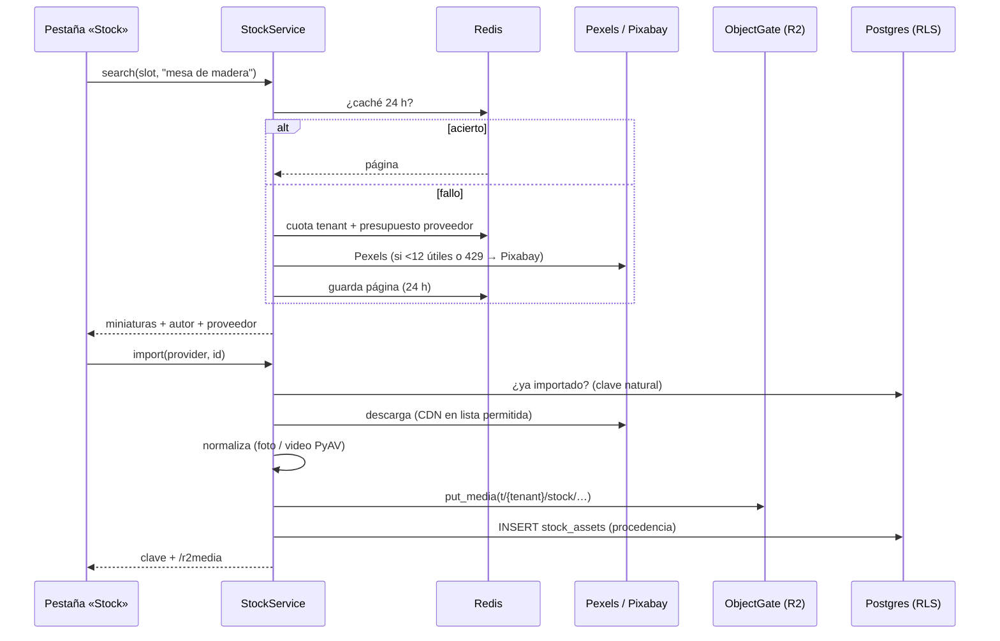

# Plan — Stock de Pexels y Pixabay en el generador (`/create`)

> **`[OBSOLETO]` HeyGen — decisión del fundador, 2026-10-16.** Los videos con avatar migran a la suite de ByteDance (BytePlus): **OmniHuman** (el avatar que habla), **Seedance** (el video), **Seedream** (la imagen y el primer fotograma) y **Seed Speech** (la voz clonada). Toda mención a HeyGen en este documento describe el estado anterior o una alternativa ya descartada: no la tomes como decisión vigente. **La migración aún no está hecha en el código** (medido el 2026-10-16): el detalle y lo que falta está en [Pendientes del generador §6](pendientes-generador-contenido.md).

`[PLAN 2026-10-16 · revisado por el fundador el mismo día (Pixabay primero, producto desde stock) · STK-01/02/03/04b implementadas el 2026-10-16 (ver «Estado de la implementación») · 7 preguntas al fundador]` · autor: arquitectura · base: [investigación de proveedores](apis-imagenes-y-videos-de-stock.md) (2026-10-16)

**Qué resuelve.** Hoy el operador solo puede llenar un hueco de foto o video con su catálogo, una subida o una pieza anterior. Este plan añade una cuarta fuente, **Stock**: Pexels como principal y Pixabay como complemento y respaldo. Cubre en qué huecos aparece, cómo se busca y se importa, qué procedencia se guarda, qué atribución exige cada licencia y qué guardarraíles cubren los riesgos legales de la investigación.

**Fase del roadmap.** Es el generador creativo: *dogfooding* sobre medios propios (Parte 4-A, ADR 21) y el Motor de Contenido de Marca. No toca las Partes 1-3 (ingesta, cascada multimodal, plano analítico). Es **compra** (ADR de compra frente a construcción): no construimos un banco de imágenes. Solo construimos el selector, la copia a R2 y la procedencia.

**Regla de lectura.** Todo lo que este plan dice que *existe* se midió en el código el 2026-10-16, en la rama de este worktree, con ruta y línea. Lo que dice de las APIs de Pexels y Pixabay viene de la investigación y de su documentación (**[DOC]**). No se hizo ninguna llamada real: no hay claves. Lo que hay que confirmar con la primera llamada real lleva la marca **verificar en STK-01**.

---

## Revisión del fundador — 2026-10-16 (manda sobre el resto del documento)

Tres cambios, más R4 (proveedor de video, añadido el mismo día por la investigación). Donde el texto de abajo los contradiga, vale esta sección.

### R1. Pixabay pasa a ser el principal: Pexels tiene pausada la emisión de claves

Verificado el 2026-10-16 en `https://www.pexels.com/api/` y `https://www.pexels.com/api/new/`: ambas dicen **«New API key issuance is currently paused.»** No anuncian lista de espera ni fecha. Pixabay sí da la clave al momento, con solo crear una cuenta (`https://pixabay.com/api/docs/`: «Please login to see your API key here»; 100 peticiones por 60 s, por clave).

Consecuencias:
- **El MVP se construye y se prueba solo con Pixabay.** La interfaz `StockProvider` (§3.2) no cambia. Pexels queda como segundo proveedor, apagado hasta que haya clave: sin `QUALIFY_PEXELS_API_KEY`, el servicio no lo llama y no hay respaldo.
- **El respaldo de §3.5 se invierte mientras dure la pausa:** Pixabay responde solo. Cuando Pexels tenga clave, se decide de nuevo el orden con datos de calidad de búsqueda medidos en STK-01.
- **Lo que se pierde sin Pexels:** el filtro `orientation=portrait` en video (Pixabay no lo tiene; se filtra `height > width` en el cliente, §3.4) y parte del catálogo vertical. Afecta a la Fase 2 (Clip), no al MVP de imágenes.
- **STK-00** queda así: crear la cuenta de Pixabay y copiar la clave a `.env` como `QUALIFY_PIXABAY_API_KEY`. Pexels: revisar la página cada semana; cuando reabra, pedir la clave y escribir la consulta de §5.4.

### R2. El producto también se puede elegir desde el stock

Pedido: en la pantalla «¿Sobre qué producto creamos?» (`Qualify/content_generator.py:933-1040`), un botón que ofrezca **elegir el producto desde el catálogo o desde el stock**. Esto **cambia** la regla de §0 y §2.2 («el stock nunca es el producto»), que pasa a ser: **el stock puede ilustrar el producto, nunca hacerse pasar por la foto real del producto sin que el operador lo sepa y lo acepte.**

**Pantalla.** Arriba de la cuadrícula, un control segmentado de dos opciones (mismo patrón que «Esta semana / Este mes» en Descubrir reels):
- **«Mi catálogo»** (por defecto): la cuadrícula de hoy, sin cambios (`_product_tile`, `choose_product`, `creative_state.py:2678-2703`).
- **«Imagen de stock»**: un buscador de Pixabay (imágenes, `orientation=vertical` o `all`, `lang=es`, `safesearch=true`, sin personas por defecto, §5.1). Debajo de los resultados, el crédito «Imágenes de Pixabay» con enlace, y el autor en cada miniatura (§4).
  - El operador elige **una** imagen y **escribe el nombre del producto** (obligatorio: el stock no trae nombre; sin él, «Continuar» queda desactivado).
  - Una nota fija, no ocultable, bajo la imagen elegida: «Es una imagen ilustrativa, no la foto de tu producto. Revisa que la pieza no prometa algo distinto de lo que vendes.»
  - Al pulsar «Continuar», la imagen se importa (§3.7: descarga en el backend, R2 en `t/{tenant}/stock/pixabay/{id}/…`, fila en `stock_assets`) y queda como foto del producto de **esta pieza**. **No se crea un producto en el catálogo** en el MVP.

**Estado** (`Qualify/creative_state.py`):
- Nuevo `product_source: str = "catalog"` (`"catalog"` | `"stock"`), y `stock_product_key`, `stock_product_name`, `stock_asset_id`.
- `choose_stock_product(provider, media_id)` y `set_stock_product_name(value)`; `confirm_product` importa la imagen y llena `brief_product_ref` con el nombre escrito y `_selected_product_photo_keys` con la clave de stock.
- `clear_product` y `skip_product` limpian también lo de stock.
- El chip del producto (`_product_chip`, `content_generator.py:1043`) muestra una insignia «Stock» cuando `product_source == "stock"`.

**Backend:**
- `brief.product_ref` con un nombre que no está en el catálogo ya funciona: `DbProductCatalog` no lo encuentra y la pieza sigue con el nombre escrito (igual que «Continuar sin producto» + nombre).
- El guardia `stock_problems` de §5.2 **acepta** una clave de stock en `product_keys` **solo si** el brief trae `product_source="stock"` (campo nuevo del brief, con valor por defecto `"catalog"`). En cualquier otro caso sigue bloqueando: una clave de stock no puede colarse como foto de catálogo.
- `stock_asset_uses.slot` gana el valor `product_illustrative`.
- La regla «siempre compuesto» (§5.2) se cumple sola: la foto del producto nunca se publica cruda, siempre pasa por la escena de Seedream o por el compositor del Flyer con texto y marca. Con la bandera de IA (F1) apagada, una foto de producto de stock solo puede ir al compositor local.

**Riesgos de esta opción (nuevos):**
1. **Publicidad engañosa.** Una hamburguesa de stock en el anuncio de una hamburguesería puede leerse como «esto es lo que vendemos». La nota obligatoria del selector traslada la decisión al operador, pero no la elimina. Pregunta **F7** abajo.
2. **Respaldo implícito (Pixabay).** Más alto que en un fondo: el producto es el centro de la pieza. Con «sin personas» activado, el riesgo baja a objetos y escenas; un producto de stock **con una marca visible** (envase, logo) está prohibido por la licencia. El filtro de palabras de §5.1 se amplía con marcas y logos en STK-01.
3. **Calidad.** Seedream recibe una referencia genérica: la pieza puede mostrar un producto que no se parece al real. Es justo lo que el operador acepta al elegir esta vía.

**Historia nueva: STK-04b · «Imagen de stock» en la pantalla de producto** (después de STK-03, en paralelo con STK-04):
- **Acepta cuando:**
  - la pantalla de producto muestra «Mi catálogo · Imagen de stock» y por defecto abre «Mi catálogo»;
  - en «Imagen de stock», buscar no se dispara al escribir (botón o Enter), y sin `QUALIFY_PIXABAY_API_KEY` la pestaña dice «no disponible» sin fallar;
  - «Continuar» queda desactivado hasta que haya imagen **y** nombre;
  - la nota de imagen ilustrativa y el crédito de Pixabay están en el DOM;
  - al continuar, la clave en `_selected_product_photo_keys` empieza por `t/{tenant}/stock/` y existe la fila en `stock_assets` con su procedencia;
  - el chip muestra «Stock»; «Cambiar» vuelve a la pantalla con la imagen y el nombre conservados;
  - un brief con clave de stock en `product_keys` y `product_source="catalog"` termina en `ROUTE_BLOCKED_BY_POLICY` sin llamadas pagadas.

### R3. Para ponerlo a prueba

El orden mínimo para probar en vivo, solo con Pixabay:
1. **STK-00:** cuenta y clave de Pixabay en `.env` (lo hace el fundador; enlaces abajo).
2. **STK-01:** cliente Pixabay de imágenes + primera llamada real, que mide: calidad de resultados en español para 5 rubros reales (hamburguesas, uñas, gimnasio, ropa infantil, inmobiliaria), cuántos resultados sin personas quedan tras el filtro, y los campos marcados «verificar en STK-01».
3. **STK-02 + STK-03:** tabla e importación.
4. **STK-04b** (producto desde stock) y **STK-04** (fondos), probados en `:3000` con la marca real de la hamburguesería.
5. **STK-05:** guardarraíles, antes de que un tenant que no sea de prueba lo vea.

**Enlaces para sacar las claves (verificados el 2026-10-16):**
- Pixabay — crear cuenta: `https://pixabay.com/accounts/register/` · iniciar sesión: `https://pixabay.com/accounts/login/` · la clave aparece, ya con sesión, en `https://pixabay.com/api/docs/` (sección «Search Images», parámetro `key`).
- Pexels — `https://www.pexels.com/api/`: **emisión de claves pausada**; no hay nada que sacar hoy.

### R4. Proveedor de video

`[2026-10-16 · gtm-specialist]` · el detalle y las fuentes están en la investigación, sección [«Alternativa a Pexels (2026-10-16)»](apis-imagenes-y-videos-de-stock.md#alternativa-a-pexels-2026-10-16).

**Estado verificado del video de Pixabay: existe y funciona según su documentación.**
- La página oficial ([pixabay.com/api/docs](https://pixabay.com/api/docs/), leída el 2026-10-16) documenta «Search Videos», `GET https://pixabay.com/api/videos/`, y no trae ningún aviso de retirada ni de pausa.
- Sin clave, el endpoint responde lo mismo que el de imágenes: `400 Invalid or missing API key`.
- **La afirmación «Pixabay no tiene videos» no se sostiene con la documentación.** Lo que sí falta es el filtro de orientación en video. Eso ya lo asume §3.4: filtrar `height > width` en el cliente.
- **Queda sin medir cuánto video vertical hay en español.** Por eso STK-01 suma una llamada real a `/api/videos/` con los 5 rubros de R3. Mide los resultados totales, los verticales tras el filtro (`dropped["orientation"]`) y los que no traen `large`.
- Si el fundador lo comprobó con su clave y salió vacío, conviene revisar la URL exacta de esa consulta, sin la clave.

**Proveedor elegido** (recomendación de investigación, pendiente de que el fundador firme):
- **El video lo da Pixabay, sin cambios en el plan.** Es el único proveedor con clave hoy, video y ninguna prohibición expresa de usarlo como entrada de IA. Y en Qualify **todo video de stock va a Seedance** (§1.3).
- **Si STK-01 mide pocos verticales útiles, el complemento es Coverr**, que es **solo video**:
  - su licencia prohíbe entrenar IA o usar el contenido como dataset, pero no habla de usarlo como entrada (la misma zona gris que Pixabay);
  - cada clip trae `is_vertical`;
  - el modo Demo es gratis (50 llamadas/h); producción, 2.000/h, con plan Pro;
  - alta en [coverr.co/developers](https://coverr.co/developers).
  - **Antes de producción** hay que obtener confirmación escrita sobre la cláusula «video editing services» y sobre cómo mostrar la atribución que exige.
  - Esto corrige §5.3, que lo excluía por «prohibición expresa» de IA: la prohibición es de entrenamiento, no de uso como entrada.
- **Para fotos y video fuera de la ruta de IA, Vecteezy**: compositor local del Flyer y fondo del avatar con HeyGen. Tiene plan gratis de 500 descargas/mes y pago por uso de 1 USD por descarga. Su licencia **prohíbe la IA** y las apps de «on-demand designs»: no entra en el MVP sin una respuesta escrita.
- **Magnific queda descartado** como fuente por defecto.

**Cómo encaja en `StockProvider` (§3.2).** No cambia la forma de `StockItem` ni de `StockPage`. Se añaden dos atributos de clase y un método al `Protocol`:

```python
class StockProvider(Protocol):
    name: str
    media_types: frozenset[StockMediaType]   # coverr: {VIDEO}; vecteezy y pixabay: {IMAGE, VIDEO}
    ai_input_allowed: bool                   # cerrado en código; pixabay/pexels/coverr: True; vecteezy/magnific: False
    def search(self, query: StockQuery, *, client: httpx.Client | None = None) -> StockPage: ...
    def resolve_download(self, item: StockItem, *, client: httpx.Client | None = None) -> StockRendition: ...
```

- **`media_types`.** `StockService.search` no llama a un proveedor que no sirve ese tipo de medio. Coverr nunca recibe una búsqueda de imágenes.
- **`ai_input_allowed`** sustituye a la lista `AI_REFERENCE_PROVIDERS` de §5.3, con el mismo efecto.
  - El servicio **no ofrece** un proveedor con `False` en los huecos que van a un modelo (tabla de §1.3).
  - El guardia del productor (§5.2) rechaza una clave `t/{tenant}/stock/{provider}/…` cuyo proveedor no lo permita, con `ROUTE_BLOCKED_BY_POLICY`.
- **`resolve_download`** lleva al proveedor la diferencia que tiene cada uno en el paso 3 de §3.7:
  - en Pixabay y Pexels devuelve `item.best` tal cual;
  - en Coverr pide `GET https://api.coverr.co/videos/{id}` y usa `urls.mp4_download`. El listado solo trae `urls` con `urls=true`; **verificar en STK-01** si el detalle también lo necesita;
  - en Vecteezy llama a `GET https://api.vecteezy.com/v2/{account_id}/resources/{id}/download`. Esa llamada devuelve una URL firmada que caduca a las 24 h y **gasta cuota de descarga**, así que solo se hace al pulsar «Usar».
- **Coverr en §3.3-3.4:**
  - el filtro vertical es `hit["is_vertical"]`;
  - la duración sale de `duration`;
  - el autor y la página: **verificar en STK-01** qué campos los traen.
- **Hosts permitidos (§3.7, paso 3).** Se suma `storage.coverr.co` (sale de los ejemplos de la doc). El host de descarga de Vecteezy está por verificar.
- **Variables de entorno (§3.6):**
  - `QUALIFY_COVERR_API_KEY`;
  - `QUALIFY_VECTEEZY_API_KEY` y `QUALIFY_VECTEEZY_ACCOUNT_ID` (el `account_id` va en la ruta).

  Sin la clave, el proveedor no se registra, igual que Pexels.
- **Atribución (§4).** Coverr exige la atribución del video servido por API; el texto exacto está por verificar con su doc. Vecteezy en Free exige atribución al autor. Las dos van en el selector y en `stock_assets.license_name`.

### Estado de la implementación — 2026-10-16

Hecho, con Pixabay solo (R1): **STK-01, STK-02, STK-03, STK-04b y la parte de STK-05 que toca a STK-04b**. Falta STK-04 (stock en los tres fondos) y la Fase 2 (video).

| Historia | Dónde | Tests |
|---|---|---|
| STK-01 cliente | `packages/creative/src/qualify_creative/stock/` (`base.py`, `pixabay.py`, `people.py`) | `packages/creative/tests/test_stock_pixabay.py` (28) |
| STK-02 migración | `migrations/postgres/versions/0066_stock_assets.py` (**0066**: `main` ya tiene `0064_signup_invites_meegle` y `0065_conversations`; renumerada el 2026-10-19), `qualify_api/stock/models.py` | `packages/api/tests/test_stock_schema_db.py` (`-m db`, 5) |
| STK-03 servicio | `packages/api/src/qualify_api/stock/` (`service.py`, `state.py`, `keys.py`) | `packages/api/tests/test_stock_service.py` (10) |
| STK-04b UI | `Qualify/stock_provider.py`, `Qualify/creative_state.py`, `Qualify/content_generator.py` (`_stock_product_panel`) | `Qualify/test_creative_stock_product.py` (8) |
| STK-05 guardias | `qualify_api/stock/guard.py` (`stock_problems`, en `MediaProducer.produce` antes de cualquier gasto), `STOCK_NOT_PUBLISHABLE` en `planner/publishable.py` | añadidos a `test_creative_media.py` y `test_planner_publishable.py` |

**Verificado en la primera llamada real (STK-01, 2026-10-16, 5 rubros, `lang=es`):**
- Cada 200 trae `X-RateLimit-Limit: 100`, `-Remaining` y `-Reset` (segundos).
- Una clave mala responde **HTTP 400** «Invalid or missing API key», no 401.
- Cada *hit* trae `userURL` (página del autor: no hace falta construirla), **`noAiTraining`** (el autor no quiere su obra en IA) e `isAiGenerated`. El cliente **descarta siempre** los `noAiTraining=true` (`dropped["no_ai"]`), porque hoy todo hueco que recibe stock va a un modelo; y la fila guarda `ai_input_allowed`.
- `largeImageURL` (≤ 1280 px) y `webformatURL` (640 px) son enlaces firmados `pixabay.com/get/…` que caducan; `previewURL` (150 px) es estable. Por eso la importación **vuelve a pedir el *hit* por id** (`?id=`) y no se fía de la URL de una búsqueda en caché. La descarga responde 200 directo desde `pixabay.com`, sin redirección.
- La miniatura del selector usa `webformatURL` (solo se muestra, nunca se guarda).
- Imágenes en español: hamburguesa 106, uñas 65, gimnasio 364, ropa infantil 4.319, casa 5.268 (`totalHits` topado en 500). El filtro de personas descarta mucho en uñas y ropa infantil (casi todo es retrato).
- **Video vertical: escaso.** De 61/10/80/80/80 videos, verticales 13/2/13/2/7. Confirma R4: si la Fase 2 necesita más, Coverr.
- Prueba real de punta a punta (marca de la hamburguesería): 27 resultados útiles (2 con personas y 1 `no_ai` fuera), la segunda búsqueda sale de la caché compartida, la importación tarda ~7 s y deja `t/{tenant}/stock/pixabay/{id}/{sha16}.jpg` en R2 y la fila con procedencia; repetirla no descarga.

**Videos de stock — hecho el 2026-10-16 (pedido del fundador: Clip, Galería y videos con avatar):**
- **Clip:** «Clip · Videos» tiene una cuarta pestaña, «Stock». Busca sola con las palabras del Brand Kit (como la imagen de producto); un clic importa el video y lo suma a las referencias que van a Seedance. Sigue en pie la regla de que un Clip no puede ser solo stock.
- **Galería:** un tipo de diapositiva nuevo, «Video de stock» (`SlideSource.STOCK`). El productor ajusta el video al formato con PyAV y le pone encima **siempre** el título o el botón de acción y el logo (`compose.text_layer`): se compone en local, sin modelo y sin gasto. Cuenta como el único video de la galería. Una diapositiva «De una pieza» nunca puede ser stock (se usaría tal cual).
- **Importación de video:** se descarga solo el elegido (tope de 80 MB) y se normaliza **con PyAV, sin `ffmpeg`** (`pyav_video_normalizer`: H.264, ≤ 1080×1920 con sus proporciones, ≤ 15 s, sin audio, `faststart`), con su póster al lado en R2. La fila guarda `duration_sec`, `source_duration_sec` y `poster_object_key`. Medido: unos 19 s por video.
- **Videos con avatar: no se hizo, a propósito.** HeyGen solo acepta un color o una imagen de fondo, y los avatares pasan a OmniHuman (decisión del 2026-10-16, [Pendientes del generador §6](pendientes-generador-contenido.md)). Se decide con OmniHuman.
- Medido en la hamburguesería: 26 videos con «hamburguesas» y «burger», **solo 1 vertical**. Los horizontales se recortan al formato. Los verticales salen primero.

**Decisiones tomadas al implementar (revisables):**
- `QUALIFY_STOCK_AI_REFERENCE` vale **`on` por defecto** (la recomendación de F1, mientras se prueba con marcas propias). Con `off`, el guardia rechaza toda pieza con stock; la ruta de respaldo al compositor local del Flyer (§5.3) no está hecha.
- **La búsqueda se lanza sola al pulsar «Imagen de stock»** (pedido del fundador, 2026-10-16) con las palabras que el operador dio en el Brand Kit, paso «Tu rubro y ubicación» (`brand_kit_details.connect`): el rubro y los hashtags; la categoría (nicho) solo si no hay ninguno de los dos (`qualify_api/stock/queries.py`). Corren **en paralelo**: `StockService.search_many` lanza hasta 4 búsquedas a la vez (20 imágenes cada una), y una palabra que no trae nada cede su lugar a la siguiente en una segunda tanda; los resultados se mezclan por turnos y se cobra **una** búsqueda de la cuota por clic. «Ver más» pide la página siguiente de cada palabra. Fuera, por medición: los nombres del catálogo («smash doble» trajo una máquina de escribir y una hélice de ADN; «super smash», Super Mario) y el nicho como palabra principal («comida y bebida»: 2 imágenes). Medido en la hamburguesería: «hamburguesas», «burger» y «comidarapida» → 46 imágenes en ~2 s; «Ver más», 32 más.
- En la pantalla de producto el filtro «sin personas» está siempre activo (sin interruptor) y la orientación es «todas».
- Un Clip cuyo único material visual es stock se rechaza también cuando el producto viene del stock: hay que añadir una foto o un video propio.
- Pendiente de STK-05: la regla de la diapositiva de Galería con fondo de stock, y la escritura de `stock_asset_uses` (la tabla existe, nadie la escribe aún).

---

## 0. Resumen

- **Dónde aparece:**
  - **MVP (imágenes):** los tres fondos, hoy de solo subida. Son el fondo del Flyer, el fondo común de la Galería y el fondo detrás del avatar, y los tres usan el mismo componente.
  - **Fase 2 (video):** las referencias del Clip, con imágenes en rol Lugar o Estilo y videos verticales.
  - **Nunca:** en una foto de producto, en la foto de producto de cada diapositiva, en el personaje animado, en los recursos de marca, en la subida directa del Planificador ni en las plantillas. Motivo: **el stock nunca es el producto del cliente ni su marca**.
- **Arquitectura en tres capas:**
  1. `qualify_creative.stock`: los clientes HTTP de Pexels y Pixabay detrás de un `StockProvider` común. Puro, sin base de datos ni Redis.
  2. `qualify_api.stock`: búsqueda con caché de 24 h en Redis, cuota por tenant, presupuesto global por proveedor y respaldo de Pexels a Pixabay. También la importación: descarga, normalización, R2 y fila con procedencia.
  3. `Qualify/stock_provider.py`: el puente fino hacia la UI.
- **Datos:** **sí hace falta una migración.**
  - Una tabla nueva, `stock_assets`, con la procedencia y la licencia de cada asset importado. Las existentes no sirven: `product_media` es por definición el producto del cliente y va atada a un producto; `image_assets` guarda salidas de un borrador.
  - Otra tabla mínima, `stock_asset_uses`: qué borrador usó qué asset, en qué hueco y si se mandó a un modelo de IA.
  - Las dos con RLS en la misma revisión.
- **Hallazgo que cambia el MVP.** En producción **todo fondo termina como referencia de Seedream**:
  - el Flyer pasa por `_ad_image` (`packages/api/src/qualify_api/creative/media.py:793-794`, `:1031-1047`), con `generated_ad_images=True` en `composition.py:276`;
  - la Galería pasa cada diapositiva por `_scene_image` (`media.py:1469-1502`).

  Así que «stock de fondo en el Flyer» **es** «stock como entrada de IA», la zona gris de la investigación. El MVP no tiene sentido sin decidir antes esa bandera (§5.3, pregunta F1). Hay una salida literal ya escrita: el compositor local `_flyer` (`media.py:857-897`) sirve como respaldo cuando la bandera está apagada.
- **Hallazgo que cambia la Fase 2.** Ni la imagen de producción ni las máquinas de desarrollo tienen el binario `ffmpeg` en el PATH (`packages/creative/src/qualify_creative/video/fit.py:6-9`). Por eso `FfmpegVideoNormalizer` (`video/normalize.py:60-70`) falla allí. Pasa hoy también con los videos del catálogo (`Qualify/catalog_provider.py:45`). El video de stock necesita un normalizador con PyAV detrás del mismo `VideoNormalizer` (`normalize.py:50`).
- **Coste: 0 USD de proveedor.**
  - El techo real es la tasa de Pexels: 200 req/h y 20.000 req/mes hasta que concedan «unlimited».
  - En Pixabay, el techo es la regla de «peticiones humanas reales».
  - R2 añade fracciones de céntimo por tenant y mes (§8).

**Borrador de ADR** (fila de §6 de `docs/arquitectura.md`). El número 37 se propone porque `plan-cicd-staging.md:263` ya reserva el 35 y el 36. Se confirma al firmar.

| # | Decisión | Alternativa descartada | Razón |
|---|---|---|---|
| 37 | **[PROPUESTO 2026-10-16]** **Stock de terceros como insumo del generador.** Pexels es el principal y Pixabay el respaldo, detrás de una interfaz `StockProvider`. (a) Cada asset elegido se **copia a R2** bajo el prefijo del tenant (`t/{tenant}/stock/…`) con una fila de procedencia (`stock_assets`): proveedor, id, autor, página, licencia con su fecha, búsqueda y versión del importador. (b) El stock **solo entra en huecos de ambiente** (fondo, lugar o estilo, movimiento) y **nunca se publica solo**. Lo garantizan un guardia por prefijo de clave en el productor y otro en el publicador. (c) Se busca **solo a petición humana**, con caché de 24 h compartida entre tenants y cuota por tenant. (d) Usarlo como referencia de Seedream o Seedance va tras una bandera global con valor por defecto firmado por el fundador. Cada uso queda registrado (`stock_asset_uses.sent_to_ai`) para poder localizar las piezas si la respuesta escrita de Pexels o Pixabay es «no» | Enlazar en caliente (*hotlink*) las URLs del proveedor. Unsplash, Magnific o Coverr. Un proveedor de pago desde el día 0 | Pixabay **obliga** a descargar, y una URL de proveedor no es una fuente de verdad que podamos auditar ni volver a leer. Unsplash, Magnific y Coverr prohíben de forma expresa el uso con IA (investigación §3.1). La ruta de pago (Storyblocks o Shutterstock) solo se justifica cuando un cliente pida personas con *model release*. La procedencia por asset es la única cobertura frente a un cambio de términos de Canva, que es dueña de las dos |

---

## 1. Qué hay hoy (medido en el código)

### 1.1 El selector «Catálogo · Subir · Piezas»

- **La vista**:
  - `_media_picker(target, upload, media_type)` en `Qualify/content_generator.py:554-629`;
  - las pestañas, en `_PICKER_TAB_ITEMS` (`:500`);
  - cada pestaña muestra sus miniaturas con `_picker_tile` (`:522-547`).
- **Las rutas de las miniaturas:** `_key_src` y `_key_has` (`:503-519`) eligen de dónde se ve cada archivo:
  - una pieza, que vive en R2, pasa por `/r2media` con `piece_views`;
  - lo demás, desde el almacén local de subidas (`rx.get_upload_url`).
- **El estado**:
  - huecos y tipos, en `_PICKER_TARGETS` (`Qualify/creative_state.py:161-170`): `products`, `reference`, `clip_images`, `clip_videos` y `slide`;
  - la pestaña abierta por defecto, en `picker_tab_view` (`:2287-2301`);
  - lo que tiene cada hueco, en `picker_selected` (`:2303-2316`);
  - el cambio de pestaña, en `set_picker_tab` (`:2342-2349`).
- **La invariante de seguridad.** `_pickable` (`:2351-2364`) junto con `pick_media` (`:2366-2412`) solo colocan una clave que la propia sesión listó (del catálogo o de las piezas). El stock tiene que respetar la misma invariante.
- **Los fondos no usan el selector.** `_background_upload` (`content_generator.py:1284-1310`) es solo de subida por decisión del 2026-10-14: el catálogo guarda productos, no lugares. Se usa en tres sitios:
  - en `_images_section` (`:1272-1281`): el fondo detrás del avatar;
  - en `_carousel_section` (`:1899-1911`): el fondo común de la Galería;
  - en `_ad_image_section` (`:1932-1939`): el Flyer.

### 1.2 Cómo un archivo se vuelve una clave

| Origen | Dónde queda | Clave | Código |
|---|---|---|---|
| Subida del operador | almacén **local** (`rx.get_upload_dir()`) | `uploads/{tenant}/{uuid}_{nombre}` | `_save_uploads`, `creative_state.py:2964-2988` |
| Catálogo | almacén **local**, normalizado | `uploads/{tenant}/catalog/{producto}/{uuid}.{ext}` | `CatalogService.add_media`, `packages/api/src/qualify_api/catalog/service.py:243-318` |
| Pieza generada | **R2** | `t/{tenant}/generated/{draft}/r{rev}/{nombre}` | `generated_object_key`, `media.py:527-531`; `R2ReadingMediaStore.keep`, `:405-414` |
| Brand Kit | **R2** | `t/{tenant}/…` | `R2ReadingMediaStore.read`, `media.py:392-400` |

**El productor ya lee `t/…` de R2 y lo demás en local** (`R2ReadingMediaStore`, `media.py:373-400`). `owned_by` y `parse_tenant_key` (`media.py:312-341`) aceptan las raíces `t`, `uploads` y `generated`. Por eso una clave de stock `t/{tenant}/stock/…` **se lee sin cambiar el productor**, y pasa el control de ajenos de `_key_problems` (`:344-370`). Ese control corre antes de cualquier gasto (`produce`, `:758-790`).

### 1.3 Quién consume cada hueco (lo que decide el riesgo)

| Hueco | Lo consume | ¿Entra a un modelo de IA? |
|---|---|---|
| Fondo del Flyer (`background_key`) | `_ad_image` es la referencia de Seedream (`media.py:1031-1047`). El compositor local `_flyer` (`:857-897`) solo actúa si `generated_ad_images=False` | **Sí** en producción. No en el respaldo local |
| Fondo común de la Galería | `_carousel` es una referencia de Seedream por diapositiva (`:1469`, `:1484`, `:1502`) | **Sí** |
| Fondo del avatar con HeyGen | `compose_scene` es una capa literal detrás del avatar (`:2122-2130`) | No (se compone, no se genera) |
| Fondo del avatar con Seedance | Es la referencia del primer fotograma de Seedream (`:1177-1190`) | **Sí** |
| Imágenes del Clip | Se envían como `data:` URL a Seedance 2.x (`:1301`, `:1317`) | **Sí** |
| Videos del Clip | Se envían como URL pública a Seedance (`_reference_urls`, `:1415-1445`). El sufijo tiene que estar en `_REFERENCE_TYPES` (`:693`) | **Sí** |
| `reference` (avatar y Ad) | **Ningún motor lo lee** (`packages/creative/src/qualify_creative/schemas.py:453-457`) | — |

Hay una última línea de defensa: Seedance y Seedream rechazan caras reales (`PrivacyInformation` → `REAL_PERSON_TEXT`, `media.py:427`, `:464`).

---

## 2. Dónde aparece el stock

### 2.1 Huecos que reciben la pestaña «Stock»

**Valores por defecto comunes:** «Sin personas» activado; Pixabay con `safesearch=true` e `image_type=photo` en imágenes; búsqueda en español (`locale=es-ES` en Pexels, `lang=es` en Pixabay).

| Hueco (UI) | Código hoy | Pestañas | Tipo | Orientación por defecto | Personas | Fase |
|---|---|---|---|---|---|---|
| **Fondo del Flyer** | `_ad_image_section` → `_background_upload` (`content_generator.py:1938`) | **Subir · Stock** | imagen | Según `brief_format` (`creative_state.py:628`): 4:5 y 9:16 → vertical; 1:1 → cuadrada | Filtro activo; se puede apagar con aviso | **MVP** |
| **Fondo común de la Galería** | `_carousel_section` (`:1904-1911`) | Subir · Stock | imagen | La Galería es de feed: 4:5 → vertical; 1:1 → cuadrada | Igual | **MVP** |
| **Fondo detrás del avatar** | `_images_section` (`:1275`) | Subir · Stock | imagen | 9:16 → vertical | Igual | **MVP** (mismo componente: sale gratis) |
| **Clip · Imágenes** | `_media_picker("clip_images")` (`:866-880`) | Catálogo · Subir · Piezas · **Stock** | imagen | Según el formato del clip (Reels/Story 9:16 o feed 4:5, `enums.py:484-487`) | **Filtro bloqueado en activo**: Seedance rechaza caras | Fase 2 |
| **Clip · Videos** | `_media_picker("clip_videos")` (`:890-905`) | Catálogo · Subir · Piezas · **Stock** | video | Vertical: Pexels en el servidor; Pixabay filtrando `width < height` en el cliente | Filtro bloqueado en activo | Fase 2 |

**Sobre la orientación horizontal.** Ningún formato de hoy es horizontal (`ContentFormat`, `packages/creative/src/qualify_creative/enums.py:106-109`: `feed_4_5`, `feed_1_1`, `reels_9_16`, `story_9_16`). El filtro horizontal no se usa por ahora. El cliente lo soporta (Pexels `orientation=landscape`, Pixabay `orientation=horizontal`) para el día que aparezca un 16:9.

**Tamaño mínimo.** El lado corto ≥ 1080 px para imágenes y ≥ 720 px para video. Pexels: `size=medium` (Full HD) **[DOC]**. Pixabay: `min_width` y `min_height` **[DOC, verificar en STK-01]**.

**Duración (video).** Seedance pide de 2 a 15 s por referencia (`content_generator.py:884`). Se descartan los clips de menos de 2 s. Los de más de 15 s se recortan al importar, porque el normalizador corta en `MAX_SECONDS = 15` (`normalize.py:28`), y la miniatura lo avisa («se recorta a 15 s»). Pexels solo filtra duración en `/videos/popular` (investigación §4), así que el filtro se aplica en el cliente con el campo `duration`.

### 2.2 Huecos que NO lo reciben, y por qué

| Hueco | Código | Por qué no |
|---|---|---|
| Producto(s) | `_products_upload`, `_media_picker("products")` (`content_generator.py:1313-1348`) | El stock nunca es el producto del cliente. Presentarlo así sería engañoso y entra en la cláusula de respaldo (investigación §3.1-2) |
| Foto del producto de cada diapositiva | `_slide_photo`, `_media_picker("slide")` (`:1547-1597`) | Es la **referencia de producto** de Seedream («para que tu producto salga igual», `:1556-1558`). La Galería recibe stock por su fondo común |
| Referencia del avatar y del Ad | `_media_picker("reference")` (`:468-488`) | **Inerte**: ningún motor lee `reference_video_key` (`schemas.py:453-457`). Se revisa cuando un motor lo lea |
| Personaje animado | `avatar_image_key` (`:2136-2152`) | Es el personaje propio de la marca, con la casilla de derechos (`:2153-2159`) |
| Recursos de tu marca (logo, elementos) | `_brand_resources` (`:1238-1269`) | Son de la marca por definición |
| Subida directa del Planificador (`FROM_UPLOAD`) | `handle_photo_upload` (`creative_state.py:3268-3293`) | **Publica el archivo tal cual**: es exactamente el uso «Standalone» que prohíben las licencias |
| Plantilla y Ad (Remotion) | `takes_background = … and not is_template` (`creative_state.py:3150-3151`) | La plantilla solo toma fotos de producto en sus puertos |
| Audios del Clip | `:907-919` | Fuera de alcance: ninguno de los dos expone audio por API para este uso (**[inferencia]**, no está en la investigación) |

---

## 3. Arquitectura

### 3.1 Capas y dónde vive cada una

```
Qualify/content_generator.py   pestaña «Stock» (vista)
Qualify/creative_state.py      search_stock / pick_stock (eventos en segundo plano)
Qualify/stock_provider.py      fábrica: construye StockService con Redis + R2 + claves (≈ catalog_provider.py)
        │
packages/api/src/qualify_api/stock/
    service.py     StockService.search() · StockService.import_item()
    cache.py       SearchCache (Redis, TTL 24 h) + MemorySearchCache (tests y sin Redis)
    quota.py       límites de ventana fija (mismo patrón que leads/rate_limit.py:18-31)
    models.py      StockAsset, StockAssetUse (SQLAlchemy)
    keys.py        stock_object_key()
        │
packages/creative/src/qualify_creative/stock/
    base.py        StockProvider (Protocol), StockQuery, StockItem, StockRendition, errores
    pexels.py      PexelsProvider (httpx, import diferido)
    pixabay.py     PixabayProvider (httpx, import diferido)
    people.py      filtro «sin personas» sobre metadatos (lista ES+EN, versionada)
    renditions.py  elección de la rendición (foto o video) sin descargar
```

**Por qué en `packages/` y no en `Qualify/`** (a diferencia de `Qualify/scrapecreators_client.py`):

- La importación necesita `tenant_session`, `ObjectGate` y los normalizadores. Esas son puertas de `packages/` (`qualify_shared`, `qualify_creative`).
- El día que el generador elija un fondo por sí mismo (§9), el que llama será el servicio de creatividad, no la UI.
- `ScrapeCreators` vive en `Qualify/` porque su docstring lo limita a la UI (`Qualify/scrapecreators_client.py:1-21`).
- `qualify_creative` ya aloja clientes de proveedor detrás de protocolos, con `httpx` importado de forma diferida mediante un *extra* (`packages/creative/pyproject.toml:40-41`, *extra* `video`). Se añade el *extra* `stock = ["httpx>=0.28.1"]`, o se reutiliza `video`.

**Estilo que se replica de `scrapecreators_client.py`:**

- errores tipados con `status_code` y sin cuerpo crudo (`:64-78`);
- la clave se lee del entorno en el momento de usarla y su ausencia da un error claro (`:81-88`);
- un `_get` que traduce `HTTPStatusError`, `HTTPError` y el JSON roto (`:110-138`);
- cada función acepta `client: httpx.Client | None`, para que los tests inyecten `httpx.MockTransport` (patrón de `Qualify/test_scrapecreators_client.py`).

### 3.2 La interfaz común y la forma normalizada

```python
# packages/creative/src/qualify_creative/stock/base.py (sketch)
class StockMediaType(StrEnum): IMAGE = "image"; VIDEO = "video"
class Orientation(StrEnum): PORTRAIT = "portrait"; SQUARE = "square"; LANDSCAPE = "landscape"; ANY = "any"

@dataclass(frozen=True)
class StockQuery:
    text: str                       # en español, tal como lo escribió el operador
    media_type: StockMediaType
    orientation: Orientation
    min_short_side: int = 1080
    min_seconds: float | None = None  # video
    max_seconds: float | None = None  # video, se aplica en el cliente
    page: int = 1
    per_page: int = 24
    exclude_people: bool = True
    category: str | None = None     # solo Pixabay (backgrounds, places, food, …), nunca "people"

@dataclass(frozen=True)
class StockRendition:
    url: str                        # host en la lista permitida (§3.7 paso 3)
    width: int
    height: int
    label: str                      # "original", "large2x", "hd-1080x1920", "medium", …
    fps: float | None = None

@dataclass(frozen=True)
class StockItem:
    provider: str                   # "pexels" | "pixabay"
    provider_media_id: str
    media_type: StockMediaType
    width: int
    height: int
    duration_sec: float | None
    thumb_url: str                  # miniatura para el selector, nunca se guarda como fuente
    author_name: str
    author_url: str | None
    page_url: str                   # la página del asset en el proveedor
    description: str                # alt (Pexels) o tags (Pixabay): lo que lee el filtro de personas
    best: StockRendition            # elegida por renditions.py para el hueco
    raw: Mapping[str, Any]          # el hit tal cual (se guarda en provider_payload)

@dataclass(frozen=True)
class StockPage:
    items: tuple[StockItem, ...]
    page: int
    has_more: bool
    total_hint: int | None          # Pexels total_results / Pixabay totalHits (tope 500)
    dropped: Mapping[str, int]      # cuántos se descartaron y por qué: "people", "orientation", "duration", "size"

class StockProvider(Protocol):
    name: str
    def search(self, query: StockQuery, *, client: httpx.Client | None = None) -> StockPage: ...

class StockError(Exception): status_code: int | None
class StockNotConfigured(StockError): ...   # falta la clave → la pestaña dice «no disponible»
class StockRateLimited(StockError): retry_after_s: int | None
```

`dropped` sirve para medir lo que se pierde en el cliente. Así se sabe con datos cuánto video vertical real tiene Pixabay, que es lo que la investigación §7 dejó sin medir.

### 3.3 Pexels (principal)

- **Endpoints [DOC]:** `GET https://api.pexels.com/v1/search` (fotos) y `GET https://api.pexels.com/videos/search` (videos). La clave va en el header `Authorization`.
- **Parámetros [DOC]:** `query`, `orientation` (`portrait|square|landscape`), `size` (`large|medium|small`), `locale=es-ES`, `page`, `per_page` (máx. 80). Fotos además: `color`, útil más adelante para casar con la paleta del Brand Kit.
- **Fotos:**
  - campos `id`, `width`, `height`, `url` (página), `photographer`, `photographer_url`, `alt` y `src{original, large2x, large, medium, small, portrait, landscape, tiny}`;
  - miniatura: `src.medium`;
  - descarga: `src.original`, que la normalización local reduce (§3.7). `src.portrait` (800×1200) se queda corto para 1080×1920.
- **Videos:** `id`, `width`, `height`, `duration`, `url`, `image` (póster), `user{name,url}` y `video_files[{quality, file_type, width, height, fps, link}]`. `renditions.py` elige, sin descargar nada:
  - `file_type == "video/mp4"`;
  - vertical (`height > width`);
  - el lado corto lo más cercano a 1080 sin pasar de 1080×1920;
  - `fps ≤ 30`;
  - nunca 4K: peso inútil, porque el normalizador baja a 1080×1920 (`normalize.py:29-30`).
- **Tasa:**
  - 200 req/h y 20.000 req/mes por defecto [DOC];
  - las respuestas 200 traen `X-Ratelimit-Limit/Remaining/Reset` [DOC, verificar en STK-01]; la 429 **no los trae** (investigación §4);
  - el servicio guarda `Remaining` y `Reset` en Redis con cada respuesta, y deja de llamar cuando `Remaining < 10`.
- **Sin filtro de personas** (investigación §4). La mitigación está en §5.1.

### 3.4 Pixabay (complemento y respaldo)

- **Endpoints [DOC]:** `GET https://pixabay.com/api/` (imágenes) y `GET https://pixabay.com/api/videos/`. La clave va en la query `key`. **Nunca se registra la URL completa en logs.**
- **Parámetros [DOC]:** `q` (máx. 100 caracteres), `lang=es`, `image_type=photo`, `orientation` (`horizontal|vertical`, **solo imágenes**), `category`, `min_width`, `min_height`, `safesearch=true`, `order`, `page` y `per_page` (3–200). El tope es 500 resultados accesibles por consulta.
- **Imágenes:**
  - campos `id`, `pageURL`, `tags`, `previewURL`, `webformatURL` (640 px, **caduca a las 24 h**), `largeImageURL` (1280 px), `imageWidth`, `imageHeight`, `user` y `user_id`;
  - miniatura: `previewURL` (**verificar en STK-01** que no caduca). `webformatURL` **nunca se guarda**;
  - descarga: `largeImageURL`. 1920 px y el original requieren el «full API access» (investigación §2);
  - la página del autor se construye como `https://pixabay.com/users/{user}-{user_id}/` (**verificar en STK-01**).
- **Videos [DOC]:**
  - `videos{large, medium, small, tiny: {url, width, height, size, thumbnail}}` y `duration`;
  - **sin filtro de orientación**: se filtra `height > width` en el cliente y se baja `medium` (~1080p), o `small` como respaldo;
  - se piden 80 por página porque el filtro descarta muchos.
- **Tasa y caché:**
  - 100 req/60 s por clave;
  - **caché de 24 h obligatoria**;
  - solo **peticiones humanas reales**, sin consultas automáticas en volumen (investigación §4, gotchas b y d);
  - los headers `X-RateLimit-*` [DOC, verificar en STK-01].

### 3.5 La búsqueda: caché, cuota, presupuesto, respaldo y páginas

**Orden de una búsqueda** (`StockService.search(tenant_id, slot, text, page)`):

1. **Normalizar la consulta.** Recortar, colapsar espacios y `casefold`. Rechazar si está vacía o pasa de 100 caracteres (el límite de Pixabay).
2. **Caché.** La clave es `stock:search:v1:{provider}:{sha256(query normalizada + filtros + page + per_page)}` y el TTL **24 h** para los dos proveedores: es obligatorio en Pixabay y prudente en Pexels.
   - La caché es **compartida entre tenants**. Los resultados son públicos y no dependen del tenant, y compartirlos es lo que más ahorra tasa.
   - No filtra información: B solo obtiene el resultado de A si escribe la misma consulta.
   - Un acierto de caché **no gasta cuota**.
3. **Cuota por tenant.** Ventana fija en Redis, `stock:quota:search:{tenant}:{hora}`, con `QUALIFY_STOCK_SEARCHES_PER_TENANT_HOUR` (por defecto **30**).
   - Sigue el patrón de `RedisFixedWindowLimiter` (`packages/api/src/qualify_api/leads/rate_limit.py:18-31`), generalizado con un prefijo de clave.
   - Al agotarse, el operador lee «Hiciste muchas búsquedas seguidas. Prueba en unos minutos o usa una búsqueda reciente.», y siguen funcionando las búsquedas en caché y «Ya usaste» (§3.9).
4. **Presupuesto global por proveedor.** `stock:budget:pexels:{hora}` con `QUALIFY_STOCK_PEXELS_HOURLY_BUDGET` (por defecto **180**, 90 % de 200), más el `Remaining` del último header. Si Pexels no tiene presupuesto o está en enfriamiento tras un 429, se salta y se va directo a Pixabay.
5. **Llamar a Pexels.** Si tras los filtros del cliente (personas, orientación, duración y tamaño) quedan **menos de 12** resultados utilizables, o Pexels falla (429, 5xx, red), se llama a **Pixabay** con la misma consulta. Se muestran juntos: primero Pexels y luego Pixabay, cada miniatura con su insignia de proveedor.
   - Pixabay no se consulta si Pexels ya bastó. Así se respeta su regla de peticiones humanas y se reduce su volumen.
6. **Ante un 429**, no se reintenta en la ruta del usuario, que está esperando.
   - Se marca `stock:cooldown:{provider}` hasta `Reset`, o 60 s si no hay header.
   - Se cae al otro proveedor.
   - Si los dos están fríos, se muestra «Hay muchas búsquedas en curso. Inténtalo en unos minutos.», el mismo texto que `RATE_LIMITED_TEXT` (`media.py:429`).
7. **Páginas.** 24 por página en imágenes y hasta 40 en video. «Ver más» pide la siguiente página **de cada proveedor que aún tenga** (`has_more`).
   - En Pixabay el techo es la página 500/`per_page`.
   - Cada página es una búsqueda (cuota y caché).
8. **Si Redis falla**, se usa un `MemorySearchCache` en proceso con TTL y la cuota se aplica en memoria por proceso. Se degrada a un límite más estricto, nunca a ninguno.

**Lo que no se hace:** buscar mientras el operador escribe. La búsqueda se lanza con Enter o con el botón, porque la tasa es el techo.

**Dónde corre en la UI.** Un evento `@rx.event(background=True)` con `asyncio.to_thread`, igual que `load_heygen_catalog` (`creative_state.py:2743-2776`). Los ids de sesión salen de `_session_ids` (`:1605`).

### 3.6 Variables de entorno

Se añaden a `.env.example` (no se toca en este plan) junto a las de otros proveedores. El estilo es `QUALIFY_HEYGEN_API_KEY` y `QUALIFY_BYTEPLUS_ARK_API_KEY` (`.env.example:72-75`), con el prefijo `QUALIFY_`. `SCRAPECREATORS_API_KEY` (`:109`) es la excepción histórica.

| Variable | Por defecto | Efecto |
|---|---|---|
| `QUALIFY_PEXELS_API_KEY` | vacía | Sin ella, Pexels no se registra. Si falta también Pixabay, la pestaña dice «El stock no está disponible ahora mismo» (igual que `HeyGenNotConfigured`, `Qualify/creative_provider.py:855`, `:886`) |
| `QUALIFY_PIXABAY_API_KEY` | vacía | Igual para Pixabay |
| `QUALIFY_STOCK_SEARCHES_PER_TENANT_HOUR` | `30` | Cuota por tenant (§5.4). `0` apaga la pestaña |
| `QUALIFY_STOCK_PEXELS_HOURLY_BUDGET` | `180` | Techo global por hora. Se sube cuando Pexels conceda «unlimited» |
| `QUALIFY_STOCK_AI_REFERENCE` | **la que firme el fundador** (F1; recomendación: `on`) | Si es `off`, el stock no entra en ningún modelo (§5.3) |

Reflex carga `.env` al arrancar (`rxconfig.py:18-19`). En producción van en `.env.prod` (`docs/despliegue-hetzner.md`).

### 3.7 La importación: «Usar» (`StockService.import_item`)

El navegador **solo envía `(provider, provider_media_id)`**. Las URLs de descarga viven en una variable de estado **solo del backend** (`_stock_items`, con prefijo `_`), que se llenó con la búsqueda de *esta* sesión. Así se mantiene la invariante de `_pickable` (`creative_state.py:2351-2364`): solo se coloca lo que la sesión listó. Además el backend nunca descarga una URL que haya elegido el navegador (sin SSRF).

1. **Cuota de importaciones.** `stock:quota:import:{tenant}:{hora}`, por defecto 20/h. La descarga va al CDN del proveedor, no a la API, pero acota disco y R2.
2. **Idempotencia.** Se busca `stock_assets` por `(tenant_id, provider, provider_media_id, rendition)`. Si ya existe, se devuelve su clave **sin descargar**. Esta es la clave natural de este dominio, igual que `(brand_id, platform, post_id)` en la ingesta.
3. **Descarga** con `httpx`, timeout de 30 s y streaming con tope: **25 MB** para imagen y **80 MB** para video.
   - **Solo hosts permitidos:** `images.pexels.com`, `videos.pexels.com`, `cdn.pixabay.com` y `pixabay.com`. La lista final se verifica en STK-01.
   - El proxy no es un buscador abierto: es la misma regla que `Qualify/avatar_proxy.py:18-21`.
4. **Normalización:**
   - **Imagen:** `load_normalized` + `export_for_instagram`, igual que el catálogo (`catalog/service.py:283-292`): EXIF, P3→sRGB y JPEG apto para Meta.
   - **Video (Fase 2):** un `PyAvVideoNormalizer` nuevo que cumple `VideoNormalizer` (`normalize.py:50-54`), con el mismo contrato: H.264, ≤ 1080×1920, ≤ 15 s, sin audio y `faststart`. Se escribe con PyAV porque **no hay `ffmpeg` en el PATH** ni en producción ni en Windows (`fit.py:6-9`). PyAV llega con el *extra* `media` de `qualify-creative` (`packages/creative/pyproject.toml:47`), el mismo motor que `PyAvVideoFitter`. Además se guarda el póster (Pexels `image`, Pixabay `thumbnail`) como `.jpg`.
5. **Clave en R2:** `t/{tenant}/stock/{provider}/{provider_media_id}/{sha256[:16]}.{jpg|mp4}`, con el póster en `…/poster.jpg`.
   - Va bajo `tenant_prefix` (`packages/shared/src/qualify_shared/objects/keys.py:29-32`): borrar un tenant sigue siendo borrar por prefijo.
   - El sufijo `.mp4` es **obligatorio**: `_reference_urls` decide el tipo por sufijo (`media.py:1423-1429`).
6. **Escritura** con `ObjectGate.put_media` (`packages/shared/src/qualify_shared/objects/gate.py:97-116`): comprueba el prefijo, guarda el `content_type` y aplica el techo de tamaño. **No hay copia local.** El productor ya lee `t/` de R2 (§1.2).
   - Si R2 no está configurado, la importación falla con «El stock no está disponible ahora mismo».
   - Eso no añade una dependencia nueva: generar una pieza ya exige R2 (`R2ReadingMediaStore.keep`, `media.py:405-414`).
7. **Fila** `stock_assets` (§3.8) en `tenant_session`, con `INSERT … ON CONFLICT (tenant_id, provider, provider_media_id, rendition) DO NOTHING` seguido de una relectura. Dos clics simultáneos acaban en una sola fila. Como los dos escriben el mismo objeto con el mismo `sha256`, el contenido en R2 queda idéntico.
8. **Vuelta a la UI:** la clave más `issue_view_path(tenant_id, key, media_type)` (`Qualify/r2_media.py:73-109`) para la miniatura.

**El orden respeta la regla 6:** el artefacto queda en R2 y el estado en Postgres antes de que el hueco lo use.



### 3.8 Modelo de datos — migración nueva

**Decisión: dos tablas nuevas, ninguna columna en las existentes.**

- `product_media` (`migrations/postgres/versions/0038_catalog_and_template_runs.py:139-170`) tiene `product_id NOT NULL` y semánticamente **es el producto**. Meter el stock ahí rompe la regla del §2.2.
- `image_assets` (`0009_creative.py:250-273`) guarda **salidas** de un borrador (`draft_id NOT NULL`). El stock es una **entrada**.
- Guardar la procedencia en el JSON del brief perdería la licencia y el autor, y no permitiría responder a «qué piezas usan el asset X».

**Número de revisión:** `main` ya tiene `0062_mention_removed_at` y `0063_signup_invites` (`git ls-tree origin/main`, 2026-10-16), y este worktree llega a `0061`. La revisión será **`0064_stock_assets`**, a confirmar al abrir el PR.

```python
"""stock assets: third-party stock (Pexels, Pixabay) imported into the generator, with provenance

Revision ID: 0064
Revises: 0063
"""
# helpers copied from 0038: _uuid_pk(), _tenant_and_brand(), _created_at(), _enable_tenant_rls()

op.create_table(
    "stock_assets",
    _uuid_pk(),
    *_tenant_and_brand(),
    sa.Column("provider", sa.Text(), nullable=False),
    sa.Column("provider_media_id", sa.Text(), nullable=False),
    sa.Column("media_type", sa.Text(), nullable=False),
    sa.Column("rendition", sa.Text(), nullable=False),            # "original", "hd-1080x1920", "large", …
    sa.Column("object_key", sa.Text(), nullable=False),           # t/{tenant}/stock/…
    sa.Column("poster_object_key", sa.Text(), nullable=True),
    sa.Column("content_type", sa.Text(), nullable=False),
    sa.Column("width", sa.Integer(), nullable=False),
    sa.Column("height", sa.Integer(), nullable=False),
    sa.Column("duration_sec", sa.Numeric(8, 2), nullable=True),          # after normalize
    sa.Column("source_duration_sec", sa.Numeric(8, 2), nullable=True),   # as the provider had it
    sa.Column("bytes", sa.BigInteger(), nullable=False),
    sa.Column("sha256", sa.Text(), nullable=False),
    # provenance + licence (hard rule: every derived thing records its source)
    sa.Column("author_name", sa.Text(), server_default="", nullable=False),
    sa.Column("author_url", sa.Text(), nullable=True),
    sa.Column("source_page_url", sa.Text(), nullable=False),
    sa.Column("license_name", sa.Text(), nullable=False),          # "Pexels License" | "Pixabay Content License"
    sa.Column("license_url", sa.Text(), nullable=False),
    sa.Column("license_terms_date", sa.Date(), nullable=False),    # 2024-11-15 Pexels · 2024-11-18 Pixabay
    sa.Column("search_query", sa.Text(), nullable=False),
    sa.Column("search_filters", JSONB(), server_default=sa.text("'{}'::jsonb"), nullable=False),
    sa.Column("provider_payload", JSONB(), nullable=False),        # the raw hit: re-parse without re-searching
    sa.Column("people_filter", sa.Boolean(), nullable=False),      # was «Sin personas» on when chosen
    sa.Column("people_check", sa.Text(), server_default="unchecked", nullable=False),
    sa.Column("people_check_version", sa.Text(), nullable=True),   # detector_version (Fase 3)
    sa.Column("importer_version", sa.Text(), nullable=False),      # pipeline_version: "stock-import/1"
    sa.Column("downloaded_at", sa.DateTime(timezone=True), nullable=False),
    sa.Column("withdrawn_at", sa.DateTime(timezone=True), nullable=True),  # provider took it down / we retired it
    sa.Column("created_by", PGUUID(as_uuid=True), sa.ForeignKey("users.id"), nullable=True),
    _created_at(),
    sa.CheckConstraint("provider IN ('pexels','pixabay')", name="ck_stock_assets_provider"),
    sa.CheckConstraint("media_type IN ('image','video')", name="ck_stock_assets_media_type"),
    sa.CheckConstraint(
        "people_check IN ('unchecked','none_found','people','error')", name="ck_stock_assets_people"
    ),
    sa.UniqueConstraint(
        "tenant_id", "provider", "provider_media_id", "rendition", name="uq_stock_assets_natural"
    ),
)
op.create_index("ix_stock_assets_brand_created", "stock_assets", ["brand_id", "created_at"])
op.execute("GRANT SELECT, INSERT, UPDATE ON stock_assets TO qualify_app;")   # no DELETE: provenance stays
op.execute("GRANT SELECT ON stock_assets TO qualify_admin;")
_enable_tenant_rls("stock_assets")   # ENABLE + FORCE + NULLIF(current_setting('app.tenant_id', true), '')::uuid

op.create_table(
    "stock_asset_uses",
    _uuid_pk(),
    sa.Column("tenant_id", PGUUID(as_uuid=True), nullable=False),
    sa.Column("stock_asset_id", PGUUID(as_uuid=True), sa.ForeignKey("stock_assets.id"), nullable=False),
    sa.Column("draft_id", PGUUID(as_uuid=True), sa.ForeignKey("content_drafts.id"), nullable=False),
    sa.Column("revision", sa.Integer(), nullable=False),
    sa.Column("slot", sa.Text(), nullable=False),          # background | clip_image | clip_video
    sa.Column("role", sa.Text(), nullable=True),           # clip_image: place | style
    sa.Column("sent_to_ai", sa.Boolean(), nullable=False), # it reached Seedream/Seedance as a reference
    sa.Column("ai_model_id", sa.Text(), nullable=True),
    _created_at(),
    sa.CheckConstraint("slot IN ('background','clip_image','clip_video')", name="ck_stock_uses_slot"),
    sa.CheckConstraint("role IS NULL OR role IN ('place','style')", name="ck_stock_uses_role"),
    sa.UniqueConstraint("draft_id", "revision", "stock_asset_id", "slot", name="uq_stock_uses"),
)
op.create_index("ix_stock_uses_asset", "stock_asset_uses", ["stock_asset_id"])
op.execute("GRANT SELECT, INSERT ON stock_asset_uses TO qualify_app;")
op.execute("GRANT SELECT ON stock_asset_uses TO qualify_admin;")
_enable_tenant_rls("stock_asset_uses")
# downgrade: drop stock_asset_uses, then stock_assets (CI gate: upgrade → downgrade base → upgrade)
```

**Notas de diseño:**

- **`provider_payload`** guarda el *hit* crudo, unos 2 KB. Es el análogo de la regla 7: si mañana interesa otro campo (`avg_color`, `tags`), se vuelve a leer sin volver a buscar. Ninguno de los dos proveedores pone la clave en el *hit* (Pixabay la lleva en la URL de la *petición*, no en la respuesta). Se comprueba en STK-01.
- **`license_terms_date`** es la fecha de los Terms vigentes al importar. Si Canva los cambia, un `UPDATE … WHERE downloaded_at < fecha` encuentra lo importado bajo los anteriores.
- **Escritura de `stock_asset_uses`:**
  - `MediaOutcome` (`media.py:239-249`) gana `stock_uses: tuple[StockUseWrite, ...]`;
  - el productor lo llena cuando ya sabe por qué ruta fue cada clave (`sent_to_ai` según §1.3);
  - `service.py` lo persiste en la misma transacción que las filas `ImageAsset` (`packages/api/src/qualify_api/creative/service.py:698-700`), como hace hoy con `template_run`.
- **La clave del objeto dice el origen.** `t/{tenant}/stock/` es lo que usan los guardias de §5.2. No hace falta consultar la base para saber que una clave es de stock.

### 3.9 Cambios de UI y estado (resumen por archivo)

- **`Qualify/creative_state.py`:**
  - **Pestañas por hueco.** `_PICKER_TARGETS` (`:161-170`) gana el hueco `"background": ("image", False)`. Un mapa nuevo, `_PICKER_TARGET_TABS`, fija qué pestañas tiene cada hueco:
    - `products`, `slide` y `reference`: sin `stock`;
    - `background`: `("upload", "stock")`;
    - `clip_images` y `clip_videos`: las cuatro.
  - `picker_tab_view` (`:2287-2301`) **nunca** abre en «Stock» por defecto.
  - **Estado nuevo:**
    - `stock_query: dict[target, str]`, `stock_results: dict[target, list[dict]]` (solo campos públicos: id, miniatura, autor, proveedor, duración, ancho y alto), `stock_loading`, `stock_error`, `stock_people_filter: dict[target, bool]`;
    - `_stock_items` (backend: el `StockItem` completo);
    - `stock_views: dict[key, view]` y `stock_recent` («Ya usaste»: los `stock_assets` del tenant, sin llamar a la API).
  - **Eventos nuevos:** `search_stock(target)`, `more_stock(target)` y `pick_stock(target, provider, id)`, este en segundo plano: importa y después coloca la clave con la misma lógica de `pick_media` (`:2366-2412`), con `source="stock"`.
  - **Clip:** `_default_clip_role` (`:173-176`) devuelve `"place"` para el stock. `set_clip_image_role` (`:2488-2496`) rechaza `"product"` si `source == "stock"`.
  - **Fondo:** `handle_background_upload` (`:2990-2994`) no cambia. El stock escribe `media_background_key` y `media_background_name` con el nombre «Stock · {autor}».
- **`Qualify/content_generator.py`:**
  - `_media_picker` (`:554-629`) recibe las pestañas del hueco y una cuarta rama en `rx.match`: `_stock_tab(target, media_type)`;
  - `_background_upload` (`:1284-1310`) pasa a `_background_picker` (Subir · Stock), con la miniatura y la ✕ de siempre;
  - `_key_src` y `_key_has` (`:503-519`) y `_clip_video` (`:715-741`) consultan un `r2_views` (piezas + stock) en vez de `piece_views` a secas.
- **`assets/qualify-creative.css`:** la clase `q-cr-stock-credit` (crédito bajo la miniatura, una línea con elipsis) y la insignia de proveedor sobre la miniatura (reutilizando `q-cr-mark`, `:320`). Los tonos van por token, nunca con un color de Radix suelto (`docs/design-system.md`).

---

## 4. Atribución

| | En el selector (obligatorio) | En la pieza publicada |
|---|---|---|
| **Pexels** | Un enlace visible a Pexels siempre que se muestren resultados: «Fotos y videos de **Pexels**», que enlaza a pexels.com. Crédito al autor cuando sea posible: «Foto de {autor} en Pexels», que enlaza a la página del asset o al perfil | **No hace falta** (la licencia de Pexels no exige atribución) |
| **Pixabay** | Indicar de dónde vienen los resultados cada vez que se muestran: «… y **Pixabay**», que enlaza a pixabay.com. El autor en cada miniatura | **No hace falta** (la licencia de Pixabay no exige atribución) |

**Cómo se ve:**

- La cabecera de la pestaña lleva la línea de crédito con los dos enlaces (`target="_blank" rel="noopener"`).
- Cada miniatura lleva la insignia del proveedor y, debajo, «{autor}» como enlace. Con el foco o al pasar el ratón muestra el texto completo.
- Una vez importado, el hueco muestra el chip «Stock · Pexels · {autor}».

**Fase 3:** el detalle del borrador en Borradores lista la procedencia de cada asset de stock (proveedor, autor, enlace y licencia). Es la vista humana de `stock_asset_uses`. No es obligación de licencia, pero cumple la regla de procedencia de cara al operador.

**Miniaturas del selector:**

- Se cargan del CDN del proveedor: es la visualización temporal de resultados, lo único que Pixabay no prohíbe.
- Nunca se guardan ni se sirven después de la búsqueda.
- Lo que se usa en la pieza es siempre la copia de R2.
- **Contrapartida aceptada:** el navegador del operador habla con el CDN del proveedor (que ve su IP). Si se quiere evitar, se puede proxyar como `avatar_proxy.py`, pero no entra en el MVP.

---

## 5. Guardarraíles (riesgos legales de la investigación §6)

### 5.1 «Sin personas» por defecto

**Lo que hay y lo que no:**

- Pexels **no tiene filtro de personas** (investigación §4).
- Pixabay tiene `category`, pero **solo para incluir**: no se puede excluir `people`.
- Ninguno de los dos admite negación en la consulta (**[inferencia]**). Añadir «sin personas» al texto tiende a *traer* resultados etiquetados con «personas», así que **no se hace**.

**Mitigación en cuatro capas.** Va de la barata a la cara, como la cascada (regla 4):

1. **Filtro en el cliente sobre metadatos**, en `qualify_creative.stock.people`, gratis y versionado como `people-blocklist/1`:
   - lee el `alt` de las fotos de Pexels (en inglés), el *slug* de `url` de los videos de Pexels (**[inferencia]**: la página del video lleva su descripción en la URL; verificar en STK-01) y los `tags` de Pixabay;
   - lista en ES+EN: persona(s), gente, mujer, hombre, niño/a, chica, chico, bebé, cara, rostro, retrato, modelo, pareja, familia, multitud, selfie / people, person, woman, man, girl, boy, child, kid, baby, face, portrait, model, couple, family, crowd, selfie, businessman, businesswoman;
   - **las manos no se excluyen**: no identifican a nadie y son la toma típica de producto en mano;
   - lo descartado cuenta en `StockPage.dropped["people"]`.
2. **Sugerencias de búsqueda de escena.** Chips por hueco: «mesa de madera», «pared de ladrillo», «textura», «cocina», «local vacío», «paisaje urbano». Para Pixabay, un chip de categoría fija `category=backgrounds|places|food|nature|buildings`.
3. **Fase 3: comprobación visual al importar** (no en cada resultado, solo en lo que se usa).
   - Un modelo de visión barato decide «hay una persona reconocible». La imagen de producción **no** tiene el grupo `ml` (`deploy/Dockerfile:20`), así que SigLIP no está. El candidato es Claude Haiku con visión, a una fracción de céntimo por asset.
   - El resultado va a `people_check` con `people_check_version` (regla de procedencia).
   - Con `people`, el hueco muestra un aviso y, en el Clip, se bloquea.
4. **La última línea ya existe:** Seedream y Seedance rechazan caras reales con `PrivacyInformation` (`media.py:464` → `REAL_PERSON_TEXT`, `:427`).

**Reglas por hueco:**

- En el **Clip**, el filtro está **siempre activo**: es legal y además técnico, porque Seedance rechaza la referencia.
- En los **fondos** se puede apagar. Al hacerlo aparece este aviso: «Las personas de stock no pueden aparecer como si recomendaran tu producto. Úsalas solo como ambiente.» La fila registra `people_filter=false`.

**Medición antes de prometer nada.** STK-01 incluye una medición: 10 consultas típicas, unos 200 resultados etiquetados a mano y la *recall* del filtro sobre «hay una persona reconocible». Objetivo: **≥ 90 %**. Por debajo, la capa 3 pasa al MVP. El filtro de metadatos es una heurística, no una garantía, y el texto de la UI no dirá lo contrario.

### 5.2 Siempre compuesto: el stock nunca se publica solo

La cláusula «Standalone» de las dos licencias (investigación §3.1-1) exige que la pieza combine el stock con otros elementos. Se garantiza en tres sitios:

1. **Por construcción, en las rutas.** Toda ruta que hoy acepta un fondo o una referencia produce una obra nueva:
   - el Flyer genera la escena con Seedream y pone encima el gancho, el CTA y el logo (`_ad_image`, `media.py:1006-1059`), o en el respaldo local compone producto, texto y logo (`_flyer`, `:857-897`);
   - la Galería genera cada diapositiva (`:1488-1503`);
   - el avatar se compone delante del fondo (`:2122-2130`);
   - el Clip es un video generado (`:1281-1340`).
2. **Guardia en el productor**, junto a `_key_problems` (`media.py:344-370`), que se ejecuta antes de cualquier gasto (`:773`). Es una función nueva, `stock_problems(tenant_id, brief)`:
   - **Una clave de stock solo se acepta** en `background_key`, `clip_image_keys`, `clip_first_frame_key`/`clip_last_frame_key` (derivadas de las imágenes) y `clip_video_keys`. Fuera de esos campos se rechaza: `product_keys`, `avatar_image_key`, `source_media_key`, `brand_logo_key`, `brand_element_keys`, `slides[].object_key` y `reference_video_key`.
   - **Un Clip cuyo único material visual es stock se rechaza.** Necesita al menos una imagen que no sea de stock (catálogo, subida o pieza). El Clip no lleva texto ni logo encima, así que un clip hecho solo con stock sería stock animado.
   - **Una diapositiva de Galería** que usa el fondo de stock (`use_background`) necesita su foto de producto o el texto (`SlideText.HOOK`).
   - **El rol `product`** en una imagen de stock del Clip se rechaza.
   - El rechazo es `FailureReason.ROUTE_BLOCKED_BY_POLICY` con texto en español sin proveedor, según la regla de `media.py:419-421`. Por ejemplo: «Combina la imagen de stock con tu producto o con el texto de la pieza.» La UI valida lo mismo antes de enviar, para no llegar al backend con un error evitable.
3. **Guardia en el publicador.** `evaluate` (`packages/api/src/qualify_api/planner/publishable.py:457-476`) rechaza cualquier `object_key` bajo `t/{tenant}/stock/` con una razón nueva, `STOCK_NOT_PUBLISHABLE`. Hoy es inalcanzable, porque solo se publican filas `image_assets`. Es defensa en profundidad: si un día una ruta copiara la entrada a la salida, no se publicaría.

### 5.3 ¿Puede el stock ir como referencia a Seedream o Seedance?

**Los hechos:**

- Pexels y Pixabay **ni lo prohíben ni lo autorizan**. Solo vetan el scraping y la minería «para machine learning» (investigación §3, §6-2).
- Una referencia por inferencia no es entrenamiento ni minería, pero **es una lectura nuestra**.
- Lo que sí sabemos: **en producción, un fondo es siempre una referencia de Seedream** (§1.3). Sin esta bandera, el MVP de fondos del Flyer y la Galería **no existe**.

**Recomendación: `QUALIFY_STOCK_AI_REFERENCE=on` por defecto, solo para Pexels y Pixabay** (lista cerrada en código: `AI_REFERENCE_PROVIDERS = {"pexels", "pixabay"}`). Hay tres razones:

1. Ninguna de las dos licencias lo prohíbe.
2. El resultado es una imagen nueva. Eso refuerza el cumplimiento de la cláusula «Standalone», que es la obligación **expresa**.
3. Es **reversible y auditable**: cada uso queda en `stock_asset_uses.sent_to_ai`. Si la respuesta escrita (STK-00) es «no», se apaga la bandera y una consulta lista los borradores afectados.

**Con la bandera en `off`:**

| Hueco | Comportamiento |
|---|---|
| Fondo del Flyer | La ruta cambia al compositor local `_flyer` (`media.py:795-796`): stock, producto, texto y logo **literales**. Hay que tocar la condición de `:793` |
| Fondo del avatar con HeyGen | Sigue: es una capa literal (`:2122-2130`) |
| Fondo del avatar con Seedance | Desaparece la pestaña |
| Fondo común de la Galería | Desaparece la pestaña (no hay ruta literal) |
| Clip | Desaparece la pestaña |

Unsplash, Magnific y Coverr **no se integran** (prohibición expresa). Si algún día se añadieran como fuente, quedarían **fuera** de `AI_REFERENCE_PROVIDERS` por construcción.

**La decisión es del fundador** (pregunta F1). Si prefiere esperar la respuesta escrita, el valor por defecto es `off` y el MVP se reduce al Flyer con composición local y al fondo del avatar con HeyGen.

### 5.4 Una clave para muchos tenants

- **Reparto justo.** El reparto entre tenants combina cuatro medidas:
  - una cuota por tenant y hora (30 búsquedas);
  - un presupuesto global por proveedor (180/h en Pexels);
  - la caché compartida de 24 h;
  - «Ya usaste», que relee la biblioteca del tenant sin llamar a la API.

  Un tenant que agote su cuota no consume la tasa de los demás.
- **Solo peticiones humanas.** No hay búsquedas automáticas en el MVP: Pixabay lo pide de forma expresa. La elección automática de un fondo por el generador queda para después (§9) y depende de la respuesta escrita.
- **No replicar un banco de imágenes.** Los Terms prohíben montar un servicio similar o competidor. Por eso el stock **solo** se ve dentro del selector del generador: no hay página de navegación ni descarga del archivo crudo para el usuario.
- **Confirmación por escrito (STK-00).** El correo a Pexels y a Pixabay describe el caso real: un SaaS multi-tenant que compone piezas de marca, guarda la copia y puede pasar fondos a modelos generativos. Pide el «unlimited» de Pexels (que se concede con una demo) y el «full API access» de Pixabay. **La respuesta escrita es la defensa ante las dos zonas grises** (IA y multi-tenant).
- **Medición.** Un contador en Redis por tenant, proveedor y día, más `stock_assets` y `stock_asset_uses`, da el volumen que hay que enseñar en la solicitud de «unlimited».

---

## 6. Plan por fases (historias del tamaño de un PR)

El prefijo es `STK-`. Cada historia es una rama y un PR que se fusiona con `just merge` y el CI en verde. Las migraciones siguen ADR 27: RLS en la misma revisión y reversibilidad como condición del CI.

### Fase 0: sin código (semana 0)

**STK-00 · Cuentas, claves y consultas por escrito** (fundador)
- Crear las cuentas de Pexels y Pixabay. Las claves van a `.env` y `.env.prod`, nunca al repo.
- Enviar las consultas escritas de §5.4: multi-tenant, referencia de IA, «unlimited» y «full API access».
- Firmar F1 (bandera de IA) y el borrador de ADR 37.
- **Acepta cuando:** existen las dos claves, se enviaron las dos consultas, F1 está firmada y el ADR pasa a `[APROBADO]` o queda con cambios.

### Fase 1: MVP, imágenes en los fondos

**STK-01 · Cliente `qualify_creative.stock` (imágenes)**
- Contenido: `base.py`, `pexels.py`, `pixabay.py` (solo `/v1/search` y `/api/`), `people.py`, `renditions.py` y el *extra* `stock`.
- **Acepta cuando:**
  - los tests con `MockTransport` cubren los parámetros enviados (header o query de la clave, `locale=es-ES` y `lang=es`, `orientation`, `safesearch`, `per_page`);
  - la forma normalizada es idéntica para los dos proveedores;
  - 401 da `StockNotConfigured`/`StockError(401)`, 429 da `StockRateLimited` (con y sin headers) y el JSON roto da `StockError`;
  - **la clave nunca aparece** en un mensaje de error ni en `raw`;
  - el filtro de personas tiene su tabla de casos (verdaderos y falsos positivos).
- **Primera llamada real** con las claves de STK-00: se registran en este documento los campos verificados (los marcados «verificar en STK-01») y la medición de *recall* de §5.1.

**STK-02 · Migración `0064_stock_assets`**
- Las dos tablas de §3.8, los modelos y `keys.stock_object_key()`.
- **Acepta cuando:**
  - `just migrate`, `just migrate-down` y `just migrate` dejan la base limpia (condición del CI `test-db`);
  - un test `-m db` prueba el aislamiento RLS: el tenant B no ve filas de A, ni con `app.tenant_id` vacío (el `NULLIF`);
  - un segundo `INSERT` con la clave natural no duplica;
  - los `CHECK` rechazan un proveedor o un hueco desconocidos;
  - `qualify_app` no puede hacer `DELETE`.

**STK-03 · `qualify_api.stock`: búsqueda e importación de imágenes**
- `StockService.search` con caché de 24 h, cuota, presupuesto, enfriamiento y respaldo. `import_item` para imágenes: lista de hosts permitidos, tope de bytes, normalización, `put_media` y fila.
- **Acepta cuando:**
  - un acierto de caché no llama al proveedor (un transporte que cuenta llamadas da 0) y la caché se escribe con TTL de 86.400 s;
  - la cuota agotada devuelve el error tipado y la caché sigue respondiendo;
  - si Pexels da 429 o menos de 12 útiles, se llama a Pixabay; si Pexels da 12 o más, **no** se llama;
  - una URL fuera de la lista se rechaza **antes** de la red;
  - importar dos veces el mismo id hace una sola descarga y deja una sola fila;
  - la clave tiene la forma `t/{tenant}/stock/{provider}/{id}/{hash}.jpg` y pasa `require_tenant_prefix`;
  - la fila lleva todos los campos de procedencia rellenos;
  - sin R2 configurado falla con el texto de «no disponible».

**STK-04 · UI: la pestaña «Stock» en los tres fondos**
- `_background_picker` y `_stock_tab`, con atribución (§4), «Sin personas», chips, «Ver más», «Ya usaste» y la miniatura vía `/r2media`.
- **Acepta cuando:**
  - Flyer, Galería y avatar muestran «Subir · Stock»;
  - productos, diapositiva, referencia y personaje **no** muestran «Stock» (test de estado sobre `_PICKER_TARGET_TABS`);
  - `pick_stock` con un id que la sesión no listó no hace nada;
  - la línea de crédito y el autor están presentes en el DOM;
  - sin claves, la pestaña dice «no disponible» y no falla;
  - la búsqueda no se lanza al escribir;
  - se prueba en vivo en `:3000` según `.claude/` y la memoria del proyecto (el servidor de desarrollo corre desde el *checkout* principal).

**STK-05 · Guardarraíles en el backend**
- `stock_problems` (§5.2), `STOCK_NOT_PUBLISHABLE` en el publicador, la bandera de IA con la ruta de respaldo del Flyer (§5.3) y la escritura de `stock_asset_uses`.
- **Acepta cuando:**
  - una clave de stock en `product_keys`, `avatar_image_key` o `slides[].object_key` termina en `ROUTE_BLOCKED_BY_POLICY` **sin ninguna llamada pagada** (*spy* del proveedor);
  - con la bandera en `off`, un Flyer con fondo de stock usa `_flyer` y no llama a Seedream;
  - con `on`, se escribe `sent_to_ai=true` con `ai_model_id`;
  - el avatar con HeyGen escribe `sent_to_ai=false`;
  - `evaluate` rechaza una clave de stock como medio publicable.

### Fase 2: video vertical en el Clip

**STK-06 · Cliente: videos**
- Pexels `/videos/search` con `orientation=portrait`. Pixabay `/api/videos/` con filtro en el cliente `height > width`. Elección de rendición (§3.3), duración ≥ 2 s y estadística de descartes.
- **Acepta cuando:** de una respuesta grabada se elige el mp4 de 1080×1920 y no el 4K; un video horizontal de Pixabay se descarta y se cuenta en `dropped["orientation"]`.

**STK-07 · `PyAvVideoNormalizer` e importación de video**
- Un normalizador que cumple `VideoNormalizer` con PyAV, más el póster. **De paso arregla el video del catálogo en producción** (`catalog_provider.py:45` usa `FfmpegVideoNormalizer`, que no tiene binario allí).
- **Acepta cuando:**
  - un mp4 de 4K y 25 s sale en H.264 de ≤ 1080×1920, ≤ 15 s y sin audio;
  - `duration_sec` y `source_duration_sec` quedan registrados;
  - el sufijo es `.mp4`;
  - `_reference_urls` lo acepta;
  - el test corre en CI sin el grupo `ml`: PyAV llega por el *extra* `media`, que hay que confirmar en el `uv.lock` del CI.

**STK-08 · UI: Stock en «Clip · Imágenes» y «Clip · Videos»**
- **Acepta cuando:**
  - una imagen de stock entra con el rol Lugar;
  - la opción Producto no aparece para el stock;
  - un clip que solo tiene stock no se puede enviar (mensaje en la UI) y el backend también lo rechaza;
  - «Sin personas» está bloqueado;
  - la duración y el aviso «se recorta a 15 s» aparecen en la miniatura.

### Fase 3: después del MVP (opcional, por valor)

- **STK-09 · Comprobación de personas al importar** (§5.1, capa 3), con `people_check_version`. Pasa al MVP si la *recall* de STK-01 queda por debajo del 90 %.
- **STK-10 · Procedencia visible:**
  - en Borradores, la lista de assets de stock con autor y enlace;
  - una consulta de administración: «qué borradores usan el asset X» y «qué usos tuvieron `sent_to_ai`»;
  - `withdrawn_at` para retirar un asset.
- **STK-11 · Retención:** borrar de R2 los `stock_assets` sin uso pasados N días. Es coherente con [backlog-retencion-datos-r2.md](backlog-retencion-datos-r2.md); el valor de N se decide allí.

---

## 7. Pruebas a escribir

| Archivo (nuevo) | Tipo | Qué fija |
|---|---|---|
| `packages/creative/tests/test_stock_pexels.py` | offline, `httpx.MockTransport` | Petición (header `Authorization`, `locale=es-ES`, `orientation`, `size`, `page`/`per_page`), normalización de fotos y videos, elección de rendición, 401/429/5xx/JSON roto, la clave nunca en el error |
| `packages/creative/tests/test_stock_pixabay.py` | offline, `MockTransport` | `key` en la query y fuera del log, `lang=es`, `safesearch=true`, `orientation=vertical` solo en imágenes, filtro vertical de video en el cliente, `previewURL` como miniatura, `webformatURL` nunca persistido, URL de la página del autor |
| `packages/creative/tests/test_stock_people.py` | offline | La tabla de la lista: «woman holding coffee» se descarta, «hand holding coffee» se queda, «mesa de madera» se queda; versión del filtro |
| `packages/api/tests/test_stock_service.py` | offline (Redis falso como en los tests de `leads`, almacén R2 falso) | Caché y TTL, cuota, presupuesto, enfriamiento, respaldo, idempotencia, lista de hosts permitidos, forma de la clave, procedencia completa, tope de bytes |
| `packages/api/tests/test_stock_schema.py` | `-m db` | RLS con `NULLIF`, clave natural, `CHECK`, sin `DELETE` para `qualify_app`, el `downgrade` limpio |
| `packages/api/tests/test_creative_media.py` (añadidos) | offline | `stock_problems` en cada campo, Clip solo con stock rechazado, bandera `off` hacia `_flyer`, `stock_uses` en `MediaOutcome` |
| `packages/api/tests/test_planner_publishable.py` (añadido) | offline | `STOCK_NOT_PUBLISHABLE` |
| `packages/creative/tests/test_video_normalize_pyav.py` | offline, con un mp4 sintético generado por PyAV en el test | El contrato de `VideoNormalizer` sin `ffmpeg` en el PATH |
| `Qualify/test_creative_stock_picker.py` | offline (estado Reflex) | Pestañas por hueco, invariante de `pick_stock`, rol por defecto y rol Producto rechazado, crédito presente, «no disponible» sin claves |
| Prueba estática (análoga a `test_object_store_sanctity.py`) | offline | Ningún módulo fuera de `qualify_creative.stock` habla con `api.pexels.com` ni con `pixabay.com/api` |

Las pruebas con las APIs reales (STK-01) llevan la marca `integration`: **nunca en CI**, como manda `pyproject.toml`.

---

## 8. Coste y capacidad

**Proveedor: 0 USD** por búsqueda y por descarga (investigación §2). El techo real es la **tasa**.

| Supuesto | Valor |
|---|---|
| Búsquedas por pieza que usa stock | ~5 (incluye «Ver más») |
| Piezas con stock por tenant activo y día | ~10 (el operador intenso de hoy) |
| Tasa de acierto de la caché compartida | 30–50 %: consultas de escena repetidas entre negocios de comida (**supuesto**, se mide con los contadores de §5.4) |
| Búsquedas reales a Pexels por tenant activo y día | 50 × (1 − 0,4) ≈ **30** |

- **Pexels por hora:** 180 de presupuesto ÷ 30 de cuota por tenant ≈ **6 tenants en pico simultáneo** antes de pasar a Pixabay. En la práctica, los picos de un operador son de pocos minutos.
- **Pexels por mes:** 20.000 ÷ (30 × 22 días) ≈ **30 tenants activos**. Más allá hace falta el «unlimited», que es gratis y se pide con una demo (STK-00).
- **Pixabay:** 100 req/min ≈ 6.000/h, **no es el techo**. Lo es su regla de peticiones humanas, que el diseño cumple: solo a petición y solo como respaldo.
- **R2:**
  - una imagen exportada pesa ~0,5–1,5 MB; un video normalizado de 15 s a 1080×1920 (CRF 23), ~4–8 MB;
  - con 100 importaciones al mes por tenant (mitad y mitad), ~0,4 GB al mes por tenant: a 0,015 USD/GB-mes, **≈ 0,006 USD por tenant y mes** el primer mes, acumulativo hasta que STK-11 purgue;
  - las operaciones PUT son despreciables y R2 no cobra salida.
- **Fase 3, comprobación visual:** una llamada pequeña de visión por asset **importado**, no por resultado. Con 100 importaciones al mes por tenant, centavos al mes por tenant. Se cuantifica con el precio vigente al abrir STK-09.

---

## 9. Fuera de alcance (y en qué fase vuelve)

- **Que el generador elija un fondo por sí mismo** (agéntico, sin el operador). Choca con la regla de peticiones humanas de Pixabay. Vuelve cuando haya respuesta escrita, y aun así solo con Pexels y la misma caché y cuota. Es Motor de Contenido de Marca, no MVP.
- **El hueco `reference`** (avatar y Ad): vuelve cuando un motor lea `reference_video_key`.
- **Audio de stock:** fuera de alcance.
- **La ruta de pago** (Storyblocks para video, Shutterstock para imágenes; *releases* de personas e indemnización): solo cuando un cliente pida personas en anuncios. Ningún contrato antes (investigación §5).
- **Cambiar el color de la búsqueda con la paleta del Brand Kit** (`color` de Pexels, `colors` de Pixabay): es una mejora barata para después del MVP.

---

## 10. Preguntas para el fundador

1. **F1: ¿el stock de Pexels o Pixabay puede ir como referencia a Seedream o Seedance antes de tener la respuesta escrita?** Recomendación: **sí**, con la bandera, el registro `sent_to_ai` y la lista cerrada de proveedores (§5.3). Si la respuesta es «no», el MVP se reduce al Flyer con composición local y al fondo del avatar con HeyGen.
2. **F2: ¿quién envía las consultas escritas a Pexels y Pixabay, y en nombre de qué entidad legal?** La respuesta tiene que llegar a nombre del titular de la cuenta para que sirva de defensa.
3. **F3: «Sin personas» en los fondos.** ¿Se puede apagar con aviso (propuesta) o queda siempre activo hasta tener la capa visual (STK-09)?
4. **F4: marcas reguladas.** Pixabay veta los contextos de salud, medicación y política (investigación §6-6). ¿Algún tenant actual o cercano es de esos rubros? Si lo es, para ese tenant no se usa stock de Pixabay (Pexels está pausado, R1), o ningún stock.
5. **F5: cuota por tenant.** ¿Valen 30 búsquedas por hora y 20 importaciones por hora para empezar, o se quiere un límite distinto por plan cuando haya cobro?
6. **F6: retención del stock sin uso en R2.** ¿Se purga a los 30 días (en línea con el techo de [backlog-retencion-datos-r2.md](backlog-retencion-datos-r2.md)) o se guarda mientras exista el tenant? Hoy el coste es despreciable (§8). La pregunta es de política, no de dinero.
7. **F7: producto ilustrado con stock (R2).** Cuando el producto viene del stock, ¿basta con la nota obligatoria en el selector, o la pieza debe llevar además un aviso («imagen ilustrativa») en el texto publicado? Recomendación: **solo la nota en el selector para el MVP de prueba con marcas propias**, y decidir el aviso en la pieza antes del primer cliente que no administre el fundador (el límite de ADR 29).
