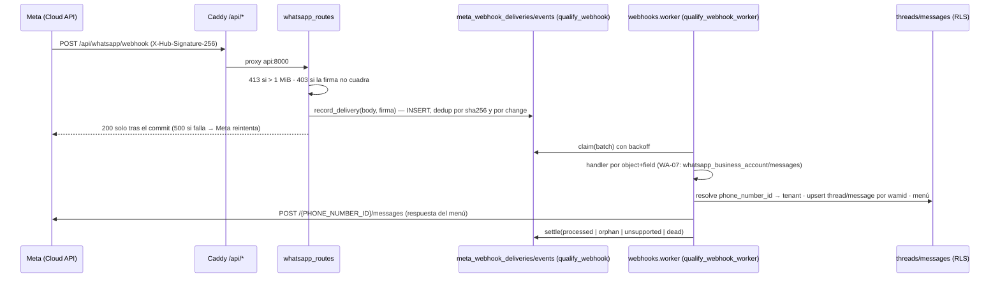

# Plan — Módulo WhatsApp Business Platform (Cloud API) en Qualify

**Fecha:** 2026-10-13 · **Estado:** `[PLAN — en ejecución desde 2026-10-14 (backlog-modulo-whatsapp.md); D1 pendiente, bloquea solo WA-13 · panel de Meta revisado 2026-10-13, §10]`
**Piloto:** **Bianki** (shawarma, Korner, San Cristóbal). Hoy atiende WhatsApp con un bot sobre **Baileys** (librería no oficial, sesión de WhatsApp Web). Este plan lo reemplaza por la **API oficial (Cloud API)** gestionada desde Qualify, con menús, plantillas, marketing y bandeja.
**Qué desbloquea:** cierra la pregunta **B0-5 / A5-4** que mantenía el canal WhatsApp en el parking lot ([QUA-41](https://linear.app/qualify-market/issue/QUA-41/canal-whatsapp-cloud-api)): *"¿la Cloud API hereda la exención de Development Mode?"*. **Respuesta, con fuente primaria: para una WABA propia no hace falta App Review ni acceso avanzado** (§2.2), y la verificación del negocio ya está hecha (2026-10-05). El gate que bloqueaba el canal **ya no existe para Bianki**.
**Docs hermanos:** [integracion-cuentas-conectadas-meta.md](integracion-cuentas-conectadas-meta.md) (§3.8 A5-4, §6.4 regla "canal = entidad"), [backlog-crm-workflows.md](backlog-crm-workflows.md) (§5.4 B0-5), [arquitectura.md](arquitectura.md) §6 (ADR 21, 24, 29; nota C1 sobre semántica por canal), épica Linear [P-QUA-8](https://linear.app/qualify-market/project/epica-meta-app-review-permisos-videos-y-tech-provider-0bfb29d15ee3) (App Review).

---

## 0. En diez líneas

1. **Bianki puede estar en la API oficial en días, no en meses.** Es "desarrollador directo" sobre su propia WABA: token de *system user* con tres permisos, sin App Review, sin acceso avanzado. Meta lo dice textual (§2.2).
2. **Lo que sí cuesta es el número**: un número ya usado en WhatsApp (el del bot Baileys) **no se puede registrar en la Cloud API sin borrarlo antes de la app**, o se usa **coexistencia** (app + API a la vez) que oficialmente pasa por Embedded Signup. Decisión del fundador (§4).
3. **Los menús del bot se reconstruyen con piezas nativas**: *ice breakers* (4), *commands* (30), botones (3), listas, y **Flows** para formularios (pedido, reserva). Es un motor **determinista**, configurado como dato, no IA autónoma: compatible con ADR 21 si el fundador lo ratifica (§9, D2).
4. **Marketing es plantillas aprobadas + opt-in registrado + precio por mensaje** (desde 2025-07-01). El formulario de leads ya captura el teléfono: es la fuente natural de opt-in (§5.4).
5. **Cero runtimes nuevos**: Python (`qualify_api.whatsapp`), Postgres (migración `0046`), el Caddy que ya enruta `/api/*`, y un worker al estilo `calendar-worker`. Sin Redis como cola, sin Node.
6. **Reutiliza el núcleo de cuentas conectadas** (`social_connections` + `oauth_credentials` cifradas + FSM + `connection_events`) y la bandeja (`threads`/`messages`) añadiendo el canal `whatsapp` como **entidad con capacidades y estado propios**, la regla ya firmada en §6.4 del doc de integración.
7. **Multi-tenant (otros clientes conectando su WhatsApp) es Tech Provider**: acceso avanzado a dos permisos + Embedded Signup v4. Entra en la épica P-QUA-8 como **envío 3**, con su video, cuando el flujo de Bianki funcione en producción (§7, fase 5).
8. **Costo variable para Bianki**: servicio (responder dentro de 24 h) **gratis**; marketing/utilidad/autenticación por mensaje entregado, en COP desde 2026-04-01 (§8).
9. **Cuatro verificaciones empíricas** antes de dar nada por hecho (§9.2): la primera es enviar un mensaje real desde la app en Development Mode con el token de system user.
10. **Entregable de la fase 1 = paridad con Baileys** (recibir, responder, menú básico) para poder apagarlo; lo demás viene encima.

---

## 1. La idea en una frase

> **El número de WhatsApp de Bianki vive en Qualify: menús que atienden solos lo repetitivo, una bandeja donde una persona retoma cuando hace falta, plantillas aprobadas para volver a hablar con quien dio permiso, y un ledger de cada mensaje y su costo.**

### Qué se abandona y qué entra

| Se va (Baileys) | Entra (Cloud API) | Qué gana el negocio |
|---|---|---|
| Sesión de WhatsApp Web emulada; riesgo de baneo del número y de que una actualización rompa el bot | API oficial sobre la WABA del negocio, SLA de Meta, webhooks firmados | El número de la tienda deja de estar en riesgo |
| Menús por texto ("escribe 1 para…") | *Ice breakers*, *commands*, botones, listas, **Flows** (formularios nativos) | Menos fricción; el cliente toca, no escribe |
| Sin plantillas, sin forma legal de escribir primero | Plantillas aprobadas + opt-in + ventana de 24 h | Marketing a quien dio permiso, dentro de las reglas |
| Un proceso en una máquina | Módulo de Qualify: multi-marca, RLS, bandeja compartida con Instagram | Lo mismo servirá a Polette y a los clientes |
| Gratis | Precio por mensaje fuera de la ventana de servicio (§8) | Costo trazable por campaña |

Lo que **no** cambia: la FSM de conexiones, el cifrado de credenciales (`qualify_credential`), la bandeja y su política "asistido, no autónomo" para respuestas generadas (ADR 21), el design system.

---

## 2. Revisión de permisos y reglas en Meta Developers (2026-10-13)

Todo lo de esta sección se leyó en la documentación oficial (`developers.facebook.com/documentation/business-messaging/whatsapp/…`, enlaces en §11). El panel de la app `QualifyMkt Connector` (App ID `1670943920870196`) se revisó con la sesión del fundador el mismo día; el estado observado está en §10.

### 2.1 Los permisos

| Permiso | Qué da | Depende de | Cuándo hace falta |
|---|---|---|---|
| `whatsapp_business_messaging` | Enviar mensajes y llamadas a un número, subir/bajar media, perfil del negocio, registrar números, **webhook `messages`** | `whatsapp_business_management` | Siempre (es el de enviar) |
| `whatsapp_business_management` | WABAs, números, **plantillas**, códigos QR, suscripción a webhooks, analítica, **todos los demás webhooks** | — | Siempre (plantillas, webhooks, estado del número) |
| `business_management` | Acceso programático al portafolio | `pages_show_list`, `pages_read_engagement` | Opcional; Meta dice que casi nunca hace falta (Business Suite lo cubre). El token de system user de la guía oficial lo incluye |
| `whatsapp_business_manage_events` | Registrar eventos (compra, lead) del WABA y mandarlos a Meta para ads | `whatsapp_business_management` | Solo con Marketing Messages API + Conversions API. **Fuera de este plan** |
| `ads_read` | Métricas de conversión con Marketing Messages API | — | Fuera de este plan |

### 2.2 Nivel de acceso según el escenario — el hallazgo que cambia el plan

Fuente primaria, página de permisos de WhatsApp:

> *"If you only access your own business data, you do not need to undergo App Review or obtain Advanced access"* for any permissions.
> *"[For clients' WABAs] your app must undergo App Review, and you must be approved for Advanced access"* for each permission. Sin `whatsapp_business_management` avanzado, las llamadas sobre WABAs ajenas devuelven **error `200`**, y *"your clients cannot grant your app that permission via Embedded Signup"*.

| Escenario | Token | App Review | Acceso avanzado | Verificación del negocio |
|---|---|---|---|---|
| **Bianki / Polette** (WABA del portafolio del fundador) | **System user access token** (long-lived, generado en Business Settings con los 3 permisos) | **No** | **No** | Ya hecha (2026-10-05, portafolio Qualify.co / Attitude Factory). Sube el límite de mensajería a 2.000 y los números registrados de 2 a 20 |
| **Clientes** (tenants que conectan su WhatsApp) | **Business integration system user token** (sale de Embedded Signup, uno por cliente) | **Sí**, para `whatsapp_business_messaging` y `whatsapp_business_management` | **Sí** | Sí (hecha). Además **Access Verification** si se va a Tech Provider |

Esto es la respuesta a B0-5: WhatsApp **sí** tiene una exención equivalente a la de Development Mode para datos propios, y su gate real (verificación del negocio) **ya está pasado**. Lo que los docs de julio llamaban "verificación de entidad y número" se reduce hoy a **registrar y verificar un número** (SMS/voz) y a que su *display name* sea aprobado.

### 2.3 Lo que exige el camino multi-tenant (Tech Provider) — para la fase 5

- Verificación del negocio **antes** del App Review (hecha).
- App Review con **dos videos**: un mensaje creado y enviado desde la app y recibido en el cliente de WhatsApp; la app creando una plantilla (o pantalla de WhatsApp Manager).
- **Embedded Signup v4** (v2 se depreca el **2026-10-15**). Devuelve WABA id, phone number id y un *code* que el servidor cambia por el token del cliente; después hay que **registrar el número** y **suscribir la app a los webhooks de esa WABA** (`POST /{WABA_ID}/subscribed_apps`).
- Límite de onboarding: **10 clientes nuevos por ventana de 7 días**; sube a 200 tras verificación + review.
- WABAs creadas desde la propia app de desarrollador **no** se pueden onboardear por Embedded Signup.
- Tech Provider: el cliente pone su tarjeta en su cuenta; **no** hay línea de crédito que compartir (eso es Solution Partner).

### 2.4 Números, límites y calidad

| Regla | Valor | Fuente |
|---|---|---|
| Número ya usado en WhatsApp (app o Messenger) | **No se puede registrar en Cloud API sin borrarlo antes**; un número registrado deja de servir en la app | business-phone-numbers |
| Coexistencia (app + API con el mismo número) | Existe, vía Embedded Signup; requiere app ≥ 2.24.17; sincroniza ~180 días de chats 1:1 y contactos; **no soporta** grupos, catálogos/pedidos, llamadas, difusiones; **20 mps**; los mensajes enviados desde la app llegan como `smb_message_echoes` y son gratis | onboarding-business-app-users |
| Números registrados por portafolio | 2 → **20** tras verificación (o al llegar a 2.000 de límite) | business-phone-numbers |
| Límite de mensajería (usuarios únicos/24 h fuera de ventana, **por portafolio**) | 250 → **2.000 al verificar** → 10k → 100k → ilimitado (escala sola si usas ≥50 % y la calidad es alta) | messaging-limits |
| Plantillas por WABA | 250 sin verificar → **6.000** verificado con un número con display name aprobado; 100 creaciones/hora; revisión automática "hasta 24 h" | templates/overview |
| Throughput | 80 mps por número por defecto | cloud-api/overview |
| Límite por par (número → mismo usuario) | 1 msg / 6 s (~600/h), ráfagas de 45 | cloud-api/overview |
| Peticiones API | 200/h por app por WABA; 5.000/h con un número registrado activo | cloud-api/overview |
| Reintentos de webhook | hasta **7 días**, con duplicados → **idempotencia por `wamid` obligatoria** | webhooks/overview |
| Display name | `name_status` ∈ `APPROVED`, `AVAILABLE_WITHOUT_REVIEW`, `PENDING_REVIEW`, `DECLINED`… (campo en beta) | business-phone-numbers |

### 2.5 Precio (vigente)

- **Por mensaje entregado, no por conversación**, desde el **2025-07-01**. Solo se cobran **plantillas** (marketing / utilidad / autenticación), según país del destinatario y volumen.
- **Gratis**: todo mensaje de servicio (texto libre, media, interactivos, Flows) dentro de la **ventana de 24 h** que abre cada mensaje o llamada del usuario; las plantillas de **utilidad** dentro de esa ventana; las conversaciones iniciadas por anuncio Click-to-WhatsApp o botón de Página respondidas en 24 h (ventana de **72 h** gratis, plantillas incluidas).
- **Colombia**: tarifas de utilidad/autenticación subieron el 2025-10-01; **moneda de facturación COP desde 2026-04-01**. Meta solo cambia precios el primer día de cada trimestre. El rate card concreto se descarga de la página de precios (§11); no se copia aquí para no congelar una cifra.
- **Límite por usuario para marketing** (adaptativo, por lectura reciente): fallo con **error `131049`**; esperar 24 h antes de reintentar; dentro de la ventana de 24 h no cuenta. No aplica en EEE/UK/JP/KR; **no se entregan plantillas de marketing a números de EE. UU.**

### 2.6 Capacidades que ofrece la plataforma (catálogo completo)

| Capacidad | Qué es | Límites | Fase en este plan |
|---|---|---|---|
| Texto, imagen, video, audio, documento, sticker, ubicación, contactos, reacción | Mensajes de servicio | Solo dentro de ventana | 1 |
| **Botones de respuesta** | Hasta **3** botones | — | 1 |
| **Lista** | Secciones con filas seleccionables | (tope conocido por práctica: 10 filas; no citado en la página leída) | 1 |
| Botón CTA URL, solicitud de ubicación, solicitud de dirección, botón de llamada | Interactivos | — | 2 |
| **Ice breakers** | Hasta **4** textos (≤80 car., sin emoji) que ve quien abre el chat por primera vez | Por número; `POST /{PHONE_NUMBER_ID}/conversational_automation` | 2 |
| **Commands** | Hasta **30** comandos `/algo` (nombre ≤32, hint ≤256) | ídem | 2 |
| Mensaje de bienvenida | Automatización por número | ídem | 2 |
| Marcar leído / indicador de escritura | `mark as read`, typing | — | 1 |
| **Plantillas** | Marketing, utilidad, autenticación; componentes header/body/footer/botones (quick reply, URL, teléfono, copiar código, **FLOW**, catálogo); parámetros con nombre | 250 → 6.000; calidad Alta/Media/Baja; pausado/deshabilitado por webhook `message_template_status_update` | 3 |
| **Flows** | Formularios multi-pantalla nativos (Flow JSON); con o sin *endpoint* (intercambio de datos cifrado); estados Draft/Published/Throttled/Blocked/Deprecated; se envían como interactivo `type: flow` o plantilla con botón FLOW; respuesta por webhook (`nfm_reply`) | Throttled = 10 msg/h si el endpoint falla | 4 |
| **Catálogo** | Mensaje de catálogo, producto único, multi-producto; requiere catálogo en Commerce Manager conectado a la WABA | body ≤1024 | 4 (ya existe `brand_products`) |
| Perfil de negocio, QR codes | Gestión del número | — | 2 |
| **Marketing Messages API** | Endpoint `/marketing_messages` con optimización de entrega y analítica; mismo precio | — | 3 (opcional) |
| **Calling API** | Llamadas VoIP usuario→negocio y negocio→usuario; requiere límite ≥2.000 y permiso por par | 1 permiso/día por usuario | Fuera (post-plan) |
| Grupos | Crear y gestionar grupos por API | — | Fuera |
| Analítica | `GET /{WABA_ID}?fields=analytics,conversation_analytics` | — | 3 |

---

## 3. Qué significa para Qualify

### 3.1 Dos tramos con gates distintos

```
Tramo A — Bianki (y Polette) ahora         Tramo B — clientes (fase 5)
─────────────────────────────────          ────────────────────────────────
system user token (env → cifrado)          Embedded Signup v4 → token por cliente
sin App Review                             App Review: 2 permisos avanzados
WABA bajo el portafolio verificado         WABA del cliente (+ coexistencia)
número nuevo o migrado                     onboarding 10/7d → 200
```

El módulo se diseña para el tramo B desde el día uno (el token es un `oauth_credentials` más, la WABA es una `social_connection` más), pero **solo se construye el tramo A** hasta que el flujo funcione en producción y se grabe el video.

### 3.2 La WABA de Bianki: ¿bajo qué portafolio?

Recomendación: **crear la WABA bajo el portafolio ya verificado (Qualify.co / Attitude Factory)**, que es el que posee la app. Hereda la verificación (límite 2.000, 20 números, 6.000 plantillas) y el método de pago se configura una sola vez. Bianki queda como un **número** (con su display name "Bianki") dentro de esa WABA; Polette será otro número de la misma WABA. Si en el futuro Bianki necesita su propia WABA por razones contables, se migra el número (Meta lo permite entre WABAs del mismo portafolio).

### 3.3 Misma app o app nueva

**Misma app** (`QualifyMkt Connector`): se añade el caso de uso *"Connect with customers through WhatsApp"*. Ventajas: un solo secreto, un solo callback de webhooks, un solo expediente de App Review para la fase 5. Riesgo a vigilar: la cola de App Review de esa app ya tiene 24 permisos y [QUA-124](https://linear.app/qualify-market/issue/QUA-124/limpiar-la-cola-de-app-review-a-los-7-permisos-del-envio-1) la está limpiando a 7; **añadir el producto WhatsApp no añade permisos a la cola** mientras no se pida acceso avanzado. Se verifica en el panel (§10).

---

## 4. El número de Bianki — la decisión más cara de equivocar

| Opción | Qué pasa con el bot Baileys y el historial | Qué pasa con la WhatsApp Business app | Esfuerzo | Riesgo |
|---|---|---|---|---|
| **A. Número nuevo para la API** (línea nueva o virtual) | Baileys sigue vivo hasta la migración de clientes; historial se queda en el teléfono | El número actual sigue en la app | Bajo | Hay que mover a los clientes al número nuevo (anuncio, QR, link `wa.me`) |
| **B. Migrar el número actual a la API** | Se **borra la cuenta de la app** (exportar historial antes), se registra en Cloud API, Baileys muere ese día | El número **deja de funcionar en la app**; todo se atiende desde Qualify | Medio | Corte en frío; durante horas no se atiende; si el display name queda `PENDING_REVIEW` se opera con nombre provisional |
| **C. Coexistencia** (mismo número en app + API) | Historial de ~180 días se sincroniza a Qualify; la app sigue; Baileys muere | Sigue, con límites (sin catálogos/pedidos, sin llamadas, 20 mps) | Medio-alto | **Oficialmente pasa por Embedded Signup como Tech Provider** (§2.4); para el propio negocio en Development Mode es plausible que funcione con rol de admin, pero **no está verificado** (V-WA-2) |

**Recomendación:** **B si el número actual es el que conocen los clientes y la app no se usa a mano**; **A si hay que seguir atendiendo desde el teléfono mientras se construye**. C solo si V-WA-2 sale positiva; es la que menos rompe para el cliente final pero la de más incertidumbre. En cualquiera de las tres, la prueba de los primeros días se hace con el **número de prueba** gratuito que Meta asigna al añadir el producto.

---

## 5. Capacidades del módulo (qué construye Qualify sobre §2.6)

### 5.1 Conexión (reutiliza `connections`)

- Una fila en `social_connections` con `platform='whatsapp'`, `account_type='waba_phone_number'`, `external_account_id=<phone_number_id>`, `external_username=<display name>`, `granted_scopes` leídos de `debug_token`, FSM `pending → active → degraded/revoked` igual que Instagram. El campo `linked_page_id NOT NULL` (ADR 25) no tiene sentido aquí: se guarda el **`waba_id`** en él **o** se relaja a nullable con CHECK por plataforma — decisión de la migración `0046` (recomiendo CHECK por plataforma; no inventar un significado).
- El token de system user entra por `oauth_credentials` cifrado (`token_type='system_user'`), leído solo por `qualify_credential`. La variable de entorno solo existe para el alta inicial del tramo A; en el tramo B el token sale de Embedded Signup.
- Salud: `GET /{PHONE_NUMBER_ID}?fields=quality_rating,messaging_limit_tier,name_status,status` cada verificación manual (mismo botón "Verificar ahora" de QUA-91) y por webhook `phone_number_quality_update` / `account_update`.

### 5.2 Bandeja (reutiliza `threads`/`messages`)

- `threads.channel` admite `'whatsapp'` (hoy `CHECK IN ('comment','dm')`); `external_thread_id = <wa_id del usuario>`; `messages.external_message_id = wamid` (único por conexión: la idempotencia del webhook descansa en esa UNIQUE).
- **Ventana de 24 h como política por canal**, no como reloj global (nota C1 de `arquitectura.md`): `last_inbound_at` ya existe en `threads`; el servicio de envío decide *texto libre vs plantilla* leyendo ese campo, y la UI pinta "ventana abierta hasta HH:MM" / "cerrada — solo plantillas".
- Estados de entrega (`sent/delivered/read/failed` + código de error) por webhook `statuses`, guardados por mensaje.
- Payload crudo a R2 (`raw_payload_r2_key` ya existe) y un ledger append-only `whatsapp_webhook_events` (mismo patrón que `inbox_meta_call_log`).
- Respuestas **humanas** desde la bandeja: texto, media, botones. Respuestas **generadas** (Claude) siguen el circuito de `replies` (borrador + aprobación), ADR 21 intacto.

### 5.3 Menús (la razón del bot)

Motor **determinista** definido como **dato** (`whatsapp_menus`), ejecutado por el receptor de webhooks:

```
Entrada            → Nodo                      → Salida
ice breaker /      → lista o botones           → siguiente nodo
command /          → texto fijo + media        → cierra
palabra clave /    → Flow (formulario)         → pedido/reserva (fase 4)
primer mensaje     → handoff                   → abre hilo, asigna, pausa automatización
```

- Un **nodo** es `{id, tipo (lista|botones|texto|flow|handoff), contenido, opciones[{id, etiqueta, siguiente}]}`; el `interactive.list_reply.id` / `button_reply.id` del webhook es la arista.
- **Handoff explícito** ("hablar con una persona") y **toma de control humana** (una respuesta desde la bandeja pausa el menú en ese hilo hasta que se cierre).
- Los *ice breakers*, *commands* y mensaje de bienvenida se **publican** al número con `conversational_automation` desde el mismo editor, de modo que el menú visible en WhatsApp y el que ejecuta Qualify son el mismo dato.
- Versionado: un menú publicado es inmutable; editar crea una versión nueva (mismo criterio que las plantillas Remotion).

Por qué esto **no choca con ADR 21** ("respuestas autónomas fuera"): la ADR prohíbe que un **modelo** responda sin aprobación porque su precisión es insuficiente. Un menú es una **tabla** escrita por el negocio; no decide, enruta. Es la misma distinción que [QUA-138](https://linear.app/qualify-market/issue/QUA-138/decision-del-fundador-dm-con-menu-automatico-vs-adr-21-sin-respuestas) pide decidir para Instagram; aquí se propone la misma regla: **automático = determinista y declarado; generativo = asistido**. Se pide la firma en §9 D2.

### 5.4 Opt-in y marketing

- Tabla `whatsapp_opt_ins` (`tenant_id, brand_id, phone_e164, source, captured_at, proof_r2_key, revoked_at`). Fuentes: el **formulario de leads** (ya guarda `whatsapp_phone` y manda al cliente a `wa.me`), una casilla en el Flow de pedido, el primer mensaje del usuario (opt-in de servicio, **no** de marketing), importación manual con evidencia. Meta exige que el opt-in deje claro **nombre del negocio e intención**; el texto se guarda con la fila.
- `whatsapp_templates`: espejo de las plantillas de la WABA (nombre, idioma, categoría, estado, calidad) sincronizado por webhook; alta desde Qualify con `POST /{WABA_ID}/message_templates`.
- `whatsapp_campaigns` + `whatsapp_campaign_sends`: audiencia = opt-ins vigentes filtrados; un envío por fila con estado, código de error (`131049` = usuario saturado → reintento ≥24 h), categoría de precio y costo estimado; ritmo respetando límite de par y de mensajería. Ejecuta el **worker** (`just whatsapp-worker --tenant <uuid>`, mismo patrón y misma advertencia que `calendar-worker`).
- Marketing Messages API (`/marketing_messages`) como **segundo paso opcional**: mismo precio, optimización de entrega; no cambia el modelo de datos.

### 5.5 Flows, catálogo, perfil (fase 4)

- Flows sin endpoint primero (pedido simple, reserva, encuesta); con endpoint (precios en vivo) cuando haga falta, que exige **par de claves** en el número y un endpoint cifrado en `/api/whatsapp/flows/data`.
- Catálogo: `brand_products` + `product_media` (migración 0038) ya son el inventario; falta el **sync a un catálogo de Commerce Manager** conectado a la WABA para mandar mensajes de producto. Es un conector, no un modelo nuevo.
- Perfil de negocio (descripción, dirección, horario, foto) editable desde Qualify.

### 5.6 UI (Reflex, design system)

Ruta `/whatsapp` construida como `app_shell(page_header, page_body)` con pestañas: **Conexión** (número, display name, calidad, tier, ventana de prueba), **Menús** (editor de nodos, vista previa tipo teléfono, botón *Publicar en el número*), **Plantillas** (lista con `tone_badge` por estado, alta guiada por categoría), **Campañas** (audiencia, plantilla, programación, resultados y costo), y el canal WhatsApp dentro de `/inbox` con el indicador de ventana. Estados siempre por tono (`ok/warn/error/info/neutral`).

---

## 6. Arquitectura del módulo

### 6.1 Paquetes y archivos

```
packages/api/src/qualify_api/whatsapp/
├── __init__.py          # seam público (service, composition, errores)
├── client.py            # Graph client: messages, media, templates, phone, conversational_automation
├── shapes.py            # [V] parsers de webhook (messages/statuses/template updates) → qualify_shared.social.wa_shapes
├── signature.py         # X-Hub-Signature-256 — reutiliza mentions/signature.py o lo mueve a shared
├── models.py            # ORM espejo de 0046
├── repository.py
├── window.py            # política de ventana de 24 h (pura, testeable)
├── menus.py             # motor determinista (puro) + publicación de conversational_automation
├── templates.py         # alta/sync de plantillas
├── campaigns.py         # audiencia, ritmo, envíos
├── handler.py           # WA-07: el handler `whatsapp_business_account/messages` que registra webhooks.processor
├── service.py           # outbound (texto/plantilla) y la orquestación del menú que el handler invoca
├── worker.py            # just whatsapp-worker
└── composition.py
packages/api/src/qualify_api/http/whatsapp_routes.py   # GET/POST /api/whatsapp/webhook (+ API de lectura)
packages/shared/src/qualify_shared/social/wa_shapes.py # contrato de formas, como ig_shapes (QUA-67)
migrations/postgres/versions/0056_whatsapp.py
Qualify/whatsapp_page.py, whatsapp_state.py, whatsapp_vm.py, whatsapp_provider.py
```

### 6.2 Flujo del webhook — sobre el intake genérico de QUA-147

**Corrección 2026-10-14.** `main` ya trae (QUA-147, migración `0050`) un intake genérico de webhooks de Meta: `meta_webhook_deliveries` (una fila por entrega HTTP, con el cuerpo crudo y la firma) + `meta_webhook_events` (una fila por `change`, con `dedup_key`, estado, reintentos con backoff, purga a 29 días), escritos por el rol `qualify_webhook` (solo INSERT) y procesados fuera de la petición por `qualify_api.webhooks.worker` (rol `qualify_webhook_worker`), que ya corre **siempre encendido** en producción (`deploy/docker-compose.prod.yml`, servicio `webhook-worker`). El sobre de Meta es el mismo para todos los productos, así que **el receptor de WhatsApp graba ahí**, con el mismo `record_delivery` que el de menciones, y no inventa tablas ni colas propias.



Reglas: el receptor no interpreta el cuerpo (un sobre que no es de WhatsApp es decisión del procesador); hasta que WA-07 registre su handler, cada change de WhatsApp queda `unsupported` en el intake, **conservado 29 días y reprocesable**, no perdido; `tenant_id` se resuelve en el worker **desde el `phone_number_id`**, nunca desde el payload del usuario. La respuesta del menú sale del worker, no de la petición HTTP.

### 6.3 Tablas nuevas (`0056` — `main` llegó a `0055` el 2026-10-14; todas con RLS y la política `NULLIF` de 0001)

| Tabla | Clave natural | Nota |
|---|---|---|
| `whatsapp_phone_numbers` | `(tenant_id, phone_number_id)` | waba_id, display_name, name_status, quality_rating, messaging_limit_tier, automation_config (jsonb), FK compuesta a `social_connections` (R2) |
| `whatsapp_menus` + `whatsapp_menu_versions` | `(tenant_id, phone_number_id, name)` | definición jsonb validada por Pydantic; `published_version_id` |
| `whatsapp_thread_state` | `thread_id` | nodo actual, `automation_paused_at`, `menu_version_id` |
| `whatsapp_templates` | `(waba_id, name, language)` | categoría, estado, calidad, componentes jsonb, `meta_template_id` |
| `whatsapp_opt_ins` | `(tenant_id, brand_id, phone_e164)` | source, proof, revoked_at |
| `whatsapp_campaigns` / `whatsapp_campaign_sends` | `campaign_id`, `(campaign_id, phone_e164)` | estado por envío, error_code, price_category, cost_estimate |
| `whatsapp_outbox` | `id` | **solo envíos salientes** (plantillas de campaña, respuestas de menú que fallaron); la entrada ya la cubre el intake de QUA-147 |

Cambios en tablas existentes: `threads.channel` CHECK + `'whatsapp'`; `social_connections.linked_page_id` → CHECK por plataforma (ver §5.1); `permission_capability.py` gana las filas de los dos scopes de WhatsApp → capacidades `WA_SEND`, `WA_TEMPLATES`, `WA_AUTOMATION`.

### 6.4 Lo que no se añade

Ningún runtime nuevo (sin Node, sin Lambda), Redis **no** como cola (el intake de QUA-147 ya es la cola de entrada en Postgres y su worker ya está desplegado; `whatsapp_outbox` cubre la salida), ninguna tabla de eventos propia, ninguna dependencia de terceros tipo BSP/agregador para el tramo A.

---

## 7. Fases e historias (`WA-00…WA-21`)

> **Plan de ejecución (2026-10-14):** el orden operativo, los contratos técnicos por historia y las dependencias viven en [backlog-modulo-whatsapp.md](backlog-modulo-whatsapp.md), ordenado por D5 en cuatro entregas. Las tablas de abajo se conservan como referencia del alcance original; ante diferencia, manda el backlog.

Cada fase termina con algo que Bianki **usa**. Los gates son de producción, no de laboratorio.

### Fase 0 — Trámite y decisiones (1–2 días, sin código salvo env)

| # | Historia | Criterio de aceptación |
|---|---|---|
| WA-00 | Decisiones del fundador D1–D4 (§9.1) | Firmadas en este doc |
| WA-01 | Añadir el producto WhatsApp a `QualifyMkt Connector`, crear la WABA bajo el portafolio verificado, método de pago | Panel muestra WABA + número de prueba; `GET /{WABA_ID}` responde |
| WA-02 | System user "qualify-whatsapp" con los 3 permisos; token en `.env.prod` como `QUALIFY_WA_SYSTEM_USER_TOKEN` (solo para el alta) | `debug_token` lista los 3 scopes; **V-WA-1**: un `hello_world` llega a un número de prueba con la app en Development Mode |
| WA-03 | Webhook en producción: `GET/POST /api/whatsapp/webhook`, `QUALIFY_WA_WEBHOOK_VERIFY_TOKEN`, suscripción a `messages`, `message_template_status_update`, `phone_number_quality_update`, `account_update`, `account_alerts` | El panel verifica el callback; un mensaje al número de prueba aparece en logs con firma válida. **Código listo 2026-10-14** (`qualify_api.whatsapp` + `http/whatsapp_routes.py` + `qualify_shared.social.wa_shapes`, 42 tests, suite offline 3051 verde); falta mergear, poner la variable en `.env.prod` y registrar el callback en el panel |

### Fase 1 — Núcleo y paridad con Baileys (semana 1–2)

| # | Historia | Criterio |
|---|---|---|
| WA-04 | Migración `0056` (tablas de §6.3 mínimas: `whatsapp_phone_numbers`, `whatsapp_thread_state`, `whatsapp_outbox`) + `threads.channel='whatsapp'` + `linked_page_id` por plataforma; `just migrate-down` limpio | CI `test-db` verde |
| WA-05 | Alta de la conexión: `platform='whatsapp'` desde el token (sin OAuth), FSM, cifrado | Fila `active`; `Verificar ahora` lee calidad y tier |
| WA-06 | `wa_shapes` [V] + `client.py` (texto, media, botones, lista, marcar leído) con tests contra fixtures reales del número de prueba | Fixtures guardadas en `tests/fixtures/whatsapp/` |
| WA-07 | Handler `whatsapp_business_account`/`messages` en `webhooks.processor` (el intake de QUA-147 ya dedup-lica y reintenta): resolver `phone_number_id` → tenant, upsert `threads/messages` por `wamid`, estados de entrega; el cuerpo crudo ya vive en `meta_webhook_deliveries` | Dos entregas del mismo webhook = una fila; un change sin tenant queda `orphan`, nunca en otro tenant |
| WA-08 | Bandeja: canal WhatsApp en `/inbox`, indicador de ventana, respuesta humana (texto/media/botones) | Una persona atiende un chat completo desde Qualify |
| WA-09 | Menú v0 por palabra clave con botones/lista + handoff | Paridad con el menú actual de Baileys |
| WA-10 | Número real de Bianki según D1 (registro, verificación SMS, display name) y **apagado de Baileys** | Un cliente real recibe el menú; Baileys apagado |

### Fase 2 — Menús completos (semana 3)

| # | Historia | Criterio |
|---|---|---|
| WA-11 | Editor de menús (nodos, opciones, vista previa) + versionado | Publicar crea versión inmutable |
| WA-12 | Publicar ice breakers / commands / bienvenida al número (`conversational_automation`) desde el editor | WhatsApp muestra los 4 ice breakers configurados |
| WA-13 | Toma de control humana y reanudación; métricas por nodo (abandono, handoffs) | Al responder desde la bandeja el menú se pausa |

### Fase 3 — Plantillas, opt-in y marketing (semanas 4–5)

| # | Historia | Criterio |
|---|---|---|
| WA-14 | `whatsapp_templates`: alta guiada por categoría, sync por webhook, estado/calidad en UI | Una plantilla de utilidad aprobada y enviada |
| WA-15 | `whatsapp_opt_ins`: desde el formulario de leads, desde el menú, importación con evidencia; revocación por "STOP" | Audiencia = solo opt-ins vigentes |
| WA-16 | Campañas: audiencia, plantilla, programación, worker con ritmo y manejo de `131049`, costo estimado por envío en COP | Campaña de prueba a 20 contactos con reporte entregado/leído/fallido/costo |
| WA-17 | Analítica de la WABA en la pestaña Conexión (mensajes, costo por categoría) | Coincide con WhatsApp Manager ±1 día |

### Fase 4 — Flows y catálogo (semanas 6–7)

| # | Historia | Criterio |
|---|---|---|
| WA-18 | Flow de pedido sin endpoint (Flow JSON desde Qualify, publicar, enviar desde el menú, `nfm_reply` → hilo) | Un pedido real llega estructurado a la bandeja |
| WA-19 | Flow con endpoint (precios/stock desde `brand_products`), claves cifradas en el número | Pantalla 2 trae datos en vivo |
| WA-20 | Sync `brand_products` → catálogo de Commerce Manager y mensajes de producto | Mensaje multi-producto con el catálogo real |

### Fase 5 — Multi-tenant (Tech Provider) — gate: fases 1–3 en producción + firma de ADR 29

| # | Historia | Criterio |
|---|---|---|
| WA-21 | Embedded Signup v4 (config id, `code` → token por cliente, registrar número, `subscribed_apps`), coexistencia como opción; videos y **envío 3** en P-QUA-8 para `whatsapp_business_messaging` + `whatsapp_business_management` | Un tenant ajeno conecta su número sin tocar el panel de Meta |

---

## 8. Costos

| Concepto | Costo | Nota |
|---|---|---|
| Atender chats (servicio, dentro de 24 h), menús, Flows, media | **0** | Todo lo que el bot Baileys hace hoy sigue siendo gratis |
| Plantilla de utilidad (confirmación de pedido, aviso) | por mensaje, tarifa Colombia; **0 dentro de la ventana** | Preferir enviarla como respuesta dentro de ventana |
| Plantilla de marketing | por mensaje, tarifa Colombia (la más alta de las tres) | Sujeta al límite por usuario |
| Número | el que cueste la línea si es nueva; virtual permitido | — |
| Infra Qualify | 0 adicional | Mismo VPS, misma DB, Caddy ya enruta `/api/*` |
| Verificación, App Review, Tech Provider | 0 | Tiempo, no dinero |

Fórmula para presupuestar una campaña: `destinatarios × tasa de entrega estimada × tarifa(categoría, CO)`. La tarifa se toma del rate card vigente el día del envío (cambia solo al inicio de trimestre); la pestaña Campañas la muestra antes de confirmar.

---

## 9. Decisiones del fundador y verificaciones

### 9.1 Decisiones (bloquean WA-00)

| # | Decisión | Recomendación |
|---|---|---|
| **D1** | Número de Bianki: A nuevo / B migrar / C coexistencia (§4) | **B** si no se usa la app a mano; si no, **A** |
| **D2** | Menús automáticos deterministas = permitidos bajo ADR 21 (regla: *automático = declarado; generativo = asistido*) | **Sí**, y aplicar la misma regla a QUA-138 |
| **D3** | WABA bajo el portafolio verificado Qualify.co / Attitude Factory, misma app `QualifyMkt Connector` | **Sí** a ambas |
| **D4** | Alcance del primer corte: fases 0–2 (paridad + menús) antes de tocar marketing | **Sí**; marketing entra cuando exista opt-in real |
| **D5** | Prioridad por valor para comida rápida (2026-10-14): **1** menú que toma el pedido, **2** chats para cerrarlo, **3** entradas (QR/enlaces), **4** volver a vender con plantillas y opt-in, **5** catálogo nativo, **6** perfil y estado | **Aplicada** en [backlog-modulo-whatsapp.md](backlog-modulo-whatsapp.md); el fundador pidió implementar el módulo entero el 2026-10-14. D2 se toma como «sí» por la misma petición, salvo objeción |

### 9.2 Verificaciones empíricas (antes de prometer nada a terceros)

| # | Qué se prueba | Por qué importa |
|---|---|---|
| **V-WA-1** | Enviar y recibir con token de system user, app en **Development Mode**, sin acceso avanzado | Es la frase de Meta de §2.2 llevada a la práctica; si falla, el tramo A pasa por App Review |
| **V-WA-2** | Coexistencia para el propio número sin Embedded Signup (o con Embedded Signup en Development Mode como admin) | Decide si la opción C de §4 existe |
| **V-WA-3** | Tiempo real de aprobación de display name y de la primera plantilla | Fija el día del corte de Baileys |
| **V-WA-4** | Que añadir el producto WhatsApp **no** altere la cola de App Review de QUA-124 | Protege el envío 1 de la épica |

Resultados: a `docs/registro-validacion-features.md` y a este doc, el mismo día (regla de la casa).

---

## 10. Estado real del panel de Meta (revisado con el fundador, 2026-10-13)

Recorrido con la sesión del fundador en Chrome, solo lectura. Nada se cambió; en particular **no** se pulsó el botón «Continuar» de la plataforma de WhatsApp porque acepta las Condiciones de WhatsApp Business y de hospedaje de Meta.

| # | Punto | Estado observado | Qué falta |
|---|---|---|---|
| 1 | Caso de uso WhatsApp en `QualifyMkt Connector` | **Añadido.** `Casos de uso → Conectarte con los clientes a través de WhatsApp` existe. Al personalizarlo, el Resumen muestra el paso inicial de la plataforma: portafolio preseleccionado **Qualify.co**, aviso de número de prueba para «un máximo de 5 números» y el botón **Continuar** que acepta los términos | **Pulsar Continuar** (lo hace el fundador: acepta términos). Eso crea la WABA bajo Qualify.co y el número de prueba |
| 2 | API Setup (WABA, número de prueba, token temporal) | **No existe todavía**: aparece tras el punto 1 | — |
| 3 | System users del portafolio Qualify.co | **Ninguno** («Aún no se agregó ningún usuario del sistema»). Personas con acceso total: Alexandra, Deivid, Yesika, Herwin | Crear `qualify-whatsapp` (Admin), asignarle la app y la WABA, generar token con los 3 permisos (WA-02) |
| 4 | Webhooks | Producto **User**: callback `https://qualify.attitudefactory.co/api/mentions/webhook` con token de verificación ya guardado (la ruta de menciones de Instagram). Producto **Whatsapp Business Account**: **vacío**, campos (`account_alerts`, `account_review_update`, …) sin suscribir | Configurar `https://qualify.attitudefactory.co/api/whatsapp/webhook` + verify token y suscribir `messages`, `message_template_status_update`, `phone_number_quality_update`, `account_update`, `account_alerts` (WA-03). El callback de WhatsApp es **independiente** del de menciones: no hay que tocar el de Instagram |
| 5 | Permisos | En el caso de uso WhatsApp: `whatsapp_business_messaging` y `whatsapp_business_management` en **«Listo para la prueba»** (acceso estándar, 0 llamadas); `business_management` también estándar con 905 llamadas. **Pero en `Revisión de la app → Solicitudes` los dos permisos de WhatsApp están en la lista «No enviada / Nuevas solicitudes»** junto a otros 22 ítems | Quitarlos de la cola en [QUA-124](https://linear.app/qualify-market/issue/QUA-124/limpiar-la-cola-de-app-review-a-los-7-permisos-del-envio-1): el tramo A **no** los necesita en revisión, y dejarlos añade dos videos que hoy no se pueden grabar. Vuelven en el envío 3 (fase 5). V-WA-4 queda respondida: añadir el producto **no** metió nada nuevo en la cola, ya estaban |
| 6 | WhatsApp Manager / números | **Sin cuentas de WhatsApp** en el portafolio («No se agregó ninguna cuenta de WhatsApp») | Se crea con el punto 1; después, registrar el número real (WA-10) |
| 7 | Métodos de pago | La cuenta de pagos del portafolio (`Qualify.co - Meta Ads Test`, USD, dirección Uruguay) **no tiene ningún método de pago**. La WABA tendrá además su propia configuración de pago en WhatsApp Manager | Añadir tarjeta cuando exista la WABA; sin ella las plantillas (fase 3) no se envían. Para las fases 0–2 (servicio gratuito) no bloquea |

**Actualización 2026-10-14 — el fundador pulsó «Continuar».** La plataforma pasó a la guía de tres pasos («Integrar con la API»: Paso 1 Pruébalo · Paso 2 Configuración de producción · Paso 3 Verificación del negocio, este último ya marcado como completado). El Paso 1 ya entregó los activos de prueba, identificadores públicos que el código puede referenciar como fixtures (no son secretos):

| Activo | Valor |
|---|---|
| Número de prueba | `+1 (555) 633-6018` |
| `PHONE_NUMBER_ID` (prueba) | `1393787420477981` |
| WABA de prueba (`WABA_ID`) | `2338576026889338` |
| Token temporal | **No generado**; cuando se genere no se copia a ningún doc ni chat, y en cualquier caso el código usa el de system user (WA-02) |

**Paso 1 completado el 2026-10-14**: el fundador añadió su número como destinatario, generó el token temporal y envió la plantilla `Confirmación del pedido`; el mensaje llegó y el panel mostró tres notificaciones `messages` (`sent` → `delivered` → `read`). La de `read` se capturó con los teléfonos redactados como fixture viva del contrato (`packages/shared/tests/fixtures/whatsapp_status_read_live_2026-10-14.json`): confirma el sobre `whatsapp_business_account → entry[].id = WABA → changes[].field = messages`, `metadata.phone_number_id` como clave de enrutamiento, `timestamp` como string y el bloque `pricing{pricing_model: "PMP", category: "utility", billable: true}` del modelo por mensaje. El Paso 2 es donde se crea la **WABA real** y se registra el número de Bianki (D1), se añade el método de pago y el system user: la guía de Meta lista exactamente los activos que este plan pide en WA-01/WA-02/WA-10.

Dos observaciones fuera de la lista que importan al plan:

- **La app está en modo Live** («Publicar · Publicada»). Para el tramo A no cambia nada (el token de system user no pasa por el diálogo de login), pero resuelve la duda (d) de la enmienda 2026-07-29 de ADR 29 en cuanto a WhatsApp: no hay que volver a Development Mode para probar.
- **El callback de menciones ya vive en producción** en la ruta `/api/mentions/webhook`, con firma verificada en código. El receptor de WhatsApp replica ese patrón (misma `signature.py`), con su propia ruta y su propio verify token.

**WA-03 construido (2026-10-14), pendiente de desplegar.** Lo que hay en el repo:

- `packages/shared/src/qualify_shared/social/wa_shapes.py` — contrato de formas del webhook (`SHAPE_VERSION = wa-webhook-shapes-0.1.0`): la mitad `statuses` está verificada contra la captura viva; la mitad `messages` (entrante) sigue **provisional** hasta que llegue el primer mensaje real de un usuario (fixture sintética `whatsapp_inbound_synthetic.json`, construida de la referencia oficial).
- `packages/api/src/qualify_api/whatsapp/` — `config.py` (`QUALIFY_META_APP_SECRET` + `QUALIFY_WA_WEBHOOK_VERIFY_TOKEN`, token distinto del de menciones a propósito).
- `packages/api/src/qualify_api/http/whatsapp_routes.py` — `GET /api/whatsapp/webhook` (handshake `hub.verify_token`) y `POST` (413 sobre 1 MiB; firma `X-Hub-Signature-256` sobre el cuerpo crudo → 403; **graba la entrega en el intake de QUA-147** con el mismo `record_delivery` que menciones y solo entonces 200; 500 si no pudo grabar, para que Meta reintente). Cableado en `http/app.py`; Caddy ya enruta `/api/*`. Segunda iteración 2026-10-14: la primera versión (PR #123) solo escribía un log; esta persiste.
- Variables documentadas en `.env.example` y `deploy/.env.prod.example`.

Para cerrar WA-03: (1) PR + `just merge`; (2) `QUALIFY_WA_WEBHOOK_VERIFY_TOKEN` en `.env.prod` (`openssl rand -hex 32`) y deploy; (3) en el panel, producto **Whatsapp Business Account** → callback `https://qualify.attitudefactory.co/api/whatsapp/webhook` + ese token → «Verificar y guardar» → suscribir los cinco campos; (4) reenviar la plantilla de prueba y comprobar la línea `whatsapp webhook: delivery=… parse=parsed changes=1 new=1` en los logs del contenedor `api` y una fila `object = whatsapp_business_account` en `meta_webhook_events` (estado `unsupported` hasta WA-07).

Orden recomendado para el fundador, 15 minutos: (1) Continuar en el caso de uso WhatsApp → (3) crear el system user y el token → (4) configurar el webhook de WhatsApp una vez exista la ruta en producción → (5) quitar los dos permisos de la cola de revisión → (7) tarjeta, más adelante.

---

## 11. Fuentes primarias (leídas 2026-10-13)

- Permisos de WhatsApp (acceso por escenario): https://developers.facebook.com/documentation/business-messaging/whatsapp/permissions
- Referencia de permisos (W): https://developers.facebook.com/docs/permissions
- Tokens de acceso: https://developers.facebook.com/documentation/business-messaging/whatsapp/access-tokens
- Get started (system user, número de prueba): https://developers.facebook.com/docs/whatsapp/cloud-api/get-started
- Tech Providers: https://developers.facebook.com/docs/whatsapp/solution-providers/get-started-for-tech-providers
- Embedded Signup (v2 → v4 el 2026-10-15): https://developers.facebook.com/docs/whatsapp/embedded-signup · https://developers.facebook.com/documentation/business-messaging/whatsapp/embedded-signup/version-4.md
- Coexistencia: https://developers.facebook.com/documentation/business-messaging/whatsapp/embedded-signup/onboarding-business-app-users.md
- Overview Cloud API (throughput, límites de API): https://developers.facebook.com/docs/whatsapp/cloud-api/overview
- Mensajes de servicio e interactivos: https://developers.facebook.com/documentation/business-messaging/whatsapp/messages/send-messages
- Componentes conversacionales: https://developers.facebook.com/documentation/business-messaging/whatsapp/business-phone-numbers/conversational-components.md
- Números: https://developers.facebook.com/documentation/business-messaging/whatsapp/business-phone-numbers/phone-numbers
- Límites de mensajería: https://developers.facebook.com/documentation/business-messaging/whatsapp/messaging-limits.md
- Plantillas: https://developers.facebook.com/documentation/business-messaging/whatsapp/templates/overview · límites por usuario: https://developers.facebook.com/documentation/business-messaging/whatsapp/templates/marketing-templates/per-user-limits.md
- Flows: https://developers.facebook.com/documentation/business-messaging/whatsapp/flows/llms.txt (overview, lifecycle, sending a flow)
- Catálogo: https://developers.facebook.com/documentation/business-messaging/whatsapp/catalogs/catalog-messages.md
- Llamadas: https://developers.facebook.com/documentation/business-messaging/whatsapp/calling.md
- Webhooks: https://developers.facebook.com/documentation/business-messaging/whatsapp/webhooks/overview
- Precios: https://developers.facebook.com/docs/whatsapp/pricing
- Marketing Messages API: https://developers.facebook.com/documentation/business-messaging/whatsapp/marketing-messages/overview
- Índice completo: https://developers.facebook.com/documentation/business-messaging/whatsapp/llms.txt
