# Registro de validación de features — inbound (listening) y outbound (gestión de cuentas/agencia)

**Qué es esto.** Un registro vivo que cruza cada feature potencial con la investigación de mercado que la respalda (o la descarta), el nicho para el que se validó, y el eje de producto al que pertenece. No es el backlog — `product-owner` (`/team-po`) posee `docs/backlog-*.md` y decide prioridad/sizing/criterios de aceptación. Este documento es el insumo: qué evidencia existe detrás de cada feature, para que esa priorización no se haga a ciegas.

**Formato, y por qué es así.** Texto plano versionado en git — el mismo enfoque abierto que ya usa todo `docs/` (nada de herramienta propietaria, nada de vendor lock-in). Cada feature lleva un ID reutilizando la convención ya existente en `docs/backlog-features-gtm.md` (P3-x = Fase 3, P4-x = Fase 4, P5-x = Fase 5) más IDs nuevos para lo descubierto en investigación reciente. Puntuación de esfuerzo/impacto con RICE (Reach/Impact/Confidence/Effort) donde hay evidencia suficiente — framework abierto, no atado a ninguna herramienta.

**Los dos ejes:**
- **INBOUND (social listening)** — leer contenido, propio o ajeno: la cascada multimodal, detección de señales, sentimiento, discovery.
- **OUTBOUND (gestión de cuentas / agencia, incluida la propia)** — publicar, responder, administrar cuentas conectadas, operar múltiples clientes. Incluye el modelo "Qualify como agencia" validado el 2026-07-30.

**Estados:** `VALIDADA` (evidencia real respalda la necesidad) · `HIPÓTESIS` (nominada, sin validar) · `DESCARTADA` (investigada y rechazada, con condición de reapertura) · `PENDIENTE` (en el parking lot histórico, nunca cruzada contra research de mercado).

---

## Índice de secciones

1. Features validadas por la investigación 2026-07-29/30 (inmobiliario, marca regulada, modelo de agencia)
2. Features descartadas, con condición de reapertura
3. Parking lot histórico — fusionado (tarea #26, `gtm`)
4. Cómo se actualiza este documento

---

## Árbol visual — nicho → feature → estado

```mermaid
graph TD
    ROOT[Qualify — features potenciales]

    ROOT --> INM[Nicho: Inmobiliario]
    ROOT --> MR[Nicho: Marca regulada]
    ROOT --> AG[Modelo: Qualify como agencia]
    ROOT --> PARK[Parking lot histórico]

    INM --> INM_D["R6 — listening de terceros<br/>❌ DESCARTADA"]
    INM --> INM_V["Parte 4 — gestión owned-media<br/>✅ VALIDADA vía Zernio"]

    MR --> MR_D["Producto insignia de compliance<br/>❌ DESCARTADA (5/5 razones cayeron)"]
    MR --> MR_H1["S1-INB-01 Timestamps transcripción<br/>✅ VALIDADA — sobrevive el descarte"]
    MR --> MR_H2["S1-INB-02 Monitoreo comentarios terceros<br/>🟡 HIPÓTESIS"]
    MR --> MR_H3["S1-INB-03 Auditoría 3 modalidades<br/>🟡 HIPÓTESIS débil"]

    AG --> AG_1["S1-OUT-01 Cablear comentarios end-to-end<br/>✅ VALIDADA — paso 1"]
    AG --> AG_2["S1-OUT-02 Panel/sesión de operador N-tenant<br/>✅ VALIDADA — paso 2"]
    AG --> AG_3["S1-OUT-03 Scheduler/Celery<br/>✅ VALIDADA — paso 3, condicional"]
    AG --> AG_4["S1-OUT-04 Publicación vía Zernio<br/>✅ VALIDADA — decisión de compra"]

    PARK --> P4["P4-1/P4-2 Lookalike de creators<br/>🟢 PENDIENTE — mejor candidata sin explotar"]
    PARK --> P3["P3-0/P3-1/P3-2 Señales tipadas<br/>🟡 PENDIENTE"]
    PARK --> UIMA["UI multi-agente<br/>🔵 reconectada con AG_2"]
    PARK --> OTROS["... resto del parking lot<br/>ver §3"]

    UIMA -.sirve al mismo fin.-> AG_2

    style ROOT fill:#4f46e5,color:#fff
    style INM_D fill:#dc2626,color:#fff
    style MR_D fill:#dc2626,color:#fff
    style MR_H1 fill:#16a34a,color:#fff
    style INM_V fill:#16a34a,color:#fff
    style AG_1 fill:#16a34a,color:#fff
    style AG_2 fill:#16a34a,color:#fff
    style AG_3 fill:#16a34a,color:#fff
    style AG_4 fill:#16a34a,color:#fff
    style P4 fill:#0891b2,color:#fff
```

**Cómo leer el árbol:** verde = validada por research real · rojo = descartada (con condición de reapertura en §2) · celeste = pendiente de investigación dedicada, pero ya nominada dos veces · la línea punteada muestra una reconexión encontrada al fusionar el parking lot histórico con la investigación nueva (la UI multi-agente aparcada hace tiempo resulta ser la misma necesidad que el panel de operador del modelo de agencia).

---

## 1. Features validadas — sesión 2026-07-29/30

### 1.1 — INBOUND

| ID | Feature | Nicho que la valida | Evidencia | Adyacencia | Estado |
|---|---|---|---|---|---|
| **S1-INB-01** | **Timestamps de transcripción** — dejar de descartar los segmentos que Whisper ya devuelve; ampliar el `Protocol` y `TranscriptionResult` | Marca regulada (F2) — pero es mejora transversal, no depende del nicho | `docs/oportunidades-mercado-marca-regulada.md` §4/§7 — verificado contra disco: `transcribe() -> tuple[str, str \| None]` en `providers.py` descarta los tiempos; `language` devuelve `None` literal | **ALTA** — 3 archivos, sin modelo nuevo, sin GPU | `VALIDADA` — sobrevive aunque el nicho entero se descarte |
| **S1-INB-02** | **Monitoreo de comentarios en publicaciones de terceros** (no solo cuentas propias) | Marca regulada (F6) — nace de una recomendación textual del regulador colombiano (SIC): *"revisar periódicamente los comentarios... de la audiencia del influenciador"* | `docs/oportunidades-mercado-marca-regulada.md` §7 — análisis reusable (`ig_comments.py`), pero ese módulo es solo para **cuentas conectadas** (su propio docstring lo dice) y el scraper solo cuenta comentarios de terceros (`comments_count: int`), nunca captura el texto | **MEDIA** — la mitad de análisis existe, la mitad de adquisición (scraper de comentarios de terceros) no | `HIPÓTESIS` — el nicho que la originó fue descartado (ver §2); la necesidad de arquitectura (leer comentarios ajenos) puede seguir siendo válida para otro nicho |
| **S1-INB-03** | **Auditoría de disclosure en tres modalidades** (audio + texto en pantalla + caption) con reporte de discrepancia | Marca regulada (F1) | `docs/oportunidades-mercado-marca-regulada.md` §7-8 — requiere OCR de frame + seguimiento temporal (la cascada hoy opera sobre un frame suelto, no una secuencia) | **MEDIA-BAJA**, degradada por su propio autor tras precisar el requisito real | `HIPÓTESIS` débil — el nicho que la originó fue descartado; falta un comprador para esta pieza específica |
| **S1-INB-04** | **Lookalike de creators sobre embeddings de contenido multimodal** | — (ya estaba en el parking lot histórico como P4-1/P4-2, ver §3) | `docs/backlog-features-gtm.md` P4-1/P4-2 — el fundador la mencionó explícitamente como ejemplo de lo que quiere priorizar | Sin verificar esta sesión — pendiente | `PENDIENTE` — nominada dos veces (parking lot + founder) sin research de mercado dedicada. **Candidata fuerte para la próxima investigación de nicho** |

### 1.2 — OUTBOUND

| ID | Feature | Nicho que la valida | Evidencia | Adyacencia | Estado |
|---|---|---|---|---|---|
| **S1-OUT-01** | **Cablear el ciclo de comentarios de punta a punta, para UN cliente, de verdad** (ruta HTTP + escritor de bandeja + probado contra Meta real) | Modelo "Qualify como agencia" | `docs/arquitectura.md` §6, nota "Qualify como agencia" — verificado contra disco: `publishing/client.py` existe pero su propio docstring dice *"nobody has run this flow against Meta yet"*; `0004_inbox` crea `threads`/`messages` con cero escritores | **ALTA** en el sentido de "es lo primero que hay que hacer" — no requiere modelo nuevo, requiere terminar de cablear lo que ya está diseñado | `VALIDADA` como **primer paso**, no como urgente (ver §1.3 — el negocio no depende de esto todavía) |
| **S1-OUT-02** | **Vista/sesión de operador cruzando N tenants** (gestionar varios clientes desde una identidad, no N logins sin relación) | Modelo "Qualify como agencia" | `docs/arquitectura.md` §6 — hallazgo de identidad: `users` es tenant-scoped (`UNIQUE(tenant_id,email)`), RLS es igualdad de valor único → no existe identidad de operador. Recomendación: N `tenant_session` secuenciales, sin migración, alcanza para 5-10 clientes | **ALTA** para la forma simple (b); la forma con tabla de identidad global (c) es una grieta arquitectónica nueva y merece su propia ADR cuando corresponda | `VALIDADA` como **segundo paso**, acoplado a S1-OUT-01 (el panel protege facturabilidad, pero solo una vez que hay estado real que mirar) |
| **S1-OUT-03** | **Orquestación/scheduler (Celery + poller periódico)** | Modelo "Qualify como agencia" | `docs/arquitectura.md` §6 — cero Celery, cero beat. Pero también: Meta exige *App en modo Activo* para mandar webhooks → hace falta un poller, no necesariamente toda la Parte 3 | **BAJA prioridad de secuencia** — es un multiplicador de un ciclo que hoy no existe, no el primer paso | `VALIDADA` como **tercer paso, condicional**: solo si sobrevive una necesidad de cadencia real después de S1-OUT-01/02, y solo después de resolver si publicación se compra (Zernio) o se construye |
| **S1-OUT-04** | **Publicación en cuentas propias (Parte 4-A) vía agregador comprado** (Zernio o equivalente) en vez de construir 15+ integraciones de plataforma | Real estate (como cliente de owned-media, no de listening) + modelo de agencia | `docs/arquitectura.md` §6, "Revisión 2026-07-30" (ADR 19) — Zernio cubre esto entero, con su propio App Review de Meta y TikTok ya pasado, a $1-6/cuenta/mes | **ALTA**, es la vía de compra recomendada | `VALIDADA`, decisión de compra pendiente de aprobación del fundador (ADR 19 sigue `[PROPUESTO]`) |

**Nota transversal, para no perderla:** el hallazgo de negocio más importante de la sesión no es una feature — es una secuencia: **conseguir clientes hasta acercarse a la capacidad manual (~4-8) antes de construir nada del modelo de agencia.** El umbral de "sueldo real" se alcanza sin herramienta. Construir S1-OUT-01/02/03 antes de tener el dolor real de operar 6-8 clientes es optimizar un techo que todavía no se toca (`docs/arquitectura.md` §6, "Qualify como agencia" §5).

---

## 2. Features descartadas — con condición de reapertura explícita

| ID | Feature | Nicho | Por qué se descartó | Condición de reapertura |
|---|---|---|---|---|
| **D-01** | Vender detección/garantía de cumplimiento normativo sobre contenido de afiliados (nicho "marca regulada") como producto insignia | Marca regulada | Las 5 razones que lo hacían atractivo cayeron una por una: 4 vendors ya analizan video, el caso colombiano insignia es de primera parte (no protege contra terceros), ADR 21 prohíbe vender un veredicto automático con ~28% de fallo, el ancla de precio real es el sueldo de un revisor (no la multa) | Si aparece un comprador que sea una **agencia** gestionando N marcas (amortiza el costo entre clientes, rompe la aritmética de "un revisor") — ver `docs/oportunidades-mercado-marca-regulada.md` §9.5 |
| **D-02** | Escuchar contenido primario de terceros para el nicho inmobiliario (R6) | Inmobiliario | Cero demanda observada en ninguna fuente reunida esta sesión, mientras que el foso (adquisición de earned media) es real pero no pedido; el comprador real (Uruguay) probablemente no está en el mercado de productos de información a ningún precio | Una demo real con contenido de un tercero (no propio) mostrada a cliente uno, y que pregunte el precio sin que se lo ofrezcan — ver `docs/oportunidades-mercado-inmobiliario.md` T-4/T-6 |

---

## 3. Parking lot histórico — fusionado (extracción de `gtm`, tarea #26)

Fuente completa: `docs/inventario-parking-lot.md`. Reclasificado aquí por eje inbound/outbound, con las conexiones a la investigación 2026-07-29/30 que `gtm` encontró al tabular.

### 3.1 — De `docs/backlog-features-gtm.md` (Fase 3-5)

| ID | Feature | Fase | Evidencia original | Eje | Conexión con esta sesión |
|---|---|---|---|---|---|
| **P3-0** | Primitiva zero-shot de texto (topic/intent/stance) + golden-set | 3 — *"shippable como spike YA"* | "7/10 dolores resueltos por esta única primitiva"; "coste incremental <5% por video" | Inbound | El benchmark de marca regulada (F1 0,93 fácil / 28,57% fallo ambiguo) es la primera medición externa de una tarea de esta clase — aplica de lleno a P3-0: **el caso fácil es gratis, el difícil sigue sin resolver por nadie** |
| **P3-1** | Detectores de señales tipados con provenance (anti-firehose) | 3 | "la queja #1 de Trigify es '50 alertas/día, 5 accionables'"; "nadie lo hace en social audiovisual" | Inbound | Sin conexión directa nueva esta sesión |
| **P3-2** | Comentaristas/audiencia como eje mapeable | 3 | "engagement capture = mina de oro de Trigify"; nadie usa la señal de comentarios | Inbound | Bloqueante de P4-2 (ver abajo) |
| **P4-1** | **Lookalike sobre embeddings multimodales** | 4 | *Challenged & survived* (datasci, 2026-07-18): Modash y Kuli ya leen contenido visual, pero ninguno usa audio/transcript+comentarios — el moat se redefine como esa fusión, no como "nadie lee contenido" | Inbound | **El fundador la nominó explícitamente esta sesión como ejemplo de feature a priorizar** (ver S1-INB-04, §1.1). Es la candidata más fuerte para la próxima investigación de nicho dedicada — nunca tuvo su propio doc de mercado |
| **P4-2** | Comentaristas como eje de similitud del lookalike | 4 | *Challenged & survived*; depende de P3-2 | Inbound | Mismo hallazgo que P4-1 |
| **P4-3** | **[NO ES FEATURE — es tarea de research]** validación del moat "español-first" | 4 / spike | "sin evidencia pública"; refuerzo secundario sin probar | Transversal | Los 5 vendors de compliance de marca regulada son todos anglófonos — evidencia circunstancial a favor, sigue sin medirse |
| **P4-4** | Waterfall de contacto de creator (pay-per-valid-data) | 4 | patrón BetterContact vs. anti-patrón Clay (cobra por intento fallido) | Outbound | Cobertura B2B LATAM y legalidad de email frío en LATAM, sin analizar |
| **P5-1** | Créditos `billing.usage_events` | 5 | "Clay cobra por intento fallido, $3.000 quemados" — anti-patrón a evitar | Monetización | — |
| **P5-2** | Outreach — comprar, no construir | 5 | caps HeyReach 20-25/día; Smartlead Pro $94; Instantly v1 deprecada | Outbound | Cobertura B2B LATAM sin medir, igual que P4-4 |

### 3.2 — De `docs/backlog-crm-workflows.md` §5.4

| Ítem | Estado/fase | Por qué se aparcó | Eje | Conexión con esta sesión |
|---|---|---|---|---|
| **UI de asignación multi-agente** | Sin fase, diferido por decisión del fundador (2026-07-24, "núcleo compartido primero") | Específico de cliente uno en ese momento | Outbound | **La conexión más directa de todo el inventario.** El modelo "Qualify como agencia" (§1.2 arriba) depende de un panel que cruce N clientes — lo mismo que este ítem, aparcado por ser "de un solo cliente", **ahora sirve al fundador operando varios**. Revisar antes de tratarlo como bajo-prioridad |
| Canal WhatsApp | Bloqueado por B0-5 | "Probablemente el canal del cliente uno" | Outbound | Sigue abierta la pregunta A5-4 de si aplica — ver hallazgos de real estate sobre WhatsApp en LATAM |
| Publicación programada TikTok | Bloqueado, sin fecha | La cuenta debe estar en privado al publicar sin auditoría | Outbound | Sin cambios — sigue bloqueado |
| Publicidad pagada / Marketing API | Fase 5, **no investigado** | "Cero líneas sobre Marketing API en todo el repo" | Outbound | Es tarea de research, no feature — nadie la ha tocado nunca |
| Respuestas autónomas | Fuera permanentemente (no es fase) | "1 de cada 3 mal en medio propio" (65% precisión) | Outbound | **Reforzado** por el benchmark de marca regulada (28,57% de fallo en el caso ambiguo) — la misma regla, evidencia independiente que la sostiene |
| Sindicación a portales | Sin fase | Queja real del cliente uno, pero ajena a Meta | Outbound | Confirmado en real estate §1.5: los portales son el **gasto obligatorio** del nicho; sin MLS en LATAM, ocupan ese hueco |
| Bandeja unificada cross-canal | Fase 6 | C-08 solo cubre Instagram | Outbound | Sin cambios |
| Listening de competidores / discovery / lookalike | Fases 1(P2/P3)-4 | "Estructuralmente inalcanzable por OAuth" — exige scraping | Inbound | **El mismo ítem tiene respuesta OPUESTA según nicho**: nadie lo ofrece en inmobiliario (confirmado, con búsqueda documentada), pero SÍ existe oferta real en marca regulada (falsado dos veces, Compliverity/Sedric/Brandwatch/influData). No tratar "nadie lo hace" como verdad universal — depende del nicho |
| Señales tipadas + zero-shot NLI | Fase 3 | "Hueco real contra la cascada comprometida" | Inbound | Sin cambios |
| Billing por créditos | Fase 5 | "copiar su cascada, no su precio por contacto" | Monetización | Sin cambios |
| Insights / `owned_metrics` | Frontera 1/2 | "Duro-bloqueado por la Parte 3" (sin ClickHouse) | Outbound | Sin Parte 3, el reporting al cliente es manual — carga horas directamente sobre la capacidad del modelo de agencia (§1.2) |

### 3.3 — De `packages/models/NOTES_research_parking_lot.md`

| Candidato | Estado | Nota |
|---|---|---|
| Dynamic-budget superpixel active learning (Frontiers in AI, DOI 10.3389/frai.2024.1498956) | Aparcado, sin dueño de fase | *"Do not treat an entry's presence here as a commitment."* Solo relevante si Fase 3 (detección de logo/producto) se define como segmentador entrenado en vez de VLM zero-shot — no es el caso hoy |

---

## 4. Cómo se actualiza este documento

- Cada sesión de `/team-research` que valide o descarte una feature agrega/actualiza una fila aquí, citando el doc de origen.
- `product-owner` puede leer este documento para priorizar, pero no lo edita — si necesita reclasificar algo, lo pide de vuelta a `research-lead`.
- Ver `docs/proceso-investigacion-oportunidades.md` para el proceso que alimenta este registro.
