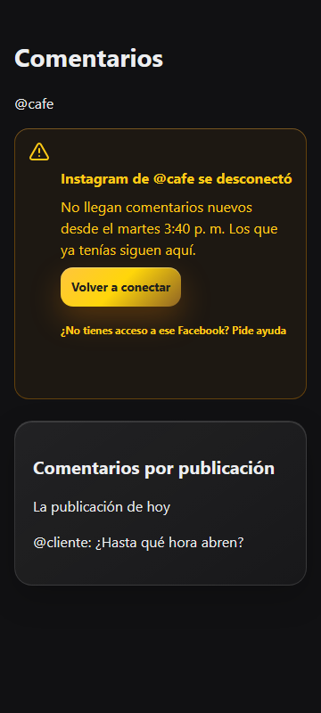
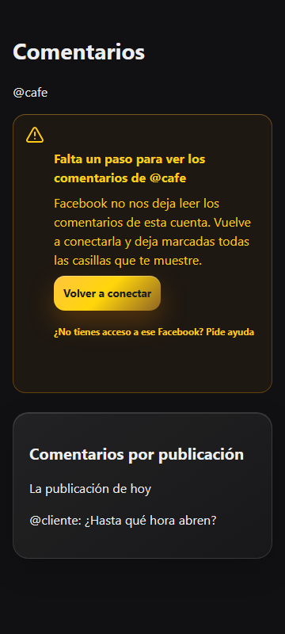
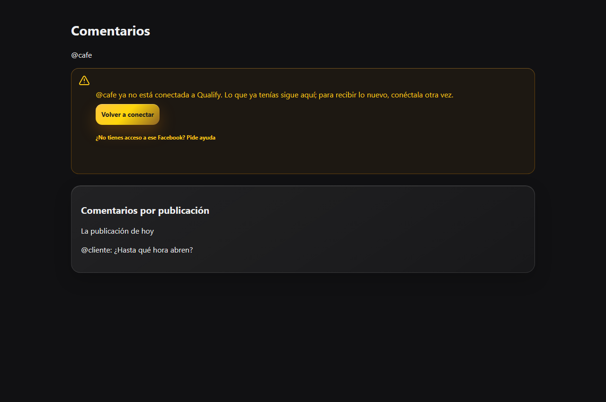
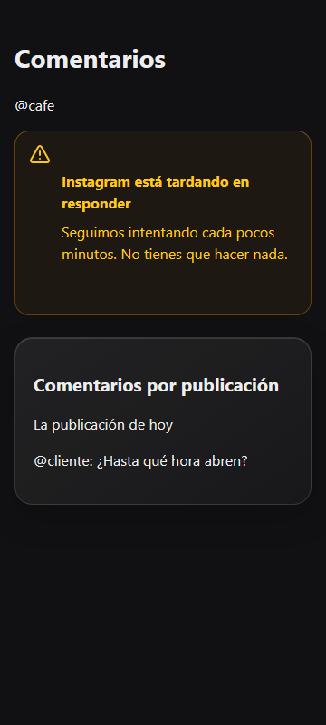

# Comentarios: conservar lo guardado cuando una cuenta se desconecta

**Revisión acotada:** el agente `ux-designer` revisó código y capturas; no pudo abrir
la app del PR en navegador. Navegación, sesión, regreso real de Facebook e interacción
del cajón de ayuda quedan pendientes de comprobación interactiva.

Ticket: [m-24854867](https://meegle.com/5h2wsx/issue/detail/24854867).

## Criterios de aceptación

| Criterio | Evidencia |
| --- | --- |
| La única cuenta degradada muestra lo guardado y el aviso | `test_view_only_invites_to_connect_when_never_connected`, con el cuerpo y el aviso reales; `test_only_disconnected_account_loads_saved_publications` verifica la carga sin llamar a Meta. |
| El vacío de conexión solo aparece cuando nunca hubo una cuenta conectada | La misma prueba de vista cubre las ramas degradada, revocada y sin cuentas; el proveedor excluye los intentos pendientes. |
| El sondeo no borra ni repinta el aviso | `test_poll_keeps_outage_and_saved_comments_without_calling_meta` y `test_transient_failure_then_success`; el diagnóstico se asigna solamente cuando cambia. |
| Textos literales y hora local del negocio | Pruebas de los tres fallos permanentes, rachas temporales, acción manual y cambio de día en `America/Caracas`. El punto final de «p. m.» no se duplica. |
| La lista sigue visible cuando falla la actualización de publicaciones | `test_candidate_read_failure_keeps_the_existing_list_above_saved_content` verifica el aviso encima de la lista conservada. |
| Reconexión y ayuda dentro del aviso | Se reutiliza `reconnect_button` con origen `/inbox`, causa persistida y el cajón compartido; el permiso quitado usa `permission_missing`. Doce casos de render comprueban resultado, cuenta correcta y una sola acción. Las pruebas compartidas simulan la acción y el regreso. |
| Aislamiento por tenant | Pruebas offline del filtro SQL y del descarte de respuestas tardías de otro negocio; pruebas `db` en `test_connections_db.py` para el selector y la lectura del diagnóstico/auditoría a través de RLS. |

## Revisión visual local

Capturas del componente real `_access_notice`, renderizado con React/Radix y el CSS del
repositorio. La cuenta y el bloque de publicaciones son datos sintéticos. Esta revisión
comprueba los avisos; no constituye una sesión completa con Facebook. La revisión
independiente del agente `ux-designer` se ejecutó con las limitaciones indicadas arriba.

- Móvil a 360 × 800: título, cuerpo, botón y ayuda caben en el aviso.
- Escritorio a 1280 × 850: el aviso conserva el ancho del contenido y precede a lo guardado.
- El aviso temporal no ofrece reconexión; el permanente incluye su acción y ayuda.
- `ux-designer`: cuatro sugerencias aplicadas; sin sugerencias adicionales en el alcance
  revisado. No emite aprobación o rechazo del PR.

## Sugerencias de UX

| Sugerencia | Estado y comprobación |
| --- | --- |
| Compartir el vocabulario de «Tus redes» | **Aplicada:** el selector usa `connection_copy`; `revoked` muestra «Desconectada» y `permission_missing`, «Sin acceso». El cuerpo literal del ticket se conserva. |
| Una sola acción tras cancelar o regresar sin permiso | **Aplicada:** el resultado conserva su texto, pero oculta acciones que ya ofrece el aviso de la cuenta rota. El cajón permanece montado. |
| Recuperar «Última revisión» al abrir durante el período de espera | **Aplicada:** se usa la fecha compartida conocida en la zona del negocio. Una ejecución ocupada o rechazada por presupuesto no inventa una revisión nueva. |
| Mostrar resultados solamente para la cuenta seleccionada | **Aplicada:** el panel filtra por `connection_id`; doce casos de render incluyen cuentas coincidentes y distintas. |

## Revisión de código

La skill `review-agent` se ejecutó en un agente independiente y de solo lectura sobre
el diff completo y volvió a revisar las correcciones:

- **Aplicada:** tiempos de espera y errores de transporte, 429 y 5xx reciben el texto
  temporal del ticket; las primeras búsquedas automáticas fallidas permanecen silenciosas.
- **Aplicada:** el resultado de reconexión y el aviso permanente comparten una única acción.
- **Aplicada:** una lease ocupada o una prevalidación rechazada por presupuesto conserva
  la hora anterior; las aperturas durante el período de espera recuperan la hora conocida.

| Caso | Captura |
| --- | --- |
| Desconectada, móvil |  |
| Permiso quitado, móvil |  |
| Sin acceso, escritorio |  |
| Tres fallos temporales, móvil |  |

## Validación

- 161 pruebas offline de Comentarios y reconexión aprobadas tras las revisiones.
- Ruff: lint y formato del repositorio aprobados.
- Ejecución general anterior: 9.764 aprobadas; los 20 fallos por la codificación
  predeterminada de Windows aprobaron al repetirse con `python -X utf8`.
- CI previo a las correcciones: 9.784 pruebas offline y 1.212 con PostgreSQL/Redis
  aprobadas, incluidas las dos nuevas pruebas `db`; migraciones de ida y vuelta aprobadas.
- El guard local impide usar una base que contiene la antigua migración
  `0102_piece_versions.py`, perteneciente a otro trabajo. No se restableció esa base
  compartida ni se ejecutaron migraciones sobre ella.
- CI del PR vuelve a validar las correcciones sobre PostgreSQL/Redis limpios.
